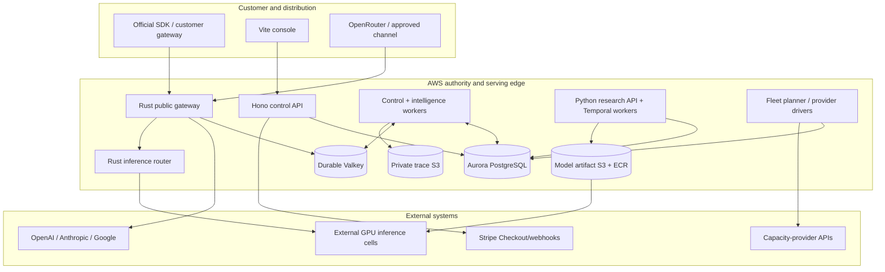

# Grad startup architecture

## Executive view

Grad is a paid inference provider with one public API and two deliberately different model lanes:

1. **Curated direct models** let a customer move an existing OpenAI, Anthropic or Google workload by changing the base URL/key while preserving the exact provider/model identity.
2. **Grad inference** exposes owned, continuously improved model stacks through a simple `grad/<effort>/<speed>` identity.

The direct lane produces revenue, customer trust and workload evidence early. The Grad lane becomes the differentiated margin and performance product. Product Intelligence retains encrypted traces by default to give the customer history, analytics and evidence-backed migration suggestions; Private/No Retention is available and still uses isolated ephemeral KV cache. The customer always chooses whether to run a migration experiment or change models.

Grad inference is not trapped behind Grad's own gateway. Customers can call the OpenAI-compatible endpoint directly, place an existing gateway in front of it, or—after separate commercial and reliability gates—consume selected Grad models through native distribution channels such as OpenRouter or Hugging Face.

The company also operates an always-on inference research lab. For every funded model program, autonomous agents continuously inspect the whole vertical stack, propose bounded experiments, preserve negative results, build complete immutable candidates and independently qualify them. Research can change weights, architecture, operators, kernels, runtime, scheduler, cache, topology and hardware mapping. Production sees only a signed qualified bundle and a human-approved release.

## Product principles

- **Simple customer surface, sophisticated internals.** Customers choose an exact direct model or a Grad effort/speed product, not provider arrays, GPU types or routing DSLs.
- **Identity means what it says.** A direct request never changes provider/model/version. A Grad request never leaves owned inference or changes effort/speed.
- **Money fails closed.** No cost-bearing dispatch occurs without one durable atomic reservation and event.
- **Research is off the request path.** A live request uses immutable release projections and ready cells; it never waits for PostgreSQL, Kubernetes, research jobs, S3 or a provider lifecycle API.
- **One owner per fact.** PostgreSQL owns durable business/control state and seed analytics, Redis owns bounded serving projections/reservations, and S3/ECR own encrypted payload/artifact bytes. Kubernetes hosts processes but owns no product state.
- **Evidence graduates; code does not teleport.** The same signed bundle digest moves from qualification into production. A component benchmark cannot authorize a release.
- **Sparse launch, extensible grammar.** The model/protocol/platform contracts allow growth, but only measured models, speeds, providers and integrations are published.

## Customer-facing system

### Main concepts

| Concept | Meaning |
| --- | --- |
| User | Human identity authenticated by Better Auth. |
| Organization | Customer, billing and top-up boundary. Owns credit, organization membership and global policy. |
| Workspace | Isolation boundary inside an organization for keys, members, model/data policy, limits and usage attribution. Every organization has one hidden Default workspace. |
| Workspace API key | Display-once inference credential resolving exactly one organization/workspace. |
| Direct model | Curated immutable provider/model identity such as `openai/<model>`. |
| Grad model product | Owned inference product such as `grad/medium/standard` or stable family head such as `grad/<family>/fast`. |
| Model release | Immutable commercial/operational contract: model/bundle, capabilities, price, direct endpoints or owned marker, and bounded pre-output retry count; stable aliases provide canary and rollback. |
| Product Intelligence trace | Bounded encrypted request/response/tool payload retained for the customer's own history and migration features. |
| Distribution channel | External router acting as Grad's customer under a separate channel credential and receivable contract. It is not a workspace. |

### Default console

The Vite/shadcn console has five primary screens:

- **Overview:** fund, create first key, copy direct/Grad quickstarts and observe first request.
- **API keys:** create, copy once, rotate/revoke, expire and optionally cap.
- **Models:** available Grad products first, curated direct providers second; unavailable 4×4 combinations are not displayed as purchasable cells.
- **Usage:** content-free lists/charts, authorized trace detail, workload grouping and migration evidence.
- **Billing:** organization balance, top-ups, receipts, warnings and transaction history.

Team, workspace, retention, model policy and advanced limits remain under Settings until used. Operator/research administration is a separately authorized surface, never a customer navigation mode.

## System planes

Only `Gateway -> Redis -> selected upstream` is on the customer inference path. PostgreSQL and Redis remain distinct authorities: Redis may reject a funded customer while stale/unavailable, but it may never allow spend from an unproved balance.

## Deployable topology

| Deployable | Language | Responsibility | May synchronously call |
| --- | --- | --- | --- |
| Web assets | TypeScript/React | customer/operator presentation | Hono only |
| Control API | Node/Hono REST/OpenAPI | sessions, RBAC, product commands/queries, Stripe endpoint, generated docs/client/MCP adapter and research BFF | PostgreSQL, Stripe, analytics read repo, private research API, trace-access grant endpoint |
| Control workers | Node | ledger posting, outbox, Redis projection/reconciliation, model catalog and public release authority | PostgreSQL, Redis, Stripe/provider metadata |
| Intelligence workers | Node | trace persistence/retention and workload/recommendation jobs | purpose-scoped PostgreSQL, Redis, S3/KMS, owned evaluation |
| Trace access | minimal service | one-grant/one-object checked decrypt stream | PostgreSQL, S3/KMS |
| Public gateway | Rust | public protocols, auth, admission, route, upstream stream, metering, trace encryption | Redis and selected model provider/inference router only |
| Inference router | Rust | select authenticated exact-release cell connection and relay stream | cells and compact Valkey catalog only |
| Fleet deployments | Rust | desired capacity and provider allocation/reconciliation | PostgreSQL and one provider API per driver role |
| Cell agent | Rust | one/multi-node bundle materialization, local queue/cache routing and runtime supervision | inference router, artifact endpoints, local runtime/members |
| Research roles | Python | programs, Temporal workflows/activities, experiments, bundles and qualification | PostgreSQL, Temporal, S3/ECR, research compute/provider APIs |
| Evaluator | Python/Rust harnesses | independently owned visible/hidden qualification | exact bundle/cell and sealed evidence API |

Logical roles sharing an image still receive separate service accounts and database roles. A deployable cannot accumulate another role's authority merely because it uses the same source package.

## Critical journeys

### 1. Activate and fund

1. User signs in; Better Auth establishes identity/session.
2. Product transaction creates organization, owner membership, Default workspace and workspace owner/admin membership.
3. Owner starts a bounded Stripe Checkout top-up intent.
4. Browser redirect changes no balance.
5. Verified webhook locks the intent, stores the payment event and posts a balanced ledger transaction plus outbox event in one PostgreSQL transaction.
6. Financial worker projects the new fenced organization balance and workspace policy to Redis.
7. Owner creates a display-once workspace key and sends the first request.

Failure rule: an uncertain webhook is quarantined; an unavailable/stale Redis projection delays inference but cannot create unpaid spend.

### 2. Serve a curated direct request

1. Gateway parses bounded public wire data and resolves the API key from Redis.
2. It derives effective workspace/key model, capability, privacy, output and budget policy.
3. Exact direct model and immutable price/release are selected; unsupported fields fail before reserve.
4. One Redis operation reserves worst-case sell exposure, all nested limits and concurrency, creates a lease and appends the reservation event.
5. Gateway invokes only a qualified endpoint for that provider/model/version.
6. It relays output, records authoritative/estimated usage class, settles once and appends the terminal event.
7. Workers post usage and optionally persist the encrypted trace.

Failure rule: pre-output retry is bounded to the same identity. After usable output, no transparent replay occurs. Failed attempts are Grad's buy-cost risk; the customer's fixed sell price does not change.

### 3. Serve a Grad request

Steps 1–4 are identical, except the immutable release resolves to eligible owned inference. The gateway calls the private inference router, which chooses an authenticated healthy exact-release cell from its compact live registry. The cell router admits by deadline/token capacity/cache affinity and invokes its supervised runtime. Events return through router/gateway under one attempt sequence.

Failure rule: before output, retry may use another healthy cell for the same release. No capacity returns a typed 429 and releases the reservation. Spot loss cannot change model, price, privacy or cache namespace.

### 4. Build customer intelligence

For Product Intelligence, the gateway strips credentials, bounds the trace and encrypts it before asynchronous Redis append. A purpose-scoped worker writes ciphertext to private S3 and metadata/wrapped-key state to PostgreSQL. Bounded PostgreSQL usage/trace queries provide lists and charts. Workload/recommendation jobs may decrypt only traces authorized for that workspace and produce evidence-level migration candidates.

A trace detail request first authorizes in Hono, then mints a single-use grant. Trace-access rechecks tombstone/retention/key state and streams one decrypted object without caching or issuing an S3 URL. Delete tombstones and revokes key/grants first, then removes the S3 object asynchronously.

Private/No Retention suppresses the payload envelope before Redis. It still emits minimum usage facts and uses a separate ephemeral cache namespace.

### 5. Serve a native distribution channel

OpenRouter or another approved channel calls the same public gateway with a channel credential. Credential lookup selects a channel principal, never a workspace. Admission uses the channel catalog/prices, exposure, rate and concurrency projection. Settlement posts a balanced transaction to fixed channel receivable/revenue accounts rather than debiting organization credit. Channel privacy governs payload handling; it never creates first-party customer traces or recommendations.

The gateway validates Grad's channel credential, not OpenRouter's end-user token. Inference router/cells reject both customer and channel keys.

### 6. Improve and release a Grad model

1. A research program continuously scans opportunities and ranks falsifiable hypotheses as a derived query.
2. Campaign planner freezes the cheapest discriminating `ExperimentSpec`, controls, budget, stop and cleanup rules.
3. Temporal schedules resumable Python activities and Kubernetes/native-provider jobs; PostgreSQL records the experiment specification, run, evidence and decision.
4. Surviving interventions advance from PyTorch reference through only the justified compiled/Triton/framework/native/Rust stages.
5. Builder creates canonical manifests and one signed content-addressed `ModelStackBundle`.
6. Independent qualification tests the exact digest through model, runtime, protocol, system, security and cell gates.
7. Python research authority emits a signed `QualifiedBundleRef`; Node release authority adds product/SLO/price/placement/rollout policy.
8. A human approves the seed release proposal. Cells attest the digest; authenticated live-cell state becomes eligible; alias canary/rollback remains deterministic.

Research agents cannot see hidden holdouts while writing candidates, publish targets, move aliases or approve their own proposal.

## Authority and data map

| Store/control surface | Authoritative for | Never authoritative for |
| --- | --- | --- |
| PostgreSQL | users/tenancy, ledger, product config, releases, traces registry, workloads, capacity intent/leases, research programs/evidence/qualification | large payload/artifact bytes, hot reservations, Kubernetes status |
| Redis/Valkey | versioned key/policy/catalog/release projections, live reservations/concurrency/leases, billing and encrypted-trace streams | durable ledger, research, raw unencrypted payloads, GPU lifecycle |
| Private trace S3 | encrypted retained customer payload objects | auth, retention/tombstone decision, analytics, model artifacts |
| Artifact S3/ECR | immutable checkpoints, bundles, runtime images, signatures/attestations | release approval, customer traces, mutable aliases |
| PostgreSQL usage views/rollups | content-free request/usage/workload facts | raw payload bytes and hot reservations |
| Kubernetes | Deployments, Jobs and static platform desired state | money, releases, allocations, provider invoices or per-request state |
| Temporal | research workflow/timer/retry/cancellation execution history | scientific evidence, budget authority, qualification or product aliases |
| Git/GitHub | source, schemas, plans, reviewed procedures and task ownership | secrets, high-cardinality runtime state, weights |

## Seed sequence to revenue

1. **Contracts/tooling:** monorepo, generated contracts, PostgreSQL/Redis fakes, `grad`, CI/PBT replay.
2. **Money vertical:** auth, organization/default workspace, key, Stripe top-up, ledger, Redis projection/reserve/settle/reconcile.
3. **First paid inference:** OpenAI Responses and Anthropic Messages through fakes then curated real providers; Overview/Keys/Billing/Usage minimum UI.
4. **Management/agent surface:** described Hono REST, OpenAPI/Scalar/generated client and allowlisted OAuth MCP; self-service organization deletion.
5. **Owned vertical:** exact bundle/topology, inference router, one native external provider, single- and multi-node cell qualification, `grad/medium/standard`, cache and preemption tests.
6. **Intelligence:** encrypted traces, analytics read model, workloads and customer-controlled replay/recommendations.
7. **Research factory:** one always-on model program producing a negative result and qualified challenger without public alias movement.
8. **Distribution:** customer gateway recipes first; native OpenRouter/Hugging Face only after soak, economics, terms and settlement gates.
9. **Production hardening:** managed data durability, EKS/GitOps, autoscaling, security/restore/failure drills and design-partner launch.

This order avoids making owned inference, an analytical database, native listings or a full research fleet prerequisites for the first dollar.

## Founder decisions and explicit uncertainty

The architecture does not ask junior agents to decide business/legal authority. Before live cloud or channel work, the founder must approve accounts/region/domain/budgets, provider accounts, data residency/subprocessors, retention/terms, tax/invoicing, production approvers and pager/security contacts. Before a public Grad product, the release owner must approve the first model, sparse effort/speed cells, prices, SLOs and support terms from measured evidence.

All numerical capacity, latency, cost and quality targets remain hypotheses until their named work package records dated measured evidence. A failed gate disables that provider/service/feature and uses the documented fallback; it does not weaken money, identity, privacy or release invariants.

## Detailed implementation map

- [Coverage and gap ledger](IMPLEMENTATION_COVERAGE.md)
- [Simplicity review and minimal model](SIMPLICITY_REVIEW.md)
- [Product architecture](../product/docs/ARCHITECTURE.md)
- [API/data contracts](../product/docs/API_AND_DATA_CONTRACTS.md)
- [Control plane implementation](../product/docs/CONTROL_PLANE_IMPLEMENTATION.md)
- [Gateway implementation](../product/docs/GATEWAY_IMPLEMENTATION.md)
- [Owned inference implementation](../product/docs/OWNED_INFERENCE_IMPLEMENTATION.md)
- [Research factory implementation](../product/docs/RESEARCH_FACTORY_IMPLEMENTATION.md)
- [Distribution implementation](../product/docs/DISTRIBUTION_IMPLEMENTATION.md)
- [AWS/platform implementation](../infra/docs/PLATFORM_IMPLEMENTATION.md)
- [Product delivery plan](../product/docs/DELIVERY_PLAN.md)
- [Infrastructure delivery plan](../infra/docs/DELIVERY_PLAN.md)
