# Grad system diagrams

These diagrams are explanatory views of [the canonical system manual](SYSTEM_MANUAL.md). Labels simplify implementation names, but arrows preserve dependency direction and authority. A diagram never overrides a written invariant or contract.

## 1. Product context

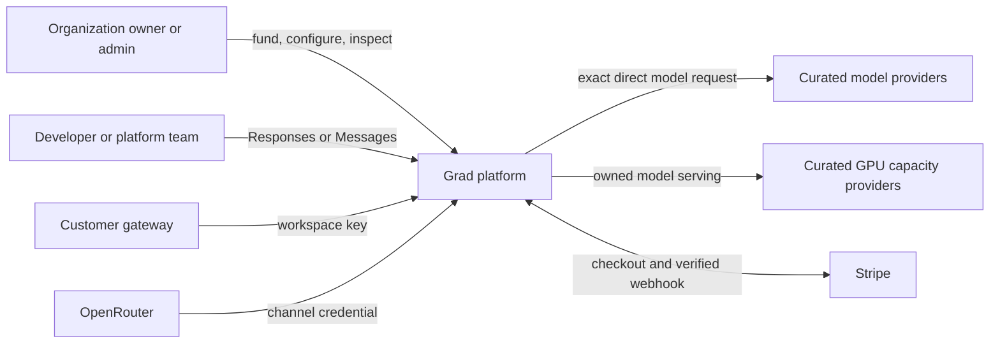

## 2. Planes and authorities

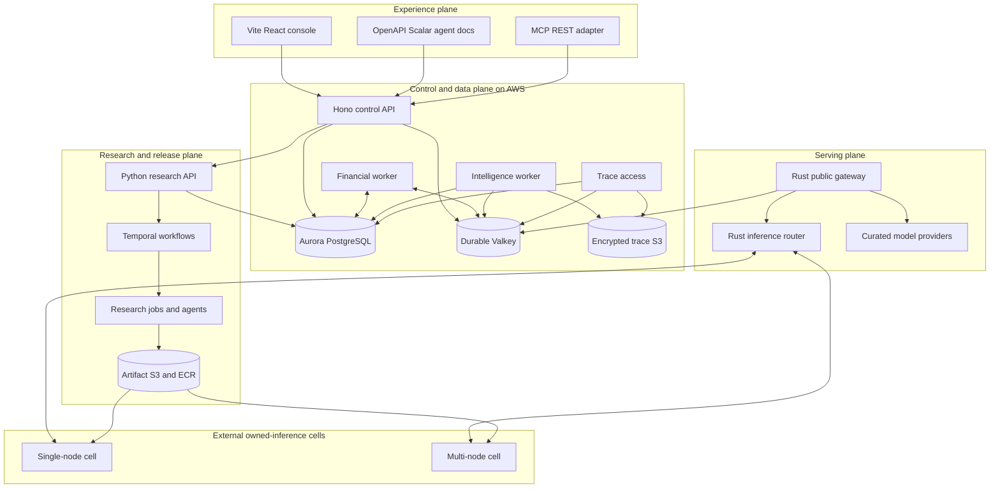

## 3. Public API generation

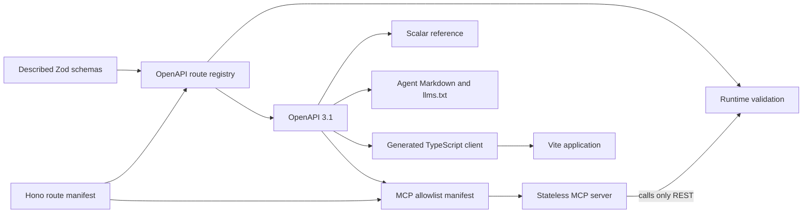

## 4. Organization activation and top-up

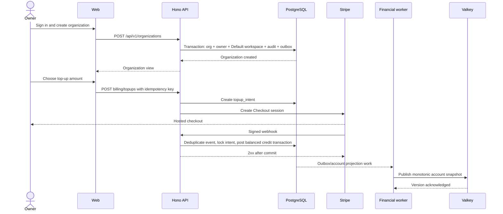

## 5. Direct paid inference request

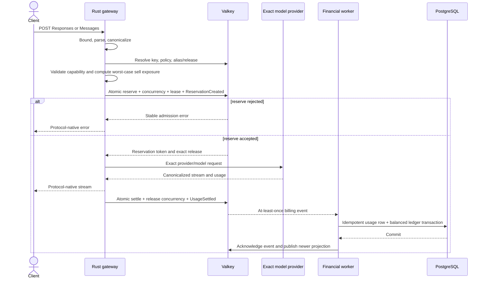

## 6. Owned Grad request

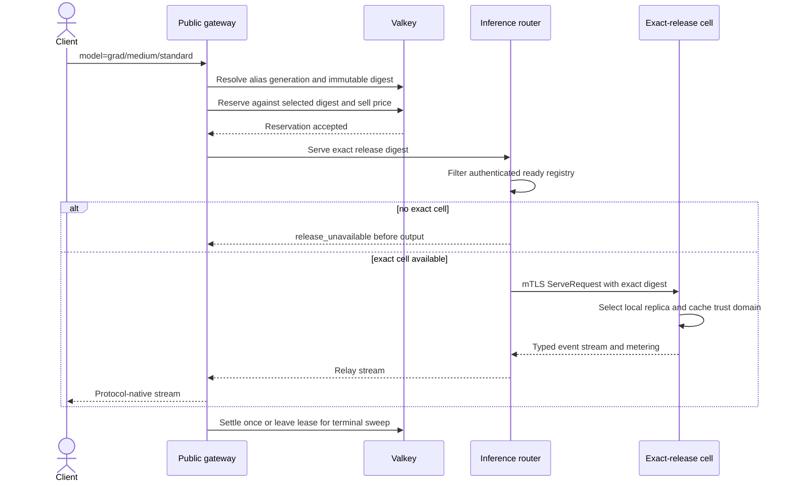

## 7. Reservation state and reconciliation

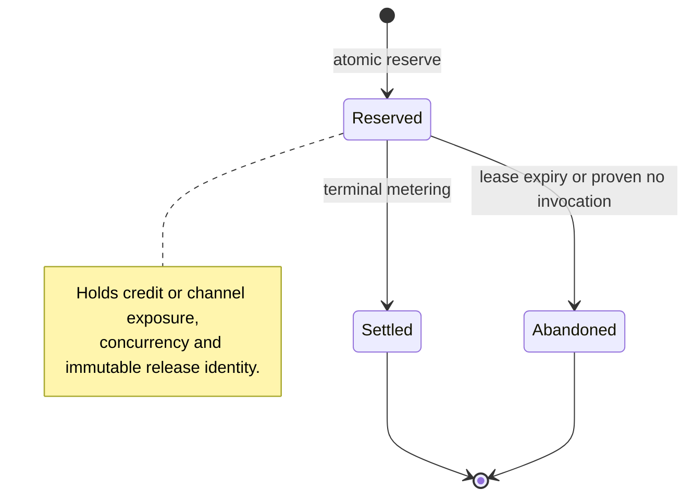

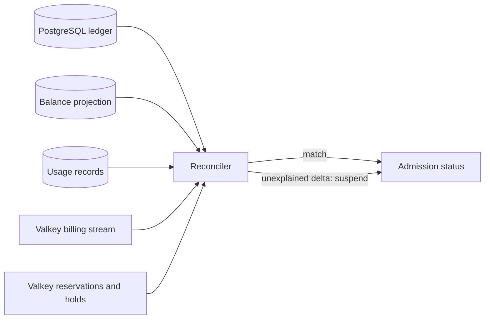

## 8. Trace retention and access

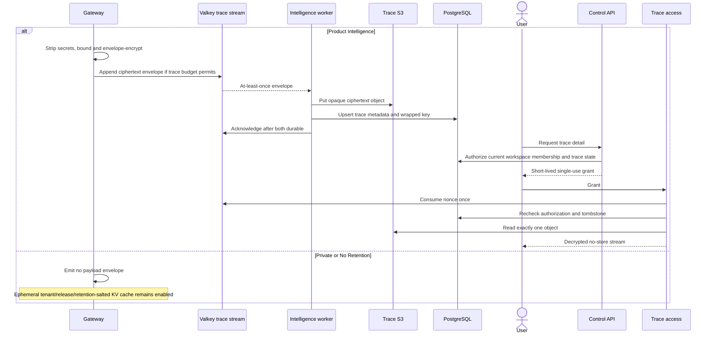

## 9. Organization deletion

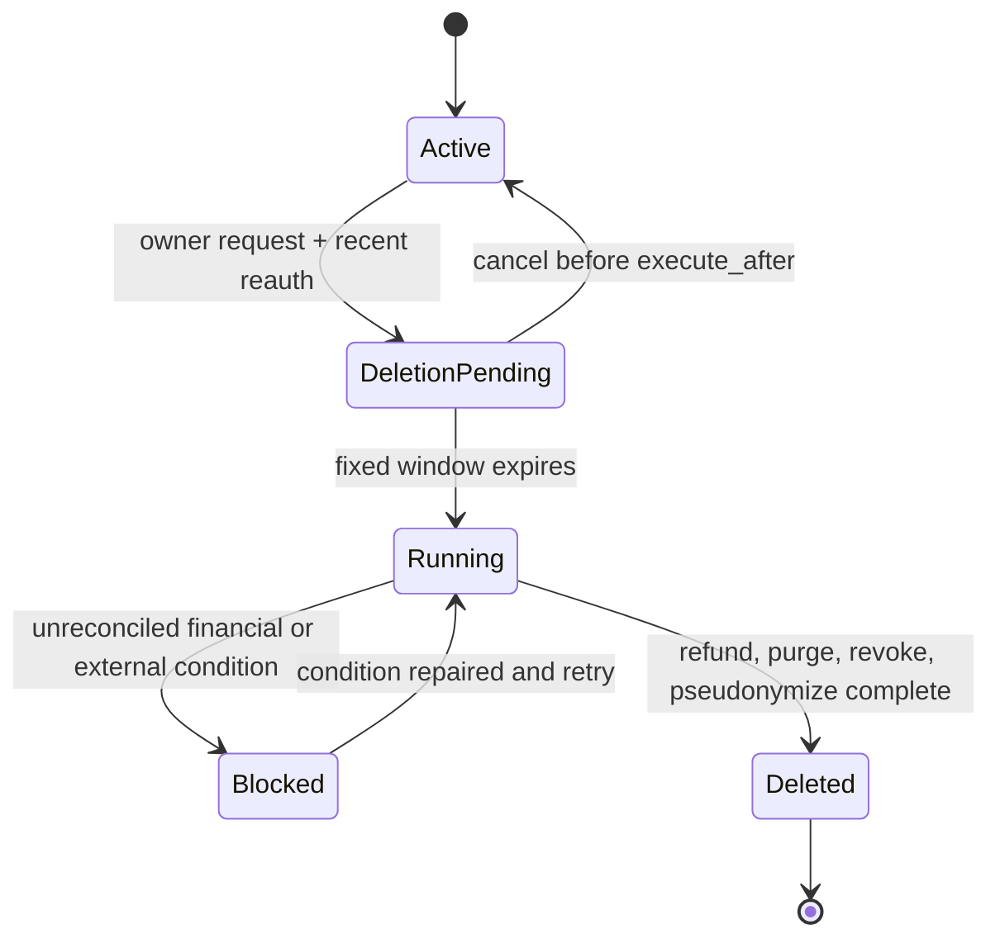

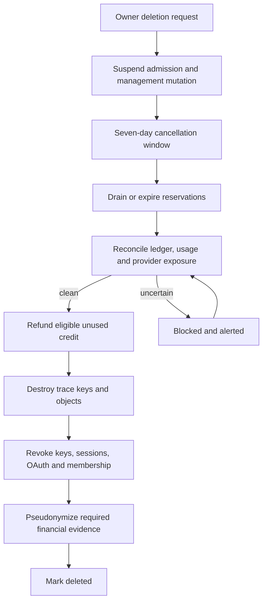

## 10. External GPU fleet and cell lifecycle

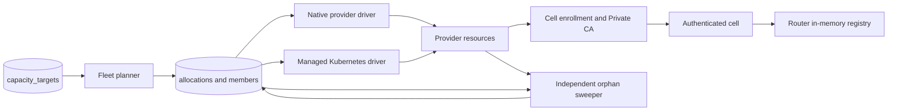

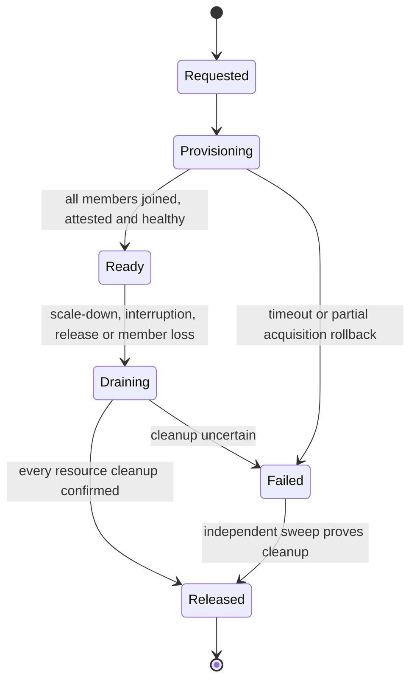

## 11. Single-node and multi-node cell

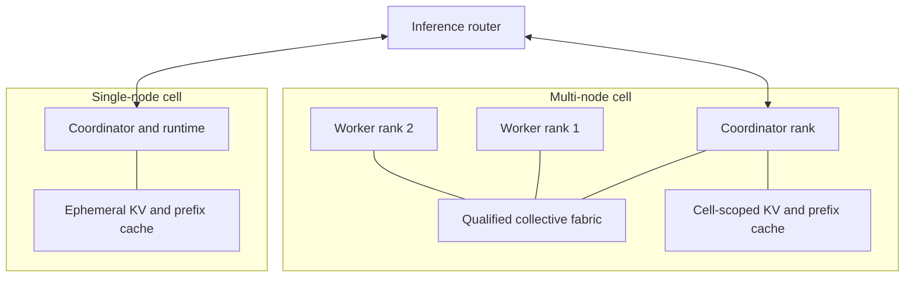

The router sees one cell identity in both cases. It never sees provider resource IDs, ranks or collective topology.

## 12. Always-on research and promotion

```mermaid
flowchart LR
  Observe[Measured observation]
  Hypothesis[Scoped falsifiable hypothesis]
  Spec[Immutable experiment spec and budget]
  Fidelity[Cheapest adequate fidelity]
  Run[Reproducible run]
  Evidence[Evidence report including negative result]
  Bundle[Content-addressed ModelStackBundle]
  Qualify[Independent qualification]
  Proposal[Signed release proposal]
  Human{Release owner approves?}
  Release[Immutable model release]
  Canary[Bounded canary]
  Alias[Public alias]

  Observe --> Hypothesis --> Spec --> Fidelity --> Run --> Evidence
  Evidence -->|promising| Bundle --> Qualify --> Proposal --> Human
  Evidence -->|falsified| Observe
  Human -->|no| Observe
  Human -->|yes| Release --> Canary --> Alias
  Canary -->|hard gate fails| Rollback[Prior release pointer]
```

## 13. AWS deployment

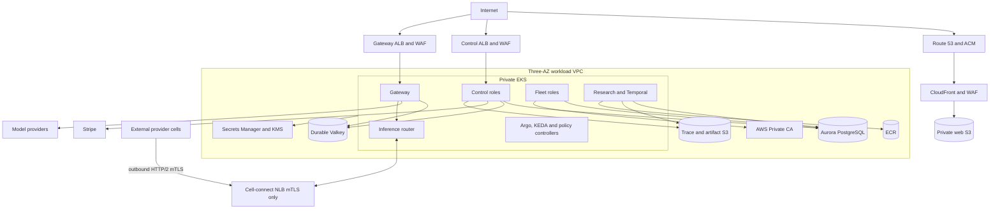

## 14. Infrastructure ownership

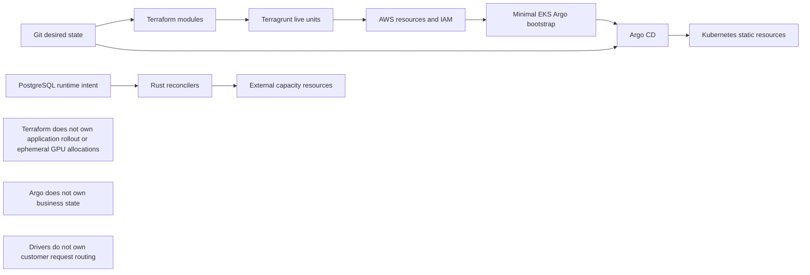

## 15. Build, promotion and rollback

```mermaid
flowchart LR
  Change[Scoped change]
  Verify[Language, PBT, contract and infra checks]
  Main[Direct push to main]
  Build[Build once]
  Supply[SBOM, provenance and signature]
  Registry[Immutable image and chart digests]
  Nonprod[Non-production GitOps]
  Smoke[Fake and protected smoke]
  Approval{Production approval}
  Production[Production digest promotion]
  Observe[Canary and SLO observation]
  Rollback[Prior application or alias digest]

  Change --> Verify --> Main --> Build --> Supply --> Registry --> Nonprod --> Smoke --> Approval
  Approval -->|approved| Production --> Observe
  Approval -->|rejected| Change
  Observe -->|hard gate fails| Rollback
```

Database and Terraform state are forward-fixed; `Rollback` means an application/chart/release pointer, never database history or Terraform state rewind.

## 16. Implementation dependency graph

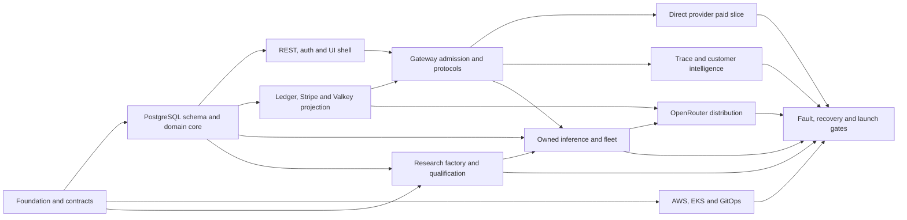
