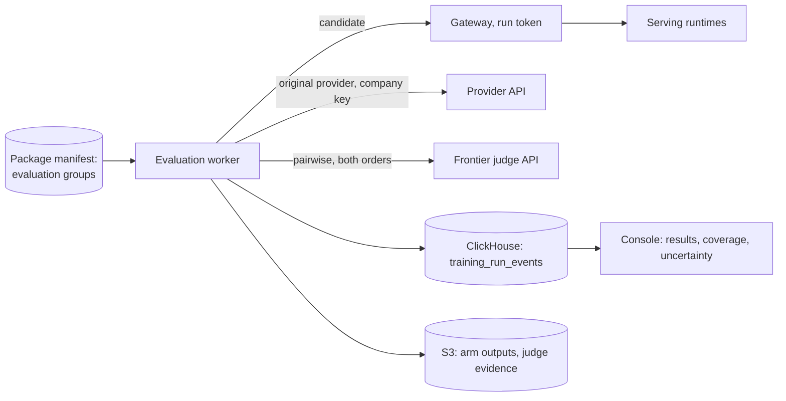

# Fine-tuning: evaluation and reporting

Status: specified design; S8 qualifies the judge and estimators before any metric is published. Owns `EVAL-01` to `EVAL-03`. Training-time rewards belong to the recipe (RUN-03); this document covers what the customer sees.

## Components

## Decisions in this contract

| Decision                                                                                            | Reason                                                                                         | Rejected                                                 |
| --------------------------------------------------------------------------------------------------- | ---------------------------------------------------------------------------------------------- | -------------------------------------------------------- |
| One judged comparison: the candidate against the original provider model it replaces (a fresh call) | That is the decision the customer is making; extra arms add cost and noise without changing it | Base and production arms (decided against on 2026-09-11) |
| Fresh provider calls, paid by us, on every evaluation                                               | Captured answers age; the customer never supplies a key                                        | Reusing old captured answers as fresh                    |
| Frontier judge, pairwise, both orders, disagreement unresolved                                      | Position bias is real; unresolved is honest                                                    | Single-order judging; hiding unresolved                  |
| Results only: no pass mark, no recommendation, no gate                                              | Customers try versions and decide; scores are evidence                                         | Quality gates on promotion                               |
| Report unit is the session group, equal weight                                                      | Correlated turns must not count as independent evidence                                        | Per-turn statistics                                      |
| Intervals by resampling whole groups; unavailable when they cannot be computed                      | Never a number that looks more certain than it is                                              | Silent drops                                             |
| Latency compared only within the same measurement context                                           | A provider call from production and a worker replay are not like for like                      | "N times faster" claims                                  |

## EVAL-01 The comparison

Evaluation measures judge-assessed response quality. It does not prove task completion in the customer's systems, and it never executes generated tool calls against them. Deterministic format and protocol checks are reported separately.

Task criteria are drafted automatically from permitted task context and development examples; no customer approval step. The rubric is versioned and qualified in S8.

**Frozen at creation:** dataset and example ids, split and grouping revision, sampling seed, arm identities, replay controls, judge identity, rubric version, operation limits, deadline. The training package supplies a frozen evaluation manifest under DATA-01. These examples are excluded from weight updates and training-time selection. The evaluation worker does not choose a new split. The evaluation belongs to one training run. A later recipe or judge change requires a new run; there is no independently scheduled evaluation at launch.

| Arm               | What runs                                                                      |
| ----------------- | ------------------------------------------------------------------------------ |
| Candidate         | The new adapter on its qualified base release                                  |
| Original provider | The provider model the task is configured to replace; fresh call, company-paid |

The provider is not automatically the judge; the task explicitly configures an eligible `provider_models` record for the reference model. Observed traffic may suggest one but cannot authorise an arbitrary endpoint. Recovery reuses only the matching accepted operation. Requested and observed provider identity and time are recorded. A retired alias reports unavailable and requires explicit reconfiguration.

The candidate is judged against the original provider only. Versions are not judged against each other or against the bare base; every version shares the same baseline, so versions stay comparable over time through that baseline. An unavailable provider arm is explicit missing evidence and does not remove examples from the sample.

Inputs are normalised through the gateway contract. Controls (prompt and template, tools and tool choice, parallel calls, output format, reasoning, stop, output budget) map to each arm through the qualified feature matrix; the effective mapping and each model's limits are frozen; an unsupported comparison is excluded with a reason. Controls are never dropped silently; sampling equivalence is never claimed across providers with different controls; seeds are best effort.

## EVAL-02 Sampling and results

Holdout groups are selected deterministically from the manifest and seed. The release profile bounds groups, examples, per-call limits and total deadline; an unset value never means unlimited. Stratification only with frozen weights. The sample is never adjusted after seeing results.

Unit: the protected session group, weight 1; examples within a group weight 1. Group and example counts are shown. Contaminated or development-used groups are excluded.

**Judge protocol.** For each candidate-versus-provider pair, two calls with left and right swapped. Model text is evidence, never instructions. Result: `left`, `right`, `tie`, `abstain`, with bounded rationale, converted to candidate orientation. Two matching non-abstain verdicts resolve the pair; anything else is unresolved. Raw verdicts and resolution reason persist. A valid unfavourable verdict is never retried.

Per group: weighted win, tie, loss and unresolved fractions over all selected examples; averaged across groups to `W`, `T`, `L`, `U` summing to 1.

| Value                   | Definition                                             |
| ----------------------- | ------------------------------------------------------ |
| Resolved share          | `1 - U`                                                |
| Conditional judge score | `(W + 0.5·T) / (1 - U)`; undefined if nothing resolved |
| Missing-evidence range  | `[W + 0.5·T, W + 0.5·T + U]`                           |
| Win, tie, loss, unknown | Weighted values with raw counts                        |

The console bar shows resolved comparisons only: widths and labels use `W / (W + T + L)`, `T / (W + T + L)` and `L / (W + T + L)`. The three segments fill the bar; widths use unrounded proportions. The compact evaluation panel shows the resolved share alongside speed and errors. Keep unresolved outcomes in individual test results. The task-list tooltip shows only better, equivalent and worse percentages. With no resolved results, show "No resolved comparisons". Detailed results keep the original four fractions and counts.

The range is not a confidence interval. The conditional score is labelled conditional. A deterministic format failure is shown separately and may be judge evidence; it is never rewritten as a loss or a success.

Interval: 95% percentile from resampling whole groups with replacement, 10,000 times, frozen seed. Fewer than two groups, or any resample with no resolved evidence, gives `interval_unavailable` with reason. Group count and the range are shown beside any interval. S8 tests coverage and calibration first. An interval is never a gate.

The denominator is fixed. Generation coverage, judge coverage and resolution are reported. Partial stays partial. No aggregate pass or fail, recommendation, regression threshold or minimum score. Any valid available version can be promoted by hand regardless.

## EVAL-03 Operations, cost and latency

Evaluation is keyed by `run_id`. The run spec fixes the reference model, judge and evaluation configuration. The `evaluation_started` event in ClickHouse `training_run_events` fixes the exact sample manifest, settings hash and deadline before any comparison calls. There are no PostgreSQL evaluation or evaluation-operation tables, and no separate evaluation ID.

Each arm generation and judge ordering has a deterministic operation ID derived from run ID, example ID, arm or judge ordering, and the frozen settings hash. Structured events record dispatch intent, call number, input hash, provider or release, deadline, result manifest, failure and usage. The frozen sample manifest, candidate/provider responses and large judge evidence live under `runs/<run_id>/evaluation/`. Small verdicts, scores, usage, errors and summaries live directly in `training_run_events`. Events reference immutable S3 objects instead of duplicating their contents. The API reads events for summary views and fetches referenced files when the user opens a detailed comparison. `evaluation_completed` records the final summary and coverage in the same event log. Any derived reporting view is rebuildable from these events.

**Resume.** The existing single orchestrator owns dispatch. Before a call, it writes an acknowledged intent event. After the call, it writes an acknowledged result event with the same operation identity. On worker restart, it reads and deduplicates the run history, verifies referenced artifacts, reuses completed results and continues unfinished operations. It never changes the sample or reruns a valid unfavorable verdict. An uncertain provider call waits until its recorded deadline before a bounded retry; possible duplicate cost is recorded. A lost write acknowledgement is reconciled by stable event ID. Conflicting results for the same call identity are an error, not last-write-wins. Later calls cannot replace a valid earlier result.

Worker takeover waits out outstanding call bounds before redispatch. These rules use the existing run execution control and leadership boundary; they do not require a PostgreSQL row per call. When history cannot be read, resume waits. Cancelled, failed or closed runs do not resume. This supports worker recovery during evaluation; it does not restart GPU training after host failure.

External calls follow RUN-04 (run tokens, provider slots), use company credentials, and cost the customer nothing. No price lookup, Grafana query or ledger gates execution. An uncertain provider request waits out its bound before retry; duplicate cost is recorded; exactly-once is never claimed. A failed evaluation never retrains, unpublishes or promotes.

**Cost.** The Temporal worker calculates token-cost estimates from recorded usage. Hosted prices come from our model catalog. External prices come from the public `GET /api/v1/models?external=true` catalog, whose separate OpenRouter loader caches in API process memory for five minutes. Direct generation calls still use OpenAI or Anthropic; these are catalog estimates, not reconciled provider invoices or customer charges. The snapshot records the exact canonical model, pricing source, capture time and long-context tiers in `runs/<run_id>/evaluation/pricing.json`. Retries reuse it. The worker stores estimated mean per-request costs and `cost_basis=catalog_token_estimate` in the PostgreSQL run evaluation summary; the console reads the saved value without fetching prices or recomputing it.

Estimates count input, cached reads/writes and billable output including reasoning where usage is available. GPU and judge costs are excluded. Missing usage or prices leave cost unknown, never zero, and pricing failure does not invalidate evaluation. Historical results without usage are not backfilled. The console shows the cost value without appended qualifiers.

The existing Qwen3-0.6B-only output estimate remains compatible with legacy runs. Its user-authorized placeholder output rate is $0.10 per million tokens, centralized in the model catalog, and the summary retains `cost_basis=placeholder_output_only`. It excludes input and GPU costs. Other combinations use the catalog estimate when complete usage and prices are available.

The console fetches individual held-out responses and judgments through the workspace-authorized version evaluation resource. The API reads the run's evaluation result manifest from artifact storage, validates its run-scoped key and checksum, and returns validated prediction pairs without caching their contents.

**Latency.** Compared only with its context: vantage point, queue and admission delay, cold load, first token, total time, streaming mode, completion. Customer-observed and worker-only durations are never compared as like for like. Fixed fleet cost is reported separately from busy GPU time.

Final evaluation events and evidence are retained indefinitely (OPS-02). Training rollouts and checkpoints are intermediates unless accepted into an evidence manifest. Turning capture off after a run's first start still permits its evaluation; an explicit cancel stops new operations.

## Required evidence

S1: replay controls. S8: the judge on known outcomes, swaps, adversarial text, correlated sessions, unavailable arms, selective timeouts; estimators against independent fixtures. Nothing here grants provider permission or proves training worked.

S6 checks worker loss before and after intent and result writes, duplicate events, uncertain provider calls, stale workers, cancellation and missing evidence objects. Replaying a run must preserve its frozen sample and completed results.
