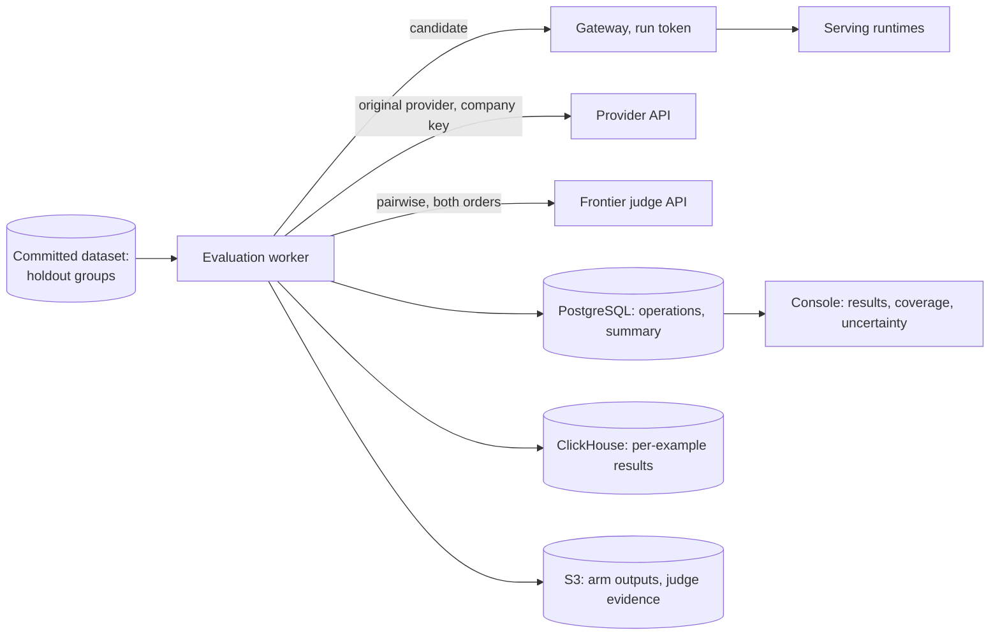

# Fine-tuning: evaluation and reporting

Status: specified design; S8 qualifies the judge and estimators before any metric is published. Owns `EVAL-01` to `EVAL-03`. Training-time rewards belong to the recipe (RUN-03); this document covers what the customer sees.

## Components

## Decisions in this contract

| Decision | Reason | Rejected |
| --- | --- | --- |
| One judged comparison: the candidate against the original provider model it replaces (a fresh call) | That is the decision the customer is making; extra arms add cost and noise without changing it | Base and production arms (decided against on 2026-09-11) |
| Fresh provider calls, paid by us, on every evaluation | Captured answers age; the customer never supplies a key | Reusing old captured answers as fresh |
| Frontier judge, pairwise, both orders, disagreement unresolved | Position bias is real; unresolved is honest | Single-order judging; hiding unresolved |
| Results only: no pass mark, no recommendation, no gate | Customers try versions and decide; scores are evidence | Quality gates on promotion |
| Report unit is the session group, equal weight | Correlated turns must not count as independent evidence | Per-turn statistics |
| Intervals by resampling whole groups; unavailable when they cannot be computed | Never a number that looks more certain than it is | Silent drops |
| Latency compared only within the same measurement context | A provider call from production and a worker replay are not like for like | "N times faster" claims |

## EVAL-01 The comparison

Evaluation measures judge-assessed response quality. It does not prove task completion in the customer's systems, and it never executes generated tool calls against them. Deterministic format and protocol checks are reported separately.

Task criteria are drafted automatically from permitted task context and development examples; no customer approval step. The rubric is versioned and qualified in S8.

**Frozen at creation:** dataset and example ids, split and grouping revision, sampling seed, arm identities, replay controls, judge identity, rubric version, operation limits, deadline. The holdout is independent of trainer selection and invisible to the trainer. A later recipe or judge change is a new evaluation.

| Arm | What runs |
| --- | --- |
| Candidate | The new adapter on its qualified base release |
| Original provider | The provider model the task is configured to replace; fresh call, company-paid |

The provider is not automatically the judge; the task explicitly configures an eligible reference model. Observed traffic may suggest one but cannot authorise an arbitrary endpoint. Recovery reuses only the matching accepted operation. Requested and observed provider identity and time are recorded. A retired alias reports unavailable and requires explicit reconfiguration.

The candidate is judged against the original provider only. Versions are not judged against each other or against the bare base; every version shares the same baseline, so versions stay comparable over time through that baseline. An unavailable provider arm is explicit missing evidence and does not remove examples from the sample.

Inputs are normalised through the gateway contract. Controls (prompt and template, tools and tool choice, parallel calls, output format, reasoning, stop, output budget) map to each arm through the qualified feature matrix; the effective mapping and each model's limits are frozen; an unsupported comparison is excluded with a reason. Controls are never dropped silently; sampling equivalence is never claimed across providers with different controls; seeds are best effort.

## EVAL-02 Sampling and results

Holdout groups are selected deterministically from the manifest and seed. The release profile bounds groups, examples, per-call limits and total deadline; an unset value never means unlimited. Stratification only with frozen weights. The sample is never adjusted after seeing results.

Unit: the protected session group, weight 1; examples within a group weight 1. Group and example counts are shown. Contaminated or development-used groups are excluded.

**Judge protocol.** For each candidate-versus-provider pair, two calls with left and right swapped. Model text is evidence, never instructions. Result: `left`, `right`, `tie`, `abstain`, with bounded rationale, converted to candidate orientation. Two matching non-abstain verdicts resolve the pair; anything else is unresolved. Raw verdicts and resolution reason persist. A valid unfavourable verdict is never retried.

Per group: weighted win, tie, loss and unresolved fractions over all selected examples; averaged across groups to `W`, `T`, `L`, `U` summing to 1.

| Value | Definition |
| --- | --- |
| Resolved share | `1 - U` |
| Conditional judge score | `(W + 0.5·T) / (1 - U)`; undefined if nothing resolved |
| Missing-evidence range | `[W + 0.5·T, W + 0.5·T + U]` |
| Win, tie, loss, unknown | Weighted values with raw counts |

The console bar shows resolved comparisons only: widths and labels use `W / (W + T + L)`, `T / (W + T + L)` and `L / (W + T + L)`. The three segments fill the bar; widths use unrounded proportions. Show `U` separately as the unresolved share of all comparisons. With no resolved results, show "No resolved comparisons". Detailed results keep the original four fractions and counts.

The range is not a confidence interval. The conditional score is labelled conditional. A deterministic format failure is shown separately and may be judge evidence; it is never rewritten as a loss or a success.

Interval: 95% percentile from resampling whole groups with replacement, 10,000 times, frozen seed. Fewer than two groups, or any resample with no resolved evidence, gives `interval_unavailable` with reason. Group count and the range are shown beside any interval. S8 tests coverage and calibration first. An interval is never a gate.

The denominator is fixed. Generation coverage, judge coverage and resolution are reported. Partial stays partial. No aggregate pass or fail, recommendation, regression threshold or minimum score. Any valid available version can be promoted by hand regardless.

## EVAL-03 Operations, cost and latency

Each arm generation and each judge ordering is an operation with an immutable input hash, attempt identity, provider or release, deadline, retry ceiling and accepted manifest; one result by compare-and-set. Customer text and judge evidence live in workspace-scoped evaluation objects. Cost metadata carries operation ids. A worker crash cannot create a new sample or restart the comparison.

External calls follow RUN-04 (run tokens, provider slots), use company credentials, and cost the customer nothing. No price lookup, Grafana query or ledger gates execution. An uncertain provider request waits out its bound before retry; duplicate cost is recorded; exactly-once is never claimed. A failed evaluation never retrains, unpublishes or promotes.

**Cost.** A price registry for the actual direct provider, model, tier and time; an OpenRouter price is not a direct price. Stored: usage category, currency, pricing revision, estimate status, cached and reasoning token categories where supported. Refresh every five minutes; older than 24 hours is stale. Missing usage or price is unknown, never zero. Coverage and possible duplicates are shown. Registry failure leaves the result valid with cost incomplete.

**Latency.** Compared only with its context: vantage point, queue and admission delay, cold load, first token, total time, streaming mode, completion. Customer-observed and worker-only durations are never compared as like for like. Fixed fleet cost is reported separately from busy GPU time.

Final evaluation records and evidence are retained indefinitely (OPS-02). Training rollouts and checkpoints are intermediates unless accepted into an evidence manifest. Turning capture off after a run's first start still permits its evaluation; an explicit cancel stops new operations.

## Required evidence

S1: replay controls. S8: the judge on known outcomes, swaps, adversarial text, correlated sessions, unavailable arms, selective timeouts; estimators against independent fixtures. Nothing here grants provider permission or proves training worked.
