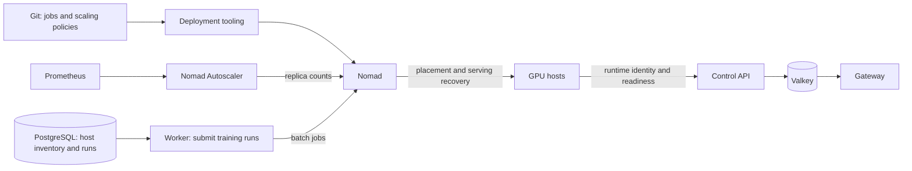

# Fine-tuning: Nomad scheduling and autoscaling

Status: infrastructure design, not implemented or qualified. Owns `FLEET-00` to `FLEET-05`.

## Components

| Owner | Responsibility |
| --- | --- |
| Git | Serving jobs, pinned runtime images, GPU requirements, constraints, scaling limits and metric policies |
| Nomad Autoscaler | Serving replica counts from Prometheus and the configured policies |
| Nomad | Node resource discovery, job placement, allocation state, serving restart, reschedule and rollout |
| PostgreSQL `instances` | Provider inventory, hardware SKU, location, timestamps, and Nomad node link |
| Worker | Submit and cancel one training job per run; interpret run events; publish validated adapters |
| Host agent and runtime | Load adapters, manage local memory, report readiness, drain and clean up |
| Gateway | Request admission and routing using Valkey runtime status |

There is no `serving_targets` table, custom fleet coordinator, desired-count calculator or PostgreSQL host-assignment plan.

## FLEET-00 Configuration ownership

Serving job definitions and autoscaling policies live in Git under `product/inference/nomad/`. They specify the base release, runtime image, resources, placement constraints, minimum and maximum replicas, metric queries, scaling strategy and cooldowns. Host provisioning remains manual; application autoscaling does not provision VMs.

**Model identity.** PostgreSQL remains the model catalog, including immutable base releases and private adapter versions. Git is not a second model catalog. A serving job declaration references a stable `base_release_id` and a runtime/scaling profile. Deployment tooling resolves that release's immutable artifact reference and digest, validates compatibility, and renders the pinned Nomad job. Nomad must not resolve a mutable model alias at startup. A changed base artifact is a new release. Names, task production pointers and model lifecycle remain in PostgreSQL.

Private adapters do not create Nomad jobs or Git entries. They load into compatible base runtimes through the existing adapter path. Training jobs are rendered from a Git template and the frozen PostgreSQL run config. One source owns each value: PostgreSQL owns model identity and artifacts; Git owns runtime and scaling policy; Nomad owns allocations and live counts.

Deployment tooling owns job configuration. Nomad Autoscaler owns the live replica count within policy limits. Redeploying a job must preserve that count unless an operator explicitly changes it; qualify the chosen deploy command/API path before rollout. The worker does not independently write serving counts.

Operators maintain provider inventory in PostgreSQL and scheduling eligibility in Nomad. Nomad owns device discovery, observed liveness, resource availability and allocations. These observations may be displayed or logged but are not a second scheduler state in PostgreSQL. The gateway does not query Nomad, Prometheus, PostgreSQL or the autoscaler on the request path.

## FLEET-01 Jobs and placement

Use one service job per base release, with host-owned on-demand adapter caches. Nomad selects compatible hosts using GPU resources, CPU/RAM requirements, node metadata and constraints. Serving replicas reserve their required GPUs. Pack compatible replicas onto hosts to use the available GPU capacity. Distinct-host placement is a model-specific availability choice, not a universal constraint. Future adapter sharding is outside launch scope.

A training run creates one deterministic batch job, `training-<run_id>`, from its frozen config. Reconcile uncertain submission by job ID and config hash. Disable training restart, reschedule and disconnected-client replacement. A host or trainer failure fails that run. Serving uses Nomad's qualified restart and reschedule policies. The worker never starts replacement serving jobs.

The run start exchange verifies the actual allocation, managed job, enrolled host and current run authorization. Nomad chooses the host; the platform does not preassign it. A duplicate allocation cannot start a second execution for the same run.

Nomad events wake reconciliation; current node, job and allocation queries establish scheduler state. Events are not copied into a separate fleet-history table. Prometheus monitors fleet health and capacity; service logs record integration errors. Training failures are recorded in the affected run’s `training_run_events`. Re-read after an event gap. The runtime must pass base and loader checks before its allocation is routable.

## FLEET-02 Capacity and priority

Minimum replicas, GPU requirements, workload eligibility and job priorities are explicit configuration. The initial pilot uses one DeepSeek serving replica. Expansion may configure two
serving replicas per offered base. They may share a host when the selected GPU packing requires it; report the resulting host-failure exposure. A configured minimum is desired capacity, not proof that resources exist.

If compatible GPUs are unavailable, Nomad leaves allocations pending. Alert on pending allocations, insufficient ready replicas and capacity shortfalls; operators add capacity or change policies. Do not build a custom reserve activation system, training-floor ledger or fair-share allocator. Operators may use static workload constraints where serving capacity needs protection from training.

Preemption is disabled at launch. Started training is not interrupted for priority. Pending-job priority does not reclaim GPUs from running workloads, and independent model autoscalers do not promise global fairness. Cross-model redistribution and adapter sharding require a later explicit policy; no custom coordinator is assumed now.

## FLEET-03 Autoscaling

Use Nomad Autoscaler with Prometheus. Each policy defines minimum and maximum replicas, a metric query, strategy, evaluation interval and cooldown. Use measured serving demand and capacity signals; qualify each policy on the actual model and host shape before enabling it. GPU utilization alone is not sufficient evidence of unmet demand.

Policies and thresholds are versioned in Git. No custom worker loop computes accepted counts or reallocates hosts. The autoscaler requests counts; Nomad places feasible allocations. Metrics unavailable or stale must not cause unsafe shrink; test the selected policy and plugin behavior. Monitor requested, allocated and ready counts separately.

Application scaling works with a fixed node pool. Scaling a job does not guarantee that a new host can be placed. Cluster autoscaling and automatic provider provisioning are outside launch scope.

References: [Nomad Autoscaler](https://developer.hashicorp.com/nomad/tools/autoscaling), [scaling policies](https://developer.hashicorp.com/nomad/tools/autoscaling/policy), [placement](https://developer.hashicorp.com/nomad/docs/concepts/scheduling/placement).

## FLEET-04 Drain, rollout and cleanup

Nomad owns serving rollout and allocation transitions. Git job configuration declares update strategy, health checks, migration behavior and shutdown limits. Verify that scale-down and rollout preserve the required serving availability. Insufficient rollout capacity leaves the deployment pending and raises an alert; it does not justify bypassing readiness checks.

Runtime readiness includes exact model and adapter checks. Liveness must not fail merely because loading is still in progress or a control store is temporarily unavailable. On SIGTERM, close local admission, report unready, forward termination and finish active requests within the configured bound. Initially allow 300 seconds for request drain and 60 seconds for cleanup; set Nomad task and client kill limits accordingly.

Do not drain started training for routine maintenance. Wait for completion or explicitly cancel the run. Host-local checks prevent a new GPU process from starting before prior compute and private files are cleaned up. A disconnected node is not free capacity. A returning failed host must pass cleanup before reuse.

Model releases are qualified before rollout. Keep the old serving path until replacements pass readiness. Exact Nomad update and autoscaler interaction must be tested, including changing counts during deployment and interrupted deployments.

## FLEET-05 Placement, identity and network

Constrain jobs to a qualified host class and reserve the GPUs required by each replica, with measured CPU, RAM and disk. GPU assignments on one host must be disjoint. Request the complete inventory only for workloads that need the whole host. Apply `distinct_hosts` when the model availability policy requires separate hosts; it is not required for the initial GLM pair. Prefer broader failure-domain spread where known; unknown metadata is not evidence of independence. No normal job constraint names a physical host. Configure operator-approved host capabilities and workload eligibility in Nomad metadata. Do not duplicate these fields in the instance record. Placement constraints use these fields. Serving and training jobs use the declared workload eligibility constraints. Quarantine clears eligibility and closes the local guard. Missing metadata matches no workload. T0 verifies these constraints, stale eligibility and device inventory. [Constraint scope](https://developer.hashicorp.com/nomad/docs/job-specification/constraint), [device resources](https://developer.hashicorp.com/nomad/docs/job-specification/device).

Inventory records provider, provider account ID, provider instance ID, SKU, region, fault domain, timestamps, and the unique Nomad node link. Credential issuance and revocation remain separate. Enrollment verifies the authenticated instance and its Nomad node identity. Nomad owns device inventory and scheduling eligibility. A reused hostname inherits no permission. Training jobs exchange Nomad workload identity for a run token under RUN-04; that exchange binds the actual allocation selected by Nomad. No static key or provider credential is baked into an image.

**Serving discovery.** The runtime registers its actual Nomad job, allocation, node, endpoint, engine boot id, release and base/loader readiness through the authenticated control API. The API validates workload identity, current credential authorization and node binding, the registered managed Nomad job and qualified release and the allocation's actual ownership before accepting a route. During a rollout, old and target qualified runtime revisions remain authorised while Nomad keeps those allocations active; a newer job revision alone must not remove the old routes. Subsequent status uses that accepted binding. Runtime status and adapter acknowledgements populate the existing deployment projection and Valkey status path. A replacement registers its new allocation; it does not need a preassigned host row. Late status from an old allocation or boot cannot overwrite or remove its replacement. The gateway reads Valkey, never Nomad or PostgreSQL. Readiness requires the exact base and functional loader; adapters are verified on demand under SERV-01. Reconciliation removes routes for allocations Nomad has stopped or replaced. Restarts do not inherit readiness.

| Flow | Control |
| --- | --- |
| Worker to Nomad API | TLS; narrow ACL; deterministic job ownership |
| Control API to Nomad API | TLS; read-only allocation and job validation |
| Nomad server quorum | Three stable identities and endpoints; authenticated |
| VM client to each server | Advertised endpoints reachable over the real network; mTLS and ACL |
| Host to control API | HTTPS; workload and host identity for registration and status; run token for training-job calls |
| Trainer to gateway | HTTPS with a run token on ordinary inference routes |
| Trainer or host to S3 | Short-lived grants or host-specific read policy; no broad bucket access |
| Gateway to runtime | Private authenticated access to the accepted allocation and release |
| Metrics and health | Authenticated reachability; no public admin or adapter port |

Host networking is not tenant authorisation. External HTTPS uses 443. Nomad API and RPC initially use 4646/TCP and 4647/TCP; server gossip uses 4648/TCP and UDP. These ports are not public. Each server advertises its own routable endpoint. Each host reports one `RUNTIME_PORT` for dispatch and status. Metrics use the authenticated host-agent path unless a private scrape endpoint is declared. Host mTLS credentials rotate through enrollment; Nomad JWT keys through JWKS; run-token keys through RUN-04. T0 verifies the pinned Nomad patch, Docker and NVIDIA versions, server storage, ports, issuer, audience, trust roots and rotation on the real provider network. [Production requirements](https://developer.hashicorp.com/nomad/docs/deploy/production/requirements), [agent configuration](https://developer.hashicorp.com/nomad/docs/configuration).

## Required evidence

T0: pinned Nomad and Autoscaler versions, GPU discovery, constraints, managed-job deployment, count preservation, identity, networking and serving recovery. S4: resource fit. S5: one training execution, terminal host failure, drain and cleanup. S7: Prometheus scaling, min/max bounds, cooldown, metric loss, insufficient GPUs, scale-down and rollout interaction. No test may claim fairness or automatic capacity provisioning that this design does not provide.

The first serving-only migration is specified in [Nomad serving pilot](NOMAD_SERVING_PILOT_PLAN.md). It starts with one DeepSeek TP4 replica on one four-B300 pod. The earlier GLM pair and second DeepSeek replica are deferred. Training and autoscaling are outside that pilot.

## Pilot security scope

The [pilot security contract](NOMAD_SERVING_PILOT_PLAN.md#security-contract) records
the agreed network, identity, process-isolation, revocation, and release gates.
GPU clients initiate restricted outbound tunnels to the three private EKS Nomad
servers. Each instance has its own tunnel key and Nomad TLS certificate. Provider
IP stability is not required. A host certificate does not grant gateway inference
access or general EKS access. Arbitrary customer code is outside scope.
