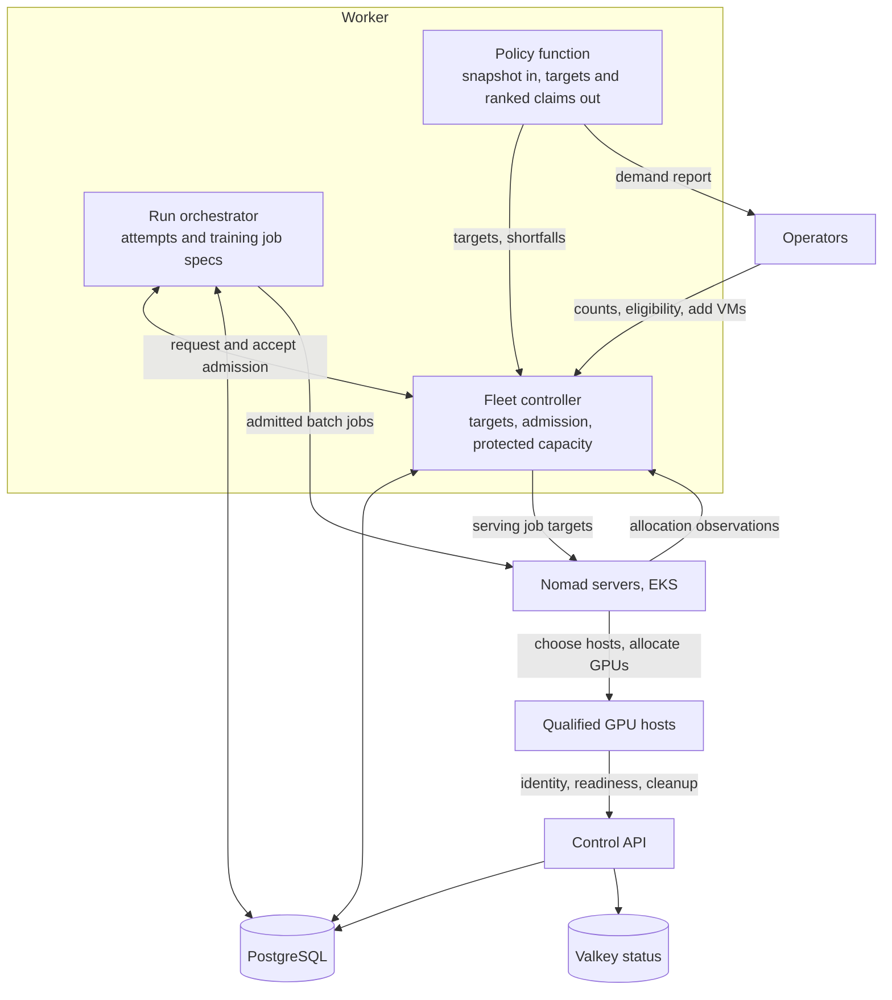

# Fine-tuning: fleet policy and execution

Status: new infrastructure design. The fleet controller and Nomad integration do not exist yet. Owns `FLEET-00` to `FLEET-05`.

## Components

| Owner | Decisions |
| --- | --- |
| Run orchestrator | Run and attempt state; recipe dependencies; immutable training job spec; training submission, cancellation and retries |
| Policy function | Ranked demand and desired counts from one snapshot |
| Fleet controller | Accepted workload targets; training admission; floor and reserve protection; eligibility changes |
| Nomad | Physical host and GPU placement; serving restart, reschedule and rollout; allocation state |
| Runtime and host agent | Adapter readiness; local admission, drain, process deadlines and safe GPU reuse |
| Gateway | Request admission, exact model selection and request leases |

These are modules in the existing worker and runtime. Job rendering and Nomad API calls are shared helpers. There is no separate allocator, training runner or executor service, queue or host-assignment state machine.

## Decisions in this contract

| Decision | Reason | Rejected |
| --- | --- | --- |
| Nomad CE places jobs within our workload and capacity policy | Use the scheduler for resource placement and serving recovery | Pinning every job to a host selected by the worker |
| One whole host, one workload at a time | Simple GPU ownership | Splitting a host between serving and training |
| One service job per base; all its replicas have the same production adapter set | Any compatible replica can replace another | Per-replica adapter subsets and a custom placement solver |
| Operators set counts and eligibility at launch; demand-driven changes in phase 2 | Qualify automatic reallocation separately | Metrics-driven reallocation at launch |
| Two serving replicas per base, two training nodes per required host class, recovery reserve | Keep availability and training commitments intact | Scale to zero; borrowing protected capacity |
| Started training is never interrupted for priority | Predictable runs | Training preemption |
| Extra capacity: customer inference, then evaluation, then new training; organisations weight 1 | Customers first | Priority bought through more tasks |
| Nomad recovers serving; the orchestrator retries training | One recovery owner for each workload kind | Two controllers replacing the same execution |

## FLEET-00 Launch scope

At launch:

1. **Operators set workload counts and host eligibility.** They choose the serving replica target for each offered base, at least two. They designate the training floor and recovery reserve. Ordinary eligible hosts are not assigned to a named base; Nomad chooses the host.
2. **The controller admits training and protects capacity.** It applies the queue order in FLEET-03, records admissions, detects deficits and opens reserve capacity for a real serving failure. Nomad restores the accepted serving count.
3. **Demand is reported.** The policy function computes suggested counts and shortfalls for Grafana and capacity alerts. It does not change accepted counts from metrics at launch.

Phase 2, behind `fleet_autoreallocation`: apply demand-driven counts and eligibility changes, with the hysteresis in FLEET-03. The job model and recovery ownership stay the same. Neither phase creates or terminates VMs.

## FLEET-01 Workloads and reconciliation

One shared fleet of qualified GPU VMs. Nomad uses rootful Docker and the NVIDIA device plugin. Control services stay in Kubernetes. Raw-exec, RunPod training and Nomad Autoscaler are outside launch scope.

| Workload | Nomad declaration | Recovery owner |
| --- | --- | --- |
| Serving base | Stable `serve-<base_release_id>` service job; one group; count from the accepted target; exact qualified host class and release; all GPUs on that host class; group-level `distinct_hosts` | Nomad restarts locally, then reschedules under the qualified policy; the worker does not create replacement jobs |
| Training attempt | `training-<run_id>-<attempt>` batch job; count one; immutable spec and admission revision; exact qualified host class; all GPUs on that class | Orchestrator creates a new attempt for an allowed retry; no automatic Nomad training restart or reschedule |

All serving replicas of a base carry the same production adapter set in host memory (SERV-01). Adapter A and B on the same base share those processes; changes in their request demand do not create separate Nomad jobs. Adding replicas increases throughput, not the size of the adapter set that can fit on each host.

Disable scheduler preemption for every job type allowed on the GPU fleet. Only the controller and orchestrator identities have routine submission access. Their shared renderer validates the managed templates, constraints and resource requests before submission. Training templates disable task restart, failed-allocation reschedule and disconnected-client replacement. Planned drains must not migrate or kill started training. Server loss, client loss and node drain are different paths; T0 and S5 must prove each on the pinned version. A duplicate allocation still cannot obtain a second start authorisation (RUN-04). Serving templates enable bounded restart and reschedule and keep the replacement when a disconnected original returns. No implicit defaults. [Restart](https://developer.hashicorp.com/nomad/docs/job-specification/restart), [reschedule](https://developer.hashicorp.com/nomad/docs/job-specification/reschedule), [disconnect](https://developer.hashicorp.com/nomad/docs/job-specification/disconnect).

Serving has separate liveness and readiness checks. Attach `check_restart` to local engine liveness with a qualified failure threshold and startup grace. Model loading and control-store outages must not trigger a restart by themselves. An unrecoverable engine integrity error fails liveness or exits the task. Readiness controls routing and deployment health. T0 records finite startup, health, restart and reschedule bounds. Exhausted recovery raises an incident; the worker does not start a competing replacement. [Health-check restarts](https://developer.hashicorp.com/nomad/docs/job-specification/check_restart).

**Durable records.** PostgreSQL stores accepted serving targets (`job_id`, base and runtime release, host class, desired count, `target_revision`, protected-set revision and pending promotion owner) and training admissions on the attempt (`admission_revision`, resource and dependency commitment, accepted allocation binding). Admission does not name a host. `instances` stores enrollment, qualification, eligibility and quarantine. Nomad owns actual allocation placement and lifecycle. PostgreSQL may retain an accepted binding or observation for audit and authorisation; it does not maintain a competing desired assignment.

**Writing jobs.** The controller is the only serving-job writer. The orchestrator is the only training-job writer. A leader lock reduces duplicate work. Each submission carries its durable target or admission revision and a canonical spec hash. Before a write, reload the current PostgreSQL intent and current Nomad job. Use Nomad `EnforceIndex` with `JobModifyIndex`; on conflict reload both, never replay a cached spec. Reconcile a lost response by job id and hash. PostgreSQL and Nomad are not one transaction: a write already in flight can complete after lock loss. The next owner reconciles that effect.

Training start and serving readiness independently check current authorisation; a submitted spec is not proof of permission. [Jobs API](https://developer.hashicorp.com/nomad/api-docs/jobs).

**Observing jobs.** Events wake reconciliation; current job, allocation and node queries establish state. Re-read snapshots after reconnect or an event gap. An event cursor is not a complete history. Serving replacement discovery follows FLEET-05; a running allocation is not a ready model. Loss of the worker does not disable Nomad's serving recovery. A new route still needs successful identity validation and status ingestion through the control API. [Event stream](https://developer.hashicorp.com/nomad/api-docs/events).

## FLEET-02 Protected capacity

Count compatible whole hosts with measured RAM, GPU, disk and throughput envelopes. GPU count alone is insufficient.

| Commitment | Rule |
| --- | --- |
| Offered base | At least two ready replicas on distinct hosts |
| Production adapters | The complete set loaded and tested on every ready replica of their base; at least two hosts |
| Training floor | Two qualified nodes per required training host class; active training counts; unused floor stays reserved |
| Started training | Keeps its allocation and declared dependencies until completion, cancel, deadline or failure |
| Recovery reserve | Compatible capacity to restore the accepted count and complete adapter set after any one serving-host loss |

The release registry maps each trainable base to one host class. Bases sharing a class share its training floor. A host counts once. Reserve the floor before enabling its base. An incompatible run waits. A local training judge needs separate declared capacity. Moving a floor designation requires its replacement first.

Eligibility is an enforceable scheduling constraint, derived from trusted enrollment. Training-floor nodes accept training only. Reserve nodes reject ordinary serving expansion, evaluation and training. General capacity can accept serving or admitted training when all commitments fit. These are logical restrictions in one fleet, not separate clusters. Do not submit more non-preemptible training than the eligible capacity can support alongside all accepted serving targets, pending starts and dependencies. Read Nomad's outstanding allocations when accounting for capacity; an unready allocation still uses resources.

Plan reserve coverage per single-host failure scenario. One spare can cover alternative failures if its class, disk and prefetched assets support each alternative. On a real failure, the controller permits the affected serving job to use compatible reserve capacity at its existing target count. This permission cannot fund demand-driven growth. Nomad chooses placement. The consumed reserve stays visible as a deficit; operators restore it. Deficits block discretionary expansion and new admissions that could delay repair. A reserve is not counted as both ordinary free capacity and recovery capacity.

Lower bound for one base with no local judge: five hosts (two serving, two training floor, one spare). Maintenance needs additional capacity to preserve both serving replicas and the independent reserve. Mixed classes and local judges need more. The complete production set, pending promotion overlap and qualified request headroom must fit on each serving host. Check that envelope directly; do not bin-pack different adapter subsets across replicas. An infeasible base or promotion waits or fails with a capacity reason; no floor is reduced. During an actual failure the target stays in place and the deficit is shown.

## FLEET-03 Policy, priority and fairness

The policy is a deterministic function of one snapshot: host capabilities and health, Nomad allocations, admissions, commitments, demand, queued claims, throughput envelopes, metric age and prior state. It returns suggested counts, ranked claims, blocked reasons and eligibility changes. It calls no provider and stops no job.

Demand includes authorised offered requests and capacity rejections, completion rate, queue age, token work, active leases, runtime memory and adapter-load demand. Utilisation alone is not demand. Exclude malformed and unauthorised traffic. Per-organisation aggregates live in bounded control-plane records, not Prometheus labels.

Priority for capacity beyond commitments:

1. Customer inference, including exact-version tests.
2. Final candidate evaluation and publication qualification.
3. New training and its preparation dependencies.

Speculative warming has no priority. The first successful token exchange makes training non-preemptible. That exchange and admission withdrawal use compare-and-set on the same attempt row (RUN-04). Nomad job priority may order pending placement work; it does not replace these admission rules or create capacity.

Fairness: weight 1 per organisation per class. Per hardware and priority class, choose the runnable organisation with least normalised charged service; ties use oldest claim then stable id. An idle organisation rejoins at the current minimum. Charge service once per interval, to the owner for training and split by the token-work estimator for shared serving. Account for pending admissions from reservation; account for floors separately. Totals persist across takeover. Normalisation applies only within a compatible class. S7 measures fairness lag. Non-preemptible jobs and strict class order do not give a queue-time guarantee.

Throughput target: ceiling of offered token work over the release's qualified sustainable throughput at its headroom, subject to readiness and protected capacity. Record suggested, accepted, placed and ready counts separately. Missing measured values block automatic scaling. A resource deficit leaves a job pending and raises a capacity signal; it does not interrupt training.

For example, a qualified change from base A at four replicas to three, and base B at two to three, changes group counts. Nomad chooses which A replica stops and where B starts. If B needs that host, B stays pending until shutdown and cleanup finish. The change is allowed only if every possible removal leaves A's two-host floor intact. A planned change at the floor needs ready replacement capacity first.

Phase-2 cadence: reconcile every 30 s and on events; 60 s sustained growth before adding; 15 min sustained shrink before removing; 10 min minimum allocation age; one discretionary capacity change at a time. Protection repair overrides delays, never safety checks. Metrics older than 90 s stop discretionary shrink and training expansion. S7 qualifies these values.

## FLEET-04 Drain, rollout and safe reuse

The controller checks commitments before it changes counts, release specs or eligibility. Nomad owns the allocation transition. Runtime and host hooks own local safety. No controller thread or transaction waits for requests to drain.

**Planned removal.** Check fresh readiness and all removals already in progress. A count decrease must keep two ready hosts for every affected base and adapter even if Nomad selects any healthy replica. At the floor, prepare replacement capacity first. Eligibility changes use a qualified Nomad drain or workload update; changing node metadata alone does not move existing allocations. Never drain started training for a role change. [Constraint updates](https://developer.hashicorp.com/nomad/docs/job-specification/constraint).

On SIGTERM, the serving wrapper immediately closes local admission, marks readiness false and publishes `accepting_requests=false` through the status path. It forwards the signal to vLLM and lets active requests finish. The gateway stops selecting the route when its status updates or expires. A stale route is refused locally before new compute and follows the gateway's normal retry rule. Nomad service deregistration alone does not update Valkey. Signal forwarding and the local admission gate are required parts of the runtime image.

| Setting | Value |
| --- | --- |
| vLLM `--shutdown-timeout` | 300 s, explicit; the default 0 aborts requests |
| Cleanup allowance | 60 s |
| Nomad task `kill_timeout` | 360 s |
| Nomad client `max_kill_timeout` | At least 360 s |

Job validation rejects absent, zero, negative or inconsistent values. Requests still active at the deadline can fail and count against availability. Forced termination is never reported as success. S7 measures the loss rate against 99.9%. [vLLM setting](https://docs.vllm.ai/en/v0.28.0/cli/serve/#--shutdown-timeout), [Nomad task limit](https://developer.hashicorp.com/nomad/docs/job-specification/task#kill_timeout).

**Runtime upgrades.** Nomad performs the rollout after release qualification and the controller's capacity check. Use a full blue/green update: `canary` and `max_parallel` equal the accepted group count, `auto_promote=false`, and health based on runtime checks. Keep counts fixed during the deployment. After every new replica passes the complete-set readiness checks, the controller requests Nomad deployment promotion. Nomad drains the old replicas. Until then, the old group stays available. This requires twice the serving hosts plus the training floor and independent reserve: seven hosts for the single-base, two-replica example with no local judge. T0 qualifies the health deadlines, failure rollback and full sequence on the pinned template. If that capacity is unavailable, the update waits; the qualified old release continues. Adapter promotion is the SERV-03 pointer operation, not a Nomad deployment promotion. [Update strategy](https://developer.hashicorp.com/nomad/docs/job-specification/update).

**Reuse.** A host-local exclusive guard runs before every GPU process start, including a restart within the same allocation. It verifies that prior GPU processes are gone, GPU memory and contexts are clean, and private directories from earlier work are removed. Record evidence with machine, boot and allocation identity. A terminal Nomad allocation is insufficient proof. Successful one-shot prestart hooks alone are insufficient because they need not repeat on a task restart. Failed cleanup blocks compute and marks the node ineligible and quarantined; the local guard remains closed even if that report cannot reach the controller. [Lifecycle hooks](https://developer.hashicorp.com/nomad/docs/job-specification/lifecycle).

A lost node is not free capacity. Replacement serving may run on another host, but the original host cannot accept new work until it re-attests and passes cleanup or an operator confirms power fencing. Reconnection reconciles original and replacement allocations before reopening routes. Trainer jobs enforce their deadline locally with 60 s grace even when Nomad, PostgreSQL or the worker is unreachable. A new attempt cannot accept output or requests under an old attempt's authorisation. Completion returns usable capacity to Nomad only after local cleanup; policy determines which workloads are eligible next.

## FLEET-05 Placement, identity and network

Constrain jobs to a qualified host class and request its complete GPU inventory, with measured CPU, RAM and disk. This excludes another GPU workload on the same node. Apply `distinct_hosts` to the serving group so its replicas are separate. Prefer broader failure-domain spread where known; unknown metadata is not evidence of independence. No normal job constraint names a physical host. Project trusted eligibility into node metadata `allowed_workloads`: `serving,training` on general nodes, `training` on floor nodes, empty on an idle reserve. An activated reserve gets only `recovery:<base_release_id>`. Serving jobs use `set_contains_any` for `serving,recovery:<base_release_id>`; training jobs require `training`. Quarantine clears eligibility and closes the local guard. Missing metadata matches no workload. T0 verifies these constraints, stale eligibility and device inventory. [Constraint scope](https://developer.hashicorp.com/nomad/docs/job-specification/constraint), [device resources](https://developer.hashicorp.com/nomad/docs/job-specification/device).

Enrollment records provider machine id, boot id, GPU inventory, release capabilities, region, failure domain, agent identity and status. Operators approve hosts. A reused hostname inherits no permission. Training jobs exchange Nomad workload identity for a run token under RUN-04; that exchange binds the actual allocation selected by Nomad. No static key or provider credential is baked into an image.

**Serving discovery.** The runtime registers its actual Nomad job, allocation, node, endpoint, engine boot id, release and protected-set revision through the authenticated control API. The API validates workload identity, enrollment and eligibility, current accepted target and the allocation's actual ownership before accepting a route. During a rollout, old and target qualified runtime revisions remain authorised while Nomad keeps those allocations active; a newer target revision alone must not remove the old routes. Subsequent status uses that accepted binding. Runtime status and adapter acknowledgements populate the existing deployment projection and Valkey status path. A replacement registers its new allocation; it does not need a preassigned host row. Late status from an old allocation or boot cannot overwrite or remove its replacement. The gateway reads Valkey, never Nomad or PostgreSQL. Readiness requires the committed production set and all execution checks in SERV-01; new allocations also prepare the pending promotion set. Reconciliation removes routes for allocations Nomad has stopped or replaced. Restarts do not inherit readiness.

| Flow | Control |
| --- | --- |
| Worker to Nomad API | TLS; narrow ACL; deterministic job ownership |
| Control API to Nomad API | TLS; read-only allocation and job validation |
| Nomad server quorum | Three stable identities and endpoints; authenticated |
| VM client to each server | Advertised endpoints reachable over the real network; mTLS and ACL |
| Host to control API | HTTPS; workload and host identity for registration and status; run token for training-job calls |
| Trainer to gateway | HTTPS with a run token on ordinary inference routes |
| Trainer or host to S3 | Short-lived grants or host-specific read policy; no broad bucket access |
| Gateway to runtime | Private authenticated access to the accepted allocation and release |
| Metrics and health | Authenticated reachability; no public admin or adapter port |

Host networking is not tenant authorisation. External HTTPS uses 443. Nomad API and RPC initially use 4646/TCP and 4647/TCP; server gossip uses 4648/TCP and UDP. These ports are not public. Each server advertises its own routable endpoint. Each host reports one `RUNTIME_PORT` for dispatch and status. Metrics use the authenticated host-agent path unless a private scrape endpoint is declared. Host mTLS credentials rotate through enrollment; Nomad JWT keys through JWKS; run-token keys through RUN-04. T0 verifies the pinned Nomad patch, Docker and NVIDIA versions, server storage, ports, issuer, audience, trust roots and rotation on the real provider network. [Production requirements](https://developer.hashicorp.com/nomad/docs/deploy/production/requirements), [agent configuration](https://developer.hashicorp.com/nomad/docs/configuration).

## Required evidence

T0: actual scheduler placement, whole-host exclusion, distinct replicas, role constraints, training recovery disabled, serving recovery enabled, event resync and rollout capacity. S4: complete-set resource envelopes. S5: one training start, local deadlines, disconnected hosts, restart cleanup and route identity. S7: policy simulation, drain and recovery on the real fleet. These are qualification requirements. They are not completed tests.
