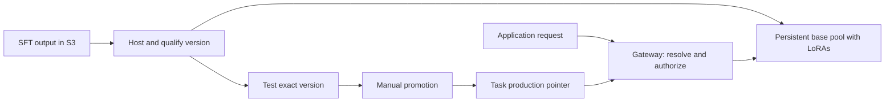

# Fine-tuning from captured traces

The console, persistent task model, Temporal orchestration and Qwen SFT executor
are implemented. The training pipeline produces downloadable PEFT LoRA archives.
Hosting those adapters and connecting promotion to inference remain to be built.
The hosting baseline here is inspected repository code; live serving qualification
is a separate implementation gate.

The [current implementation stack](LORA_HOSTING_PR_STACK.md) simplifies this
proposal to startup preloading and demand-loaded per-allocation LRU caches using
existing version/task records, with no new hosting or promotion tables. The
earlier hosting-resource, workflow and audit proposals below are deferred.

The hosting design below is proposed functionality, not deployed behavior or
authorization to provision GPUs or change production.

The [run contract](TASK_FINE_TUNING_RUN_CONTRACT.md) defines the implemented
interfaces. [TRACES_PLAN.md](TRACES_PLAN.md) owns capture and S3 trace storage.
[ARCHITECTURE.md](ARCHITECTURE.md) owns service boundaries.

Published adapter downloads use `GET /api/v1/workspaces/{workspace_id}/tasks/{task}/versions/{version_id}/adapter`. The API checks workspace membership and version ownership, then returns an uncached, five-minute signed archive URL. Serving eligibility does not restrict downloads. The API needs `TRAINING_ARTIFACTS_BUCKET` and `s3:GetObject` / `s3:GetObjectVersion` on that bucket's `runs/*` prefix; production configuration and the API role policy declare both. The archive must belong to the version's training run and match its recorded size and SHA-256. Signed links pin the verified S3 object version. Archives without an S3 full-object SHA-256 are streamed through the API for hashing before signing. No standalone manifest is published by the current trainer, so the console offers the archive only.

## Implemented

The console's `training` feature flag exposes workspace-scoped tasks, model
settings, runs, paged events, versions and manual promotion through the generated
Management API client. The collector creates tasks idempotently at capture time;
task listing reads PostgreSQL directly. The workspace default judge seeds each new task’s saved judge.
Tasks can override that judge independently. The Data tab reads captured traces; no traffic chart,
request/token statistics or trace progress counter is maintained for training.

Manual training requires 100 distinct trace arrivals since the last successful
run's input cutoff. Each task has a PostgreSQL schedule setting and its own
Temporal Schedule, configured with a nullable UTC cron expression and defaulting
to a weekly cron with a persisted staggered minute, hour and weekday. Updating a
task saves its settings in PostgreSQL and then directly creates or updates its
Temporal Schedule. Clearing the cron deletes the schedule. Temporal failures return 503 without confirming the save or rolling back the
task configuration; resubmitting the same task settings retries synchronization. There is no periodic reconciliation or pending-update
queue. Scheduled executions recheck task, workspace and organization eligibility
before starting training and require 500 trainable arrivals per task.
It reads manifests newest hour first, stops at the threshold and uses manifest
modification times to include late uploads. There is no training counter or
ClickHouse dependency. Manual admission does not require capture to remain on.

The separate TypeScript `temporal-worker` application hosts one workflow per task, identified by the
internal task UUID. Temporal rejects concurrent starts. Every client and worker
uses encrypted payload and failure conversion. PostgreSQL stores run state and
ordered events; each stage transition and its event share a transaction. S3 owns
large artifacts. Workflow activities isolate retries by step. Cancellation waits
for active work to stop and releases the host before recording a terminal state.

The API starts and cancels runs, and the console displays admission failures.
Train and Cancel require an editor role. Promotion remains manual. Mock execution
is enabled only with `TRAINING_EXECUTOR=mock` and produces synthetic, unavailable
versions that cannot be promoted. It validates orchestration, not model quality.

Workflow changes must replay the committed v1 history. Compatible patches retain
old command behavior for existing runs; incompatible changes introduce a new
workflow type while keeping old handlers available until their executions finish.
Rolling deployments must not strand hours-long runs on a removed worker build.

## Verification

The control package tests admission, late arrivals, transactional events,
idempotent publication and cancellation against real PostgreSQL. Temporal tests
use the time-skipping environment for step retries, cancellation and scheduled admission
behavior, replay a frozen history, and exercise schedule creation and a complete
`temporal-worker` lifecycle with encrypted clients and PostgreSQL. Console browser tests
cover persistence, pagination, collector registration and outage recovery, admission errors and cancel.

The real trainer increment adds dataset provenance and split tests, trainer event
and artifact validation, GPU host lifecycle tests, checkpoint recovery and a
bounded H100 smoke run. Synthetic orchestration results do not establish training
correctness or quality.

## Qwen executor

The `qwen-sft` workflow is orchestrated by `product/services/temporal-worker`.
Training runs as a separate Python process on exact enrolled H100 nodes, using
pinned Qwen3-0.6B, rank-two LoRA and fifty optimizer steps. The training library
lives in the private [Gradiated/autotrain](https://github.com/Gradiated/autotrain)
repository, pinned as the `product/packages/autotrain` submodule. It accepts local
files and an explicit recipe; progress and checkpoint callbacks connect it to the
private runtime adapter. Docker packaging, HTTP, signed S3 transfers, Kubernetes and
host lifecycle remain in this repository. Only the Python library is intended
for future open sourcing.

The worker publishes conversational prompt/completion JSONL train/validation/test
artifacts and a portable dataset manifest, then coordinates training, verification
and infrastructure evaluation. Host replacement requires confirmed process death
and resumes verified optimizer checkpoints. See the run contract and
`infra/environments/prod/runpod/training/README.md` for deployment order and manual
pool assignment. Live H100 training and rolling-deployment recovery still require
production qualification.

## Proposed hosting and production promotion

### Product behavior and initial scope

A customer can host a trained version, test it through the ordinary inference API,
and explicitly promote it for a task. Applications can pin an immutable version
or explicitly request the task's production version. Training completion never
changes production. A failed hosting attempt leaves current production serving.
Rollback uses the same promotion operation with the previous version.

Use the existing Qwen3-0.6B rank-two recipe to prove the product loop. The intended
production workload includes GLM-5.3-Flash-sized models with rank-two adapters
covering every layer. Freeze their exact target modules, including expert coverage,
before sizing caches. Qualify each production base, precision path and parallelism
profile separately; Qwen results do not establish GLM compatibility or capacity.
Serve trusted adapters generated by our trainer. Customer uploads, arbitrary
Python, custom tokenizers, automatic quality
promotion and weighted canaries are later features. The current small-model judge
is infrastructure evidence; its score alone must not qualify a production release.

Recommended hosting unit: a persistent base-model pool with multiple immutable
LoRAs sharing each engine. A pool is a compatible set of existing Kubernetes serving
allocations, pinned to one base/tokenizer/template/runtime/precision profile.
Do not merge every adapter into a full checkpoint or allocate one GPU per version
as the default. Dedicated replicas remain an operator option for isolation or
measured demand. Shared pools imply shared fault and capacity boundaries.

Use a pinned vLLM bundle for the first candidate because the current serving jobs
already use vLLM. Its [official LoRA documentation](https://docs.vllm.ai/en/stable/features/lora/)
describes named adapters, bounded adapter capacity and dynamic loading; the exact
Qwen/runtime combination still needs qualification. Upstream limits dynamic
loading to trusted isolated environments. Our design therefore keeps that control
on an authenticated private path and accepts only validated local artifacts.
This is a candidate runtime choice, not measured compatibility or performance.



### Existing foundation and required extensions

| Existing component | Reuse | Required work |
| --- | --- | --- |
| `task_versions` and signed downloads | Immutable trained output, workspace ownership | Freeze base identity and a serving manifest; qualify each version |
| `PUT .../tasks/{task}/production` | Editor authorization, same-task check, manual pointer | Readiness gate, audit and cache/drain semantics |
| Temporal training worker | Durable step retries, encrypted payloads, S3 verification | Separate hosting workflow; preserve existing training histories |
| Kubernetes, instance inventory and runtime bundles | GPU reservation, process lifecycle, placement and restart | Qwen LoRA service job and explicit serving pool constraints |
| Worker Kubernetes reconciliation | Physical allocation to `model_deployments` mapping | Desired adapter reconciliation and version-to-pool bindings |
| Desmond and allocation-aware host proxy | Authenticated ingress and runtime status | Adapter control allowlist, boot-bound adapter readiness |
| Rust gateway | Authorization, admission, streaming, leases, retries and settlement | Workspace-scoped version resolution and adapter-aware routing |
| Console versions tab | Evaluation, downloads and manual promotion | Hosting progress, readiness, test snippet and rollback |

Implementation code is the baseline where older architecture prose differs:
`gateway/src/postgres_reader.rs` loads authoritative records from PostgreSQL;
`serving_state.rs` caches them in Valkey with a bounded TTL. Physical deployments
are reconciled from Kubernetes and must not be created by hand. The existing release
schema has no adapter identity, and generic deployment health does not prove
that a specific adapter can serve. Update the canonical architecture and data
model with implementation, without treating this proposal as current authority.

### Identity, integrity and persistence

Keep three distinct states: training completion, durable serving qualification,
and current runtime readiness. Preserve `task_versions.status` as durable
eligibility (`available`/`unavailable`). Add a hosting resource with desired state
(`hosted`/`unhosted`), observed state (`pending`, `preparing`, `ready`, `failed`,
`draining`, `unhosted`), a bounded failure code, and the current operation ID.
Losing a host changes readiness; it does not erase qualification or production.

The following are proposed additions to the existing control package and schema:

- A closed, immutable serving manifest for each qualified version: workspace,
  task/version/run IDs, S3 object version, archive digest and size, per-file
  digests, exact base and tokenizer revisions, template/rendering profile
  including `enable_thinking=False`, PEFT rank/alpha/target modules, dtype and
  supported runtime profile. Derive it from the frozen run manifest and verified
  archive, never from the task's current editable base setting.
- A workspace-owned version hosting record: desired state, target pool/profile,
  operation identity, qualification result and serving-manifest reference.
  One active operation per version, with idempotent retries.
- A version-to-physical-deployment binding keyed by version and allocation ID:
  immutable adapter digest, runtime adapter name, qualification profile and
  desired membership. This is an adapter attachment, not another GPU deployment.
- A production change audit record: task, old/new version, actor and timestamp,
  written in the pointer transaction. Retain existing last-write-wins semantics
  for concurrent authorized promotions; report the resulting current pointer.

One `model_deployments` row continues to represent one physical allocation. All
versions on it share its health and concurrency lease. New bridge records must
not manufacture independent capacity for each adapter. Reuse the base catalog's
closed capability/pricing contracts with an explicitly qualified serving profile;
never copy the currently unavailable Qwen row's placeholder prices into billing.
Private versions resolve from task ownership, not globally public catalog rows.
Pool serving eligibility must be explicit and must not depend on advertising the
raw base model publicly. Base/catalog availability and private hosting availability
are separate decisions.

Before extracting an adapter, verify versioned S3 bytes and SHA-256. Bound archive
size, expanded size, file count and tensor dimensions; reject traversal, links,
executables and unexpected files. Accept safetensors and validated PEFT JSON;
reject pickle weights and remote code. Check tensor names/shapes, finite values,
rank and target-module compatibility against the pinned base/runtime. Use an
atomic content-addressed local directory; partial downloads are never loadable.
Keep customer artifacts separate from public runtime bundles and scoped to their
workspace. Hosts receive only narrow artifact access or expiring signed transfers;
never reuse a public bundle URL scheme to expose private adapters.

### Hosting lifecycle

Use the existing encrypted Temporal worker for a separate, bounded version-hosting
workflow. Hosting does not hold a training allocation or block the next training
run. The API persists desired state and starts an idempotent operation; a lost
start acknowledgement can be retried. A small reconciliation loop retries saved
hosting intents after API/Temporal outages. This is hosting-specific recovery,
not a change to training schedule synchronization.

1. Verify ownership, real training output and the immutable serving manifest.
2. Select the operator-configured compatible serving pool. If none exists or no
   adapter slot is free, report capacity waiting with a deadline. Do not purchase
   capacity, borrow training GPUs or evict production adapters automatically.
3. Prepare the artifact through the privileged downloader and load it under a
   deterministic internal name containing version ID and digest. Serialize load
   and unload on each allocation. Never overwrite weights under an existing name.
4. Run protocol and adapter identity checks against that allocation, then an
   inference smoke through the same transport used by the gateway. Compare
   deterministic adapted outputs/logits with the trainer reference using declared
   numerical tolerances; an HTTP 200 or `/models` entry alone is insufficient.
5. Persist qualification, attach the desired version, and publish fresh boot-bound
   readiness. The version becomes eligible and the hosting operation becomes
   ready only after its configured replica target has passed.

The existing `worker` continuously reconciles desired attachments to active Kubernetes
allocations. It restores them after engine restart or allocation replacement and
removes stale observed readiness. An authenticated host-side component beside the
engine performs download/load/unload; the gateway never invokes those operations.
Extend the existing proxy/Desmond boundary with a small explicit private control
contract rather than exposing engine administrative endpoints to customers.

Operations include allocation and engine-boot identity plus desired generation.
A result from an old boot or superseded operation cannot mark a version ready or
undo a newer hosting intent. Use bounded exponential retry and a terminal failed
state for incompatible artifacts. A worker outage preserves already loaded
production adapters; it only stalls changes and recovery.

Hosting is serverless: customers reserve no engine or GPU. Qualified versions stay
callable while their residency follows demand. S3 holds immutable artifacts; local
disk, bounded CPU RAM and smaller GPU caches hold progressively warmer working
sets. Only use a local-disk tier where storage is actually local; `/workspace` on
the inspected eight-B300 pods is network-mounted. Do not pin the whole CPU cache
by default; honor the selected engine's staging and pinned-memory limits.

Prewarm production and rollback versions on selected replicas rather than loading
every version on every replica. Route with both cache locality and available
capacity. Coalesce cold loads by allocation, engine boot and immutable version;
bound pending requests and the adapter preparation deadline before inference
admission. Exhaustion returns a retryable error, never a different adapter or raw
base. Active generations retain their adapter tensors until completion. Engine
eviction may remove idle residency without removing durable eligibility. Expansion
and sharding are manual initially.

### Mixed TP2 and TP4 allocations on one host

Support multiple disjoint GPU allocations on the same eight-B300 host, including
TP4 + TP2 + TP2 and four TP2 engines. The serving Rollouts already request
explicit GPU counts; the host agent assigns exclusive GPU UUIDs and passes
`CUDA_VISIBLE_DEVICES` to each runtime. This is the placement foundation, not proof of LoRA support.

- One engine allocation owns its CPU/GPU adapter caches, generation capacity and
  boot-bound readiness. A deployment identity is never the entire host.
- Pool membership requires the exact base, tokenizer, adapter targets, precision
  and qualified runtime profile. Different compatible TP profiles can serve the
  same immutable version only after separate qualification; unrelated bases cannot.
- A load succeeds only after every participating rank has its required tensors.
  Partial load, one-rank failure or replacement invalidates that allocation's
  adapter readiness. Account for actual sharded and replicated tensors.
- Allocate byte budgets to each engine under a host-wide ceiling. Charge CPU
  copies, staging buffers, model files in tmpfs, engine overhead and restart
  overlap; do not grant the full host cache budget independently to every replica.
  The host agent enforces cgroup memory limits; the cache loader must also bound
  its own staging and transfers within that allocation.
- Keep GPU budgets separate per assigned device. Prefer GPU groups and CPU memory
  from the same NUMA domain, verifying actual UUID topology. GPU counts alone do
  not guarantee NUMA-local placement. Respect the observed cgroup CPU/RAM limits,
  rather than host-wide inventory totals.
- Keep downloaded immutable files reusable on a host where practical. Start with
  separate tensor caches per engine, fully accounted for; cross-process shared
  tensor memory is a later optimization, not a correctness dependency.

An illustrative 128 GiB host CPU-adapter budget can be split 64 GiB for TP4 and
32 GiB for each TP2. This is a budgeting example, not a rule that memory scales
with GPU count; actual adapter footprints and traffic determine the split. Each
engine starts qualification with eight GPU adapter slots, comparing four and
sixteen under traffic. Include concurrent cold loads, rank failures and engine
restart while sibling engines keep serving in the acceptance checks.

### Inference contract

Proposed OpenAI-compatible `model` values:

```json
{"model": "ft/<version_uuid>", "messages": [{"role": "user", "content": "Hello"}]}
```

```json
{"model": "tasks/<task_uuid>/production", "messages": [{"role": "user", "content": "Hello"}]}
```

The first pins an exact version. The second explicitly resolves the saved task
pointer in the authenticated API key's workspace. This is a narrow proposed
exception to the exact-model-only rule; it requires corresponding architecture
and contract changes. There is no general alias graph. `x-gradiated-task` remains
a capture label and never silently switches a hosted base or provider relay to
an adapter. Version names remain display labels; UUIDs prevent rename ambiguity.

Authenticate first, then resolve with `(workspace_id, selector)`. Unknown and
foreign versions/tasks have indistinguishable not-found behavior. Scope cached
resolution to workspace; catalog listing includes only that workspace's private
versions, and OpenRouter/global provider discovery never advertises them.
The proxy forwards these reserved selectors to the gateway and preserves hosted
capture behavior. It never treats them as third-party provider IDs.

At admission, freeze the resolved version, adapter digest, serving profile,
physical engine release and effective prices. Compute a combined canonical
`served_release_digest` over engine/base/tokenizer/template/precision and adapter
identity. Physical engine health still uses the base release's status key;
version-aware readiness additionally proves the correct adapter on the current
boot. Extend this distinction explicitly rather than changing the physical
release digest each time a sibling adapter is loaded.

Route only to fresh healthy allocations with that exact attachment and profile.
Keep rendezvous affinity scoped to workspace, version and combined release;
lease capacity by physical allocation, across all adapters and base traffic.
The qualified runtime request uses the internal adapter name, and response
validation requires the selected adapter identity before rewriting the public
model. Engine prefix/KV caches must isolate adapters; prove this with alternating
same-prompt requests across versions and workspaces. Gateway affinity alone is
not a cache isolation guarantee.

Retry once before usable output, on another allocation serving the same frozen
version/release. Never fall back to the raw base or another production version.
Use a bounded adapter-preparation wait before inference admission; the private
control path performs the load, and the gateway never calls engine administration.
This explicitly extends the current no-queue behavior for cold adapter preparation,
without adding an unbounded generation queue. Return `429` for exhausted
shared capacity and `503` for an eligible version with no ready route; unknown
selectors return `404`, malformed requests `400`. Use the existing usage authority,
service-tier scheduling, billing and cancellation paths. Store requested selector,
resolved task/version, adapter digest and combined served release in typed
terminal usage and captured trace metadata so training provenance stays exact.

### Promotion, rollback and removal

Keep the existing editor-only `PUT .../tasks/{task}/production` with
`{version_id}`. A candidate must belong to the task, be durably qualified, have
real prices and satisfy the configured production readiness target immediately
before commit. Promotion does not initiate a hidden multi-minute hosting action;
unhosted versions return a conflict directing the user to host them first.
Failure preserves the old pointer. Readiness cannot be transactionally guaranteed
across a GPU failure, so subsequent inference can still return `503`.

Commit the pointer and audit atomically. The response reports the saved version
and bounded serving propagation window. Existing gateway record cache TTL defaults
to 15 seconds and is configurable from 1 to 300 seconds; expose the deployed bound.
Do not promise that every gateway switches instantly. Resolve the pointer once
per admission; in-flight requests and retries retain their original version.
A cache outage fails closed and never restores an older pointer as a fallback.

Retain the previous production version as the rollback target for a proposed
24-hour window. This is a configurable initial policy, not a measured optimum.
Switching back reuses promotion and does not require retraining or engine restart;
an evicted rollback adapter must be prewarmed to satisfy the promotion readiness gate.
Extend retention for explicit preview hosting; garbage collect only undesired
local copies. Durable S3 retention is a separate policy and must protect hosted,
production and retained rollback artifacts from deletion.

Unhosting is editor-only and rejected while the version is current production.
Remove it from new routing, wait for the deployed record-cache window plus the
630-second default generation deadline and finalization grace, then confirm no
active lease before unload. Account for configured deadlines rather than hard-code
a delay. The host rejects new dispatch after attachment draining; gateway retries
remain restricted to the same version. Outstanding stale status expires. No
unload or pool shrink may terminate a stream as an ordinary release step.

### Console and management API

Add `PUT .../tasks/{task}/versions/{version_id}/hosting` to ensure hosted desired
state and return `202` with an operation ID; `GET` reads progress, qualification,
replica readiness and bounded failure details; `DELETE` requests unhosting.
Generate all schemas, OpenAPI and client calls through the existing pipeline.
Editor roles mutate hosting/promotion; workspace readers inspect state and results.
Inference remains authorized by workspace API keys and normal billing rules.

The versions view distinguishes Trained, Hosting, Ready, Failed and Production,
without implying `available` means current health. Offer Host, Test, Promote and
Rollback with current eligibility reasons. Test uses the ordinary inference path,
shows a copyable SDK snippet and bills ordinary usage; do not store an API key in
the page. Production shows the active version and propagation window. A candidate
can be tested with application-specific holdouts before manual promotion.

### Capacity, observability and recovery

Keep training and inference node assignments disjoint. Persistent inference uses
Kubernetes serving restart/replacement policies, not the training allocation lease or
24-hour hard deadline. Use compatible already authorized serving capacity if
available; otherwise size a separate pool proposal before any rental or apply.
Never reset a provider pod to publish a runtime or adapter.

One replica proves the loop but cannot provide availability on host loss. Production
readiness should require two qualified replicas in distinct fault domains; if
only one exists, label the deployment a limited pilot rather than silently claim
redundancy. No replica count, GPU type, throughput or dollar cost is qualified by
this plan. Measure base memory, KV budget, adapter CPU/GPU residency, cold load,
load under traffic, mixed-adapter throughput, tail latency and restart recovery
on the exact target GPU before setting pool limits and pricing.

Extend existing Prometheus/Grafana views with hosting waits/failures, desired vs
ready attachments, recovery age, load latency, shared capacity saturation and
per-version error/latency views. Keep version/workspace UUIDs out of unbounded
Prometheus labels; use existing usage views for per-version analysis. Never log
prompts, weights, signed URLs or secrets. Record hosting and promotion actors.

### Implementation sequence and acceptance

The [LoRA hosting PR stack](LORA_HOSTING_PR_STACK.md) expands these increments
into four reviewable changes with code scope, dependencies, interface boundaries
and acceptance checks, based on the existing pinned vLLM stack.

| Increment | Deliverable | Acceptance |
| --- | --- | --- |
| 1. Runtime qualification | Qwen loop smoke plus exact GLM-sized rank-two/all-layer profiles, safe artifact loader, Kubernetes serving Rollout, private adapter control | Real adapters load; reference agreement, two-adapter cache isolation, streaming/cancel, TP2 + TP4 co-location and restart cleanup pass |
| 2. Durable hosting | Manifest, hosting records/bindings, encrypted hosting workflow and worker reconciliation | Idempotent retries, lost workflow start, corruption, capacity wait, boot fencing and restart restore pass |
| 3. Private inference | Scoped selectors, combined identity, readiness routing, shared leases, prices and provenance | Cross-workspace denial, private catalog isolation, adapter-aware response checks and billing pass; two versions share one engine's capacity |
| 4. Production loop | Console testing, readiness-gated pointer, audit, rollback and safe unhost | Promotion during streams, cache propagation, concurrent promotion, stale reports and failed hosting preserve exact version semantics |
| 5. Production qualification | Authorized fixed pool, measured limits, two fault domains and recovery checks | End-to-end capture/train/host/test/promote/rollback and replica loss work without base fallback or broken existing streams |

Run DevEx first, then focused contract, control/PostgreSQL, Temporal replay,
API/console and Rust gateway checks for the increment. Live GPU qualification
requires a separately bounded hypothesis, spending/time budget and exact resource
scope. CPU doubles establish orchestration only. The runtime qualification gate
comes before claiming vLLM compatibility or selecting fleet sizing.

Decisions proposed for review: shared serverless base pools, mixed TP2/TP4 host
placement, tiered demand-driven caches, explicit immutable/production selectors,
private control-only adapter loading, bounded cold preparation, manual
promotion, 24-hour rollback retention and two-fault-domain production readiness.
Pool GPU choice/count, numeric capacity limits, serving prices, artifact retention
and production quality thresholds remain release inputs to determine from actual
workload and hardware evidence. This planning change implements none of the
hosting or promotion behavior above.

## External LoRA model uploads

The Training page has an Add model action which creates a task together with its
first uploaded adapter version. An existing task has an Upload version action.
Both use a shared dialog for a workspace-unique version name, base model, immutable
40-character checkpoint revision, PEFT adapter_config.json and
adapter_model.safetensors. Configs are capped at 64 KiB and weights at 256 MiB.
The config can suggest a base model but the user supplies the exact checkpoint.
An immutable revision declared in the config must match the submitted checkpoint.
New upload-created tasks inherit the workspace default judge and have automatic training disabled.

Admins create a workspace-scoped model-upload resource, receive one-hour signed
PUT grants bound to declared file lengths, then PUT its version resource to
validate and publish. Completion checks access again, validates sizes, config,
tensor pairs, ranks, offsets and complete layer and expert coverage, and constructs a canonical tar.gz archive in a
separate content-addressed output key. Weights are spooled to a private temporary
directory, validated in 64 KiB reads, and archived through a gzip/hash pipeline to
a file before streaming that file to S3. One validation runs per API process;
working disk use is bounded to roughly twice the 256 MiB input cap. Temporary files
are removed after success and failure. Neither weights nor archives are collected
into whole-file buffers. The published row never points at a key
covered by the browser's write grants. Completion retries return the same version.
Layer and MoE expert coverage are checked against the selected repository's `config.json` at the
submitted immutable revision, including `text_config` for multimodal models.
Configuration reads are capped at 1 MiB with a 10-second deadline and same-origin
Hugging Face redirects; the uploader never supplies the trusted layer or expert counts.
Both indexed 2-D and fused 3-D expert tensors are supported; fused tensors must
match the base expert count, and mixed expert layouts are rejected. Tensor
dimensions follow the runtime's 1,000,000-element-per-dimension limit.
CPU parity tests run representative fixtures through the actual Python serving
validator as well as upload validation, including malformed JSON and expert coverage.
Raw inputs live under `uploads/<upload_id>/` and are deleted after publication.
The staging prefix expires current and noncurrent input versions after one day,
covering failed deletes, abandoned uploads and writes arriving before grants expire.
Published output archives and the upload row are retained for workspace cleanup.
Only synthetic fixtures are used in tests. Raw model bytes and signed grants must
never be logged. Expired unfinished uploads and archived workspace artifacts use
the existing worker cleanup loop.

Externally uploaded versions have no training_run_id. They appear in task lists
and version history as Uploaded, without synthetic training runs or evaluations.
The initial version status is unavailable, matching trained versions; uploading
alone does not qualify serving. The existing serving qualification boundary,
private hosting grants and exact base revision checks apply before use/promotion.
The API needs S3 upload/read/write permissions and KMS encryption permissions;
the artifacts bucket permits signed browser PUTs from the hosted and local console.
