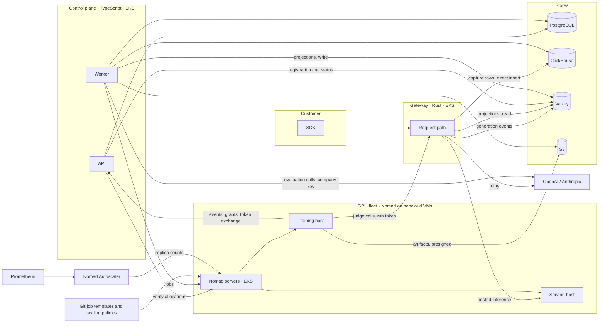
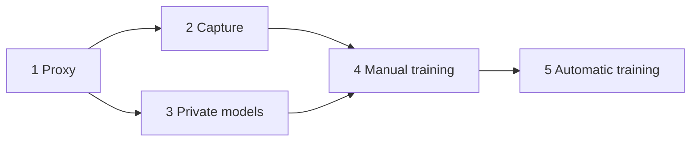

# Fine-tuning from traces: launch plan

Status: implementation plan for the backend. A gated console prototype exists; it does not prove the backend contracts are implemented or qualified. Each section states what must be true before its part can be enabled for customers.

The detailed contracts define the architecture. The [remaining simplification proposals](TASK_FINE_TUNING_SIMPLIFICATION_OPPORTUNITIES.md) do not change those requirements unless accepted into the owning contract.

## 1. What we are building

A customer points their OpenAI or Anthropic SDK at `api.gradiated.com`, keeps their provider key, and adds two headers: a Gradiated workspace key and a task label. Traffic passes through unchanged. With capture on, we store requests and responses per task. When a task has 500 new sessions, we train a LoRA adapter on an open base model, publish it as a private version, evaluate it against the provider model it would replace, and the customer promotes it by hand. Production is the task name, so switching is a one-line change, and the adapter can be exported.

| Property | How |
| --- | --- |
| No dataset preparation | The gateway captures traffic; datasets are built from it |
| Evidence before promotion | Every version is judged against the provider model on held-out traffic |
| Improvement over time | After promotion the customer's traffic runs through our model, so later versions train on its own trajectories with real outcomes |
| No lock-in | Adapters are exportable; the base is open-weight |

## 2. Services



| Component | Language, where | Owns | Talks to |
| --- | --- | --- | --- |
| Gateway | Rust, EKS | Authentication, routing, relay, hosted inference, capture rows, generation events | Providers (relay), serving hosts, ClickHouse (inserts), Valkey (read projections, write streams) |
| API | TypeScript, EKS | Management routes (console), run-token issuance, artifact grants, trainer events and runtime registration/status ingest | PostgreSQL, S3 (presign), Valkey (runtime status), Nomad API (allocation validation) |
| Worker | TypeScript, EKS, one leader | Loops: capture eligibility, automation, run orchestrator, evaluation, projector, ingestion | PostgreSQL, ClickHouse, S3, Valkey, Nomad API, providers (evaluation) |
| Nomad servers | Nomad CE 2.0.x, EKS StatefulSet | Host and GPU placement within workload constraints; serving restart, reschedule and rollout; allocation state and host liveness | Hosts (clients dial out), worker (API) |
| Serving host | VM at a neocloud; Nomad client; Docker | One base runtime (vLLM, later native engine) with adapters; host agent reports status | Gateway (private route), S3 (adapter download), API (status) |
| Training host | VM at a neocloud; Nomad client; Docker | One training job: trainer plus in-job inference engine | API (token, grants, events), S3 (grants), gateway (judge calls) |
| Trainer image | Python, Docker | The recipe steps, checkpoints, artifact upload | As above |
| Console | TypeScript, browser | Tasks, sessions, runs, versions, promotion, settings | API only |

Ownership rules: Rust owns everything on the request path. TypeScript owns policy, state and orchestration. Python exists only in the trainer image and the existing host reporter. PostgreSQL owns the model catalog, host inventory and run definitions. Git owns Nomad job templates and serving scaling policies. Nomad Autoscaler adjusts replica counts from Prometheus. Nomad owns physical placement and serving recovery. Each run has one execution. A host failure fails the run; neither the orchestrator nor Nomad retries it. Training admission is stored on the run. Hosts own on-demand adapter loading and eviction; there is no per-host adapter placement plan.

Valkey is the gateway's only required synchronous internal state store. Capture writes must not block inference. Training and control-plane operations may use ClickHouse as authoritative storage, including for recovery decisions. PostgreSQL run rows define runs; detailed execution history belongs in ClickHouse.

## 3. Data

The model catalog stays in PostgreSQL. Git serving declarations reference its immutable base-release IDs and define runtime and scaling configuration. Private adapters have no separate Nomad job.

### PostgreSQL

| Record | Purpose | Key fields |
| --- | --- | --- |
| `workspaces` (additions) | Capture switch and its audit | `trace_capture_enabled`, policy revision, changed by, changed at |
| `provider_models` | Configured OpenAI and Anthropic models | `id`, provider, exact API model name, display name, enabled; task reference and judge IDs reference these records |
| `tasks` | One customer workload | `id`, `workspace_id`, `slug` (immutable), display name, `base_release_id`, `reference_model_id`, `recipe_version`, `evaluation_judge_id`, `production_model_id`, production revision, sampling policy per day |
| `training_runs` | One configured execution | `id`, `task_id`, frozen `config`, `status`, `created_at`, `started_at`, `finished_at`, `cancel_requested_at`; config schema in RUN-01 |
| `models` (additions) | A private version | workspace, task, version string, base release, run, lifecycle (`candidate`, `available`, `retired`), artifact manifest reference, compatibility hashes |
| `instances` | One GPU host | provider, region, fault domain, GPU shape, capabilities, Nomad node id, allowed workload kinds, operator eligibility, quarantine reason, enrollment identity |

### ClickHouse

| Table | Rows | Written by |
| --- | --- | --- |
| `audit_events` | Best-effort structured action history: actor, action, resource, timestamp and changes | Shared control-plane audit helper |
| `generations` (v3) | One per request: route, mode, billing mode and exemption reason, provider, usage, cost, timing, served version | Worker, from `generation-events` |
| `traces` | One per captured request: metadata, whole request and response bodies, eligibility evidence, expiry | Gateway, direct async inserts |
| `training_run_events` | Structured JSON execution history per run; user logs, training and evaluation results, call history, summaries and checkpoint references | API (trainer events), worker (execution events) |

### S3 (`gradiated-<env>-artifacts-us-east-1`)

| Prefix | Content | Written by |
| --- | --- | --- |
| `bases/<base>/<hash>/` | Mirrored base weights and tokenizer | Operator operation |
| `runs/<run_id>/` | Input snapshot, package-generated datasets and splits, checkpoints, output adapter, and large evaluation artifacts | Worker supplies input; training package and evaluation worker write their own artifacts |
| `adapters/<hash>/` | Verified immutable adapter bytes and manifest for serving and export | Publisher (worker) only |

Run subdirectories organize files without separate storage workflows: `input/`, `dataset/`, `checkpoints/`, `output/`, and `evaluation/`. The training package owns dataset selection and splits. Evaluation manifests, candidate/provider responses and large judge evidence live under `runs/<run_id>/evaluation/`. Small settings, progress, verdicts, scores, usage, errors and summaries live in ClickHouse `training_run_events`, with immutable S3 references where needed. Do not duplicate result payloads across both stores.

These paths do not change retention: accepted datasets and evaluation evidence are retained; intermediate checkpoints and files expire under OPS-02. Do not apply one blanket TTL to `runs/`. The run ID identifies its workspace; grants and all reads check that ownership. Only the publisher writes `adapters/`; serving never loads unvalidated run output.

### Valkey

| Key | Content | Writer, reader |
| --- | --- | --- |
| `workspace:<id>`, `task:<ws>:<slug>`, `model:<id>` | Projections with `(bootstrap_epoch, revision)` | Worker projector, gateway |
| `deployment-status:<digest>`, `instance-status:<id>` | Host and runtime status, adapter states, TTL | Status ingest, gateway and worker |
| `generation-events` | One generation stream with explicit billing mode | Gateway, worker |

## 4. The life of a task

```mermaid
sequenceDiagram
  participant C as Customer
  participant G as Gateway
  participant W as Worker
  participant A as Control API
  participant N as Nomad
  participant H as Training host
  participant S as Serving host
  participant J as Training judge (open model, ours)
  participant E as Evaluation judge (frontier) + provider
  C->>G: requests with task label
  G->>G: relay or serve; capture row to ClickHouse
  Note over W: 500 new eligible sessions
  W->>W: freeze input snapshot
  W->>N: register batch job from run config
  N->>H: choose host, start job
  H->>A: exchange Nomad identity for run token (= start)
  A->>A: validate allocation and authorize run
  H->>H: package prepares dataset and splits
  H->>J: score candidates during training
  H-->>W: adapter in run output
  W->>W: validate, publish version (callable by id)
  W->>E: evaluate candidate vs provider
  Note over C: reads results, promotes by hand
  C->>G: model = task name
  G->>S: serve promoted adapter
```

## 5. Decisions

Each decision names the choice, why, and what was rejected. The contracts hold the detail.

| Area | Decision | Why | Rejected |
| --- | --- | --- | --- |
| Mode selection | The credential format decides: `grad_` key is native, provider key plus `grad_` key is proxy, run token is internal | No header means anything by presence; one rule for all callers | A mode header; a separate internal listener |
| Relay | Bytes unchanged; only `gpt-` and `claude-` names on their routes; local names resolve first | Never silently change a provider request; never leak a private name to a provider | A catch-all proxy; provider fallback on local errors |
| Capture transport | Gateway inserts whole bodies straight into ClickHouse from a bounded memory buffer; best effort | Megabyte bodies through Valkey memory needed caps that dropped agent sessions; cost after compression is small | Valkey stream spool; Kafka (later if durability is needed); delta or content-addressed storage |
| Eligible unit | A complete captured request; a session counts when it has one | Each request carries its full context; long or interrupted sessions still contribute | Requiring whole verified sessions |
| Session identity | `(workspace, task, trace id)`; the day only picks the sampling rate; 24 h inactivity ends it | Midnight must not split a session or double-count it | Day in the identity |
| Trigger | 500 new eligible sessions per task, one run in progress per task; no daily or organisation caps, no spend gate | Simple, observable; caps were not needed | Daily caps; budget ledger |
| Student models | Capable open MoE bases (GLM-5.3 Flash class); small dense students are not the norm | Target workloads are agentic; quality must hold | Gemma 4 31B as the default |
| Teacher | None. No supervised imitation of a teacher | Bases are capable; imitation caps at the teacher and needs a target pipeline | Teacher-generated targets |
| Training method | On-policy judged RL (GRPO) on real prefixes in one self-contained job; recipe steps versioned per base; exact step order still being designed | Beats imitation on agent tasks; needs no environment; capable bases produce rankable candidates | SFT-first; multi-node; live environments at launch |
| Training judge | A capable open model we host, never the student | Verifying is easier than generating; open model outputs may drive weights | Frontier model as reward (terms) |
| Frontier model | Customer-facing evaluation and rubric review only | Its outputs never drive weight updates | Frontier rewards |
| Provider output | Never a training target; recorded calls used only as hard-check references, listed under D01 | Provider terms | Training on provider outputs |
| Promotion | Manual only, including the first version; results shown, no recommendation or pass mark | Customers try versions first; automatic promotion is a later decision | Automatic first promotion; quality gates |
| Residency | Host-owned disk/RAM/GPU adapter caches; adapters load on demand from S3 | Local caches avoid distributed warm queues | Global cache synchronization; mandatory production preloading |
| Versions | `<task>/yyyy-mm-dd[-n]`; production is the bare slug; no customer retire | Readable, stable; promotion is the only state | Alias table; TTL field (replaced by operator cleanup after a year unused) |
| Internal auth | One run token with scopes and fixed expiry, no renewal or per-run revocation; Nomad identity exchanged once (that is the start permit) | One credential, one issuer, one verifier per language | Internal listener; static bearer; separate grant and permit systems |
| Fleet substrate | Nomad CE 2.0.x places jobs and recovers serving; Git defines serving policies; worker submits training jobs | Use the scheduler for placement; T0 qualifies networking and recovery on our VMs | Kubernetes per site; a thin agent of our own |
| Fleet at launch | Git job/scaling policies, Prometheus and Nomad Autoscaler; Nomad placement and serving recovery; manual VM provisioning | Use standard scheduling and autoscaling | Custom fleet coordinator; PostgreSQL serving targets |
| Capacity | Serving minima and workload constraints in job configuration; insufficient GPUs leave jobs pending and alert operators | Explicit configuration on a fixed fleet | Custom training-floor and reserve ledger |
| Retention | Sources 30 days; datasets and evaluation evidence indefinite; models no TTL with operator cleanup; intermediates 30 days | Training window versus evidence versus cost | A one-year TTL field |
| Judge and evaluation | Frontier judge, candidate against a fresh call to the replaced provider model only, position-swapped, results only | One comparison the customer can trust, same baseline for every version | Judge scores as gates; base and production arms |

## 6. Launch behaviour

| Topic | Behaviour |
| --- | --- |
| Switch | `trace_capture_enabled` per workspace, default off, enables capture and automatic training together |
| Tasks | Created from any valid labelled request, capture on or off; need base, reference model and recipe before training |
| Capture | Whole bodies, 16 MiB per request bound, straight to ClickHouse; no per-session cap |
| Versions | Immutable, validated; callable by exact name regardless of evaluation; publication never changes production |
| Promotion | Manual; B over A leaves A callable; no retire action |
| Fleet | Shared whole-host fleet; Git scaling policies and operator eligibility; Nomad Autoscaler counts; Nomad placement and serving recovery; training never interrupted for priority; VMs added by hand |
| Serving | At least two ready base replicas; each host fetches and caches exact adapters from S3 on demand; internal calls with run tokens |
| Evaluation | Frontier judge; candidate versus original provider; results, coverage, uncertainty; no recommendation |
| Data lifetime | Sources 30 days; datasets and evidence indefinite; models until operator cleanup; intermediates 30 days |

## 7. What exists today and what is new

| Exists | Reused for |
| --- | --- |
| Rust gateway: authentication, qualification, `switchyard_translation` to `ChatCompletionRequest`, admission, streaming, usage | All three APIs, hosted inference, relay, capture normalisation |
| TypeScript control plane: API, PostgreSQL, billing, projection, ingestion loops | Management routes, run state, projections |
| Valkey generation ingestion and billing finalization | One shared generation stream; explicit billing classification; existing charge semantics |
| RunPod pods with `report_status.py` | Host status reporting; adapter sync |

| New | Where |
| --- | --- |
| Credential modes, route allowlist, capture inserts, run-token verification, host-owned cold loading | Gateway |
| Run orchestrator with training job submission; shared Nomad submission helpers; evaluation worker, automation loop, projector revisions | Worker |
| Run-token issuer, artifact grants, trainer events ingest, runtime registration and status, management routes | API |
| Trainer image with versioned recipes | `product/inference/training/` |
| Nomad servers, enrollment, host images | Infrastructure |
| Workspace-scoped model names, private lifecycle, retention classes, role removal | Schemas and canonical docs |

`docs/ARCHITECTURE.md`, `docs/DATA_MODEL.md` and product instructions are updated in increment 1. The current zero-payload-retention rule and the organisation-role model are replaced there.

## 8. Build order: whole things behind flags

Each increment ships something usable behind its own flag. Shared foundations are built inside the first increment that needs them.



| Increment | What a customer or operator can do | Flag | Contracts | Built here | Opens when |
| --- | --- | --- | --- | --- | --- |
| 1 Proxy | Swap the base URL; see tasks and provider usage in the console; nothing stored | `proxy_enabled` per workspace | GW-01 to GW-04; OPS-01 projections; OPS-05 monitoring; task record and connection-status route | Generation v3 readers and writers; workspace-scoped names; configuration registry; canonical doc updates | S1; malformed, private-route and cross-tenant tests; SDK conformance on three APIs; monitoring-gap alerts |
| 2 Capture | Turn on the switch; see sessions as conversations, eligible counts, retention | The switch, behind an operator allowlist until increment 5 | CAP-01, CAP-02; DATA-01; OPS-02; OPS-01 barrier; OPS-03 cleanup | Direct capture inserts; `traces`; input snapshots; expiry and cleanup | S2; loss tests with ClickHouse down; expiry and cleanup end to end |
| 3 Private models | Call private versions by name; promote to the task name; export; configured serving minima hold. First adapters trained offline by us | `private_models_enabled` per workspace | ART-01; SERV-01 to SERV-04; FLEET-00 to 02, 04, 05; promotion and export routes; GW-04 release qualification | Nomad servers and enrollment; Git service jobs and scaling policies; Nomad Autoscaler; local drain and cleanup; bf16 LoRA base deployment; validator and publisher; explicit loader; projector prune | T0; S3 and S4 on the first base; S5 serving replacement; S6 publication and promotion races; base/loader readiness and independent host caches |
| 4 Manual training | Start a run by hand; see stages, log and evaluation; version published | `training_enabled` per workspace; operator or allowlisted console action | RUN-01 to RUN-05; EVAL-01 to EVAL-03; FLEET-01 batch jobs and FLEET-02 constraints | Orchestrator and admitted batch jobs; run-token issuer and verifiers; trainer image with first recipe; training-judge deployment; evaluation worker and provider client; `training_run_events` | Recipe design done; T1; S5 training starts and lost hosts; S6 crash matrix; S8 |
| 5 Automatic training | The switch alone: trigger, versions, promotion, the loop through production | The switch, open to all workspaces | DATA-02 input cutoff; continuation and disable in OPS-01 and OPS-04; FLEET-03 autoscaling; OPS-05 incidents | Automation loop; run input cutoffs; Nomad job priority; alerts and drills; restore drill; rollback | Launch parts of S7; T2, T3; repeated full cycle; capacity, drain, recovery measured; backup inventory; isolation review |

Increments 2 and 3 are independent; 3 is larger and starts first. Safety lands before enablement in every increment: cancellation, cleanup, publication and bounded internal admission exist before an automatic run depends on them. A later increment never supplies something an earlier one promised.

Outside these increments, each with its own design when wanted: customer adapter uploads, automatic VM provisioning, customer SLAs, management API keys and roles, a spend budget, interrupting training for priority.

Mapping to earlier drafts: increments 1 and 2 are the old M1 and M2; 3 is M3's serving half; 4 is M3's training half plus M4; 5 is M5.

## 9. Qualification

Each S item is an experiment with a hypothesis, fixed inputs, a resource ceiling, a timeout, cleanup and an expected artifact, all recorded before it runs. Local first; GPU, provider and cloud stages need a bounded allocation. A time ceiling is a stop rule, not a pass.

| Evidence | Must show | Gates |
| --- | --- | --- |
| S1 | Source feature matrix; fixtures that detect translation loss | Gateway and replay |
| S2 | Honest capture coverage; reproducible input snapshots and run cutoffs | Capture and automatic selection |
| S3 | Exact MoE layout on every load; host-owned caches; swap, cold-load and promotion timings | Adapter serving |
| S4 | Measured artifact, RAM, GPU, disk and validation envelopes | Every release and host shape |
| S5 | Local deadlines; host fencing; start, stop and recovery under faults | Training and host reassignment |
| S6 | Transaction-and-effect crash matrix; projection epochs; late writes; expiry; cleanup | Durable automation and lifecycle |
| S7 | Autoscaler policies, fixed-pool capacity limits, drain and recovery; a truthful availability number | Shared-fleet rollout |
| S8 | Judge calibration; comparison semantics; estimator fixtures | Published evaluation metrics |
| T0 | Pinned Nomad and VM networking, identity, constraints, device exclusion, serving recovery and rollout, training recovery disabled | Nomad infrastructure |
| T1 | The recipe with its permitted data and reward flow; complete checkpoints; correct artifact | Real training |
| T2 | Serving recovery, training failure, drain and cleanup | Each host action |
| T3 | Two-host production; any-one-host recovery; a repeated full cycle | Customer launch |

**S1 Protocol and routing.** A versioned corpus for all three APIs: text and tools, tool linkage, structured output, reasoning, state references, unknown controls, malformed and duplicate `model` keys, complete and partial streams, maximum bodies. Supported inputs keep meaning and served identity; unsupported ones produce the declared rejection or exclusion; relayed bytes are unchanged. Artifacts: capability matrix, fixtures, memory results, SDK conformance. Budget: two engineer-days; 15 minutes a corpus run.

**S2 Capture and input cutoffs.** Per-request eligibility under missing events, interrupted sessions, midnight, 24-hour inactivity, repeated contexts, maximum bodies, ClickHouse outages; 500 multi-step sessions; duplicate events; HMAC rotation; late arrivals; sources expiring during selection. Capture loss never blocks serving or fakes completeness; manifests reproduce exactly; automatic runs do not reuse the same input window; package selection and split correctness are qualified under T1. Artifacts: counters, fixtures, stored bytes, peak memory. Budget: two engineer-days; up to a million synthetic records; 30 minutes a run.

**S3 Adapter loading and residency.** Test the pinned host loader on first load, cache hit, eviction and restart. Validate exact bytes and MoE layout across tensor workers. Test concurrent requests for one adapter, memory saturation, cancellation, missing S3 objects and independent replica caches. No worker warm queue or synchronized cache map is required. Budget: one engineer-day prototype; up to four host-hours on one host. Stop on wrong-model output or active-use eviction. Two-host readiness needs T3.

**S4 Release resource envelope.** Inventory one release: tensor index, dtype, rank and modules, tokenizer, image, adapter, checkpoints, assets; plus extraction, validator memory, runtime and KV cache, handover assets, cleanup margin. Measure the host shape and every artifact limit; reject combinations that do not fit; block a release with no trainer memory evidence. Budget: one engineer-day analysis; two host-hours for a fit test. No downloads when arithmetic already fails.

**S5 Host ownership and termination.** Deterministic job registration; token exchange before compute; run status and execution-start evidence; duplicate allocations; stale leaders; disconnected hosts; control-store outages; normal and stuck streams; failed signal forwarding. No training compute without an accepted start; lost contact never frees a GPU; local deadline, exit and cleanup checked before every process start, including same-allocation restart. Launch: Nomad placement, training starts, serving restart and reschedule, new route registration, serving recovery. The orchestrator never competes with Nomad to replace serving, and Nomad never starts a second training execution. Budget: two engineer-days; two hours on the recovery host set. Stop on overlapping compute or failed termination.

**S6 Durable operations and storage races.** Failure before and after every transaction and effect: disable versus first exchange, publication, promotion, projection acknowledgement, source acceptance, checkpoint upload, operator cleanup; stale projections; Valkey bootstrap; fixed JWT expiry; cancellation without token revocation; provider slots; pending operations; conflicting retries; cleanup against issued URLs, multipart uploads and expiry. Exactly one result commits; restrictive state survives recovery; content stays inventoried; late writes cannot escape cleanup. Budget: two engineer-days; 30 minutes a run. S3 URL and versioning behaviour is checked on S3 itself.

**S7 Autoscaling and availability.** Test Git-defined Nomad Autoscaler policies against Prometheus fixtures and the actual serving runtime: min/max bounds, cooldowns, metric loss, insufficient compatible GPUs, pending jobs, recovery, scale-down and rollout interaction. Confirm that job redeployment does not overwrite autoscaled counts and the worker does not compete with the autoscaler. No global fairness or automatic node-provisioning claim. Budget: two engineer-days; 30 minutes per local policy test; bounded real-fleet qualification recorded before execution. Check Prometheus request counters, edge failures, probes and monitoring-gap alerts under capacity errors, cold loads, cancellations and interrupted streams. Do not claim an exact per-request ledger. Measure drain and recovery against the internal 99.9% target.

**S8 Evaluation and reporting.** Known synthetic outcomes: ties, position disagreement, absent production, unavailable references, correlated groups, identical arms, parser errors, partial usage and cost. Every score, interval and unavailable result recomputed independently under EVAL-02; missing results stay in coverage; no result controls promotion; rubric tested against instructions inside evaluated text. Budget: one engineer-day; real-judge calibration on at most 100 synthetic comparisons with a token budget; qualification applies only to that judge and configuration.

Every evidence record carries commit, image and dataset hashes, hardware, commands, ceiling, measured result, failure cases and scope. `specified`, `implemented`, `tested` and `qualified` are tracked separately. A citation supports an interface claim, not a pinned image. A document check proves only document consistency.

## 10. Configuration and acceptance

One typed configuration registry holds every value with owner, unit, default or required marker, validation range and evidence reference. Recipe and release limits must be finite and measured; a missing value blocks that recipe or release; there is no unlimited default.

Each PR maps the rule ids it touches to code, tests and evidence, and runs the DevEx check, generated API checks, the relevant tests and `git diff --check`. No customer data or credentials in fixtures.

Two designs remain before their dependent code: RUN-03 (the recipe, its environment, its permitted provider uses) and OPS-03 (real backup coverage and restore). They are finished in their owning contract before enablement.
