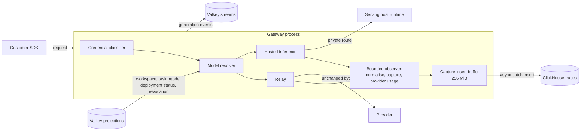

# Fine-tuning: gateway and capture contract

Status: implementation contract, not implemented. Owns `GW-01` to `GW-04` and `CAP-01` to `CAP-02`. All of it runs in the Rust gateway on the request path.

## Components

The gateway reads Valkey projections and writes ClickHouse and Valkey streams. It never queries PostgreSQL, never calls the fleet controller, and never waits on capture.

## Decisions in this contract

| Decision | Reason | Rejected |
| --- | --- | --- |
| Mode is decided by the credential format | One rule for every caller; no header can select a mode by being present | A mode header; a separate internal listener with a static token |
| Local names always resolve before relay | A private model name must never reach a provider; a local error must never fall back to a provider | Provider fallback; relay first |
| Relay only `gpt-` and `claude-` on their own routes | We claim relay only for the two providers we have tested | A catch-all proxy; every vendor family |
| Task slugs may not start with those roots or equal a catalog id | Those are the only names that could shadow a relay or a hosted model | A thirteen-vendor reserved registry |
| Relayed bytes are forwarded unchanged | Customers must see exactly the provider's behaviour | Rewriting, decompressing or retrying provider requests |
| Capture rows go from the gateway straight to ClickHouse, whole bodies, best effort | Megabyte bodies through Valkey memory needed caps that dropped agent sessions; ClickHouse compresses repeated text well | A Valkey spool; Kafka (an upgrade if durability is needed); delta or content-addressed storage |
| No per-workspace in-flight cap for relay; memory is the only bound | A relay costs memory and nothing else | A per-workspace request count |
| The eligible unit is a complete captured request | A request carries its whole context; long or interrupted sessions still contribute | Requiring verified whole sessions |
| Sessions are `(workspace, task, trace id)`; the day only picks the sampling rate | Midnight must not split or double-count a session | The day inside the identity |
| Sampling is per session, decided by a keyed hash | Whole sessions are captured or not; every gateway agrees | Per-request sampling |

## GW-01 Credentials and routes

**One credential per header.** Duplicate headers, combined bearer values, both `Authorization` and `x-api-key`, and malformed syntax are rejected. Classification order:

| Presented | Mode |
| --- | --- |
| A valid run token (RUN-04 in the run contract) | Internal hosted inference; never relayed |
| Something shaped like a run token but invalid or expired | 401, locally; never tried as a provider credential |
| A `grad_` key in the standard header | Native customer inference |
| `x-gradiated-api-key: grad_...` with no standard credential | Native customer inference |
| A provider credential plus `x-gradiated-api-key` | Proxy mode, after workspace and account checks |
| Two Gradiated credentials | Digests must match, else 401 |

Run tokens are identified by a dedicated JWT `typ`, issuer and audience under strict JOSE validation. A JWKS URL never comes from a request. Credentials are never logged. A provider credential lives in bounded request memory and goes only to its provider.

**Routes.** The edge and the gateway share one generated allowlist.

| Aliases | Method | Provider in proxy mode | Recorded |
| --- | --- | --- | --- |
| `/chat/completions`, `/v1/chat/completions` | POST | OpenAI, bearer | One terminal generation |
| `/responses`, `/v1/responses` | POST | OpenAI, bearer | One terminal generation |
| `/messages`, `/v1/messages` | POST | Anthropic, `x-api-key` | One terminal generation |
| `/messages/count_tokens`, `/v1/messages/count_tokens` | POST | Anthropic | Operational observation only |
| `/models`, `/v1/models` | GET | The provider of the credential type present | Nothing |

There is no catch-all and no legacy `/completions`, files, batches, provider fine-tuning, resource mutation or multipart API. Query strings pass through on permitted routes. `/internal/v1/` belongs to the API service and never falls through to relay. Internal inference uses the ordinary inference routes.

Native `/models` lists the workspace's private models and the global catalog. Proxy `/models` is the provider's own listing, unmodified; it does not imply every listed id can be relayed. The console links to the workspace model list.

## GW-02 Classification and naming

On a POST route that carries a model, the gateway parses a bounded JSON object and requires exactly one non-empty string `model`. Duplicate `model` keys, invalid JSON, a missing model or an unsupported content encoding are rejected locally in the caller's error envelope. After classification, a relayed body is forwarded byte for byte.

**Resolution order.**

1. Workspace-scoped local reservations, including retired, deleted and inaccessible ones. A local access or lifecycle failure is a local error.
2. In proxy mode only: an unresolved name starting with `gpt-` on an OpenAI route or `claude-` on an Anthropic route is relayed. The route never switches provider. Any other name is a local model error. A typo inside an admitted prefix reaches the provider; we do not claim to catch it.

Native mode never relays. Internal mode may use only the models named in its token.

**Names.**

| Name | Form |
| --- | --- |
| Production | The bare task slug |
| Exact version | `<task-slug>-<YYYYMMDD>`, then `-2`, `-3`, … for further versions that UTC day |
| Task slug | `^[a-z0-9][a-z0-9-]{0,63}$`; immutable; display name may change |
| Version string | At most 200 ASCII characters; checked integer ordinal; explicit failure on overflow |
| Internal model id | Globally unique; separate from the public name; keys artifacts and caches |

A version name is reserved once under the task lock; its date and ordinal persist across retries and midnight; nothing is allocated by counting rows; no reservation is reused. A slug that looks like a version name gets the normal uniqueness check and nothing special.

One `public_model_names` table: workspace, name, kind, owner id, tombstone; unique on `(workspace_id, name)`. Global catalog ids are a separate registry, and both are checked under one namespace lock. Collisions are reported without revealing another workspace's names. The same private name may exist in different workspaces. Every cache, negative cache, token count, retry, listing and load intent includes the workspace id.

**Reserved roots.** A task slug may not be `gpt`, `chatgpt`, `o1`, `o3`, `o4` or `claude`, nor one of those followed by `-` or a digit, nor an exact hosted catalog id, compared ASCII case-insensitively. Adding a root requires a collision audit and a migration of existing slugs. Reservation never enables provider routing.

**Labels.** One task label and one trace label. Duplicates, control characters or over-length values return 400. A well-formed task label that fails slug eligibility does not fail the request; the exclusion is recorded and no task is created. No task label means no capture. `x-gradiated-trace-id` is 1 to 128 characters from `[A-Za-z0-9._:-]`; an invalid value disables session capture with a diagnostic. Internal labels require a run token. Labels never become Prometheus dimensions.

## GW-03 Relay, memory and finalisation

**Request handling.** Buffer the request once as immutable bytes. Reserve memory before allocation; unknown length reserves the full cap. Release every permit on every exit. Observation and capture run in a separate bounded observer whose failure cannot fail the relay.

**Headers.** Remove hop-by-hop headers and anything named in `Connection`; `host`; content-length; proxy credentials; cookies; platform headers; edge forwarding headers. Reject an inbound `x-gradiated-hop`; add it upstream. Never follow redirects. Never retry a provider inference request.

**Responses.** Ask for identity encoding, disable automatic decompression, pass the provider's bytes and `content-encoding` through untouched, decode only in the observer. Strip hop headers, content-length, cookies and `alt-svc`. Add `x-generation-id`, the route identity and, for hosted requests, the resolved version. A provider failure before headers returns the caller's 502 or 504 envelope. A failure after partial output closes the stream and records the failure; no terminal success frame is invented. A client disconnect cancels upstream work. Unknown usage is null.

**Limits.**

| Setting | Initial value |
| --- | --- |
| Timeouts: connect, response header, idle, total | 10 s, 120 s, 120 s, 900 s; total starts before body buffering |
| `PROXY_MAX_REQUEST_BYTES` | 8 MiB; 413 above |
| `PROXY_REQUEST_BUFFER_BYTES` | 64 MiB per process |
| `PROXY_MAX_IN_FLIGHT` | Derived from the byte budget; initially 2,000 per process; 503 on overload; no per-workspace cap |
| `OBSERVER_BUFFER_BYTES` | 16 MiB per process |
| `CAPTURE_MAX_BODY_BYTES` | 16 MiB per request or response; truncated means ineligible |
| `CAPTURE_INSERT_BUFFER_BYTES` | 256 MiB per process; overflow drops newest captures and counts the loss |
| `CAPTURE_INSERT_BATCH` | Flush at 8 MiB or 2 s |
| Recorded exempt spool | 32 MiB, 8,192 records fleet-wide; maximum record size in the schema |
| SSE observer frame | 256 KiB; larger frames lose observation only |
| Model cache | 10,000 entries, 16 MiB per process, including in-flight loads; bounded negative entries |
| Projection cache | 1 s; no stale-on-error extension |

**Capture path.** After a response completes, the gateway appends a row (metadata plus whole request and response bodies, compressed) to an in-memory batch and inserts batches into ClickHouse `traces` with async inserts. If ClickHouse is down or the buffer is full, the newest captures are dropped, a loss counter increments, and the session's coverage evidence records the gap. Serving is never delayed. Whole bodies are stored per generation; agent sessions repeat their context every step and that growth is accepted. Settlement and recorded exempt events keep their Valkey streams. Automatic capture shedding changes an operational status, not the customer's switch.

**Modes.**

| Mode | Tenant check | Charge | Capacity | Terminal event |
| --- | --- | --- | --- | --- |
| Native customer | Workspace credential, visible model | Billed admission and finalisation | Physical deployment lease | Settlement stream |
| Hosted in proxy mode | Same; provider credential discarded before dispatch | Same | Same | Settlement stream |
| Provider relay | Workspace credential, active account | None | Proxy permits | Recorded stream, zero charge |
| Internal hosted | Run token, current tenant access, exact claims | None | Reserved capacity, or shared capacity above customer headroom, plus deployment lease | Recorded stream, zero charge |

Billed settlement scripts are unchanged. Exempt finalisation is idempotent by generation id, releases its permits, and records once within a 24-hour marker window; later duplicates are removed by logical dedupe. Exempt records never advance settlement watermarks. Adapter inference is billed at the base model's price. Internal evaluation and relay are zero-charge with their own cost observations.

## GW-04 Protocols and release qualification

All three APIs go through the existing Rust `switchyard_translation` into `ChatCompletionRequest`. TypeScript consumes the versioned normalised capture schema and never reinterprets provider wire formats.

**Nothing is dropped silently.** Source fields are validated before translation can discard them. Each qualified release has a generated matrix marking every source feature `supported`, `rejected` or `capture_ineligible`. A feature without an entry cannot be used for trained-adapter replay.

| Feature family | Behaviour |
| --- | --- |
| Text, system and developer messages, tools, text or structured tool results | Preserve bytes, order, tool ids, argument-to-result linkage, declared semantics |
| Images, audio, video, non-text output | Reject for trained adapters; exclude any capture prefix with media anywhere in its context; relay stays byte-preserving |
| Responses state (`store: true`, `previous_response_id`, `conversation`) | Reject before translation; never fetch history |
| Tool choice, parallel calls, response format, reasoning, stop controls, output budgets | Per-release capability with cross-protocol fixtures; unsupported controls rejected before dispatch |
| Streams and errors | Preserve caller protocol, served identity, normal completion; an incomplete stream is a failure |
| Unknown fields | Explicitly permitted extension, or error or exclusion; never dropped then treated as eligible |

A capture record carries the source protocol, translator version, normalised request and response, replay controls, loss diagnostics, source expiry and bounded wire evidence. Canonical JSON sorts object keys and preserves arrays and string bytes; Unicode is not normalised. `dedupe_hash` covers the normalised input and feature semantics; `replay_hash` adds output controls and the normalisation version. Samples are identified by immutable example and generation ids.

**Context limits.** An adapter inherits its base release's prompt, output and total context limits. A shorter training sequence never shrinks serving context. Over-limit input is rejected, not truncated. A smaller limit for one adapter needs reproducible base-versus-adapter evidence and a new visible contract.

A compatible tokenizer, template and parameter class is selected before tokenising; there is no retry into another class without repeating qualification and admission before output. Actual release and adapter digests are recorded. Release qualification evidence is append-only and never changes an adapter's artifact contract.

## CAP-01 Capture identity and eligibility evidence

Capture needs the workspace's current policy and a valid task label, and covers native, hosted and relayed requests. Internal requests never create tasks, are never captured, and earn no credit. A task is created only from valid non-internal traffic; a provider authentication failure or a malformed request cannot configure a reference model.

**Session.** `(workspace_id, task_id, supplied_trace_id)`. The UTC day of the first generation selects the sampling policy and source expiry; it is not part of the identity. A session ends, for counting, after 24 hours without a generation. Without a trace header, each generation is its own session. Sessions are never inferred from message overlap or Responses chains. The rule is documented for customers.

**Evidence fields per captured request:** `request_complete`, `terminal_outcome_known`, `capture_truncated`, `session_coverage` (`unknown`, `gap_observed`, `verified`), reason codes. Best-effort events cannot prove `verified` coverage because a missing event is invisible.

**Eligible unit.** A complete captured request: bodies complete and untruncated, outcome known. It stands on its own because it carries its full context. A session cut off later still contributes its earlier requests. Coverage is recorded and shown, never required. No grace period is claimed to prove completeness.

**Dedupe.** By immutable generation id. Different content under one id is quarantined. Rows are validated independently; one bad envelope cannot block others. A missing generation or cost observation does not hold up a valid capture. Every query deduplicates before joins and aggregates.

## CAP-02 Sampling and counters

Distinct counters with distinct names: observed sessions, sampled sessions, complete captured requests, eligible sessions, selected sessions, consumed session credit, excluded or unknown coverage. Body-free observation cannot establish eligibility. The console and the automation loop read the same eligible-credit view.

**Sampling.** A keyed HMAC of the session identity against the day's frozen policy, so every gateway makes the same choice. Key version and policy version are recorded; the identity key stays stable for the retained grouping window; rotation uses an explicit overlap mapping so it never manufactures credit; secrets stay out of records; old daily policies are kept through request and insert lag.

Target: 500 sampled sessions per task per seven days, a target and not a quota. Default probability 1.0. Once a day's observation coverage is complete, the next day's probability is `min(1, target / distinct_observed_sessions_in_last_7_days)`; with incomplete coverage the last valid probability is kept; a new task stays at 1.0. S2 measures usable yield.

No per-session generation or byte cap. The only size bound is `CAPTURE_MAX_BODY_BYTES` per request; an over-size request is truncated, ineligible, and marks a coverage gap. No customer request waits for capture.

Source expiry and ingestion follow the operations contract. The workspace switch is the only customer control.

## Required evidence

S1: route and credential ambiguity, protocol equivalence, unsupported fields, real transport bounds. S2: missing events, sessions crossing midnight, key rotation, repeated-context growth, credit and split protection. SDK conformance on all three APIs through the declared aliases. Memory and loss tests fill the capture buffer at maximum body sizes with ClickHouse unavailable, and stop recorded ingestion, while serving latency and billed settlement stay correct.
