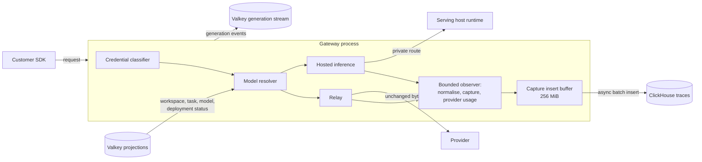

# Fine-tuning: gateway and capture contract

Status: implementation contract, not implemented. Owns `GW-01` to `GW-04` and `CAP-01` to `CAP-02`. All of it runs in the Rust gateway on the request path.

## Components

The gateway reads Valkey projections and writes ClickHouse and Valkey generation stream. It never queries PostgreSQL, never calls Kubernetes, and never waits on capture.

## Decisions in this contract

| Decision | Reason | Rejected |
| --- | --- | --- |
| Authenticate the workspace and retain the request provider key | Hosted billing and customer-key relay stay separate | Platform-funded relay; account switching after an error |
| Local names resolve first; request or workspace policy selects fallback | Private names never reach a provider; tasks own no fallback | Fallback for unknown names, access errors, or exact versions |
| Relay only `gpt-` and `claude-` on their own routes | We claim relay only for the two providers we have tested | A catch-all proxy; every vendor family |
| Task slugs may not start with those roots or equal a catalog id | Those are the only names that could shadow a relay or a hosted model | A thirteen-vendor reserved registry |
| Direct provider requests keep their body bytes; fallback replaces only the model value | Provider semantics stay intact; a task name never reaches the provider | Cross-protocol translation, decompression, or provider retries |
| Capture rows go from the gateway straight to ClickHouse, whole bodies, best effort | Megabyte bodies through Valkey memory needed caps that dropped agent sessions; ClickHouse compresses repeated text well | A Valkey spool; Kafka (an upgrade if durability is needed); delta or content-addressed storage |
| Customer-key relay uses bounded proxy permits | The customer pays the provider directly | Platform-funded provider inference |
| The eligible unit is a complete captured request | A request carries its whole context; long or interrupted sessions still contribute | Requiring verified whole sessions |
| Sessions are `(workspace, task, trace id)`; the day only picks the sampling rate | Midnight must not split or double-count a session | The day inside the identity |
| Sampling is per session, decided by a keyed hash | Whole sessions are captured or not; every gateway agrees | Per-request sampling |

## GW-01 Credentials and routes

**One credential per header.** Duplicate headers, combined bearer values, and malformed syntax are rejected. A Gradiated key and one provider key may occupy `Authorization` and `x-api-key`. Matching Gradiated keys across different headers are accepted; conflicting keys or multiple provider keys are rejected. Classification order:

| Presented | Mode |
| --- | --- |
| A valid run token (RUN-04 in the run contract) | Internal hosted inference; never relayed |
| Something shaped like a run token but invalid or expired | 401, locally; never tried as a provider credential |
| A `grad_` key in the standard header | Hosted inference only; provider calls require a customer provider key |
| `x-gradiated-api-key: grad_...` with no standard credential | Hosted inference only; provider calls require a customer provider key |
| A provider credential plus `x-gradiated-api-key` | Customer-key relay, after workspace and account checks |
| Two Gradiated credentials | Digests must match, else 401 |

Run tokens are identified by a dedicated JWT `typ`, issuer and audience under strict JOSE validation. A JWKS URL never comes from a request. Credentials are never logged. A provider credential lives in bounded request memory and goes only to its provider.

**Routes.** The edge and the gateway share one generated allowlist.

| Aliases | Method | Provider in proxy mode | Recorded |
| --- | --- | --- | --- |
| `/chat/completions`, `/v1/chat/completions` | POST | OpenAI, bearer | One terminal generation |
| `/responses`, `/v1/responses` | POST | OpenAI, bearer | One terminal generation |
| `/messages`, `/v1/messages` | POST | Anthropic, `x-api-key` | One terminal generation |
| `/messages/count_tokens`, `/v1/messages/count_tokens` | POST | Anthropic | Operational observation only |
| `/models`, `/v1/models` | GET | The provider of the credential type present | Nothing |

There is no catch-all and no legacy `/completions`, files, batches, provider fine-tuning, resource mutation or multipart API. Query strings pass through on permitted routes. Route `/internal/v1/*` to the API service only. Internal inference uses the ordinary inference routes.

Gradiated-only `/models` lists the workspace's private models and the hosted global catalog. Proxy `/models` is the provider's own listing, unmodified; it does not imply every listed id can be relayed. The console links to the workspace model list.

## GW-02 Classification and naming

On a POST route that carries a model, the gateway parses a bounded JSON object and requires exactly one non-empty string `model`. Duplicate `model` keys, invalid JSON, a missing model or an unsupported content encoding are rejected locally in the caller's error envelope. After classification, a direct provider body is forwarded byte for byte. GW-05 defines the sole model-field change for task fallback.

**Resolution order.**

1. Workspace-scoped task and version records, then exact hosted catalog ids. A local access or lifecycle failure is a local error. An existing active task or known hosted base model can use a request override or workspace default under GW-05. A name in the task/version format is always resolved locally; an unknown task or version never reaches a provider.
2. Customer-key relay permits an unresolved `gpt-` name on an OpenAI route or `claude-` name on an Anthropic route. Provider price metadata is optional and does not gate relay. The route never switches provider. Any other name is a local model error. A typo inside a customer-key prefix reaches the provider.

A Gradiated-only request cannot relay to a provider. Internal mode may use only the models named in its token and never uses a task fallback.

**Names.**

| Name | Form |
| --- | --- |
| Production | `<organization-slug>/<task-slug>` |
| Exact version | `<organization-slug>/<task-slug>/<version>`; trained versions are `yyyy-mm-dd`, then `-2`, `-3`, … for further versions with that input cutoff day |
| Organization slug | `^[a-z0-9][a-z0-9-]{0,37}[a-z0-9]$`; changeable; every slug the organization has held still resolves |
| Task slug | No `/`, at most 128 characters; unique within the organization |
| Version name | No `/`, at most 128 characters; unique within the task |
| Legacy name | A bare task or version name still resolves within the workspace |
| Runtime name | `<workspace-id>/<task-slug>/<version>`; keys the adapter on GPU runtimes |

Assign a version date and ordinal when publishing the model, under the task lock. A retry finds the model by its source run ID and returns the same name.

Enforce unique `(organization_id, slug)` on tasks, unique `(task_id, name)` on versions and one published model per source run. Resolve names through these records and `organization_slugs`; there is no other name registry. A request's slug must belong to the calling workspace's organization, and the name resolves within that workspace. Responses and usage record the canonical name with the current slug. Failed runs that publish no model need no public name.

Organization slugs may not equal the author segment of a hosted catalog id, so `<slug>/<task>` never shadows a catalog id; the gateway still rejects a name that matches both as ambiguous. Every cache, negative cache, token count, retry, listing and adapter request includes the workspace id.

**Reserved roots.** A task slug may not be `gpt`, `chatgpt`, `o1`, `o3`, `o4` or `claude`, nor one of those followed by `-` or a digit, nor an exact hosted catalog id, compared ASCII case-insensitively. Adding a root requires a collision audit and a migration of existing slugs. Reservation never enables provider routing.

**Labels.** One task label and one trace label. Duplicates, control characters or over-length values return 400. A well-formed task label that fails slug eligibility does not fail the request; the exclusion is recorded and no task is created. No task label means no capture. `x-gradiated-trace-id` is 1 to 128 characters from `[A-Za-z0-9._:-]`; an invalid value disables session capture with a diagnostic. Internal labels require a run token. Labels never become Prometheus dimensions.

## GW-03 Relay, memory and finalisation

**Request handling.** Buffer the request once as immutable bytes. Reserve memory before allocation; unknown length reserves the full cap. Release every permit on every exit. Observation and capture run in a separate bounded observer whose failure cannot fail the relay.

**Headers.** Remove hop-by-hop headers and anything named in `Connection`; `host`; content-length; proxy credentials; cookies; platform headers; edge forwarding headers. Reject an inbound `x-gradiated-hop`; add it upstream. Never follow redirects. Never retry a provider inference request.

**Responses.** Ask for identity encoding, disable automatic decompression, pass the provider's bytes and `content-encoding` through untouched, decode only in the observer. Strip hop headers, content-length, cookies and `alt-svc`. Add `x-gradiated-generation-id`, the route identity and, for hosted requests, the resolved version. A provider failure before headers returns the caller's 502 or 504 envelope. A failure after partial output closes the stream and records the failure; no terminal success frame is invented. A client disconnect cancels upstream work. Unknown usage is null.

**Limits.**

| Setting | Initial value |
| --- | --- |
| Timeouts: connect, response header, idle, total | 10 s, 120 s, 120 s, 900 s; total starts before body buffering |
| `PROXY_MAX_REQUEST_BYTES` | 8 MiB; 413 above |
| `PROXY_REQUEST_BUFFER_BYTES` | 64 MiB per process |
| `PROXY_MAX_IN_FLIGHT` | Derived from the byte budget; initially 2,000 per process; 503 on overload; no per-workspace cap |
| `OBSERVER_BUFFER_BYTES` | 16 MiB per process |
| `CAPTURE_MAX_BODY_BYTES` | 16 MiB per request or response; truncated means ineligible |
| `CAPTURE_INSERT_BUFFER_BYTES` | 256 MiB per process; overflow drops newest captures and counts the loss |
| `CAPTURE_INSERT_BATCH` | Flush at 8 MiB or 2 s |
| Generation event stream | One shared bounded stream; retain unacknowledged events and apply existing settlement backpressure; qualify capacity for combined traffic |
| SSE observer frame | 256 KiB; larger frames lose observation only |
| Model cache | 10,000 entries, 16 MiB per process, including in-flight loads; bounded negative entries |
| Projection cache | 1 s; no stale-on-error extension |

**Capture path.** After a response completes, the gateway appends a row (metadata plus whole request and response bodies, compressed) to an in-memory batch and inserts batches into ClickHouse `traces` with async inserts. If ClickHouse is down or the buffer is full, the newest captures are dropped, a loss counter increments, and the session's coverage evidence records the gap. Serving is never delayed. Whole bodies are stored per generation; agent sessions repeat their context every step and that growth is accepted. All generation events use the same `generation-events` Valkey stream. Automatic capture shedding changes an operational status, not the customer's switch.

**Modes.**

| Mode | Tenant check | Charge | Capacity | Terminal event |
| --- | --- | --- | --- | --- |
| Native customer | Workspace credential, visible model | Billed admission and finalisation | Physical deployment lease | `generation-events`, billable |
| Hosted in proxy mode | Same; provider credential discarded before dispatch | Same | Same | `generation-events`, billable |
| Customer-key provider relay | Workspace credential, active account | None at launch | Proxy permits | `generation-events`, exempt |
| Internal hosted | Run token, current tenant access, exact claims | None | Reserved capacity, or shared capacity above customer headroom, plus deployment lease | `generation-events`, exempt |

**One generation stream.** All terminal generation events use `generation-events` and one worker ingestion path into ClickHouse `generations`. The event schema includes:

| Field | Meaning |
| --- | --- |
| `billing_mode` | Required enum: `billable` or `exempt`, set by the gateway from the authorized request mode |
| `exemption_reason` | `provider_relay` or `internal_execution` for exempt events; null for billable events |
| Usage and charge | Actual usage and computed customer charge; unknown usage/cost stays null; exempt customer charge is zero |

Never infer billing mode from charge amount. A billable request can have zero charge. Provider cost observations are separate from the customer charge. Adapter inference uses the base model's price.

The worker validates and deduplicates all events by generation ID before writing `generations`. Settlement explicitly filters `billing_mode = 'billable'`. Exempt events cannot debit balances or contribute to billable settlement totals. Ingestion acknowledgement covers both event classes; stream position alone does not establish billing eligibility.

The gateway retains its existing billable charge calculation and atomic balance finalization. Update the event append destination and schema in that finalization path to use the shared stream. Exempt finalization releases its own permits and appends an exempt event without changing a customer balance. Both paths remain idempotent by generation ID. Stream retention and overload behavior must preserve unconsumed billable records under combined relay and internal traffic; a second exempt spool is not introduced.

## GW-04 Protocols and release qualification

Hosted requests on all three APIs go through the existing Rust `switchyard_translation` into `ChatCompletionRequest`. Provider relay bypasses translation; only its optional observer normalises content. TypeScript consumes the versioned normalised capture schema and never reinterprets provider wire formats.

**Nothing is dropped silently.** Source fields are validated before translation can discard them. Each qualified release has a generated matrix marking every source feature `supported`, `rejected` or `capture_ineligible`. A feature without an entry cannot be used for trained-adapter replay.

| Feature family | Behaviour |
| --- | --- |
| Text, system and developer messages, tools, text or structured tool results | Preserve bytes, order, tool ids, argument-to-result linkage, declared semantics |
| Images, audio, video, non-text output | Reject for trained adapters; exclude any capture prefix with media anywhere in its context; relay stays byte-preserving |
| Responses state (`store: true`, `previous_response_id`, `conversation`) | Reject before translation; never fetch history |
| Tool choice, parallel calls, response format, reasoning, stop controls, output budgets | Per-release capability with cross-protocol fixtures; unsupported controls rejected before dispatch |
| Streams and errors | Preserve caller protocol, served identity, normal completion; an incomplete stream is a failure |
| Unknown fields | Explicitly permitted extension, or error or exclusion; never dropped then treated as eligible |

A capture record carries the source protocol, translator version, normalised request and response, replay controls, loss diagnostics, source expiry and bounded wire evidence. Canonical JSON sorts object keys and preserves arrays and string bytes; Unicode is not normalised. `dedupe_hash` covers the normalised input and feature semantics; `replay_hash` adds output controls and the normalisation version. Samples are identified by immutable example and generation ids.

**Context limits.** An adapter inherits its base release's prompt, output and total context limits. A shorter training sequence never shrinks serving context. Over-limit input is rejected, not truncated. A smaller limit for one adapter needs reproducible base-versus-adapter evidence and a new visible contract.

A compatible tokenizer, template and parameter class is selected before tokenising; there is no retry into another class without repeating qualification and admission before output. Actual release and adapter digests are recorded. Release qualification evidence is append-only and never changes an adapter's artifact contract.

## CAP-01 Capture identity and eligibility evidence

Capture needs the workspace's current policy and a valid task label, and covers native, hosted and relayed requests. Internal requests never create tasks, are never captured, and do not count toward automatic training. A task is created only from valid non-internal traffic; a provider authentication failure or a malformed request cannot configure a reference model.

**Session.** `(workspace_id, task_id, supplied_trace_id)`. The UTC day of the first generation selects the sampling policy and source expiry; it is not part of the identity. A session ends, for counting, after 24 hours without a generation. Without a trace header, each generation is its own session. Sessions are never inferred from message overlap or Responses chains. The rule is documented for customers.

**Evidence fields per captured request:** `request_complete`, `terminal_outcome_known`, `capture_truncated`, `session_coverage` (`unknown`, `gap_observed`, `verified`), reason codes. Best-effort events cannot prove `verified` coverage because a missing event is invisible.

**Eligible unit.** A complete captured request: bodies complete and untruncated, outcome known. It stands on its own because it carries its full context. A session cut off later still contributes its earlier requests. Coverage is recorded and shown, never required. No grace period is claimed to prove completeness.

**Dedupe.** By immutable generation id. Different content under one id is quarantined. Rows are validated independently; one bad envelope cannot block others. A missing generation or cost observation does not hold up a valid capture. Every query deduplicates before joins and aggregates.

## CAP-02 Sampling and counters

Distinct counters with distinct names: observed sessions, sampled sessions, complete captured requests, eligible sessions, new sessions since the run cutoff, package-selected sessions, excluded or unknown coverage. Body-free observation cannot establish eligibility. The console and the automation loop read the same new-session view.

**Sampling.** A keyed HMAC of the session identity against the day's frozen policy, so every gateway makes the same choice. Key version and policy version are recorded; the identity key stays stable for the retained grouping window; rotation uses an explicit overlap mapping so it never duplicates session counts; secrets stay out of records; old daily policies are kept through request and insert lag.

Target: 500 sampled sessions per task per seven days, a target and not a quota. Default probability 1.0. Once a day's observation coverage is complete, the next day's probability is `min(1, target / distinct_observed_sessions_in_last_7_days)`; with incomplete coverage the last valid probability is kept; a new task stays at 1.0. S2 measures usable yield.

No per-session generation or byte cap. The only size bound is `CAPTURE_MAX_BODY_BYTES` per request; an over-size request is truncated, ineligible, and marks a coverage gap. No customer request waits for capture.

Source expiry and ingestion follow the operations contract. The workspace switch is the only customer control.

## Required evidence

S1: route and credential ambiguity, protocol equivalence, unsupported fields, real transport bounds. S2: missing events, sessions crossing midnight, key rotation, repeated-context growth, run cutoff boundaries. SDK conformance on all three APIs through the declared aliases. Memory and loss tests fill the capture buffer at maximum body sizes with ClickHouse unavailable, and stop shared generation ingestion, while serving latency and billed settlement stay correct.

Cold adapter requests go directly to a compatible base runtime after normal authorization and admission. The host loads and caches the exact adapter from S3 under SERV-01 and SERV-02. No Valkey warm key or worker request is involved. Cache status is an optional routing hint, not required authorization or readiness evidence.

## GW-05 Proxy implementation plan

The standalone [proxy feature plan](PROXY_FEATURE_PLAN.md) owns the current
scope, fallback policy, build order, and reporting contract. It supersedes
platform-funded relay and task-owned fallback proposals.

Provider relay is available to every active workspace without a proxy enable
flag or allowlist. It always uses a customer key supplied on the current request.
A Gradiated key alone authorizes hosted inference, not external provider calls.
There are no stored customer provider keys or platform provider credentials in
this feature. Keys remain in bounded request memory and go only to their provider.

Workspace `proxy_settings.fallback_models` contains nullable `anthropic` and
`openai` model IDs. It is strict typed JSON with a separate policy revision.
`x-gradiated-fallback-model` overrides the matching provider default for one
request. Strip this header before dispatch. No task has a fallback field.
A missing provider key makes default fallback unavailable; an explicit override
without a provider key returns `provider_key_required`.

For an active task without production, or a known hosted base target with no
healthy deployment before dispatch, select the effective fallback automatically
if its key is present. Exact private versions never fallback. Unknown names,
access errors, invalid input, insufficient hosted balance, and unavailable
projection state fail locally. Never start fallback after hosted dispatch.
Never retry a provider request or switch accounts after a provider error.

Keep the original provider-protocol request for fallback. Replace only its
model value. A direct frontier request keeps its exact requested model and
body bytes, with or without a task. Provider pricing is not a dispatch gate.
Missing prices or usage produce unknown analytics estimates.

All provider generations are exempt from Gradiated charges and settlement.
Hosted inference keeps its existing billing. Report route identity, fallback
source and reason, policy revisions, and nullable provider usage. Optional
public price snapshots support savings estimates only. Never debit an account
from a provider-cost estimate.

Implement relay, event separation, workspace defaults, optional task production
routing, and usage reporting in the sequence in the standalone plan. Capture,
training, run-token infrastructure, and private adapter publication are not
proxy prerequisites. Keep the existing settlement stream key unless a separate
migration is necessary; a stream rename is not a proxy prerequisite.
