# Fine-tuning: control, storage and operations

Status: specified design; deployment evidence and backup configuration still required. Owns `OPS-01` to `OPS-06`.

## Stores

| Store | Owns | Never used for |
| --- | --- | --- |
| PostgreSQL | Policy, task configuration, name reservations, run, spec and attempt state, credit, dataset and artifact manifests, evaluation operations, model lifecycle, promotion operations, serving targets, attempt admissions and accepted allocation bindings, host enrollment, purge inventories, audit outboxes | Bodies, high-rate telemetry |
| ClickHouse | Traces, generations, run events, evaluation results, availability events, fleet events, and summaries over them | Any recovery or lifecycle decision |
| S3 | Immutable content named by accepted manifests | Anything mutable |
| Nomad | Actual workload placement, allocation lifecycle and serving-process recovery | Product authorisation, training retry decisions or adapter readiness |
| Valkey | Gateway projections, admission counters, leases, settlement and recorded-event streams | Source of truth for anything |

Logical records live in the existing control modular monolith; schemas and constraints are described before implementation.

## Decisions in this contract

| Decision | Reason | Rejected |
| --- | --- | --- |
| PostgreSQL owns product state and accepted workload targets; Nomad owns allocation state; ClickHouse is observation; Valkey projections are rebuildable | One owner per kind of state; ClickHouse can be down without losing state | ClickHouse-driven decisions; Valkey as state |
| `MergeTree` plus explicit logical dedupe | Correctness never depends on background merges | `ReplacingMergeTree`, `FINAL` |
| Projections carry `(bootstrap_epoch, revision)` with compare-and-set; tombstones ordered | An old worker cannot resurrect a deleted model or reopen a policy | Last-write-wins projections |
| Restriction is a three-step barrier (intent and denial, project and acknowledge, commit) | Denial takes effect before the flag flips; nothing reopens through a stale snapshot | Flipping a boolean |
| Retention classes: sources 30 days, datasets and evidence indefinite, models by operator cleanup, intermediates 30 days | Training window, customer evidence and cost are different needs | One blanket TTL |
| Grants are scoped by the run token; no static IAM signer; presigned URLs at most 15 minutes | Least privilege with short-lived credentials | A long-lived signer user |
| Purge is a durable multi-step operation with a writer wait and a second sweep | Issued URLs remain bearer capabilities until they expire | Deleting a prefix once |
| Console-only management; one permission level for all active members | No customers yet; roles are removed rather than migrated | Role hierarchy; management API keys |
| Availability is a request ratio, 99.9% per month, unknown counts as failure | A number that cannot be gamed by missing telemetry | Uptime minutes |
| Standard managed backups of the stores in use | No custom backup service | A bespoke pipeline |

## OPS-01 Database authority and barriers

**Constraints.** Composite tenant-and-task foreign keys on datasets, runs, models, evaluations, promotion targets, artifact ownership. A production target must be in the same workspace and task and be available. Lifecycle (`candidate`, `available`, `retired`) and readiness (`ready`, `unavailable`) are separate columns. Catalog readers stay compatible through a migration adapter. Partial unique index: one non-terminal run per task. Unique operation identities. CHECK constraints on terminal timestamps and required fields.

Every JSON and event variant has a closed versioned schema with lengths, units and null semantics. Generation v3 makes API-key and release identity and unknown usage and cost nullable by mode; typed JSON paths and materialised columns migrate together; v1 and v2 rows keep their meaning; old rows, nulls and mixed readers are tested before v3 is emitted. Internal and relayed events never look like settlement rows.

**Projections.** Every projected resource carries `(bootstrap_epoch, resource_revision)`. The projector writes with a compare-and-set script accepting only a newer pair or identical content at the same pair; different content at the same pair is corruption. Tombstones follow the same order. Deployment heartbeats expire after 6 s; gateway caches last 1 s with no stale-on-error extension. Runtime registration validates actual Nomad allocation ownership and enrollment (FLEET-05). Status binds allocation id, engine boot id, release and protected-set acknowledgement; stale incarnations cannot overwrite current readiness. Nomad running state alone never opens routing.

**Restriction barrier.**

```mermaid
sequenceDiagram
  participant A as API
  participant PG as PostgreSQL
  participant W as Projector
  participant VK as Valkey
  participant G as Gateway
  A->>PG: 1. commit restriction intent (next revision) + denial projection intent
  Note over PG: new grants and first starts blocked from here
  W->>VK: 2. project denial (CAS on epoch, revision)
  VK-->>W: acknowledged
  Note over G: after the 1 s cache window the denial is effective
  A->>PG: 3. commit final policy state + audit; complete the operation
```

Concurrent intents on one resource are serialised. A projection failure leaves a visible pending restriction that retries; it never reports success or drops the denial. No transaction is held while waiting for Valkey. Reversal needs a newer revision. The projector treats a pending restriction as denial even if the stored boolean reads enabled; ingestion checks intent before accepting capture. Enabling is the inverse: commit and outbox, project, then report enabled. The console shows pending and effective separately. A started run's continuation authorisation is separate from capture permission.

**Valkey restore.** Admission starts closed for private and internal routes and capture. The controller installs a new bootstrap epoch, rebuilds every resource including intents and tombstones, reconciles physical leases or waits out their bounds, then declares the projection ready; gateways reject old or incomplete epochs. Billed inference keeps its existing recovery contract.

## OPS-02 Retention

| Content | Lifetime |
| --- | --- |
| Source traces and every copy or buffer | 30 days from trusted request start; reads and selection reject at expiry |
| Accepted datasets and final evaluation evidence | Indefinite, including copies of customer text; purge still applies |
| Published model payloads, manifests, serving caches | No expiry field; SERV-04 operator cleanup after 365 days unused |
| Intermediate checkpoints and retained run files | 30 days from the run's terminal `finished_at`, all attempts |
| Unaccepted staging, partial uploads, disposable caches | Operation deadline or source expiry, whichever first |
| Content-free audit, names, accounting, deletion evidence | Existing durable metadata policy |

Classes are independent: source expiry does not delete an accepted derivative; a derivative does not authorise new training from expired sources; export does not require keeping a training VM.

Accepting a dataset rechecks, in the transaction that commits the manifest and consumes credit, the current policy and continuation authority, every source id and its expiry; the transaction time must precede each source's expiry. Only that manifest moves copies into derivative retention. Before reading a source, access and expiry are validated; before writing staging, the inventory (names, class, deadline) is persisted.

Capture in flight during a disable or purge: the gateway rechecks policy before enqueueing; ingestion rejects expired or denied payloads and sweeps staged objects. Accepted data keeps its lifetime; started runs may use their accepted dataset.

Private data: `us-east-1`, encryption at rest, TLS, private bucket policies, separate publisher and trainer permissions. Platform processing in the US; providers process where they operate. No credential, signed URL or payload in logs, labels or events.

## OPS-03 Grants, purge and backups

**Grants.** A grant names a purpose; the server resolves one exact object and version. Authorised by the run token's `artifacts:read:<purpose>` or `artifacts:write:<purpose>` scope (RUN-04). Purposes: dataset input, accepted resume checkpoint, quarantined output, bounded intermediate output. Refused: arbitrary keys, prefix listing, cross-attempt access, the holdout. URLs last at most 15 minutes and no longer than the operation or source deadline. No static IAM signer: the control service's short-lived workload credentials sign, bounded by their validity; S3 and KMS access validated together. Job specs and Nomad snapshots hold identities, never signed URLs or provider keys. A write inventory precedes every PUT or multipart grant. Exports use the same exact-version inventory and lifecycle checks.

Storage facts that shape purge: an issued URL is a bearer capability until it expires, so denial cannot recall it instantly; a started GET continues after expiry; S3 delete markers do not erase older versions. [Presigned URLs](https://docs.aws.amazon.com/AmazonS3/latest/userguide/using-presigned-url.html), [version deletion](https://docs.aws.amazon.com/AmazonS3/latest/userguide/DeletingObjectVersions.html).

**Purge.**

```mermaid
stateDiagram-v2
  [*] --> restricting: deny tenant; stop grants, jobs, loads, provider operations
  restricting --> waiting_for_writers: quarantine compute; bound requests and tokens
  waiting_for_writers --> deleting: last write grant + max upload duration elapsed; inventory complete
  deleting --> verifying: all copies and non-current versions deleted; multipart uploads aborted
  verifying --> complete: second sweep matches inventory and tombstones
  verifying --> deleting: drift found
  complete --> [*]
```



A prefix poll is not verification. A PUT reused during the wait is removed by the final sweep. Errors keep the operation pending with bounded backoff and operator visibility. A purge cannot complete with unknown write ownership. Private artifacts are workspace-scoped, so no cross-tenant reference counting; shared base assets have explicit owners and are deleted only when unreferenced.

**Backups.** Standard managed mechanisms of the stores in use. Infrastructure setup records coverage, retention, restore procedure and physical-deletion bounds before launch. Every restore applies current tombstones and expiry before access reopens. Exports are outside managed-copy purge.

## OPS-04 Management and lifecycle

Console-only management with authenticated sessions and the generated client. Every route has a described schema, metadata, generated OpenAPI, client and tests. All active organisation members have equal authority; every action checks membership, ownership, lifecycle and request protections. Inference keys and run tokens never authorise management. Platform operators are separate. A live organisation keeps at least one active human member. Role-specific schemas are removed in increment 1 (no customers, so no live migration; if that changes, migrate safely).

No customer retire or unpublish action; `retired` is for operator cleanup; promotion never retires the previous version.

| Action | Checks and result |
| --- | --- |
| Read task, run, model, evaluation | Membership, scope; bounded pagination |
| Set the capture switch | Disclosure; OPS-01 barrier; no second switch |
| Configure a task | Immutable slug; exact base, reference, recipe; field errors |
| Request a run | Switch and permission; valid sources and recipe; one non-terminal run per task; no caps |
| Cancel a run | RUN-02 and RUN-04 durable cancel; models stay available |
| Promote or roll back | SERV-03; any valid available version; previous stays callable; no score gate |
| Export a version | Membership; not restricted for deletion; short-lived exact-object grant |
| Archive task or workspace | Restrict new capture, inference, runs; stop owned work; keep records; no implicit purge |
| Purge workspace | Explicit irreversible confirmation; OPS-03 operation |

A task seen in valid traffic exists before configuration, collects eligible data when the switch permits, and shows `configuration_required` until base, reference, recipe and permissions are explicit. A base is never guessed from a provider name. Slugs never rename. Restore is an explicit revisioned action.

| Method and path | Request and response |
| --- | --- |
| `GET /workspaces/:workspaceId/tasks` | Cursor, page size; summaries and next cursor |
| `GET /workspaces/:workspaceId/connection-status` | Latest valid customer request and task from generations; capture policy; ingestion freshness; works with capture off |
| `POST /workspaces/:workspaceId/tasks` | `slug`, `display_name`, idempotency key; 201 or existing identical result |
| `PATCH /workspaces/:workspaceId/trace-capture` | `enabled`, `expected_revision`, disclosure version, idempotency key; 202 policy operation |
| `PATCH /tasks/:taskId` | Expected revision plus any of `display_name`, `base_release_id`, `reference_model_id`, `recipe_version`, `evaluation_judge_id`; 200; no slug change |
| `POST /tasks/:taskId/training-runs` | Expected task revision, idempotency key, optional explicit source selection; 202 run |
| `GET /training-runs/:runId` | Stage, deadlines, attempts, blocked reason, model and evaluation references |
| `POST /training-runs/:runId/cancel` | Expected revision, idempotency key; 202 |
| `POST /tasks/:taskId/promotions` | Target model id, expected production revision, idempotency key; 202 |
| `POST /models/:modelId/exports` | Idempotency key; 201 bounded download operation |
| `POST /tasks/:taskId/archive`, `POST /workspaces/:workspaceId/archive` | Expected revision, idempotency key; 202 |
| `POST /tasks/:taskId/restore`, `POST /workspaces/:workspaceId/restore` | Expected revision, idempotency key; 202, subject to policy and capacity |
| `POST /workspaces/:workspaceId/purge` | Expected revision, confirmation bound to the workspace id, idempotency key; 202 |
| `GET /operations/:operationId` | State, result reference, reason, observed revision |
| `GET /tasks/:taskId/models`, `GET /models/:modelId`, `GET /evaluations/:evaluationId` | Scoped views, bounded pagination |

Unknown fields rejected. Same key and payload returns the same operation; different payload 409. 401 without authentication; 404 for inaccessible resources with no cross-tenant disclosure; 409 stale revision; 422 field errors. Pending operations are never shown as completed. Membership removals serialise on the organisation row.

**Console.** Connection panel polls every 5 s while open and distinguishes request received, waiting for ingestion, capture off, eligible data accumulating; an empty capture table never means no connection. The switch "Capture traces and train models" is shown before and after the first task. Production version is distinct from newest. Shown: observed, captured, eligible and consumed counts; run stage and blocked reason; partial evaluation coverage; exact version identity; production status; last use and export; pending promotion; capacity failures. Not shown or claimed: upload controls, management tokens, roles, automatic promotion, quality badges, recommendations, "all text deleted at day 30", or an SLA.

**Operator commands.** `stop-new-automation` (blocks new runs and first starts; started runs continue), `cancel-run`, `retry-run` (new linked run), `quarantine-host`, `retire-unused-models` (SERV-04). `quarantine-host` closes eligibility and new local compute; it does not claim that a running process has stopped. Reuse requires FLEET-04 cleanup or fencing evidence. Routine role changes wait for started training to finish. No patching of run stages, no bypass of validation, no management authority for inference keys.

## OPS-05 Availability, telemetry and incidents

Target: **99.9% successful eligible hosted-inference requests per UTC month.**

| Rule | Detail |
| --- | --- |
| Denominator | Authenticated, structurally valid requests for an offered hosted model, including exact-version tests and requests failing at the edge or capacity admission |
| Excluded | Provider relay, internal evaluation, invalid credentials or requests, genuine account-policy rejections (distinguished from capacity 429 by reason) |
| Success | The expected complete response or stream |
| Failure | Capacity 429, 503, failed cold loads, drain interruptions, edge or gateway failures, incomplete streams, unknown outcomes |
| Cancellation | Excluded only with independent evidence the caller cancelled before any service failure |
| Retries | Each is a request |
| No traffic | `no_data` |
| Unknown coverage | Report `incomplete`, never passing |

Events travel on a content-free path independent of capture: edge request id; gateway classification and terminal facts with boot id and sequence; edge counters reconciled against gateway counts; pre-authentication failures keep unknown classification. Schema: version, request and generation id, trusted times, process identity and sequence, scoped model and organisation ids, mode, classification, outcome, reason. Finalisation window: 24 hours after the maximum request deadline; provisional before, then missing outcomes are failures and missing classification is incomplete. Later facts create a new summary revision with an audit reason. Summaries and coverage manifests are kept indefinitely; raw events for at least the window.

The consumer is a worker loop on a bounded Valkey stream with byte and count accounting; overflow counts loss and marks the interval incomplete; it never blocks inference or uses the settlement stream. Generation evidence reconciles known requests; edge and Prometheus counters detect gaps. S7 injects loss into each path.

Grafana: request outcomes, cold-load and drain failures, desired versus ready capacity, floor deficits, training-floor occupancy, spare scenarios, queue and run age, capture loss, eligibility yield, projection age, cache bytes, provider usage and cost coverage, cleanup lag; bounded labels; per-task and per-organisation views from scoped database queries.

Incidents: Incident.io, 24/7 coverage, 300 s human acknowledgement target, escalation and backup responders, drills before launch. No customer-facing SLA. Runbooks: stop automation, add capacity, quarantine, failed promotion or projection, bad-release rollback, expiry and purge, reserve restoration.

## OPS-06 Rollout and rollback

Readers and schemas expand before writers. Gateway readers for private ids, run tokens, policy revisions and tombstones deploy before the worker publishes those records. Membership contract deploys coherently across API, client and console. Model and deployment classes are registered with workspace identity.

Rollout uses internal enable flags per increment, not customer switches; customer capture stays disabled until the capture-to-run path is ready. Old workers reject unsupported schema versions; new writers enable only when all consumers report compatible versions; mixed-version behaviour and Valkey bootstrap are audited.

Rollback after the first private model or run exists keeps compatible readers and denial and tombstone support: disable writers, bound or drain work, restore a known compatible release; never roll back to code that could relay a private model id or ignore a policy revision. Destructive down-migrations need an explicit plan; disabling never deletes customer state. The last compatible rollback release is recorded and tested before launch.

## Required evidence

S6: transactional effects, stale leaders, expiry, grants, purge, restore. S7: availability counting; response and recovery faults. API tests: wrong tenant, equal member permissions, inference-token rejection, session protections, idempotency, every lifecycle action. Infrastructure evidence: real backup coverage and restore results.
