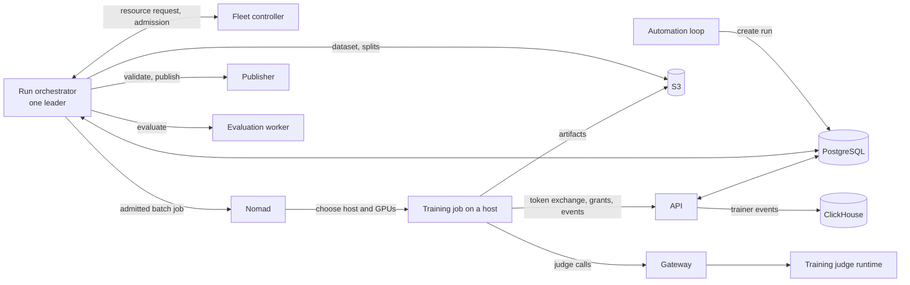

# Fine-tuning: dataset, run and trainer contract

Status: implementation contract, not implemented. Owns `RUN-01` to `RUN-05` and `DATA-01` to `DATA-02`. The exact recipe is a separate design under RUN-03; the rest holds for any recipe.

## Components



## Decisions in this contract

| Decision | Reason | Rejected |
| --- | --- | --- |
| PostgreSQL is the queue and the authority; one orchestrator leader under an advisory lock | A few thousand transitions a day need transactions, not throughput; the row is queryable and resumable | Kafka or another broker |
| Every stage is idempotent by effect; recovery is "re-execute the stage" | A crash anywhere is handled by one rule | Per-stage resume cursors |
| Eligibility is per complete request, one predicate shared by console, automation and builder | The number the customer sees is the number the builder uses | Separate counts; whole-session requirement |
| Trigger is 500 new eligible sessions per task; no daily or organisation caps | Simple and observable | Run caps; budget ledger |
| Selection consumes only what it includes; unselected sessions keep credit | Trigger volume and dataset size are different things | Consuming all credit on trigger |
| Split protection is sticky and persisted per group | Holdout must never leak into training across runs | Re-splitting per run |
| Starting adapter is the production adapter when base and recipe match, else the base | Continues what customers use; never silently picks the newest candidate | Newest version |
| A recipe is versioned steps in `training-release.yaml`; the interface is fixed, the steps are not | Step order is still being designed; nothing else should depend on it | Hard-coding one algorithm |
| No training on provider output | Provider terms | Teacher targets from provider answers |
| One internal credential, the run token, with scopes and variable lifetime | One issuer, one verifier per language; the Nomad exchange is the start permit | Internal listener; static bearer; separate grant and permit systems |
| Long-lived tokens are revoked by epoch, short ones by expiry | Training tokens last hours; cancellation must bite in seconds | Expiry-only revocation |
| Internal admission by reserved capacity or customer headroom, no fixed counts | Customers first without a global number | Fleet-wide concurrency constants |

## RUN-01 Identities and owners

| Identity | Meaning | Changes |
| --- | --- | --- |
| `run_id` | One requested execution | Never |
| `spec_hash` | Settings frozen at creation; never includes later grants | Never |
| `dataset_manifest_hash` | Selected content, committed once | Never once committed |
| `attempt_id`, attempt number | One trainer execution; a lost-host retry is a new attempt | Per attempt |
| `state_revision` | Bumps on every durable state change | Often; never in an input identity |
| `admission_revision` | Orders training admission and withdrawal on the attempt | Before start or on withdrawal |
| Nomad allocation, node and trainer boot ids | Actual execution; bound to the attempt by the first accepted exchange | Fixed after exchange; replacement requires a new attempt |
| `policy_revision` | The workspace's authorisation revision | On policy change |
| `authorization_id`, `auth_epoch` | Start or continuation authorisation and its revocation generation | On authorisation change |
| `operation_id` | One external side effect with an immutable input hash | Per side effect |

**The spec freezes:** workspace and task; policy and disclosure version; data cutoff; base with tokenizer and template hashes; recipe id, schema, hash and image; starting adapter; comparison settings; evaluation protocol; split and hash versions; execution requirements; every finite limit. The starting adapter is the current production adapter only when it exists on the same base and recipe and the release declares it compatible; otherwise the base.

Preparation operations are keyed `run_id + spec_hash + step + ordinal` so they can run before a dataset hash exists; later operations also bind the dataset hash; attempts bind the accepted checkpoint and resource admission; the first token exchange binds the actual Nomad allocation. A renewed token or new host never changes the spec.

**Owners.** PostgreSQL owns accepted outcomes. The orchestrator owns run and attempt state, publication intent and training job submission, cancellation and retries. The fleet controller owns resource admission and protected dependencies. Nomad chooses the host and GPUs; its templates cannot restart, reschedule or replace a training execution. Shared Nomad helpers follow FLEET-01. Observers report; the orchestrator validates observations before advancing a stage. Every durable write checks its expected revision.

## DATA-01 Selection and split protection

**Eligibility.** A request is eligible when: the workspace's current policy and access allow it; it is a supported normalised text-or-tool request; its content is complete and untruncated; it fits the recipe's token limit; it did not come from an internal caller. Session coverage is recorded and shown, not required.

**Freezing input.** The data cutoff is fixed at run creation. The builder stages an inventory (exact source ids, hashes, trusted expiry, task, policy) and commits only unexpired sources through the manifest transaction in the operations contract. A committed dataset supports its run after the sources expire. Later arrivals never change it. Contamination found later is recorded as separate evidence.

Every normalised request keeps its real context. The recipe's input adapter converts selected records to the recipe's format (RUN-03). Recipe-specific fields live only in the versioned recipe schema.

**Splits.** Example ids are stable regardless of group changes. Membership and consumption are persisted in `task_dataset_memberships` without bodies. Grouping uses exact normalised-input hashes and session grouping first; near-duplicate grouping uses a versioned algorithm qualified in S2.

| Group merges with | Result |
| --- | --- |
| Nothing (new) | Task-scoped hash: 10% holdout, then 5% of the rest for trainer validation |
| Training | Training, unless a protected member is found |
| Validation | Validation protection persists |
| Holdout | Holdout protection persists |
| Prior training and validation or holdout | Contaminated: excluded from future qualification sets; prior evidence that used it is annotated |
| Validation and holdout | Protected from training; excluded from future final holdout |
| Unknown or overflowing candidate | Excluded pending bounded analysis; a stopped search never means "no leakage" |

A near-duplicate index reports bucket overflow separately from group size. Grouping runs to a declared watermark. A rule upgrade creates new evidence and conservative exclusions; it never rewrites manifests or releases protected examples. S2 picks the simplest method that meets the contamination policy; exact-only grouping cannot claim near-duplicate protection.

## DATA-02 Credit

Trigger: 500 new eligible sessions per task, where an eligible session has at least one new eligible request. One non-terminal run per task. No daily or organisation caps.

A run triggered by 500 sessions may select fewer, within the recipe's example and token limits. Selection consumes only included sessions, once, across train, validation and holdout. Unselected sessions keep credit.

Run creation reserves candidate credit under the task lock. Groups are taken whole in deterministic order (newest completion, hash tiebreak). Groups that do not fit are skipped; a group that could never fit is marked `recipe_group_too_large` for that recipe version and stops triggering runs until inputs or limits change.

The selected manifest, consumed ids, exclusions and next stage commit in one transaction after content verification. Cancel before that commit consumes nothing; cancel after does not recreate the dataset. A content failure records the exact inputs and recipe version, so a new cutoff alone cannot retry identical content. An infrastructure retry reuses run and dataset.

A manual run follows the same access, expiry and minimums, and may explicitly reuse retained inputs only while their eligibility and reuse authorisation hold. An operator retry after a terminal run is a new linked run.

## RUN-02 States and deadlines

Every side effect: persist intent; perform; reconcile an uncertain outcome by exact identity; validate; commit the next state with a revision compare-and-set. No transaction is held across a network call, a training job, a drain or a startup.

```mermaid
stateDiagram-v2
  [*] --> queued
  queued --> building_dataset
  building_dataset --> awaiting_capacity
  awaiting_capacity --> preparing_attempt: resources admitted; attempt persisted
  preparing_attempt --> training: first token exchange
  training --> verifying: job exit, artifact in quarantine
  verifying --> awaiting_publication_capacity
  awaiting_publication_capacity --> publishing
  publishing --> evaluating: version callable by id
  evaluating --> succeeded
  training --> preparing_attempt: lost host, one retry
  queued --> cancelling
  building_dataset --> cancelling
  awaiting_capacity --> cancelling
  preparing_attempt --> cancelling
  training --> cancelling
  evaluating --> cancelling
  cancelling --> cancelled
  building_dataset --> failed
  training --> failed
  verifying --> failed
```



| Stage | Entered when | On failure or cancel |
| --- | --- | --- |
| `queued` | Settings, name reservation, data cutoff exist; policy permits | No permit or GPU; queue deadline fixed |
| `building_dataset` | Inventory staged; manifest produced; recipe inputs prepared | Reuse accepted operations; stage deadline; cancel discards staging |
| `awaiting_capacity` | Dataset accepted; recipe dependencies and host shape requested | No worker permit; pending, not resubmitted |
| `preparing_attempt` | Admission, immutable job spec and id persisted; Nomad placement and host preparation may still be pending | Admission withdrawable until first exchange; latest admission and policy rechecked; preparation deadline includes placement and prefetch |
| `training` | First token exchange commits authorisation; trainer runs under local deadline | One lost-host retry; never evicted for priority |
| `verifying` | Output inventory accepted for validation; GPU cleanup proceeds separately | Invalid output fails the run |
| `awaiting_publication_capacity` | Valid artifact needs release qualification or base floor | Holds artifact and intent, not the GPU |
| `publishing` | Final bytes qualified; policy and lifecycle pass | Commit exact-id availability, then project; retry projection |
| `evaluating` | Version testable; arms run under their bounds | Judge failure cannot withdraw publication or retrain |
| `cancelling` | Durable cancel intent recorded | Stop calls and renewal; tokens follow RUN-04; stop compute; cleanup or quarantine |
| `succeeded`, `failed`, `cancelled` | Immutable timestamp and reason | Never reopened; retry is a new linked run |

Publication never sets the production pointer. Cancel after publication returns that outcome; the model stays available. A failed evaluation is recorded separately. No quality threshold controls any stage.

**Deadlines.** Persisted: `queue_deadline_at`, `run_deadline_at`, `stage_deadline_at`, `attempt_deadline_at`, retry-window start, next retry, attempt count. Deployment configuration supplies queue and run limits before automation is enabled; recipe qualification supplies preparation, execution, upload and stage limits; an unset value blocks the recipe with `unqualified_limits`. The queue deadline starts at creation. The run deadline never extends. The attempt deadline is the lesser of remaining run time and the recipe's qualified attempt duration, anchored before setup, enforced locally by the trainer. SIGTERM, then 60 seconds of grace. A 7,200-second attempt is allowed only for a recipe measured to fit it.

**Retries.** Infrastructure failures back off 30 to 900 seconds within a persisted six-hour window and the remaining deadlines. Out-of-memory after a passed GPU-free check is a recipe or content failure. A failed GPU-free check quarantines the host. A lost host is retried once on a new attempt and job from the accepted checkpoint. Invalid hashes, templates or manifests end the attempt. Uncertain registration is reconciled by `training-<run_id>-<attempt>` and the spec hash. A conflicting spec blocks that job and admission for operator review. Before an allowed lost-host retry, close the old attempt authorisation and revoke its token epoch; a recovered old allocation cannot submit an accepted result or resume calls. Create a new attempt, resource admission and job, within the existing retry limit. PostgreSQL loss stops new application side effects and first exchanges; Nomad serving recovery remains independent. Running training obeys its local deadline. A terminal run never proves a free GPU. The host-local guard must prove process exit, GPU cleanup and file cleanup before another process starts; otherwise it quarantines the node (FLEET-04).

## RUN-03 The trainer interface

Code under `product/inference/training/`: pinned image, locked dependencies, `train.py`, release manifest, tests. A recipe is an ordered list of versioned steps in `training-release.yaml`; resolved step parameters are frozen in the spec. The recipe design decides the steps and order. No recipe trains directly on provider output.

| Boundary | Requirement |
| --- | --- |
| Input | Run, attempt, spec and dataset ids; canonical base, tokenizer, template; recipe schema and hash; starting adapter or base; named permitted inputs; fixed deadline |
| Capabilities | GPU, CPU, RAM, disk shape; isolation requirement; local and external inference dependencies; network destinations |
| Start | Nomad selects the host; the host prepares and verifies the declared assets within the attempt deadline; the trainer exchanges identity before GPU compute, rollout or judge calls; no trainer-side base download or upstream token |
| Progress | Closed bounded events; observational only |
| Checkpoint | Immutable manifest after every step: adapter, optimizer, all resume state |
| Resume | `resume_checkpoint` input, resolved server-side to one accepted prior-attempt manifest in the same run |
| Stop | Local deadline and cancel handler; bounded cleanup; never interrupted for priority |
| Result | Deterministic canonical adapter; dependency and config hashes; output inventory; validation evidence; terminal code |

Before the trainer is written, the recipe design defines environment semantics, admissible provider data, the reward and judge flow, optimizer and checkpoint state, input construction and correctness tests; provider use is qualified against that flow; every judge dependency is declared and protected by the fleet controller before admission. No execution of customer tools is authorised by this plan.

The trainer works in `/tmp/gradiated/<run_id>/<attempt>/<allocation_id>` (mode 0700), reads base weights read-only, requests grants by purpose (the server picks the object), and has no prefix listing, arbitrary output path or holdout access. A previous attempt's output is reached only through an accepted checkpoint input.

## RUN-04 The run token

One internal credential. It authorises internal inference, artifact grants and trainer events; its first exchange commits a training start; it travels on ordinary gateway routes and scoped API routes.

```mermaid
sequenceDiagram
  participant N as Nomad
  participant T as Training job
  participant A as API (issuer)
  participant G as Gateway
  participant S as S3
  N->>T: start with workload identity
  T->>A: POST /internal/v1/run-tokens (Nomad identity)
  A->>A: validate actual allocation and admission; atomically bind first start
  A-->>T: run token, scopes, expiry = attempt deadline
  Note over A: exchange recorded as the attempt's start
  T->>A: grant (artifacts:read:dataset)
  A-->>T: presigned URL
  T->>S: GET
  T->>G: judge calls (inference:judge)
  T->>A: events (events:write)
  T->>A: renew with current token
```

| Claim | Content |
| --- | --- |
| Header | Fixed algorithm, `typ`, issuer, audience `internal` |
| Subject | `run:<run_id>:<attempt>` |
| Tenant | Organisation, workspace |
| Binding | Immutable spec identity, `authorization_id`, `auth_epoch` |
| Time | Issue time, expiry, `jti` |
| `scopes` | `inference:judge`, `inference:evaluation`, `inference:base_probe` (each with exact model and release ids); `artifacts:read:<purpose>`; `artifacts:write:<purpose>`; `events:write` |

One verifier library in Rust and one in TypeScript, generated from the same claims schema, both reading the API's JWKS.

**Lifetime.** The mint route takes a requested lifetime, capped per scope: worker tokens for evaluation, probes and preparation default to 15 minutes; a training job's token lasts to its attempt deadline so it never renews mid-step. No token outlives its operation, attempt or run deadline. Renewal never extends deadlines. Maxima live in the configuration registry.

**Exchange is the start permit.** A training job boots with its Nomad identity. It calls `POST /internal/v1/run-tokens` with one trainer boot id, generated once per process.

1. The API validates the signed identity. It checks the actual allocation against the deterministic job, immutable spec, enrolled node, qualified host class and current admission.
2. A short PostgreSQL transaction locks the attempt and enrolled node. It rechecks admission, node eligibility, run state, tenant access and provider policy. It binds the first allocation and trainer boot id to the unstarted attempt and records start authorisation with the expected admission revision. Admission withdrawal and disable take the same attempt lock. Eligibility changes take the same node lock.
3. The API returns the token after commit. A lost response can repeat the exchange for the same allocation and boot. That returns the same authorisation without extending the deadline.

A second allocation or boot, closed attempt or stale admission is refused. It exits without training compute. The host-local guard and disabled training restart policy enforce the same boundary (FLEET-01, FLEET-04).

Host preparation before exchange may read only the exact mirrored base and public runtime assets declared in the job, under the enrolled host identity. Dataset and checkpoint access require the run token after exchange. CPU asset verification is preparation; GPU training, rollouts and judge calls cannot start before exchange. A failed or timed-out preparation closes the admission and follows RUN-02.

**Renewal and use.** Renewal presents the current token to the same route after a state, revision and policy recheck. Control-plane preparation uses a worker-minted token; that token is never passed to the trainer or host. Continuation after the customer turns capture off follows the durable first-start authorisation. Cancelled and terminal runs do not renew. Grants are authorised by `artifacts:*` scopes (OPS-03); the presigned URL is an output bounded by the token's life. Trainer events carry the same token. Workers mint their own tokens.

**Verification.** JWKS cached with a bounded refresh and last-good window; an unknown key id triggers one coalesced refresh, then fails closed. Algorithm, type, issuer, audience and time are checked before any claim is read. A failed token is never forwarded. A run token cannot reach management, relay, or models outside its claims. An unpublished model is reachable only with its owning run's token and an accepted artifact.

**Revocation.** Each token carries `auth_epoch`. On cancel, failure or lost authorisation the worker projects `run-auth-epoch:<run_id>` to Valkey; gateway and API compare the claim to it (cached 5 s; absent means valid) before honouring a long-lived token. Short worker tokens rely on expiry. Cancellation stops dispatch and renewal, bumps the epoch and requests trainer termination; a revoked long token is refused within seconds. Suspension and archive also use the tenant denial projection.

**Admission.** No fixed fleet-wide or per-run counts. Reserved judge capacity admits up to its grant. A deployment shared with customers admits an internal request only if remaining customer headroom stays at or above `INTERNAL_ADMISSION_HEADROOM` (initially 0.20, in lease resource units including token memory); check and reservation are atomic. Customers may use that headroom; admitted internal requests are not aborted. Trainer parallelism is set by the recipe (32 initially). External provider calls: `PROVIDER_MAX_IN_FLIGHT[provider]` (initially 16), shared across workers on that credential, with bounded per-provider queues and fair run selection.

**External calls.** Each has a persisted operation id, timeout, maximum output, attempt ceiling and accepted result manifest. Unknown outcomes stay unknown; the attempt bound is waited out before a retry; possible duplicate cost is recorded; at most one result is accepted; no provider fallback. Provider slots have operation identity and a maximum expiry, persisted before dispatch; uncertain completion keeps the slot until proof or the bound; a late callback cannot release a newer slot. Valkey admission scripts use one cluster slot each; Valkey loss closes internal admission until leases expire or work is reconciled; slots survive restarts.

## RUN-05 Loops, events and audit

Supervised loops in one worker: automation every 300 s; run reconciliation every 10 s. Three execution permits cover active work only. Queue scans are paginated. Leader lock loss stops new work; revisions fence old effects.

Control state and its audit event commit together; an outbox copies audit events to ClickHouse with stable ids. Trainer events are keyed by allocation, producer boot id and sequence and validated through the token's `events:write` scope. Limits: 1 KiB per event; 100 events or 256 KiB per batch; one progress event per 10 s; 2,048 events per attempt with 32 reserved for lifecycle facts. No event contains prompts, output, URLs, credentials, environment or free-form metadata. Previous-attempt events are accepted until attempt end plus 900 s and cannot change an accepted result. Conflicting content under one id is an error. Terminal facts come from validated exit observations and artifact acceptance.

Live reads return bounded attempt snapshots paged by id; clients merge by id and restart each poll; polling stops after the terminal grace. Summaries are materialised once complete. PostgreSQL alone answers a run's state when ClickHouse is down.

## Required evidence

S2: selection, credit, split invariants. S5: local deadlines, one accepted allocation per attempt, retries, cleanup on restart, and Nomad placement without a preassigned host. S6: worker killed around every transaction and effect; old leaders; disable versus first exchange; late checkpoints; capacity recovery. RUN-03 and T1: trainer qualification. A recipe is enabled only with its design, finite limits and qualification complete.
