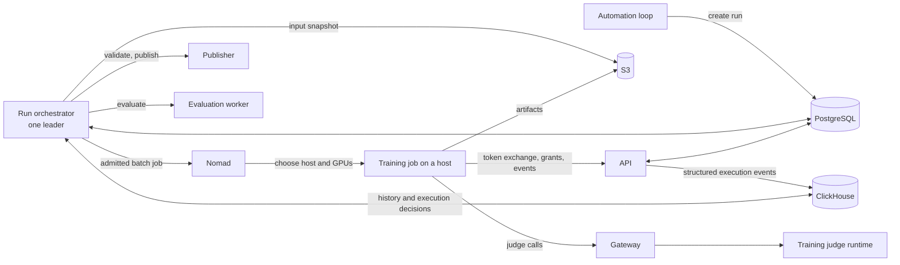
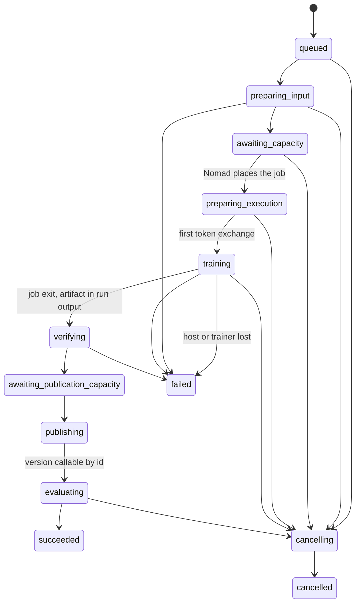

# Fine-tuning: dataset, run and trainer contract

Status: implementation contract, not implemented. Owns `RUN-01` to `RUN-05` and `DATA-01` to `DATA-02`. The exact recipe is a separate design under RUN-03; the rest holds for any recipe.

## Components



## Decisions in this contract

| Decision | Reason | Rejected |
| --- | --- | --- |
| PostgreSQL defines runs; ClickHouse stores structured execution history for logs and execution decisions; one orchestrator leader under an advisory lock | Keep the run definition small and avoid duplicate step state | A separate training step table |
| Reconciliation reads execution events and validates referenced artifacts; uncertain external actions are reconciled by identity | Reconcile completed work without duplicate step records | A PostgreSQL recipe state machine |
| Eligibility is per complete request, one predicate shared by console, automation and builder | The number the customer sees is the number the builder uses | Separate counts; whole-session requirement |
| Trigger is 500 new eligible sessions per task; no daily or organisation caps | Simple and observable | Run caps; budget ledger |
| Automatic runs use an input cutoff; the package selects examples | One boundary per run is enough to trigger new work | Per-session credit records |
| The training package owns dataset preparation and splits | Keep training internals behind the package interface | Platform-owned split membership tables |
| Starting adapter is the production adapter when base and recipe match, else the base | Continues what customers use; never silently picks the newest candidate | Newest version |
| A pinned package validates versioned recipe settings; its internal steps are package-owned | Step order is still being designed; nothing else should depend on it | Hard-coding one algorithm |
| No training on provider output | Provider terms | Teacher targets from provider answers |
| One internal credential, the run token, with scopes and fixed expiry | One issuer, one verifier per language; the Nomad exchange is the start permit | Internal listener; static bearer; separate grant and permit systems |
| Run JWTs have fixed expiry; cancellation stops execution | Local gateway verification without per-run revocation state | Revocation epochs and token renewal |
| Internal admission by reserved capacity or customer headroom, no fixed counts | Customers first without a global number | Fleet-wide concurrency constants |

## RUN-01 Run configuration and state

`training_runs` stores `id`, `task_id`, `config`, `status`, `created_at`, `started_at`, `finished_at` and `cancel_requested_at`. Configuration is frozen before execution. Status is the current lifecycle state for listing and control; detailed execution history remains in ClickHouse. There is no separate control-state column, attempt table, per-step table or progress cache.

| `config` field | Purpose |
| --- | --- |
| `schema_version` | Configuration format version |
| `base_release_id` | Exact base weights, tokenizer and template release |
| `starting_model_id` | Optional compatible fine-tuned model; absent means start from the base |
| `training_package` | Exact package image digest |
| `recipe` | Package-defined, versioned training parameters |
| `data.input_ref` | Immutable input snapshot manifest |
| `data.cutoff` | Capture boundary used by automatic training |
| `resources` | GPU type/count and CPU, RAM and disk requirements |
| `evaluation.reference_model_id` | Provider-model record used for comparison |
| `evaluation.judge_model_id` | Provider-model record used for judging |
| `evaluation.settings` | Versioned comparison settings and limits |
| `deadline` | Fixed absolute UTC stop time |

The platform uses config to schedule the job; the trainer consumes the same config. Credentials are supplied separately. The package owns preparation, splits and training internals. Resolved input manifests, hashes, allocation identity, progress, checkpoints and evaluation results are recorded in run events and S3 artifacts, not duplicate PostgreSQL columns. Model version date and ordinal belong on the published model record.

Nomad job ID is `training-<run_id>`. Its templates disable replacement training executions. The first start checks the actual allocation and current run status under the run lock, then marks the run started. A repeated token exchange must match the recorded start identity in ClickHouse; if required identity history is unavailable, issuance waits. No token exchange starts another trainer after failure. A host failure fails the run. Worker restart may reconcile completed actions and resume unfinished evaluation from events; it does not restart GPU training.

PostgreSQL status and cancellation serialize start and stop decisions. ClickHouse owns the execution history; S3 owns immutable files. A later manual execution is a new run. Stable operation IDs and config hashes support reconciliation without generic operation tables. Recipe internals remain a package implementation detail.

## DATA-01 Training package inputs and ownership

The platform supplies an immutable input dataset reference, the model and starting adapter, versioned package configuration, GPU resource details and a deadline. It checks workspace access, capture policy and source expiry before accepting the input snapshot. The input manifest records source IDs and hashes so the run can be reproduced.

The training package owns example selection, normalization for training, deduplication, grouping, train/validation/evaluation splits and training. It records the selected examples, split seed and split policy in an S3 manifest under `runs/<run_id>/dataset/` and emits structured JSON events to ClickHouse. There is no platform-owned per-example membership or credit table.

The package must keep evaluation examples out of weight updates and training-time selection. Its internal data policy, including any protection across runs, is defined and tested when the package is built. The platform does not prescribe a grouping algorithm, split percentage or per-example state machine. Evaluation reads the package's frozen evaluation manifest; it does not resplit after seeing results. Until qualified, the system cannot claim cross-run contamination protection.

## DATA-02 Automatic trigger

Automatic training starts after 500 new eligible sessions for a task, with at most one non-terminal run per task. Count sessions in ClickHouse after the previous automatic run's input cutoff. Freeze the next cutoff and input selection window on the new run under the task lock. Use trusted ingestion time and a stable event ID to order the boundary; late arrivals belong to a later window. The session-count query deduplicates session identities within that window.

The cutoff marks the input window handed to the package, not the examples it ultimately selects. There is no selected-session credit ledger or carry-forward credit. Creating an automatic run advances the boundary even if that run later fails; the same window does not trigger an automatic retry. A later manual run may explicitly select retained, authorized inputs. Source expiry and package input limits still apply.

The console shows the same new-session count used by automation. Training selection and split counts come from package events in ClickHouse.

## RUN-02 States and deadlines

The statuses below describe the run lifecycle. PostgreSQL holds the current status; ClickHouse holds the detailed transitions and evidence. The worker derives them from structured events and accepted artifacts. PostgreSQL status decides whether work may start or continue. For an external action, record its intent, perform it, validate its outcome and append its result. Reconcile an uncertain outcome by exact identity before retry. No transaction is held across a network call or compute job. Closing a run checks the current run and cancellation state under the run lock; a late event cannot reopen it.



| Stage | Entered when | On failure or cancel |
| --- | --- | --- |
| `queued` | Frozen config and input cutoff exist; policy permits | No GPU execution; config deadline applies |
| `preparing_input` | Raw input snapshot prepared; selection and splits remain package work | Reuse accepted operations; stage deadline; cancel discards staging |
| `awaiting_capacity` | Input snapshot accepted; Nomad batch job submitted with resource constraints | Nomad keeps the job pending until resources fit; worker reconciles by job ID |
| `preparing_execution` | Nomad has placed the job; host preparation runs within the configured deadline | Start refused after cancellation; current status and policy rechecked; preparation deadline includes placement and prefetch |
| `training` | First token exchange commits authorisation; trainer runs under local deadline | Host loss fails the run; never evicted for priority |
| `verifying` | Output inventory accepted for validation; GPU cleanup proceeds separately | Invalid output fails the run |
| `awaiting_publication_capacity` | Valid artifact needs release qualification or compatible ready serving capacity | Holds artifact and intent, not the GPU |
| `publishing` | Final bytes qualified; policy and lifecycle pass | Commit exact-id availability, then project; retry projection |
| `evaluating` | Version testable; arms run under their bounds | Judge failure cannot withdraw publication or retrain |
| `cancelling` | Durable cancel intent recorded | Stop dispatch and compute; fixed-expiry tokens follow RUN-04; clean up or quarantine the host |
| `succeeded`, `failed`, `cancelled` | PostgreSQL terminal status and finish time; reason in ClickHouse | Never reopened; retry is a new linked run |

Publication never sets the production pointer. Cancel after publication returns that outcome; the model stays available. A failed evaluation is recorded in the run event history. No quality threshold controls any stage.

**Deadlines.** `config.deadline` is the fixed run deadline. Queue, setup, training and upload limits are frozen in its spec. Stage starts and derived deadlines are recorded in ClickHouse; they never extend the run deadline. The trainer enforces its execution deadline locally. Termination uses SIGTERM and 60 seconds of grace. An unset required limit blocks the recipe.

**Failures and reconciliation.** Host loss, trainer exit without a valid result, invalid output or execution timeout fails the run. Neither the orchestrator nor Nomad starts a replacement execution. Uncertain job submission is reconciled by `training-<run_id>` and the immutable job hash; this must not start a second trainer. Transient API and storage calls may retry within their operation bounds. They do not restart training or extend the run deadline. A terminal run never reopens. Stop its process and reject new control API grants and accepted outputs; an issued JWT remains valid at the gateway until expiry. A host returning after failure must pass cleanup before new work. PostgreSQL loss stops new starts; ClickHouse loss may delay interpreting history. Running compute obeys its local deadline. Nomad serving recovery remains independent.

## RUN-03 The trainer interface

Code under `product/inference/training/`: pinned package image, locked dependencies, entry point, release manifest and tests. The package owns its internal steps. It validates the versioned `recipe` configuration; the platform does not prescribe a step list or interpreter. No recipe trains directly on provider output.

| Boundary | Requirement |
| --- | --- |
| Input | Run ID and frozen config from RUN-01; access credentials supplied separately |
| Capabilities | GPU, CPU, RAM, disk shape; isolation requirement; local and external inference dependencies; network destinations |
| Start | Nomad selects the host; the host prepares and verifies the declared assets within the run deadline; the trainer exchanges identity before GPU compute, rollout or judge calls; no trainer-side base download or upstream token |
| Progress | Structured JSON events in ClickHouse for user logs, metrics and recovery |
| Checkpoint | Trainer-owned checkpoint schedule; immutable manifest containing adapter, optimizer and all checkpoint state; completed event after verified upload |
| Stop | Local deadline and cancel handler; bounded cleanup; never interrupted for priority |
| Result | Deterministic canonical adapter; dependency and config hashes; output inventory; validation evidence; terminal code |

Before the trainer is written, the recipe design defines environment semantics, admissible provider data, the reward and judge flow, optimizer and checkpoint state, input construction and correctness tests; provider use is qualified against that flow; every judge dependency is declared in the run configuration and checked for availability before execution. No execution of customer tools is authorised by this plan.

The trainer works in `/tmp/gradiated/<run_id>/<allocation_id>` (mode 0700), reads base weights read-only, requests grants by purpose (the server picks the object), and has no prefix listing, arbitrary output path or cross-run access. No previous run checkpoint is accepted as a resume input at launch.

## RUN-04 The run token

One internal credential. It authorises internal inference, artifact grants and trainer events; its first exchange commits a training start; it travels on ordinary gateway routes and scoped API routes.

```mermaid
sequenceDiagram
  participant N as Nomad
  participant T as Training job
  participant A as API (issuer)
  participant G as Gateway
  participant S as S3
  N->>T: start with workload identity
  T->>A: POST /internal/v1/run-tokens (Nomad identity)
  A->>A: validate actual allocation and run status; atomically bind first start
  A-->>T: run token, scopes, fixed expiry, at most run deadline
  Note over A: exchange recorded as the run's start
  T->>A: grant (artifacts:read:dataset)
  A-->>T: presigned URL
  T->>S: GET
  T->>G: judge calls (inference:judge)
  T->>A: events (events:write)
```

| Claim | Content |
| --- | --- |
| Header | Fixed algorithm, `typ`, issuer, audience `internal` |
| Subject | `run:<run_id>` |
| Tenant | Organisation, workspace |
| Binding | Immutable config hash |
| Time | Issue time, expiry, `jti` |
| `scopes` | `inference:judge`, `inference:evaluation`, `inference:base_probe` (each with exact model and release ids); `artifacts:read:<purpose>`; `artifacts:write:<purpose>`; `events:write` |

One verifier library in Rust and one in TypeScript, generated from the same claims schema, both reading the API's JWKS.

**Lifetime.** The issuer fixes `exp` at issuance to the earlier of the run deadline and 24 hours after issuance. The configured run must fit this limit. No renewal endpoint or per-run revocation state exists. Worker tokens for bounded evaluation or preparation may expire sooner, but never after the operation or run deadline. Repeating an issuance request for the same authorized execution does not extend its original expiry.

**Exchange is the start permit.** A training job boots with its Nomad identity. It calls `POST /internal/v1/run-tokens` with one trainer boot id, generated once per process.

1. The API validates the signed identity. It checks the actual allocation against the deterministic job, immutable spec, enrolled node, qualified host class and current run authorization.
2. A short PostgreSQL transaction locks the run and enrolled node, rechecks eligibility and access, and conditionally records the first start through status and `started_at`. Cancellation takes the same run lock.
3. After commit, write and acknowledge the execution-start event in ClickHouse, including allocation, boot identity and fixed token expiry. Recheck cancellation before returning the JWT. A repeated exchange must match that recorded identity and expiry. If a crash leaves a started row without verifiable start evidence, fail the run rather than authorize another execution. No transaction spans the ClickHouse write.

A second allocation or boot, closed run or cancelled run is refused. It exits without training compute. The host-local guard and disabled training restart policy enforce the same boundary (FLEET-01, FLEET-04).

Host preparation before exchange may read only the exact mirrored base and public runtime assets declared in the job, under the enrolled host identity. Dataset and checkpoint access require the run token after exchange. CPU asset verification is preparation; GPU training, rollouts and judge calls cannot start before exchange. A failed or timed-out preparation fails the run and follows RUN-02.

**Use.** Control-plane preparation uses a worker-issued token; it is not passed to the trainer. Turning capture off does not invalidate the existing run JWT. Artifact grants require current run-state and access checks in the control API as well as token scopes. Presigned URLs cannot outlive the run JWT. Cancelled or terminal runs receive no new grants or tokens. Structured history may record late events, but these cannot reopen a run or publish an unaccepted output.

**Verification.** JWKS cached with a bounded refresh and last-good window; an unknown key id triggers one coalesced refresh, then fails closed. Algorithm, type, issuer, audience and time are checked before any claim is read. A failed token is never forwarded. A run token cannot reach management, relay, or models outside its claims. An unpublished model is reachable only with its owning run's token and an accepted artifact.

**Cancellation and expiry.** Cancellation records the stop request and terminates the trainer through Nomad. The worker stops new evaluation dispatch. The gateway verifies signature, issuer, audience, scopes and expiry locally; it does not look up run status or a revocation epoch. An issued token can still authorize scoped inference until it expires, even after cancellation or run failure. This is an accepted launch tradeoff. Existing tenant access checks still apply. Control API operations such as new upload grants check the current run state and refuse closed or cancelled runs.

**Admission.** No fixed fleet-wide or per-run counts. Reserved judge capacity admits up to its grant. A deployment shared with customers admits an internal request only if remaining customer headroom stays at or above `INTERNAL_ADMISSION_HEADROOM` (initially 0.20, in lease resource units including token memory); check and reservation are atomic. Customers may use that headroom; admitted internal requests are not aborted. Trainer parallelism is set by the recipe (32 initially). External provider calls: `PROVIDER_MAX_IN_FLIGHT[provider]` (initially 16), shared across workers on that credential, with bounded per-provider queues and fair run selection.

**External calls.** Each has a persisted operation id, timeout, maximum output, request-attempt ceiling and accepted result manifest. Unknown outcomes stay unknown; the request bound is waited out before a retry; possible duplicate cost is recorded; run event replay selects the valid result by stable operation and call identity, as specified in EVAL-03; no provider fallback. Provider slots have operation identity and a maximum expiry, persisted before dispatch; uncertain completion keeps the slot until proof or the bound; a late callback cannot release a newer slot. Valkey admission scripts use one cluster slot each; Valkey loss closes internal admission until leases expire or work is reconciled; slots survive restarts.

## RUN-05 Loops, events and audit

Supervised loops in one worker: automation every 300 s; run reconciliation every 10 s. Three execution permits cover active work only. Queue scans are paginated. Leader lock loss stops new dispatch. Recheck run status before actions and reconcile stable operation identities after takeover.

Control actions use the best-effort ClickHouse audit helper in OPS-03. Recipe events are written directly through the authenticated event API to ClickHouse; they do not pass through PostgreSQL. Workers use the same structured event contract for execution results.

**Event envelope:** schema version, workspace ID, run ID, producer and boot ID, producer sequence, stable event ID, event type, event time, ingest time and typed JSON payload. Events include `stage_started`, `progress`, `checkpoint_completed`, `run_failed`, `output_completed` and `run_completed`. Checkpoint and output payloads contain immutable manifest references and hashes, not file contents. No credentials, signed URLs, prompts or generated customer text appear in these logs.

Validate event scope against the admitted run. Deduplicate reads by event ID before interpreting history. Repeated identical events are harmless; conflicting content under one ID blocks interpretation and raises an error. Producer sequence orders one producer; wall-clock or arrival order never resolves conflicting runs. Delayed old-run events remain history and cannot authorise work or override cancellation.

**Checkpoints.** Upload checkpoint objects and verify the immutable manifest before appending `checkpoint_completed`. These events support inspection and validation of trainer artifacts. Launch has no cross-run checkpoint resume contract. A host failure fails the run even if checkpoint files exist.

**Delivery.** Recovery events require acknowledged ClickHouse writes and retries with unchanged event IDs. The API must not acknowledge memory buffering as durable acceptance. An uncertain write is retried or read back by identity. A missing or incomplete history is not proof that an external action did not occur. Reconcile its actual destination before retry. If required history cannot be read, wait within the run deadline rather than starting speculative duplicate work. A host loss fails the run.

**Bounds.** At most 16 KiB per event and 256 KiB per batch, with at most 100 events per batch. Progress is emitted at most once per 10 seconds. The recipe declares a finite event-count and byte budget that includes checkpoints and lifecycle events; exhausted recovery-event capacity stops further work with an explicit error. Progress may be coalesced. Recovery events cannot be silently dropped. ClickHouse outages may delay checkpoint acceptance, recovery and run completion; they do not block inference.

**Reads.** The API reads scoped ClickHouse history for progress, results and logs. It returns bounded pages with stable event IDs. Run lists use PostgreSQL status and timestamps; detailed views read ClickHouse history. No additional PostgreSQL display cache or event watermark is required. If history is unavailable, show that condition alongside the run definition and status. Cancellation remains available through PostgreSQL. An orchestrator-validated terminal event precedes normal run closure; output completion alone does not close a run that still needs evaluation. A crash between the terminal event and closure is reconciled from that event and the current run status. Cancellation or deadline expiry can close execution authority while ClickHouse is unavailable; the worker can later emit that control outcome from the persisted run status and timestamps with a deterministic event ID. Recovery checks the run status even if that event is missing.

## Required evidence

S2: input cutoffs, snapshot identity and automatic trigger. T1: package selection and split correctness. S5: local deadlines, one accepted allocation per run, terminal host failure, cleanup before host reuse, and Nomad placement without a preassigned host. S6: worker killed around every transaction and effect; old leaders; disable versus first exchange; late checkpoints; capacity recovery. RUN-03 and T1: trainer qualification. A recipe is enabled only with its design, finite limits and qualification complete.

S6 also checks acknowledged-write failures, duplicate and reordered events, missing checkpoint objects, stale runs, ClickHouse outages, and crashes between a completed event and run closure. Replaying the same history must preserve the terminal outcome without starting another execution.
