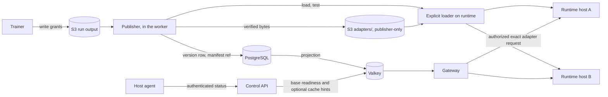

# Fine-tuning: artifacts, serving and promotion

Status: implementation contract, not implemented. Owns `ART-01` and `SERV-01` to `SERV-04`. S3 and S4 qualify it before enablement.

## Version eligibility and runtime residency

`task_versions.status` is durable serving eligibility, not a report of whether an
adapter is loaded. `available` permits exact-version use and promotion once the
serving integration is qualified; `unavailable` disables them. Training success
and evaluation quality are separate. Do not flip this field on cache eviction,
a replica restart, temporary capacity loss or a cold-load timeout.

The current SFT worker publishes versions as `unavailable`. It verifies training
artifacts, but does not yet qualify them through the inference loader or project
private versions into gateway routing. Current promotion only updates
`tasks.production_version_id`; loader preparation, revision checks and routing
projection described below remain unimplemented. Setting a row to `available`
alone cannot make an adapter callable.

The serving implementation must:

1. Bind validated immutable adapter bytes to the exact compatible base weights,
   tokenizer and template, and verify load/use through the production loader.
2. Publish an authorized private model descriptor for gateway routing and mark
   the version available. A failed qualification leaves it unavailable.
3. Route each authorized request to a healthy compatible base allocation. Its
   runtime loads the exact adapter from its local cache or immutable S3 storage,
   coalesces concurrent loads and retains it while requests use it.
4. Prepare and validate a promotion before changing the task production pointer.

There is one serving Nomad job per base release, not per adapter. Residency is
local to each allocation, so a global `loading` or `loaded` version status would
be misleading. Serving eligibility, healthy base capacity and per-allocation
cache residency are separate facts. The trainer does not manage any of them.

## Components

| Component | Role |
| --- | --- |
| Publisher (worker) | Validates run output bytes, copies them to final storage, records the version |
| Explicit loader (private runtime API) | The only way an adapter reaches a runtime; verifies layout on every worker |
| Runtime adapter cache | Local GPU, RAM and disk residency, coalesced loads and active-use references |
| Host agent | Enforces local resource limits and reports base-runtime readiness |
| Promotion (API) | Prepare the adapter, then update the task production pointer |

## Decisions in this contract

| Decision | Reason | Rejected |
| --- | --- | --- |
| Only the exact validated bytes are ever served; publisher-only final storage; publication is a database row | The served model must be the tested model | Serving from unvalidated run output; trusting a listing |
| One explicit private loader; the stock filesystem resolver is not used | The resolver does not carry the MoE layout flag, and the engine trusts the caller | vLLM filesystem resolver |
| Each host owns its adapter cache and loads on demand | Keep loading and eviction local | Global cache synchronization and mandatory production preloading |
| Adapters load from S3 on demand into bounded caches, with a 60 s gateway wait | Old versions cost storage only | Every version resident |
| Promotion prepares the target and updates the task pointer with a revision check | One authoritative production selection per task | Separate promotion table; automatic promotion |
| Runtime releases are qualified once per base on a fixed adapter set | Adapters depend on base, tokenizer and template, not the engine | Per-adapter certificates |
| No version TTL; operator cleanup of versions unused for a year | Simpler; policy still allows removal | A TTL field |

## ART-01 Accepting an artifact

The trainer writes only inventoried objects under `runs/<run_id>/output/` and cannot publish. Before any write grant, the operation records workspace, run, expected names, object versions, size limits and checksums. Keys are workspace-scoped.

Publisher order; bytes are never modified after step 4:

1. Freeze the run output object-version inventory.
2. Validate the archive envelope before extraction.
3. Perform any allowed canonical format conversion in an isolated bounded process.
4. Validate final tensors: names, shapes, dtypes, offsets, finite values, dependency identities.
5. Hash the final payload; write the immutable manifest.
6. Copy the validated versions to publisher-owned final storage; recheck hashes.
7. Load those same bytes through the private loader and compare against reference outputs before publication.
8. Commit the publication with the manifest reference in PostgreSQL.

A retry compares the input hash and exact object versions. An incomplete multipart upload or a replaced run output object cannot change an accepted artifact. Public ACLs are disabled; only the publisher writes the final prefix.

Permitted: declared safetensors and configuration files. Rejected: pickle and executable formats, links, device files, absolute paths, traversal, duplicate names, overlapping tensor ranges, unknown required tensors, undeclared files. Bounded before allocation: compressed and expanded bytes, file count, dimensions, JSON size, memory, wall time. Errors are closed codes, never customer content.

Each qualified release declares measured limits: base bytes, adapter rank, modules and layout, tensor and archive sizes, CPU and GPU memory, disk, conversion space. Disk includes handover assets, download staging, validation copies, retained work and cleanup headroom; the host must fit the worst permitted combination. An unset or exceeded limit blocks the release.

The manifest records: base revision and digest; tokenizer and template hashes; adapter format and layout; rank and modules; payload digests and sizes; trainer and recipe identity; original serving release; validation evidence; original digest, conversion version and final digest if converted. Lifecycle, production membership and later compatibility evidence live outside it. No expiry field.

## SERV-01 Host-owned adapter loading

The serving host owns its adapter cache hierarchy: GPU memory, host RAM, local disk, then S3. The gateway authorizes the model and selects a ready runtime for its exact base release. It sends the immutable adapter identity and manifest hash over the authenticated private inference interface. The host ensures the adapter is loaded before execution. There is no Valkey warm intent, worker-mediated cold load or global adapter placement map required for correctness.

The runtime accepts only trusted internal model identities and publisher-owned artifact references. It verifies workspace scope, base, tokenizer, template, format and hashes. Customer model names never become filesystem paths. The loader supplies the verified MoE layout flag on every load. Partial tensor-worker loading blocks execution of that adapter; an unrecoverable integrity failure closes runtime readiness.

Each host coalesces concurrent requests for the same immutable adapter. It downloads from S3 directly and manages disk, RAM and GPU limits locally. It evicts unused adapters according to local cache policy. Active requests hold local use references; an adapter cannot be evicted while in use. No permanent production residency or identical cache contents across replicas are promised. GPU residency is engine-managed.

Runtime readiness means the base and loader are ready to accept compatible requests; it does not require every adapter to be cached. Optional cache hints can improve routing later, but the selected host always verifies and loads the exact adapter itself. No worker reconciles cache contents.

## SERV-02 Cold requests and publication

The gateway checks tenant access and model lifecycle, selects a compatible base runtime from Valkey, and dispatches through normal bounded admission. The host checks its caches, fetches a missing adapter from S3 and executes the request. Normal generation identity, cancellation and finalization apply once across cold loading and inference; failed loading does not become a successful generation. Billing uses actual execution usage, never a synthetic charge for loading.

Cold loading has a 60-second bound within the request deadline. Limit waiters to 64 per adapter per host and bound total host waiters and download concurrency by its qualified resource profile. Cache saturation returns a capacity error; load failure or timeout returns an explicit unavailable error. A cancelled waiter detaches; shared loading can continue for remaining callers within its bound. No fallback after a runtime dispatch or for an exact version. A bare task can use the request override or provider-specific workspace default before dispatch under GW-05, with the customer provider key. Tasks own no fallback setting. Retries obey the gateway's existing before-output policy and retain the exact adapter identity.

Publication validates the output, copies final bytes to `adapters/`, tests those immutable bytes through the same host loader, then commits the available model record. The private test is authorized only for the owning run before publication. The serving loader never reads unvalidated run output. Publication does not set the task production pointer.

Base serving jobs and scaling policies remain in Git, referencing PostgreSQL base releases. No per-adapter Nomad job or worker load queue is created. A runtime release is qualified against the exact base and a fixed adapter test set. New base weights, tokenizer or template require a new base release. Publication waits visibly if compatible test capacity is unavailable.

## SERV-03 Promotion

Promotion sets `tasks.production_version_id`. There is no promotion table, background promotion workflow or per-model production boolean. The task's production revision detects concurrent changes. The audit log records actor, previous model, target model and time.

1. Check membership and that the target is an available version of the same task.
2. Prepare the target through the normal private adapter loader within a bounded request deadline. Preparation checks exact-adapter execution on a compatible host while at least two base replicas are ready. It does not pin the adapter across replicas.
3. In one short transaction, lock the task and target model. Recheck lifecycle, current readiness and the expected production revision. Set the pointer, increment its revision, and write the existing projection outbox entry.
4. Project the updated task to Valkey through the existing projector. The host handles subsequent cold loads and local eviction. In-flight requests keep their local adapter references.

After commit, call the best-effort ClickHouse audit helper. Its failure does not undo promotion.

Preparation uses bounded runtime load/use protection. It does not create a durable promotion reservation. Failed preparation or a stale revision leaves the pointer unchanged. Unused prepared adapters return to normal cache eviction. A replacement runtime becomes ready after its base and loader checks; adapters load on demand.

The request returns the updated task and revision after projection acknowledgement. A projection timeout after commit reports that the pointer changed but propagation is pending; it must not report that preparation failed or roll back the pointer. The existing projector completes propagation. After a lost response, read the task to determine its current pointer before retry. Concurrent changes return 409 with the current revision. Runtime loss can still make the selected model unavailable; it never causes model substitution.

In-flight requests keep their resolved version. Rollback is the same action with a previous version as the target. Previous versions remain callable by exact name. Evaluation scores do not gate promotion.

## SERV-04 Version lifetime and release changes

No expiry field. Policy: a non-production version with no customer-served use for 365 days may be removed. Enforcement: the operator-confirmed `retire-unused-models` operation, driven by ClickHouse served generations; automatable later. The console shows last customer use and coverage.

Use is an authorised customer request dispatched to the version, including exact-version tests and failed executions; not run-token traffic, failed authorisation or undispatched requests. A request on the task slug records the resolved version. Known recent use excludes a candidate; so does unknown or incomplete evidence. A content-free per-version last-use summary with its coverage watermark is kept beyond raw generation retention, derived from ClickHouse.

The operator previews candidate ids, last-use evidence, coverage, object inventory and expected revisions; confirmation freezes the set. Before deletion: a reversible per-version restriction through OPS-01; existing leases finish; use observations reconcile through the barrier. A production reference, active run input, active runtime preparation or newer use excludes the candidate. Then lifecycle is compare-and-set to retired with deletion requested. Promotion and cleanup lock the same target model before changing its lifecycle or production reference. A stale preview never authorises deleting a version used or promoted since.

Cleanup denies new inference, export and loading, then deletes artifact, manifest and caches through OPS-03 cleanup; datasets and evaluation evidence are untouched; content-free records remain. Export stays available while the artifact exists and no restriction is in force.

Shared base dependencies are kept while any available version, production placement, accepted run input or active use references them. Old available versions keep an old base's configured serving minimum in force until retired; the console shows that required capacity.

Runtime upgrades: qualified once per base on the fixed adapter set (SERV-02). The release owner runs the check before rollout. Git job configuration defines rollout and capacity constraints; Nomad performs the health-gated rollout (FLEET-04). Keep the old path until the new one is qualified and ready. S3 defines the numerical checks. No automatic model substitution or context-limit reduction.

## Required evidence

S3: exact adapter identity and layout, first load, disk/RAM/GPU cache hits, concurrent cold requests, bounded download and memory use, cancellation, eviction and restart. S4: resource envelopes. S5/S6: host loss, missing S3 objects, partial tensor-worker loads, promotion and cleanup races, stale cache hints, and publication tests reading only validated bytes. Two base replicas must work even when their adapter caches differ.

The [core proxy product plan](PROXY_FEATURE_PLAN.md) also permits an explicit global hosted open-model production target before private training is available. Private promotion retains its task and workspace ownership checks. Both target variants use the same routing and reporting contract.
