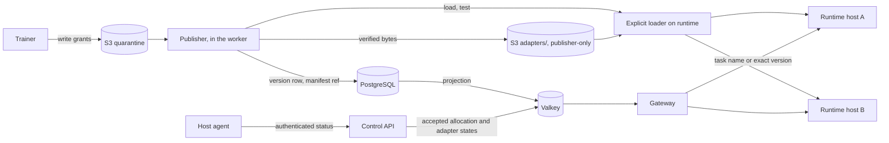

# Fine-tuning: artifacts, serving and promotion

Status: implementation contract, not implemented. Owns `ART-01` and `SERV-01` to `SERV-04`. S3 and S4 qualify it before enablement.

## Components

| Component | Role |
| --- | --- |
| Publisher (worker) | Validates quarantine bytes, copies them to final storage, records the version |
| Explicit loader (private runtime API) | The only way an adapter reaches a runtime; verifies layout on every worker |
| Runtime adapter registry | Per-runtime state of each adapter and the protected production set |
| Host agent | Disk, RAM and transfer limits; reports placement deltas and snapshots |
| Promotion operation (API and worker) | Durable manual change of the production pointer |

## Decisions in this contract

| Decision | Reason | Rejected |
| --- | --- | --- |
| Only the exact validated bytes are ever served; publisher-only final storage; publication is a database row | The served model must be the tested model | Serving from quarantine; trusting a listing |
| One explicit private loader; the stock filesystem resolver is not used | The resolver does not carry the MoE layout flag, and the engine trusts the caller | vLLM filesystem resolver |
| Same production adapter set resident in host memory on every replica of its base, at least two hosts; GPU residency engine-managed | RAM holds hundreds of adapters; GPU slots would cap customers per base | GPU pinning; different production subsets per replica |
| Non-production versions load from S3 on demand into bounded caches, with a 60 s gateway wait | Old versions cost storage only | Every version resident |
| Promotion is a durable operation with reservations and compare-and-set; manual only | It either completes or leaves production untouched; customers try first | Automatic promotion; pointer PATCH |
| Runtime releases are qualified once per base on a fixed adapter set | Adapters depend on base, tokenizer and template, not the engine | Per-adapter certificates |
| No version TTL; operator cleanup of versions unused for a year | Simpler; policy still allows removal | A TTL field |

## ART-01 Accepting an artifact

The trainer writes only inventoried objects into quarantine and cannot publish. Before any write grant, the operation records workspace, run, attempt, expected names, object versions, size limits and checksums. Keys are workspace-scoped.

Publisher order; bytes are never modified after step 4:

1. Freeze the quarantine object-version inventory.
2. Validate the archive envelope before extraction.
3. Perform any allowed canonical format conversion in an isolated bounded process.
4. Validate final tensors: names, shapes, dtypes, offsets, finite values, dependency identities.
5. Hash the final payload; write the immutable manifest.
6. Load the same bytes on the qualified serving release and compare against reference outputs.
7. Copy the verified versions to publisher-owned final storage; recheck hashes.
8. Commit the publication with the manifest reference in PostgreSQL.

A retry compares the input hash and exact object versions. An incomplete multipart upload or a replaced quarantine object cannot change an accepted artifact. Public ACLs are disabled; only the publisher writes the final prefix.

Permitted: declared safetensors and configuration files. Rejected: pickle and executable formats, links, device files, absolute paths, traversal, duplicate names, overlapping tensor ranges, unknown required tensors, undeclared files. Bounded before allocation: compressed and expanded bytes, file count, dimensions, JSON size, memory, wall time. Errors are closed codes, never customer content.

Each qualified release declares measured limits: base bytes, adapter rank, modules and layout, tensor and archive sizes, CPU and GPU memory, disk, conversion space. Disk includes handover assets, download staging, validation copies, retained work and cleanup headroom; the host must fit the worst permitted combination. An unset or exceeded limit blocks the release.

The manifest records: base revision and digest; tokenizer and template hashes; adapter format and layout; rank and modules; payload digests and sizes; trainer and recipe identity; original serving release; validation evidence; original digest, conversion version and final digest if converted. Lifecycle, production membership and later compatibility evidence live outside it. No expiry field.

## SERV-01 One exact load path

One private runtime load API for qualification, cold tests, production preparation and recovery. Inputs: authorised internal model id, exact manifest and hash, release id, accepted Nomad allocation and engine boot id, operation id; a protected-set change also carries its expected set revision. The runtime resolves only publisher-owned objects. Customer names are never paths or runtime-global ids.

The loader passes the verified `is_3d_lora_weight` on every load and reload, allocates a stable positive runtime adapter id with a collision check, rejects a reused id with different bytes, and never replaces an adapter in place while a request may hold it. The stock vLLM v0.28.0 filesystem resolver builds requests without the 3D layout flag, which defaults to false, and the engine trusts the caller; it is not used. [Resolver](https://docs.vllm.ai/en/v0.28.0/api/vllm/plugins/lora_resolvers/filesystem_resolver/), [request fields](https://docs.vllm.ai/en/v0.28.0/api/vllm/lora/request/), [MoE layout](https://docs.vllm.ai/en/v0.28.0/features/lora/#mixing-2d-and-3d-moe-lora-adapters).

**Residency.**

| Adapter | Where | Protection |
| --- | --- | --- |
| Production | Complete set in host memory on every ready replica of its base, on at least two distinct hosts; GPU by engine recency | Same committed set on each replica; never evicted by tests |
| Non-production | Bounded disk, host-memory and GPU caches, loaded from S3 on demand | Evictable when unused |

Each base has one Nomad service job. Its replicas are interchangeable. The protected set is derived from current production pointers plus additions and removals held by a pending promotion. Historical non-production versions remain demand-loaded; unrelated bases do not load each other's adapters. The complete set and promotion overlap must fit on each qualified host. Extra replicas add throughput, not per-host adapter capacity. GPU swapping, mixed-adapter batching and their latency are measured in S3 on the exact release.

**Registry.** States `absent`, `fetching`, `validating`, `loading`, `ready`, `evicting`, `failed`; reports engine boot id, every worker's acknowledgement, manifest and layout identity, resident bytes, protected-set revision, active-use leases, last error. Ready means the exact bytes are loaded and a release-specific execution check passed on every worker.

Cache mutations are serialised per engine. Host-memory bytes are reserved before loading. The protected-set operation reserves the new set before releasing the old and fails explicitly if both cannot fit. Active requests hold use leases. Eviction requires no protection and no active use. After restart or reschedule, protection is rebuilt from the current base set; nothing is evicted while that state is unknown. The new engine cannot inherit readiness. It loads and tests the required set before routing opens, through FLEET-05.

The host agent (the existing one) enforces disk, inode, file-count, transfer-concurrency and runtime RAM limits, reports placement deltas by revision and a paginated snapshot on resync; a stale delta cannot remove a newer placement. Healthy placements are left alone.

A partial load or unload across workers is a failure: fence new requests to that adapter, keep others only if isolation is provable, reconcile each worker, else mark the allocation unhealthy so its qualified Nomad restart or reschedule policy recovers it. The worker does not submit a second serving job. S3 must demonstrate protection, byte accounting, partial-failure recovery and readiness.

## SERV-02 Cold requests and publication

Authorisation and resolution precede a cold-load intent. The gateway creates or joins a bounded intent for `(workspace_id, internal_model_id, release_id)` before admission, holding no generation lease, charge lease or GPU assignment while waiting. Retries never cross a workspace or release.

| Bound | Initial value |
| --- | --- |
| Wait | 60 s, within the request deadline |
| Waiters | 64 per model; 1,024 per gateway process; excess get 429 |
| Load timeout or no compatible runtime | 503 with retry guidance |
| Intent expiry | 5 minutes without demand; refreshed by authorised use |
| Host mutations | One adapter download or load at a time; production repair and promotion first |

A cancelled waiter detaches; a shared load continues within its own deadline. No fallback to another model. A base-runtime request follows customer-demand policy; a cache intent cannot allocate a host. After readiness the gateway resolves again, validates model and tenant state, then admits normally; finalisation happens once.

Offered base runtimes keep two ready replicas on distinct hosts. Non-production versions need a compatible offered base but no permanent placements. Qualifying a new base and publishing for exact-id use is a fleet claim with the same priority as candidate evaluation; it cannot borrow training-floor nodes or the recovery reserve. Publication waits visibly when capacity or the base floor cannot fit. Finished training compute is released regardless.

**Release upgrades.** A LoRA adapter depends on base weights, tokenizer and template, not the engine. An adapter's contract binds to those hashes. A runtime release is qualified for a base once, by the exact-byte load-and-compare test on a fixed set (the synthetic adapter with known outputs plus a few real ones). Pass: every adapter sharing those hashes is qualified. Fail: the release is not offered for that base. Adapters route to any runtime running a qualified release of their base. New weights, tokenizer or template is a new base release.

Publication makes a valid version testable by exact id before evaluation. The production pointer is untouched. A failed or missing judge result cannot undo publication. A run token may load an unpublished artifact only for its owning operation.

## SERV-03 Promotion

One durable operation per task at a time. Request: idempotency key, expected production revision. Conflict: current operation and revision. Frozen in the record: actor, target, previous target, evaluation snapshot reference and affected base releases. Record the protected-set reservation and revision when preparation starts. Host ids are observations, not frozen promotion inputs. Quality scores never block promotion.

Serialise protected-set changes per base. A promotion reserves each affected base in stable id order; another promotion on that base waits. Reserve the union of current production adapters and the target before loading. For a cross-base promotion, preserve the old base's protection until projection and old leases finish. These reservations prevent two tasks from overwriting the same base set. No database lock is held during preparation.

```mermaid
stateDiagram-v2
  [*] --> accepted: membership, ownership, lifecycle, compatibility, revision
  accepted --> preparing: reserve base sets and per-host overlap; load and test
  preparing --> ready_to_commit: all routable target replicas acknowledge; at least two hosts
  ready_to_commit --> projecting: one transaction: pointer, lifecycle revision, audit, outbox
  projecting --> complete: projection converged; obsolete protection released after old leases finish
  accepted --> failed
  preparing --> failed
  ready_to_commit --> cancelled
  failed --> [*]: old pointer kept
  cancelled --> [*]
  complete --> [*]
```

Pending additions do not remove readiness for the current production set. Each currently routable replica of the target base must acknowledge the prepared union before commit. Require at least two distinct ready hosts, the current engine boot ids and fresh execution acknowledgements. A failed or stale replica is excluded from routing, not counted as prepared. A joining or replacement allocation must load the latest required set before admission; an older acknowledgement cannot reopen its route.

The pointer transaction locks the task, involved versions and base reservations in stable id order and serialises with operator cleanup. It rechecks task and set revisions, lifecycle and current accepted readiness. Status registration and projection enforce the same committed set revision, so an unprepared replica cannot enter routing after the pointer changes. A lost response after commit returns the same operation on retry. After commit, projection is retried until it converges; the decision is never rolled back silently. A customer rollback is another promotion.

In-flight requests keep their resolved version and lease. New requests follow the committed pointer after convergence. Readiness lost after commit triggers repair and an honest unavailable status, never a different model. The confirmation shows results and status only.

No customer retire or unpublish action. B replacing A leaves A callable by its exact name. The operator cleanup below never touches current production.

## SERV-04 Version lifetime and release changes

No expiry field. Policy: a non-production version with no customer-served use for 365 days may be removed. Enforcement: the operator-confirmed `retire-unused-models` operation, driven by ClickHouse served generations; automatable later. The console shows last customer use and coverage.

Use is an authorised customer request dispatched to the version, including exact-version tests and failed executions; not run-token traffic, failed authorisation or undispatched requests. A request on the task slug records the resolved version. Known recent use excludes a candidate; so does unknown or incomplete evidence. A content-free per-version last-use summary with its coverage watermark is kept beyond raw generation retention, derived from ClickHouse.

The operator previews candidate ids, last-use evidence, coverage, object inventory and expected revisions; confirmation freezes the set. Before deletion: a reversible per-version restriction through OPS-01; existing leases finish; use observations reconcile through the barrier. A production reference, active run input, pending promotion or newer use excludes the candidate. Then lifecycle is compare-and-set to retired with deletion requested. Promotion and cleanup take the same lock order. A stale preview never authorises deleting a version used or promoted since.

Cleanup denies new inference, export and loading, then deletes artifact, manifest and caches through OPS-03; datasets and evaluation evidence are untouched; content-free records remain. Export stays available while the artifact exists and no restriction is in force.

Shared base dependencies are kept while any available version, production placement, accepted run input or active use references them. Old available versions keep an old base's two-replica floor in force until retired; the console shows that required capacity.

Runtime upgrades: qualified once per base on the fixed adapter set (SERV-02). The release owner runs the check before rollout. The fleet controller checks surge capacity and protected floors; Nomad performs the health-gated rollout (FLEET-04). Keep the old path until the new one is qualified and ready. S3 defines the numerical checks. No automatic model substitution or context-limit reduction.

## Required evidence

S3: exact layout, full production set on each replica, host-memory protection, GPU swap behaviour, cold-load bounds, promotion overlap. S5 and S6 also cover simultaneous promotions on one base, replacement during preparation, stale engine acknowledgements and registration during pointer commit. S4: storage, validation and resource envelopes. S5 and S6: lost readiness, projection failure, promotion, last use, retirement and cleanup races. One host cannot qualify two-host production or the reserve.
