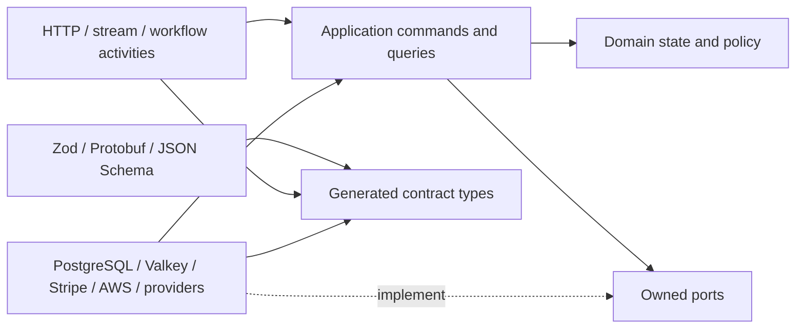
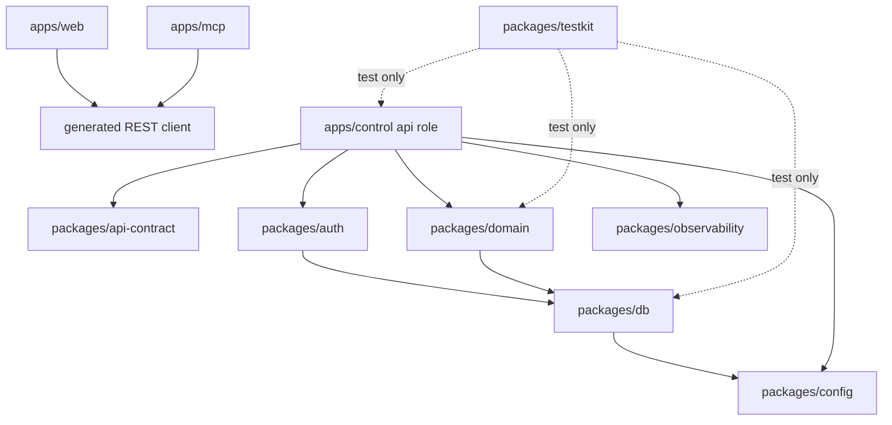

# Package boundaries and core interfaces

Status: canonical source-layout and dependency contract

This document tells implementation agents where code lives, which package owns each decision, and which interfaces may cross a boundary. Names below are normative unless a language convention requires a mechanical spelling change. Business behavior remains authoritative in the [system manual](../SYSTEM_MANUAL.md), [contract catalog](CONTRACT_CATALOG.md), and [physical data model](DATA_MODEL.md).

## 1. Dependency rules

1. Dependencies point inward: transport and adapters depend on application ports; application depends on domain; domain depends only on language primitives and narrow shared value types.
2. A service may write only its owned PostgreSQL tables or Valkey keys. Cross-domain changes use an application command, Protobuf event, or outbox event defined in the contract catalog.
3. Generated types are leaves. Agents modify their schema source and regenerate; handwritten packages never patch generated output.
4. Public API models, domain models, persistence rows, and provider payloads are distinct types with explicit mapping functions.
5. No `utils`, `common`, `manager`, generic repository, generic event bus, or service-locator package is allowed. A helper stays with its only consumer until at least three stable consumers need the same semantics.
6. Configuration and credentials enter through typed startup construction. Runtime code does not read environment variables directly.
7. Time, IDs, randomness, external clients, and persistence are ports in stateful logic so tests can control them.
8. Cycles are build failures. Boundary checks run in CI for TypeScript, Rust, and Python.



## 2. Repository source tree

```text
product/
  apps/
    control/              Hono API plus api/financial/intelligence/trace-access/MCP role entrypoints
    web/                  Vite React control plane
  packages/
    api-contract/         described Zod route registry and generated client inputs
    auth/                 Better Auth adapter and authorization context
    config/               typed TS configuration
    db/                   Drizzle schema, migrations, scoped repositories
    domain/               TS domain values, commands, queries and ports
    observability/        safe TS logs, metrics and traces
    testkit/              clocks, IDs, fakes, containers and PBT replay
  proto/gradiated/        canonical internal Protobuf source
  schemas/                public protocol and immutable artifact schemas
  fixtures/contracts/     cross-language golden fixtures
  services/
    gateway/              Rust public inference gateway
    inference-router/     Rust owned-release router
    cell-agent/           Rust external cell identity and lifecycle agent
    runtime-stock/        pinned stock serving runtime image/configuration
    fleet-planner/        Rust desired-capacity computation
    fleet-driver/         Rust compiled provider adapters and allocation controller
    enrollment/           Rust one-use bootstrap and cell-connect service
research/factory/         Python research control and experiment workflows
infra/                    Terraform/Terragrunt, Helm, GitOps and environment config
tools/grad/               Rust developer/operator CLI
```

Deployable names are stable operational identities. A package may begin in the same process as another package when the work packet allows it, but its ownership and dependency direction stay intact. In particular, the control API may host trace metadata routes while the trace worker remains the only object writer.

## 3. TypeScript control plane

### 3.1 Package graph



Forbidden dependencies:

- `domain` must not import Hono, React, Drizzle, Better Auth, Stripe, Valkey, AWS SDK, or generated transport types.
- `web` and `mcp` must not import `db`, `domain`, or server-only auth code.
- route handlers must not execute SQL or call Stripe/AWS directly.
- repositories must not authorize actors or construct HTTP responses.

### 3.2 Domain values and ports

The domain package exports opaque IDs (`OrganizationId`, `WorkspaceId`, `ApiKeyId`, `RequestId`, `ReleaseDigest`), checked `MoneyMicros`, bounded names, `Actor`, and explicit result/error unions. It contains these application ports:

| Port | Required operations | Adapter owner |
| --- | --- | --- |
| `UnitOfWork` | execute one retry-aware PostgreSQL transaction | `db` |
| `OrganizationRepository` | get scoped organization, memberships and deletion state; save through named commands | `db` |
| `WorkspaceRepository` | scoped get/list and policy-version compare-and-set | `db` |
| `ApiKeyRepository` | create digest row, resolve candidate prefix, revoke | `db` |
| `BillingQuery` | balance, transactions, usage and top-up intent views | billing repository |
| `LedgerCommands` | post named balanced business effects | financial package/service |
| `PolicyPublisher` | publish monotonic workspace/channel snapshots | Valkey adapter |
| `ModelCatalog` | resolve model/release/alias under tenant policy | catalog repository |
| `TraceCatalog` | metadata, grant authorization, deletion intent | trace repository |
| `AuditSink` | append bounded audit record in owning transaction | `db` |
| `OutboxSink` | append typed event in owning transaction | `db` |
| `Clock`, `IdGenerator`, `RandomSource` | deterministic infrastructure primitives | config/testkit |

Repositories expose named methods for concrete use cases; they do not expose `findMany`, arbitrary predicates, raw transaction handles, or generic save methods.

### 3.3 Application services

Each class has one public method per named command/query and receives ports in its constructor.

| Service | Owns decisions | Must not own |
| --- | --- | --- |
| `OrganizationService` | create with Default workspace, rename, suspend, membership/last-owner rules | sessions, payments, deletion execution |
| `InvitationService` | issue, revoke, reissue with prior-token invalidation, accept and expiry behavior | sending transport details |
| `WorkspaceService` | create/update/suspend, Default invariant, data mode, limits and model allowlist | request-time admission |
| `ApiKeyService` | display-once creation, digest/pepper, revoke and rotation | request authentication in gateway |
| `OrganizationDeletionService` | request, cancel and status authorization | destructive step execution |
| `OrganizationDeletionWorker` | restartable suspend/drain/reconcile/refund/purge/pseudonymize sequence | financial rule invention |
| `TopUpService` | validate amount, create intent and checkout session command | webhook financial authority |
| `StripeWebhookService` | verify, dedupe, validate object and invoke named ledger effect | raw payload persistence |
| `BillingEventConsumer` | validate/dedupe billing event and acknowledge only after authoritative commit | gateway admission or Valkey script behavior |
| `LedgerPoster` | post a named fixed-chart balanced transaction and update locked balance | reserve/settle hot state |
| `UsageFinalizer` | persist immutable usage and its exact sell/buy financial effect | provider invocation |
| `ProjectionReconciler` | compare/rebuild PostgreSQL authority and Valkey projection under a fenced epoch | changing ledger history |
| `CatalogService` | curated direct models, immutable releases and alias commands | provider invocation |
| `TraceQueryService` | scoped metadata and short-lived plaintext grant command | durable plaintext/caching |
| `RecommendationService` | evidence-backed recommendation and evaluation authority | automatic production routing |

`WorkspaceService` also owns terminal non-Default archival and coordinated key revocation. A `UsageExportQuery` streams the fixed bounded CSV projection from PostgreSQL; it is a query, not an export-job domain or object-store workflow.

Mutating methods receive an `IdempotencyKey` when exposed publicly. The application service owns conflict semantics; HTTP middleware only validates/passes the key.

### 3.4 HTTP and generated surfaces

`packages/api-contract` defines a `RouteDefinition` containing method, path, stable operation ID, summary, description, auth scope, sensitivity, Zod parameters/body/success/error schemas, and idempotency classification. Every object and field has `.describe()` text and examples where safe.

The `apps/control` API role contains only:

- `createApp(dependencies)` composition;
- request context/auth/CSRF/CORS/idempotency/problem middleware;
- one thin handler per route that maps transport input to an application command and maps result to the declared response;
- `/openapi.json`, Scalar docs, health/readiness, and Better Auth endpoints.

Generators produce OpenAPI 3.1, a typed browser/MCP client, operation inventory, and agent-facing field documentation. Generation fails for missing descriptions, undocumented errors, duplicate operation IDs, unsafe examples, or allowlisted MCP operations with sensitive output.

### 3.5 Frontend modules

Routes are feature folders: onboarding, organizations, workspaces, keys, billing, models, usage, traces, recommendations, and deletion. Each feature may contain page components, generated-client query/mutation hooks, form schemas derived from the contract, and feature-local tests. Query keys begin with organization and workspace identity. Scope change cancels requests and removes prior-scope cache entries.

No global client state stores server entities, API keys, checkout URLs, trace plaintext, or billing balances. Session selection and transient UI state are the only global client state.

### 3.6 TypeScript worker roles

The `apps/control` financial role hosts `BillingEventConsumer`, reservation sweeping, ledger posting, reconciliation and fenced projection rebuild. It imports the same billing application/repository modules used by control routes; it does not reimplement financial rules. The intelligence role hosts encrypted trace object persistence, retention/deletion jobs, recommendation/evaluation workers and bounded analytics jobs. Both use the ordinary composition/startup contract and separate least-privilege database/IAM roles.

The API, financial, intelligence and trace-access deployment roles may share a versioned Node image with role-specific entrypoints initially. They scale and authorize independently; code reuse does not grant a combined production identity.

## 4. Rust serving services

### 4.1 Workspace graph

```text
product/crates/
  config/                 typed startup config and secret references
  contracts/              generated Protobuf plus checked mapping helpers
  observability/          redacted tracing/metrics/error primitives
  testkit/                fake ports, deterministic clock and proptest replay
  money/                  checked micro-USD arithmetic
  gateway-core/           request lifecycle, admission and settlement traits
  provider-core/          canonical provider request/event/error traits
  inference-core/         release, cell, topology and routing types
  fleet-core/             allocation state machine and provider driver trait
```

Deployable crates depend on these focused libraries. Core crates never import Axum, SQLx, Valkey, AWS, Kubernetes, or a provider SDK. Provider SDKs remain inside their adapter modules; use direct HTTP when an SDK adds no durable value.

### 4.2 Gateway core interfaces

| Trait/type | Responsibility |
| --- | --- |
| `CredentialResolver` | authenticate key prefix/digest and return immutable principal/policy snapshot |
| `CatalogResolver` | exact requested-model resolution to immutable release and deterministic canary |
| `AdmissionStore` | atomic reserve, settle, lease refresh and bounded unknown-outcome recovery |
| `ExposureEstimator` | conservative sell-price reserve from bounded request/release policy |
| `ProtocolAdapter` | parse bounded public request and emit protocol-specific stream/error from canonical events |
| `ProviderInvoker` | invoke one curated upstream target and return canonical event stream |
| `OwnedInvoker` | invoke inference router for one exact release digest |
| `AttemptPolicy` | bounded pre-output retry/fallback decision from immutable release |
| `UsageMeter` | count canonical input/cache/output usage and bounded attempt evidence |
| `TerminalGuard` | permit exactly one settlement event for request/lease identity |
| `TraceEmitter` | append policy-filtered trace event without blocking client completion |

`RequestMachine` is an explicit enum-driven state machine: received, authenticated, resolved, reserved, invoking, output_started, terminal. Illegal transitions are typed failures and property-tested. Once usable output starts, automatic provider retry is forbidden.

Gateway modules are `server`, `auth`, `catalog`, `admission`, `protocol/{models,responses,messages}`, `providers/<curated>`, `owned`, `metering`, `traces`, and `errors`. Only `server` imports Axum; only `admission` imports the Valkey adapter.

## 5. Owned inference, fleet and cells

### 5.1 Router and runtime boundary

`inference-router` owns live cell connections, health/capacity memory, least-loaded compatible selection, bounded queueing, stream proxying and route metrics. It accepts an exact release digest only; it does not resolve public aliases, authenticate customer keys, reserve money, or qualify bundles.

Core interfaces:

| Interface | Responsibility |
| --- | --- |
| `CellRegistry` | authenticated connect/disconnect/heartbeat and in-memory rebuild |
| `RoutePlanner` | choose compatible ready cell from release/topology/capacity class |
| `CellTransport` | multiplex one canonical serving stream over mTLS HTTP/2 |
| `CapacityReporter` | aggregate bounded release demand/saturation for planner metrics |
| `RuntimeAdapter` | translate canonical serving request/events to the pinned stock/custom runtime protocol |

Cells expose no public/customer endpoint. The cell agent opens an outbound mTLS connection to the dedicated AWS cell-connect endpoint, verifies assigned artifact signatures/digests, starts the runtime, reports readiness/capacity, and drains on command or certificate/lease expiry.

### 5.2 Fleet services

`fleet-planner` computes desired complete-cell counts from configured floor/ceiling/budget, current allocations, bounded demand aggregates, spot interruption signals, and metric freshness. It persists targets/commands through PostgreSQL but never calls a provider.

`fleet-driver` owns allocation/member state transitions and calls compiled `CapacityDriver` implementations:

```rust
trait CapacityDriver {
    async fn quote(&self, request: QuoteRequest) -> Result<Quote, DriverError>;
    async fn acquire(&self, request: AcquireRequest) -> Result<ProviderAllocation, DriverError>;
    async fn observe(&self, id: ProviderAllocationId) -> Result<Observation, DriverError>;
    async fn release(&self, id: ProviderAllocationId) -> Result<ReleaseOutcome, DriverError>;
}
```

Requests contain a qualified release/topology/hardware identity, region, complete-cell count and idempotency token. Results never contain provider credentials. Every provider adapter must prove acquire retry safety, exact member topology, partial-failure cleanup, interruption handling, quota/backoff, and uncertain-release reconciliation before production enablement.

The managed-Kubernetes adapter may create a namespace-scoped workload using the provider's ordinary API/Kubernetes credentials, but PostgreSQL allocation state remains authority. No cross-provider CRD, Cluster API dependency, or remote-cluster inbound trust is introduced.

`enrollment` owns one-use bootstrap exchange, attestation binding, short-lived AWS Private CA cell identity, allocation-tagged STS artifact grants and revocation. It is the only component that can issue cell identity; it cannot make routing or qualification decisions.

## 6. Python research factory

The target package remains Python because model, PyTorch, evaluation, and data tooling iterate fastest there. Production serving artifacts are Rust/runtime images and immutable manifests; language equality is not required across the research/serving boundary.

```text
research/factory/src/grad_research/
  domain/                 program, hypothesis, experiment and evidence types
  application/            commands, queries and promotion requests
  workflows/              Temporal orchestration definitions
  activities/             bounded external actions
  adapters/               PostgreSQL, object storage, compute and evaluator clients
  harnesses/              model/runtime/benchmark intervention harnesses
  qualification/          independent policy and report verification client
  schemas/                generated immutable artifact models
```

Core interfaces are `ProgramRepository`, `HypothesisRepository`, `ExperimentRepository`, `EvidenceRepository`, `ArtifactStore`, `ComputeBackend`, `Harness`, `Evaluator`, `BundleBuilder`, `QualificationClient`, `Clock`, and `BudgetMeter`.

A `Harness` declares supported intervention schema, required hardware/runtime, deterministic setup, bounded execution, result schema and cleanup. Temporal workflows orchestrate durable retries and budgets; activities contain side effects. Workflow code never imports PyTorch, shell commands, cloud SDKs, or mutable current configuration directly.

The factory may continuously propose and run authorized experiments, but it cannot publish a public alias. It emits immutable evidence and bundle candidates. Independent qualification produces exact-scope reports; a human-authorized control-plane command creates an immutable release and updates an alias.

## 7. Infrastructure code boundaries

```text
infra/
  modules/                small Terraform resource modules with typed outputs
  live/                    Terragrunt environment composition and remote-state config
  charts/                  one chart per deployable plus shared schema conventions
  gitops/                  Argo applications and environment values
  policies/                IAM, Kubernetes, network and policy-as-code tests
  tests/                   plan, chart, policy, recovery and qualification fixtures
```

Terraform owns AWS resources, identities, networks, EKS/Aurora/Valkey/S3/KMS/ECR/SES/CloudWatch and cell-connect NLB. Helm owns Kubernetes object templates. GitOps owns deployed versions and environment values. Application code owns neither cloud provisioning nor ad hoc Kubernetes mutation, except the fleet driver's explicitly scoped remote-provider adapter.

Module outputs are references/identities, never secret values. Terragrunt composes environments and S3/DynamoDB remote state. Argo reconciles charts; CI does not run `kubectl apply`. KEDA scales stateless roles from approved metrics while financial, fleet and deletion workers retain explicit safe minimums.

## 8. Cross-service authentication

| Link | Identity and transport | Authorization |
| --- | --- | --- |
| browser to control API | Better Auth secure session cookie, TLS, CSRF/origin controls | membership and role rechecked per request |
| MCP to control REST | OAuth authorization code + PKCE, short-lived bearer token, TLS | user/org scopes plus operation allowlist |
| client to gateway | display-once workspace or channel API key, TLS | immutable Valkey principal/policy snapshot |
| gateway to direct provider | provider credential from Secrets Manager, TLS | curated endpoint/model allowlist |
| gateway to inference router | private TLS plus dedicated service credential/identity | exact release invocation only |
| router to external cell | outbound cell mTLS via AWS Private CA and dedicated NLB | allocation/release/cell identity binding |
| worker to PostgreSQL/Valkey/AWS | IRSA/IAM database auth or rotated secret reference | least-privilege role/table/key/object grants |
| research to service APIs | private TLS plus workload identity | research-specific commands only |

The seed does not require a service mesh. NetworkPolicy/security groups, private endpoints, TLS, workload identity and narrow application credentials are sufficient. Adding a mesh requires measured operational/security need and an ADR.

## 9. Construction and shutdown

Every deployable has a `build(config) -> Application` composition root and a `run()` lifecycle. Startup order is: parse/validate config; initialize telemetry; connect mandatory dependencies; verify schema/snapshot compatibility; start background loops; mark ready; accept traffic. Readiness fails when an authority required for new work is unavailable. Liveness reports process deadlock, not dependency health.

Shutdown order is: stop readiness/new work; drain bounded public streams/claims; checkpoint or release leases; flush only payload-safe telemetry; close clients; exit before the orchestrator deadline. A forced shutdown leaves durable leases/events recoverable by another instance.

## 10. Boundary verification

CI must enforce:

- TypeScript package export maps plus dependency-cruiser/ESLint forbidden-import rules;
- Rust workspace layering with crate dependency audit and feature checks;
- Python import-linter contracts separating domain/workflow/activity/adapter code;
- generated source ownership and clean regeneration;
- one database writer role and one Valkey key writer per catalog entry;
- no network/cloud/provider imports in domain/core packages;
- no public-protocol DTO reused as a database row or provider payload;
- architecture fixtures that instantiate composition roots with fakes;
- a path-ownership overlap check before parallel packet merge.

An implementation packet is incomplete if its new class, table, event, endpoint, background loop, chart, IAM grant, or configuration field is not assigned to a boundary and an acceptance test in the canonical manuals.
