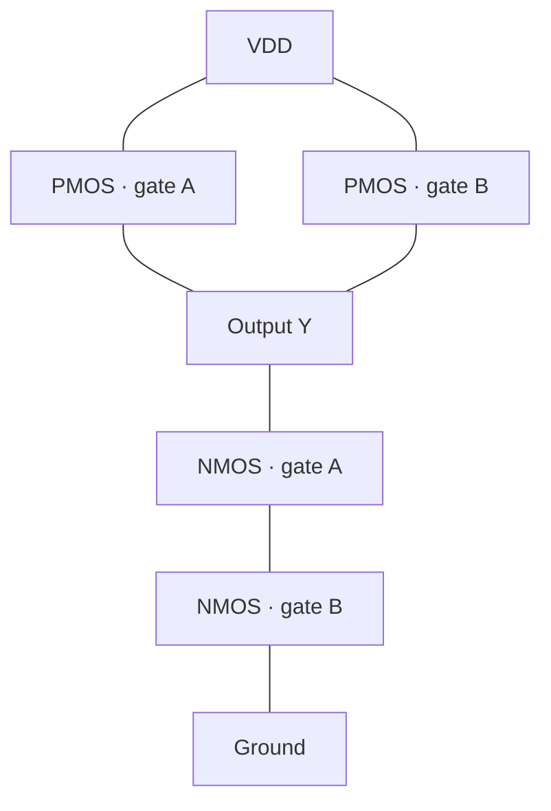

# Chip Architecture Notebook

From transistors to architecture, company strategy, and our own design decisions.

Started: 2026-10-06  
Last updated: 2026-10-21  
Status: Studying ETH DDCA Spring 2026 Lecture 8: Instruction Set Architectures II, from video slide 16 into instruction-cycle control. Latest point: opcodes and instruction fields; earlier discussion covered the program counter (PC), sequential fetch, and jumps.

## Purpose

Build a deep, first-principles understanding of how different kinds of chips work, starting literally at the transistor. Use that understanding to explain why companies choose different architectures, assess what went wrong when a strategy struggled, and identify lessons we could apply if we designed our own chip.

The intended endpoint is the ability to reason about a design: reconstruct how it works, identify its assumptions, estimate its limitations, and explain when another approach would be better.

## How to maintain this notebook

- Treat this file as the main record. Read the current version before updating it, and update the same document as notes arrive.
- Preserve the user's original notes and meaning. Put substantial explanations, proposed study directions, and interpretations in clearly labelled sections.
- Append dated entries to the learning log. Consolidate explanations into topic sections as they develop, retaining useful examples, sources, and unresolved questions.
- Explain new terms when first introduced. Connect each new abstraction to the layer beneath it.
- Record video timestamps when supplied; never invent them or claim to have reviewed unavailable lecture content.
- Distinguish sourced facts, vendor claims, estimates, and our own hypotheses. Date company and product claims and specify the chip generation.
- Correct errors explicitly rather than silently preserving a mistaken conclusion. Do not mark a topic as understood solely because an explanation has been written.
- Style: Concise lecture-course notes. Use short bullets, definitions, equations, and compact examples; avoid repeated explanations. Keep chat replies concise too.
- Current workflow (2026-10-12): update this notebook as notes and questions arrive. Save key topics, interesting points, corrections, and useful talking points; keep detail brief. Teaching scripts are edited only when explicitly requested.
- User preference: Always correct mistakes and qualify oversimplifications. Ask short questions when they expose a useful gap or check understanding. Expand only when requested or needed for accuracy.
- Chapter structure: Current material on transistors, CMOS gates, power, capacitance, and delay belongs to **Chapter 1: Physics**. Add future chapters as the course progresses.
- Follow the user's pace through the course. The study map below is provisional, not a fixed schedule or an assertion of prior knowledge.

## Starting sources

### S1 — Current lecture course

- Current course: **ETH Zürich DDCA, Spring 2026**. [Course playlist](https://www.youtube.com/playlist?list=PL5Q2soXY2Zi-yo9kK-BKrq11ykNKkVEpd).
- Current progress (2026-10-17): **Lecture 8: Instruction Set Architectures II**, from video slide **16** (PC update) into instruction-cycle control. [Official L8 video](https://www.youtube.com/watch?v=n4wUE6H8tCU). Video slide 16 was checked around **4:14**; it corresponds to **slide 13 in the after-lecture PDF** [S13]. Do not assume video and PDF slide numbers match. Earlier notes retain their original edition references.
- Earlier user-provided video (Spring 2025): https://www.youtube.com/live/ubhxKNlOlRg?is=FkSLZbfeLCKGQ0be
- Indexed title: **Digital Design and Computer Architecture — L1: Intro**.
- Indexed description identifies the course as **ETH Zürich, Spring 2025**.
- Role: The user's current route into the foundations; follow their notes and questions as they progress.
- Review status: Video title and description identified on 2026-10-06. The lecture itself has not been reviewed for this notebook; no lecture-specific technical claims or timestamps have been extracted.
- Earlier progress (2026-10-07, Spring 2025): **Lecture 3: Sequential Logic**, Onur Mutlu, 27 February 2025; discussing slide 28. [Video](https://www.youtube.com/watch?v=smHJ1W7S-2Q). Timestamp not supplied.
- Slide review (updated 2026-10-07): Official ETH after-lecture PDFs for L2 [S8] and L3 [S9] retrieved and reviewed. Notes use printed slide numbers (matching PDF pages in these versions). Videos have not been watched.
- Coverage: L2 ends after slide 104 (marker on 105); L3 ends after slide 112 (marker on 113). Later slides are supplementary, not assumed to have been taught in those recordings.
- Teaching practice: One two-minute whiteboard lesson per three ETH lectures: L1–3, L4–6, etc. Plans live in [standup_lectures.md](../../publishing/sand-to-thought/lectures/standup_lectures.md). Lesson 1, **Combinational Logic**, is being developed; final two-minute timing is pending.

### S2 — Destination survey

- Jacob Peake, **AI Chip Architectures**: https://www.jacobpeake.com/ai-chip-architectures
- Accessed: 2026-10-06.
- Role: A map of architectures and company approaches the user ultimately wants to understand deeply.
- The article includes sections on NVIDIA GPUs, Google TPUs, AMD GPUs, Cerebras, AWS Trainium, and Groq LPUs. Its introduction also points toward reconfigurable dataflow, neuromorphic, photonic, and analog approaches.
- Use it to identify questions and follow its references. Check detailed architecture descriptions, performance comparisons, product status, and claims about company outcomes against primary documentation before adopting them as conclusions.

## Chapter 1: Physics

### 1.1 NMOS and PMOS

- **MOS transistor:** voltage-controlled switch; gate voltage controls source–drain conduction.
- Switching depends on gate voltage **relative to the source**.
- In these static CMOS gates: logic 0 ≈ ground; logic 1 ≈ $V_{DD}$. Output charging current comes from the supply.

| Device | On when input is… | CMOS role | Passes well |
| --- | --- | --- | --- |
| PMOS | Low | Pull output up to $V_{DD}$ | High |
| NMOS | High | Pull output down to ground | Low |

- With ordinary supply-limited gate drive, NMOS passes a degraded high; PMOS passes a degraded low.
- **“P on top, N on bottom”:** schematic arrangement, not physical stacking.
- Real transistors have resistance, capacitance, and leakage. [S3, S4]

### 1.2 NOT gate — 2 transistors

Input $A$ drives both gate terminals.

| Transistor | Conduction connection |
| --- | --- |
| PMOS | $V_{DD}$ to output $Y$ |
| NMOS | Output $Y$ to ground |

| A | PMOS | NMOS | Y |
| --- | --- | --- | --- |
| 0 | On | Off | 1 |
| 1 | Off | On | 0 |

- **Function:** $Y=\neg A$.
- PMOS charges the output capacitance; NMOS discharges it.
- Ideally, no direct supply-to-ground path in either settled state. [S4]

**The +3 V example — gate voltage is relative to source (ETH L2, 13–16):**

| Input / both gates | PMOS source = +3 V | NMOS source = 0 V | Output transition |
| --- | --- | --- | --- |
| 0 V | $V_{GS}=-3$ V: on | $V_{GS}=0$ V: off | Charges toward +3 V. |
| +3 V | $V_{GS}=0$ V: off | $V_{GS}=+3$ V: on | Discharges toward 0 V. |

- **Pull-up:** PMOS supplies charge from $V_{DD}$ to the output capacitance. **Pull-down:** NMOS provides a path for discharge to ground. These words describe output voltage.
- During NMOS discharge, electrons move **ground → output**, reducing its positive charge; conventional current is **output → ground**. During PMOS charging, holes move **supply → output**.
- The selected transistor remains on after the output settles, but ideal net current stops when its source and drain voltages match. **ON does not imply a continuous current.**
- **Why these types?** The selected device keeps strong gate–source drive all the way to its desired rail. Reversing their roles with ordinary rail-limited gate voltages gives degraded levels: NMOS high ≈ $V_{DD}-V_{Tn}$; PMOS low ≈ $|V_{Tp}|$. *(ETH L2, 16; approximate threshold model.)*

**Band-physics recap (supplementary to ETH):**

- NMOS has n-type source/drain in a p-type body; a sufficiently positive gate forms a thin electron channel. PMOS reverses the doping and uses a sufficiently negative gate relative to its source to form a hole channel.
- Positive electrical potential lowers electron energy: $\Delta E=-q\Delta V$. Positive NMOS gate bias lowers the channel $E_C$ barrier; negative PMOS gate bias raises channel $E_V$, reducing the hole barrier. Both diagrams use electron energy upwards.
- Raise the voltage of a neutral source contact: its **bands and Fermi level move down together**. Its doping does not change. Varying an insulated gate instead bends channel bands relative to the fixed source/drain contact levels.
- At equilibrium, the connected silicon has a flat Fermi level even when its bands bend. The oxide allows a biased gate to have a different Fermi level. With source–drain bias, there is no single global equilibrium Fermi level.
- Conduction needs an accessible carrier path; exact alignment of all bands is unnecessary. Net channel current also needs a driving bias. Source = drain can mean zero net current even with an on channel.
- PMOS source +3 V / gate 0 V is **on** because $V_{GS}=-3$ V. PMOS source 0 V / gate 0 V is the separate, normally **off** case. Assume enhancement-mode devices and sufficient gate drive.

Full explanation, sources, whiteboard script, and [comparison diagrams](../../publishing/sand-to-thought/shared/sources.md) are linked at the beginning of [Standup Lesson 1](../../publishing/sand-to-thought/lectures/standup_lectures.md).

### 1.3 NAND gate — 4 transistors

- **Pull-up:** 2 PMOS in parallel.
- **Pull-down:** 2 NMOS in series.
- $A$ and $B$ each control one PMOS/NMOS pair.



Connections show conduction paths; gate controls are labelled in the boxes.

| A | B | Pull-up conducting | Complete pull-down path? | Y |
| --- | --- | --- | --- | --- |
| 0 | 0 | Both PMOS | No | 1 |
| 0 | 1 | PMOS A | No | 1 |
| 1 | 0 | PMOS B | No | 1 |
| 1 | 1 | Neither | Yes | 0 |

**Function:** $Y=\neg(A\land B)$. Both inputs must be high to discharge the output; either low input enables a pull-up. [S3]

### 1.4 Power consumption

$$
P_{\text{switching}}\approx\alpha C V_{DD}^{2}f,
\qquad
P_{\text{leakage}}=V_{DD}I_{\text{leakage}}
$$

- $C$: capacitance; $f$: clock frequency.
- $\alpha$: average **0→1 transitions per clock cycle**; a clock node has $\alpha=1$.
- **Correction to $CV^2f$:** include activity unless $\alpha=1$, activity is absorbed into $C$, or $f$ counts complete charge/discharge cycles.
- **Lecture notation:** slide 18 uses $f$ for capacitor charging frequency; its $CV^2f$ already reflects switching activity. Use $\alpha$ when $f$ means clock frequency. [S8]
- Leakage persists without switching; it approximates static power in these gates.
- Dynamic power also includes brief **short-circuit current** when both networks conduct during switching. [S5]
- **Energy:** charging draws $CV_{DD}^2$ from the supply. Half dissipates during charging; half is stored and later dissipates during discharge. A complete cycle dissipates $CV_{DD}^2$; the ideal capacitor stores energy, while conducting paths dissipate it. [S6]

### 1.5 Circuit size and capacitance

- More transistors and wiring generally mean more capacitance.
- **Qualification:** added capacitance increases switching power only if it switches, with other terms fixed.
- For nodes sharing voltage and clock frequency:

$$
P_{\text{switching}}\approx V_{DD}^{2}f\sum_i\alpha_i C_i
$$

- Constant-voltage nodes consume no capacitive switching power after settling; their circuitry may still leak. [S5, S7]

| Change, other terms fixed | Switching power |
| --- | --- |
| Double capacitance | ×2 |
| Double frequency | ×2 |
| Voltage reduced to 80% | ×0.64 |

Voltage also affects achievable speed; voltage and frequency are not always independent.

**Example:** $C=1\ \text{pF}$, $V_{DD}=1\ \text{V}$, $f=1\ \text{GHz}$, $\alpha=0.1$ → $P=0.1\ \text{mW}$. Doubling only $C$ → $0.2\ \text{mW}$.

**Check:** A powered block has no switching. Which power term remains? *(Answer not yet recorded.)*

### 1.6 Why series connections add delay

Changing voltage requires moving charge; transistor current is finite:

$$
t\approx\frac{C\,\Delta V}{I_{\text{average}}}
$$

More capacitance or less current → slower transition. [S6]

| Connection | Delay mechanism |
| --- | --- |
| Transistors in series inside a NAND | On-resistances approximately add; discharge current falls. |
| Logic gates cascaded | Each stage drives the next stage's input capacitance; propagation delays accumulate. |

- **Simple NAND model:** two equal-sized NMOS give $R_{\text{total}}\approx2R$. At the same output capacitance, the $RC$ discharge-delay estimate roughly doubles.
- **Limits:** not an exact NAND/inverter speed ratio. Current varies with voltage; internal capacitance, input timing, and initial voltages also matter. [S3, S6]
- **Terminology:** source–drain paths are in series; gate terminals are controls. Both transistors can turn on together.
- **Sizing trade-off:** wider transistors reduce resistance but add input and diffusion capacitance → more load on the preceding stage and potentially more switching energy. [S3]

### 1.7 Three-input majority

- **Definition:** output is 1 when **at least two of three inputs are 1**; otherwise 0. Each input is one bit.
- **Boolean expression:** $Y=AB+AC+BC$, where multiplication means AND and $+$ means OR. Any pair of 1s makes the output 1.
- **Examples:** 110 → 1; 101 → 1; 111 → 1; 100 → 0.
- **Full adder:** $C_{\text{out}}=AB+AC_{\text{in}}+BC_{\text{in}}$. Adding three input bits produces a carry when at least two are 1: their arithmetic total is 2 or 3. The sum bit is a separate output. [S8, slide 40]

### Technical references

S3–S7 support the circuit clarifications (accessed 2026-10-06); S8–S9 are the official lecture slides reviewed on 2026-10-07.

- **S3:** MIT 6.884, [CMOS Technology and Logic Gates](https://ocw.mit.edu/courses/6-884-complex-digital-systems-spring-2005/5db68ba6abd100ecc232604ccfeb9f46_l03_cmos_gates.pdf), slides 14–20: pull-up/down networks and NAND; slides 23–26: resistance, capacitance, and delay.
- **S4:** Weste and Harris, [CMOS VLSI Design, 4th edition, Chapter 1](https://pages.hmc.edu/harris/cmosvlsi/4e/cmosvlsidesign_4e_ch1.pdf): transistor switches, CMOS gates, and strong/degraded logic levels.
- **S5:** Harris, [CMOS VLSI Design, Lecture 7: Power](https://pages.hmc.edu/harris/cmosvlsi/4e/lect/lect7.pdf), slides 7–10, 18–20: activity, switching power, leakage, and capacitance.
- **S6:** MIT 6.012, [Lecture 13: CMOS Circuits](https://ocw.mit.edu/courses/6-012-microelectronic-devices-and-circuits-spring-2009/de333d22ec4230412f4e7bdd4da3d6ce_MIT6_012S09_lec13.pdf), slides 3–9: delay and load capacitance; slide 13: charging/discharging energy; slides 15–16: NAND transistor sizing.
- **S7:** MIT 6.004, [8.1 Annotated Slides](https://ocw.mit.edu/courses/6-004-computation-structures-spring-2017/pages/c8/c8s1/): static and dynamic power.

- **S8:** Onur Mutlu, **Lecture 2: Combinational Logic**, ETH Zürich, Spring 2025, 21 February 2025. [Official after-lecture slides](https://safari.ethz.ch/ddca/spring2025/lib/exe/fetch.php?media=onur-ddca-2025-lecture2-combinational-logic-afterlecture.pdf). Replaces the earlier third-party copy as the reference. Slides 10–18 support Chapter 1; slides 36–104 support Chapter 2.
- **S9:** Onur Mutlu, **Lecture 3: Sequential Logic**, ETH Zürich, Spring 2025, 27 February 2025. [Official after-lecture slides](https://safari.ethz.ch/ddca/spring2025/lib/exe/fetch.php?media=onur-ddca-2025-lecture3-sequential-logic-afterlecture.pdf) · [Video](https://www.youtube.com/watch?v=smHJ1W7S-2Q). Slides 2–35 finish combinational logic; slides 37–112 introduce sequential logic. Detailed FSM design after slide 115 is supplementary to L3.
- **S10:** Onur Mutlu, **Lecture 6: Timing and Verification**, ETH Zürich, Spring 2026, 6 March 2026. [Official after-lecture slides](https://safari.ethz.ch/ddca/spring2026/lib/exe/fetch.php?media=onur-ddca-2026-lecture6-timing-and-verification-afterlecture.pdf) · [Saved deck](https://safari.ethz.ch/ddca/spring2026/lib/exe/fetch.php?media=onur-ddca-2026-lecture6-timing-and-verification-afterlecture.pdf). Retrieved 2026-10-13 via the official schedule. Printed slide numbers match PDF pages. Slides 34, 50–51, 59, 61, 65, 67, 72, 74, and 89 checked visually.
- **S11:** Onur Mutlu, **Lecture 6b: Verification & Testing**, ETH Zürich, Spring 2026, 11 March 2026. [Official slides](https://safari.ethz.ch/ddca/spring2026/lib/exe/fetch.php?media=onur-ddca-2026-lecture6b-verification-and-testing.pdf) · [Saved deck](https://safari.ethz.ch/ddca/spring2026/lib/exe/fetch.php?media=onur-ddca-2026-lecture6b-verification-and-testing.pdf). Retrieved 2026-10-13 via the official schedule; 42 PDF pages, with printed slide numbers matching pages. Text reviewed throughout; slides 9, 11, 34, and 36 checked visually. Some material also appears in S10's further-study slides after its lecture-end marker on 109.
- **S12:** Onur Mutlu, **Lecture 7: Von Neumann Model & Instruction Set Architectures**, ETH Zürich, Spring 2026, 12 March 2026. [Official after-lecture slides](https://safari.ethz.ch/ddca/spring2026/lib/exe/fetch.php?media=onur-ddca-2026-lecture7-vonneumann-isa-afterlecture.pdf) · [Saved deck](https://safari.ethz.ch/ddca/spring2026/lib/exe/fetch.php?media=onur-ddca-2026-lecture7-vonneumann-isa-afterlecture.pdf). Retrieved 2026-10-13 via the official schedule; printed numbering matches the checked PDF pages. Selected timing, memory, processing-unit, I/O, ISA, and instruction-cycle slides checked visually as recorded in their sections. Coverage ends at slide **106**, followed by marker **107**; marker **109** identifies the remaining slides as supplementary. The instruction-cycle notes separately identify supplementary slides **110–111**.
- **S13:** Onur Mutlu, **Lecture 8: Instruction Set Architectures II**, ETH Zürich, Spring 2026, 13 March 2026. [Video](https://www.youtube.com/watch?v=n4wUE6H8tCU) · [Official after-lecture slides](https://safari.ethz.ch/ddca/spring2026/lib/exe/fetch.php?media=onur-ddca-2026-lecture8-isa-ii-afterlecture.pdf) · [Saved deck](https://safari.ethz.ch/ddca/spring2026/lib/exe/fetch.php?media=onur-ddca-2026-lecture8-isa-ii-afterlecture.pdf). Retrieved 2026-10-17. Video **16** = PDF **13**, “PC UPDATE in LC-3”; video **17** shows the abbreviated control FSM also shown on PDF **14**. These mappings were checked in the recording; PDF slides 13–14 and 16 were checked visually. Other video/PDF mappings remain unverified.
- **Course index:** [ETH Spring 2025 schedule](https://safari.ethz.ch/ddca/spring2025/doku.php?id=schedule), checked 2026-10-07; confirms lecture numbering, dates, videos, and slide versions.

## Chapter 2: Combinational logic — Lecture 2

**Core idea:** build a computation from gates. These are slide-based notes, not a record of completed study. [S8]

- **Physical foundation:** transistors → gates; changing voltages costs time and energy. See Chapter 1. *(L2, 10–18.)*
- **Combinational circuit:** no stored state; after settling, the same inputs give the same outputs. A **truth table** lists every input combination and its result. *(37–40, 54–56.)*
- **Boolean notation:** $AB$ = AND; $A+B$ = OR; $\neg A$ = NOT; $A\oplus B$ = XOR (1 when the two bits differ). These are logic operations, not ordinary arithmetic. *(19, 40–49.)*
- **Equivalent circuits:** different expressions can give the same truth table but different area, delay, and energy. Example: $AB+A\neg B=A$. De Morgan: $\neg(AB)=\neg A+\neg B$. *(45–51, 68–70.)*
- **Canonical forms:** SOP (sum of products) ORs the AND terms for output-1 rows; POS (product of sums) ANDs the OR terms that are zero on output-0 rows. Each canonical term includes every input. Simplify afterwards. *(52–70.)*
- **Decoder:** a basic active-high $n$-to-$2^n$ decoder turns an input code into one active output (**one-hot**). Example: 2-bit input 10 raises $D_2$; all other outputs are 0. Each output detects one minterm: $D_2=A\neg B$. *(77–78.)*
- **Decoder uses:** address 10 can select location 2 in a four-location memory. Instruction decoding recognises an **opcode** (operation code) and generates controls for operations such as ADD or MULTIPLY; arithmetic circuitry performs the operation. Toy encoding: 01 = ADD, 10 = MULTIPLY; real instruction formats may use several fields. *(79; illustrative codes, not a real ISA.)*
- **Multiplexer (MUX):** selects one data input and passes its value to the output. In a 2-to-1 MUX, $S=0$ selects $D_0$; $S=1$ selects $D_1$: $Y=(\neg S)D_0+SD_1$. Example: $D_0=0$, $D_1=1$, $S=1$ → $Y=1$. A 4-to-1 MUX needs two select bits. Tri-state buffers can implement a MUX; see the L3 slide 21 notes in §3.1. *(L2, 81–84; L3, 21.)*
- **Full adder:** combines two operand bits and a carry-in into a sum bit and carry-out. See §2.1 below for the gate logic and a worked four-bit addition. *(40, 92–95.)*
- **Lookup table (LUT):** a small stored truth table. A single-output $k$-input LUT stores $2^k$ output bits; the inputs select one using a MUX. Example: input order 00, 01, 10, 11 with stored bits 0, 0, 0, 1 implements AND. Replacing these with 0, 1, 1, 0 implements XOR. *(L2, 88–89; L3, 83.)*
- **FPGA (field-programmable gate array):** many LUTs plus configurable connections implement larger circuits. **Qualification:** LUT lookup explains much of the programmable combinational logic; a full FPGA also has flip-flops for state, routing, and input/output circuitry. *(L3, 84; supplementary detail: [AMD logic blocks](https://docs.amd.com/r/en-US/ug474_7Series_CLB/CLB-Overview), [interconnect](https://docs.amd.com/r/en-US/ug474_7Series_CLB/Interconnect-Resources), accessed 2026-10-07.)*
- **Programmable logic array (PLA):** forms AND terms from plain/inverted inputs, then ORs selected terms for each output. See §2.2 for a full-adder implementation and why any finite Boolean function can be represented. *(L2, 98–104; L3, 6.)*

### 2.1 Binary addition and the full adder

**Sources:** L2 slide 40 (equations), 92–93 (full adder), 94 (this example), 95 (ripple carry). [S8]

- **Binary place values:** from right to left, 1, 2, 4, 8, … . Just as decimal addition carries at 10, binary addition carries at 2: $1+1=10_2$ means write 0 here and carry 1 to the next column.
- **Full adder:** handles one column. Inputs are two operand bits $A,B$ and incoming carry $C_{in}$; outputs are sum bit $S$ and outgoing carry $C_{out}$.
- **Arithmetic meaning:** $A+B+C_{in}=S+2C_{out}$. The total can be 0, 1, 2, or 3; its two-bit binary representation is $C_{out}S$.

**Gate logic:**

$$
S=A\oplus B\oplus C_{in}
$$

$$
C_{out}=(A\land B)\lor(A\land C_{in})\lor(B\land C_{in})
$$

- Sum is 1 when an **odd number** of inputs are 1 (one or three); carry is 1 when **at least two** are 1. XOR, AND, and OR gates implement these rules.
- Example for one column: $1+1+1=11_2$ → sum 1, carry 1.
- **Multi-bit addition:** use one full adder per bit; connect each carry-out to the next column's carry-in. For ordinary addition, the rightmost carry-in is 0. This chain is a **ripple-carry adder**; carries take time to propagate through the combinational circuit.

**Worked example: $1011_2+1001_2$ (11 + 9).** Start at the rightmost column with carry-in 0.

```text
   1011
 + 1001
 ------
  10100
```

| Column (right to left) | Input bits + carry-in (arithmetic) | Sum bit | Carry to next column |
| --- | --- | --- | --- |
| 0: ones | 1 + 1 + 0 = 2 | 0 | 1 |
| 1: twos | 1 + 0 + 1 = 2 | 0 | 1 |
| 2: fours | 0 + 0 + 1 = 1 | 1 | 0 |
| 3: eights | 1 + 1 + 0 = 2 | 0 | 1 |

Read the sum bits from left to right: **0100**. Put the final carry **1** in front: **10100₂ = 20**. Retaining that carry gives the full five-bit unsigned result.

#### Subtraction using the same adder — L3, slide 13

- **Correction:** $A-B=A-\operatorname{NOT}(B)$ is not generally true. The useful identity is

$$
A-B\equiv A+\operatorname{NOT}_n(B)+1\pmod{2^n}.
$$

- $\operatorname{NOT}_n$ flips all $n$ bits. Keep the lowest $n$ result bits. **Two's complement negation** means flip the bits **and add 1**.
- **Why:** for an unsigned $n$-bit pattern, $\operatorname{NOT}_n(B)=2^n-1-B$. Adding 1 gives $2^n-B$; adding $A$ gives the desired difference plus $2^n$, which disappears when only $n$ bits are kept.
- **Four-bit example: $5-3=2$.**

```text
    0101   A = 5
  + 1100   NOT(0011), where B = 3
  + 0001   initial carry-in
  ------
   10010   keep four bits → 0010 = 2
```

- **L3 slide 13 wiring:** control $F_2=1$ both selects inverted $B$ through the upper MUX and supplies the adder's carry-in of 1. For subtraction, $F_{1:0}=10$ selects the adder result at the output MUX. With $F_2=0$, the same adder uses plain $B$ and carry-in 0 for addition. [S9, slides 13–14]

### 2.2 PLA: from a truth table to any Boolean function

**Sources:** L2 slides 98–100 (structure), 104 (full-adder PLA); L3 slide 4 (full-adder recap), 6 (functional completeness). [S8, S9]

A **programmable logic array (PLA)** implements sum-of-products logic: an AND stage forms product terms, then an OR stage combines selected terms for each output. A general PLA can configure both stages' connections.

**Important qualification:** we need both plain and inverted inputs, such as $A$ and $\neg A$; NOT gates provide the inverted versions. **AND, OR, and NOT together** can implement any finite Boolean function. AND and OR alone cannot implement functions such as NOT.

**Example: implement the full adder as a PLA.** Let $C=C_{in}$. Each AND term below detects exactly one input pattern. A 1 in an output column means connect that term to that output's OR gate; 0 means leave it disconnected.

| Input $ABC$ | AND term (minterm) | Connect to sum $S$ | Connect to carry $C_{out}$ |
| --- | --- | --- | --- |
| 000 | $m_0=(\neg A)(\neg B)(\neg C)$ | 0 | 0 |
| 001 | $m_1=(\neg A)(\neg B)C$ | 1 | 0 |
| 010 | $m_2=(\neg A)B(\neg C)$ | 1 | 0 |
| 011 | $m_3=(\neg A)BC$ | 0 | 1 |
| 100 | $m_4=A(\neg B)(\neg C)$ | 1 | 0 |
| 101 | $m_5=A(\neg B)C$ | 0 | 1 |
| 110 | $m_6=AB(\neg C)$ | 0 | 1 |
| 111 | $m_7=ABC$ | 1 | 1 |

$$
S=m_1\lor m_2\lor m_4\lor m_7,\qquad
C_{out}=m_3\lor m_5\lor m_6\lor m_7
$$

- **Trace 110:** only $m_6$ is 1. It feeds the carry OR gate, so $S=0$, $C_{out}=1$: $1+1+0=10_2$.
- **Shared term:** $m_7$ feeds both OR gates; input 111 produces $S=1$, $C_{out}=1$. The unused $m_0$ can be omitted.
- **L3 slide 4 — why leave the first AND output disconnected?** Its three input bubbles mean inversion, so it computes $m_0=(\neg A)(\neg B)(\neg C_{in})$: it outputs 1 only for 000. But $0+0+0$ requires sum 0 and carry 0. Connecting $m_0$ to either output's OR gate would incorrectly make that output 1 for 000. Its inputs are connected; its output is unused, and the gate can be omitted.

**Why this works for any Boolean function:** take its truth table, make an AND term for each output-1 row, then OR those terms. Repeat for each output, sharing terms where useful. A sufficiently large PLA can therefore implement any chosen combinational input/output mapping.

**Why it may be inefficient:** an $n$-input truth table has $2^n$ rows, so the canonical construction can require exponentially many terms and connections. Here, carry uses four three-input minterms, but simplifies to $AB+AC+BC$ (Boolean $+$ means OR); sum can use two XOR gates. PLAs can also simplify and share terms: the construction guarantees the function, not minimum area, delay, or energy.

## Chapter 3: From logic to memory — Lecture 3

**Status:** in progress; current discussion includes the sequential-circuit introduction on slide 50. L3 first completes combinational logic, then adds stored state. Later sequential-logic notes remain a preview until covered. [S9]

**Opening picture — ETH L3, slide 50:**

```text
Inputs --> [Combinational logic] --> Outputs
                    ^   |
       stored state |   | next state
                    |   v
                    [Storage]
```

The logic uses current inputs **and stored state** to calculate outputs and the next state. Storage feeds that remembered information back, so behaviour can depend on past inputs. This is the opening diagram for Standup Lesson 2. Clocked flip-flops are one implementation, introduced later.

- **Remaining blocks:** NAND alone can implement any Boolean function; an equality comparator checks matching bits; an arithmetic logic unit (ALU) selects an arithmetic/logic operation. *(L3, 6, 10–13.)*
- **Tri-state buffer:** enables **controllable communication**: an enable signal determines whether the device drives 0 or 1 onto a connection or releases it to high impedance ($Z$). Shared wires need at most one enabled driver. See §3.1 for the transistor implementation and why slide 23 is an inverting version. *(17–23.)*
- **Simplification:** preserve the truth table while improving the implementation; gate count is one consideration alongside design effort, area, delay, and power. See §3.2 for the verified slide 28 example, the main laws, and methods. *(28–34.)*
- **Memory from feedback:** two cross-coupled inverters have two stable states, storing one bit. Controls let us change that bit. *(50–56.)*
- **NAND R–S latch:** inputs are active-low: $(S,R)=(1,1)$ holds; $(0,1)$ sets $Q=1$; $(1,0)$ resets $Q=0$; avoid $(0,0)$. *(56.)*
- **D latch:** while write-enable is 1, output $Q$ follows input $D$; when disabled, it holds. **D flip-flop:** samples $D$ on a clock edge, then holds. Level-sensitive versus edge-triggered. *(60–61, 103–110.)*
- **Registers and memory:** group bits into registers; addressable memory adds row selection and read/write controls. $2^a$ locations × $w$ bits = $2^a w$ stored bits, using $a$ address bits. Example: 4 × 3-bit locations = 12 bits, 2 address bits. *(63–77, 111–112.)*
- **Sequential circuit:** current inputs plus stored **state** determine behaviour. A synchronous finite-state machine (FSM) has a state register, next-state logic, and output logic. Its clock coordinates state updates; logic must settle before the next capture. *(50, 87–100.)*

### 3.1 Tri-state buffers: transistor implementation

**User question:** “of what is a tri state buffer made? one transisitor?”

**L3 slide 23 shows four transistors — specifically a tri-state inverter:**

- **Two data-controlled transistors:** a PMOS and an NMOS, like an ordinary CMOS inverter; both gates receive input $A$.
- **Two enable-controlled transistors:** another PMOS in series with the pull-up path, controlled by $\neg EN$, and another NMOS in series with the pull-down path, controlled by $EN$.

| Enable | Enable-controlled transistors | Output |
| --- | --- | --- |
| $EN=1$ | Both on; the data-controlled pair determines the conducting path. | $Y=\neg A$ |
| $EN=0$ | Both off; neither rail drives the output. | $Y=Z$ (high impedance) |

**Why $Y=\neg A$ — logic values versus voltages (slide 23):**

- This relation assumes **$EN=1$**, valid digital inputs, and enough time for the output to settle. The top rail is the supply $V_{DD}$; the bottom rail is ground (0 V).
- In the ideal model, logic 0 is 0 V and logic 1 is $V_{DD}$. The two enable-controlled transistors are on, so the remaining pair acts as an ordinary inverter:

| Input $A$ | A-controlled PMOS | A-controlled NMOS | Output $Y$ |
| --- | --- | --- | --- |
| 0 V (logic 0) | On | Off | Near $V_{DD}$ (logic 1) |
| $V_{DD}$ (logic 1) | Off | On | Near 0 V (logic 0) |

- **Real inputs need not equal the rails exactly:** the circuit specifies valid low and high voltage ranges. A voltage between those ranges has no guaranteed Boolean interpretation; both data-controlled transistors may conduct during a transition.
- $\neg A$ means the opposite **logic value**. It is not a claim that output voltage follows $V_{DD}-V_A$ for arbitrary analog inputs. With $EN=0$, the output is $Z$ instead.

**Counts and qualifications:**

- The four-transistor drawing assumes $EN$ and $\neg EN$ are already available. A separate CMOS inverter to generate $\neg EN$ adds two transistors if needed.
- For a **non-inverting tri-state buffer**, put an ordinary two-transistor inverter **before** the four-transistor stage: six transistors if both enable polarities are available, eight including a separate enable inverter. Other implementations exist.
- A single MOSFET can act as a pass switch, but it does not provide this full CMOS buffering function; with ordinary supply-limited gate drive, one device type passes one logic level poorly (see §1.1).
- $Z$ means the output is not actively driven by this circuit; it is not a third driven voltage level. Another enabled driver can determine the shared wire's voltage.

Source: [S9, slide 23]; enabled behaviour and shared-wire use on slides 17–18.

#### L3 slide 20: what the buffers do on a shared bus

**Purpose:** tri-state buffers enable controllable communication by controlling which device can transmit onto the shared bus. Enable signals determine who drives; input buffers allow devices to listen.

- **Ordinary buffer:** reproduces the input logic value at its output ($Y=A$), using its supply to drive the connected load. Here “buffer” means a signal driver; it does not store data.
- **Upper triangle, pointing toward the bus:** a tri-state output buffer. When that device's enable is 1, it drives its data onto the shared bus; when enable is 0, its output is $Z$, allowing another device to drive the bus.
- **Lower triangle, pointing into the device:** an ordinary input buffer. It receives the bus voltage and supplies the corresponding logic value to the device's internal circuitry. It does not drive the bus.
- **Example:** memory sends data with $en4=1$ and $en1=en2=en3=0$. The processor receives that data through its lower, “from bus” buffer. The other devices can also observe the bus; control logic determines which device uses the data.
- **Rule:** at most one output driver should be enabled at a time; opposing driven values cause bus contention. Receiving through multiple input buffers is allowed. [S9, slide 20]

#### L3 slide 21: a multiplexer made from tri-state buffers

**MUX** is short for **multiplexer**: it selects one data input to drive the output.

Connect the outputs of two non-inverting tri-state buffers to the same wire $Y$. Buffer T0 receives $D_0$ and is enabled when $S=0$; buffer T1 receives $D_1$ and is enabled when $S=1$.

| Select $S$ | T0 | T1 | Output |
| --- | --- | --- | --- |
| 0 | Drives $D_0$ | $Z$ | $Y=D_0$ |
| 1 | $Z$ | Drives $D_1$ | $Y=D_1$ |

- The bubble on T0's **enable** input means active-low enable; it does not invert the data.
- The disabled buffer releases the wire, so the enabled buffer alone determines $Y$. This implements $Y=D_0\neg S+D_1S$.
- For the four-input example, decode the two select bits into four one-hot enables, one per buffer. This connects the decoder, tri-state buffer, and MUX ideas. [S9, slide 21]

### 3.2 Logic simplification — L3 slides 28–34

**Talking point:** “One goal of circuit design is to simplify the logic while preserving its behaviour. We want a circuit that is easy to design, implement, and verify; the fewest gates is not the only goal. The design must also meet area, speed, and power requirements.”

**Slide 28 is correct.** In Boolean algebra, $+$ means OR and multiplication means AND; $AA=A$, not an arithmetic square.

$$
\begin{aligned}
F&=(\neg A)(A+B)+(B+AA)(A+\neg B)\\
 &= (\neg A)B+(A+B)(A+\neg B)\\
 &= (\neg A)B+A+B\neg B\\
 &= (\neg A)B+A\\
 &= A+B.
\end{aligned}
$$

**Steps:** first use idempotence, distribution, and $A\neg A=0$; then $(X+Y)(X+Z)=X+YZ$; remove $B\neg B=0$; finally use $A+(\neg A)B=A+B$.

**Independent check:** evaluated both expressions on all four inputs; both return 0, 1, 1, 1 for 00, 01, 10, 11. The resulting circuit is one two-input OR gate.

| Tool / theorem | Useful rule |
| --- | --- |
| Idempotence, identity, complement | $AA=A$; $A+0=A$; $A\neg A=0$; $A+\neg A=1$. |
| Distributivity / factoring | $A(B+C)=AB+AC$; $(A+B)(A+C)=A+BC$. |
| Absorption | $A+AB=A$; useful related rule: $A+(\neg A)B=A+B$. |
| Uniting theorem | $AB+A\neg B=A$: combine terms differing in just one input. |
| De Morgan's laws | $\neg(AB)=\neg A+\neg B$; $\neg(A+B)=(\neg A)(\neg B)$. |

**Ways to simplify:** rewrite/factor Boolean expressions; use Karnaugh maps to group compatible truth-table cases; exploit irrelevant inputs or specification-permitted don’t-cares; use synthesis tools to automate simplification and map it to available hardware. Check that the truth table is preserved for every required input. *(L2, 43–51; L3, 28–34. K-maps are signposted for self-study.)*

**Priority circuit (one-line example):** Once the highest-priority request is active, lower-priority inputs cannot change the winner, so their redundant truth-table cases can be grouped into one condition. *(L3, slides 31–32.)*

**Arithmetic connection:** these rules simplify the Boolean circuits inside adders and other arithmetic units, preserving the numerical operation. For example, the full-adder carry simplifies from four canonical minterms to $AB+AC+BC$.

**Design qualification:** easiest to design is a useful preference, not a universal optimisation rule. Fewer gates need not mean lower delay or power. For example, extra carry-lookahead logic can accelerate addition (L2, 95–96). The chosen implementation must meet the design’s requirements. [S8, S9]

**Connection:** gates compute; storage preserves results; clocks coordinate updates.

## ETH DDCA Spring 2026 — Lecture 6: Timing & Verification

**Lecture 6 checkpoint:** user reports finishing the lecture and continuing to L6b. Last explicitly reported L6 slide: **89**. [Lecture 6 video](https://www.youtube.com/watch?v=smY30P4inhk). Official 2026 deck available [S10]; slide references below are verified against it.

### FSM recap — discussion on 2026-10-12

These points summarise our discussion, rather than claim specific coverage in Lecture 6.

- **Finite-state machine (FSM):** remembers one of a fixed number of states; rules determine its next state and outputs from its current state and inputs. Some FSMs have outputs determined only by state.
- **Hardware:** flip-flops store the state; combinational logic calculates the next state and outputs. In a synchronous FSM, the clock edge updates the stored state.
- **Talking point:** “The same input can produce a different response because the machine remembers what happened before.” Example: a two-coin vending machine waits after the first coin and dispenses after the second; two states need one bit.
- **Capacity:** $n$ state bits provide up to $2^n$ states. Finite means a bounded number of states, not a bounded running time: a two-bit counter can repeat $00\rightarrow01\rightarrow10\rightarrow11\rightarrow00$ forever.
- **Limits:** any digital behaviour with fixed, finite internal memory can be represented as an FSM, potentially with enormous numbers of states. A fixed FSM cannot count without bound or retain unlimited information. A real computer with fixed memory also has finitely many states.

**Supplementary reference:** [MIT 6.004, Finite State Machines](https://ocw.mit.edu/courses/6-004-computation-structures-spring-2017/pages/c6/c6s1/), especially state encoding, register implementation, and state-count discussion. Earlier ETH context: Spring 2025 L3, slides 87–100 [S9].

### Delay variation — discussion on 2026-10-13

- **User's point:** “Delays are statistical.”
- **Qualification:** delay varies across manufactured devices and with voltage, temperature, output load, and input transitions. Statistical models describe variation; this does not mean every switch gets a wholly new random delay. Timing checks use minimum/maximum delay models and operating conditions, rather than only an average.
- **Topic placement:** primary home is subject 2, **Circuits and reliable signals**, under propagation delay and variation. Connect to subject 4 for setup/hold timing and reliable state updates, subject 8 for timing closure, and subject 9 for manufacturing variation and yield.
- **Proposed story placement:** introduce delay with carry propagation in chapter 3, **From logic to calculation**; revisit reliable capture in chapter 4, **How circuits remember**, and verification across conditions in chapter 9, **How a design becomes a chip**. Fits the existing chapters; no new chapter needed.
- **Talking point:** “Correct logic must also produce its answer in time, despite variation.”

**References:** ETH L6 slide **32**, now checked in the official 2026 deck [S10], lists causes of delay variation. Supplementary: [MIT 6.004, CMOS timing specifications](https://ocw.mit.edu/courses/6-004-computation-structures-spring-2017/pages/c3/c3s1/) and [Intel, timing analysis concepts](https://www.intel.com/content/www/us/en/docs/programmable/683243/24-1/timing-analysis-basic-concepts.html). Chapter/topic placement is a proposal recorded here.

### Longest and shortest paths — slide 34

- **Longest / critical path:** maximum propagation delay $t_{pd}$; bounds how long we must wait for the result to settle. Slide 34: A or B → AND → OR → AND → Y, giving $t_{pd}=2t_{pd,AND}+t_{pd,OR}$.
- **Shortest path:** minimum contamination delay $t_{cd}$; bounds how soon the output can start changing. Slide 34: D → final AND → Y, giving $t_{cd}=t_{cd,AND}$.
- **Why the longest matters — later connection, slide 65:** data must settle before the next capture edge, allowing **setup time** (the required stable interval before that edge). The longest path helps set the minimum clock period and maximum operating frequency.
- **Why the shortest matters — later connection, slide 72:** newly launched data must not reach the receiving flip-flop so soon that it violates **hold time** (the required stable interval after the capture edge). Slowing the clock generally does not fix a hold violation; the short path may need extra delay.
- **Talking point:** “Data can arrive too late, but it can also arrive too early.” Longest/shortest refer to total signal delay, not physical wire length. Slide 34 uses a simple sum of gate delays; real timing analysis includes interconnect delay too.

**Source:** [S10], slide **34** (circuit and delay paths); slides **65** and **72** (setup/hold significance, previewed to answer why both paths matter). These notes do not mark the later slides as studied.

### Glitches and redundant terms — slides 50–52

- **Cause:** unequal delays can create a brief output pulse even though the correct value before and after an input change is the same. A possible unwanted 1→0→1 pulse is a **static-1 hazard**.
- **K-map test:** for a two-level AND–OR (sum-of-products) implementation with one input changing at a time, check every adjacent pair of 1-cells, including wraparound neighbours. If no selected group covers both cells, there is a potential static-1 hazard. Add a valid group covering both; it introduces no new output-1 cases and omits the changing input.
- **Verified lecture example:** $Y=(\neg A)(\neg B)+BC$. With $A=0$, $C=1$, and $B:1\rightarrow0$, $BC$ can turn off before $(\neg A)(\neg B)$ turns on, causing a dip. Add the **consensus term** $(\neg A)C$: it stays 1 throughout because it does not depend on B. The truth table is unchanged. *(Slides 50–51.)*
- **Talking point:** “Keep one path holding the output steady while the other paths hand over.” Redundant for the settled Boolean result can still be useful for timing.
- **General case: the function alone is insufficient.** The illustrative circuit $(\neg A)CB+(\neg A)C(\neg B)$ computes $(\neg A)C$, yet with $A=0$, $C=1$, and B falling, its two branches can briefly both be 0. The physical output can therefore dip to 0 while its correct settled value is 1. Simplification can hide paths through the changing input.
- **Practical check:** a complex implementation needs analysis of its actual gates, connections, and input transitions. Trace the added term's **fan-in** (all signals/gates feeding it); a K-map or simplified formula alone cannot certify an arbitrary implementation. A settled subcircuit fed solely by steady A and C is a sufficient structural guarantee in the ordinary gate-delay model. Slide 51 uses that direct path: **B changes; A and C stay fixed**. Design tools can analyse connections; delay simulation checks cases but is not an exhaustive proof.
- **Scope and cost:** this test addresses single-input static-1 hazards in that implementation, not every glitch or simultaneous input changes. Preserve the term in the realised circuit; logic optimisation may otherwise remove it. Added logic costs area and can increase power. Glitches on ordinary data paths may be acceptable if they settle before capture and meet setup/hold timing; signals used as clocks or asynchronous controls require particular care. *(Lecture trade-off: slide 52; implementation cautions are supplementary.)*

**Source:** [S10], slides **50–51** checked visually, slide **52** reviewed for the design trade-off. The added item is a product term/gate path, not another input bit or a change to the required truth table. The follow-up example is illustrative; supplementary background: [MIT 6.004, combinational logic and glitches](https://ocw.mit.edu/courses/6-004-computation-structures-spring-2017/pages/c4/c4s1/).

### Reading the D2 waveform — slide 61

- **Cross-hatching means an unsettled interval**, not a literal drawing of rapid, repeated flips. D2 is the data input to receiving register R2; during that interval its value is not guaranteed stable. It may be transitioning or glitching as the combinational logic settles after R1 updates.
- **Timing significance:** D2 must retain the old value through R2's hold interval after the current edge, then reach the new stable value before R2's setup interval preceding the next edge. Too early risks hold; too late risks setup. The marked interval illustrates these potential violations.
- **Instability distinction:** ordinary combinational settling is expected. If it overlaps the capture window, R2 may capture incorrectly or become metastable. The cross-hatching itself does not assert metastability or sustained oscillation. *(Metastability introduced on slide 57.)*
- **Talking point:** “Data may change during computation, but must be steady around capture.”

**Source:** [S10], slide **61** checked visually; slides **56–60** reviewed for the surrounding timing definitions.

### Timing is more than avoiding glitches — slide 67

- **Purpose:** ensure the correct data is available and stable when captured. Even a glitch-free circuit takes time to compute; one clean 0→1 transition arriving after the capture edge can leave the receiving register storing the old 0.
- **Clock-speed limit:** slide 67 gives $T_c>t_{pcq}+t_{pd}+t_{setup}$: allow time for the launching register's output, the longest combinational path, and the receiving register's setup requirement. The critical path helps determine maximum clock frequency.
- **Performance trade-off:** shortening the logic delay does not remove register timing overhead. Very short logic stages can spend a large fraction of their cycle on that overhead; a faster clock alone does not describe useful work per cycle.
- **Talking point:** “A correct answer still needs to arrive on time.” Glitch prevention addresses unwanted pulses; setup/hold checks address safe capture, including ordinary transitions.

**Source:** [S10], slide **67** checked visually; the clean-but-late transition is an illustrative example.

### Setup/hold specifications and register boundaries

- **Who specifies the times?** The flip-flop's internal transistor design determines its capture requirements. Its designer/library supplier characterises these by simulation and testing, then provides setup/hold specifications for the operating conditions. The circuit designer chooses a storage element and meets its requirements; the inequality does not choose $t_{hold}$.
- **Hold requirement versus available delay:** $t_{hold}$ is the minimum specified interval for which data must stay steady after the receiving flip-flop's clock edge. With aligned clocks, $t_{ccq}+t_{cd}>t_{hold}$ checks whether the earliest arriving new data leaves enough time. Slide 74 supplies $t_{hold}=70$ ps and $t_{ccq}=30$ ps, so its simple model needs $t_{cd}>40$ ps. These are example device characteristics, not universal constants; slide 74 is a preview, not reported viewing progress.
- **General concept:** setup/hold requirements apply to data capture, including flip-flops, latches, and memory/interface timing. For a transparent latch, they are relative to its closing transition. Ordinary combinational gates instead have propagation/contamination delays; they do not capture on a clock edge.
- **Standard synchronous structure:** register → combinational logic → register. A register groups flip-flops; the logic block may contain many gates, with no flip-flop between each gate. The clock coordinates stored-state updates. This is a common structure, not a requirement for every circuit: latches, memory blocks, and asynchronous designs also exist.
- **Talking point:** “The storage element sets the capture requirements; the surrounding circuit must deliver data within them.”

**References:** [S10], slides **56**, **59**, **70–74**; [TI SN74HC373 latch datasheet](https://www.ti.com/lit/ds/symlink/sn74hc373.pdf), §4.5, explicitly specifies setup before latch-enable falls and hold after it falls. Device-characterisation explanation is supplementary.

### Clock skew: the price of synchronous design — slide 89

- **User-reported phrasing:** clock skew is “the price of synchronous design”. A shared clock simplifies coordination, but distributing its edge through physical wires and buffers gives different arrival times at different registers. That difference is **clock skew**. *(Definition: slide 86.)*
- **The cost:** designers must build a clock-distribution network that limits skew and allow for remaining skew in timing checks. These margins reduce useful computation time or require added data-path delay. *(Summary: slide 90.)*
- **Slide 89 — hold:** if R2 receives the same clock edge later than R1, R1 has already begun launching new data while R2 is still capturing the old value. The check becomes $t_{ccq}+t_{cd}>t_{hold}+t_{skew}$, where $t_{skew}$ here is the positive amount by which R2's edge is later. R2's intrinsic hold requirement has not changed; the circuit's effective budget has.
- **Illustrative timing:** R1's edge at 0 ps, R2's at 20 ps, and R2 hold time 70 ps → D2 must retain the old value until 90 ps relative to R1's edge. Opposite skew (R2 earlier) tightens setup instead. *(Setup connection: slide 88.)*
- **Talking point:** “A shared clock simplifies coordination; getting it everywhere at nearly the same time costs timing margin and engineering effort.”

**Source:** [S10], slide **89** checked visually; slides **86**, **88**, and **90** reviewed for context. The quoted phrase is reported from the user's viewing, not printed on slide 89; the numerical example is illustrative.

## ETH DDCA Spring 2026 — Lecture 6b: Verification & Testing

**Viewing checkpoint:** user reported watching [short L6b](https://www.youtube.com/watch?v=7FZ-A4wMXlk) before moving to Lecture 7. No exact L6b slide/timestamp supplied. References here use the separate **L6b deck [S11]**, not L6's slide numbering.

### Goals and process

- **Functional correctness:** does the circuit implement the intended behaviour, including relevant states and input sequences? **Timing correctness:** is the correct data available and stable when required? Physical implementation also needs manufacturing-rule checks. *(L6b, 4–8.)*
- **Workflow:** specification/reference model → RTL (register-transfer-level hardware description) + testbench → functional simulation/formal checks → synthesis into a **netlist** (components and connections) → placement/routing → timing and physical checks → iterate on reported failures. The detailed physical flow depends on FPGA versus ASIC technology. *(5–6, 36–40; flow terminology is supplementary.)*
- **Why several levels:** high-level behavioural testing is faster; transistor-level simulation is much slower. Verify intended behaviour at the high level, check equivalence across transformations, and assess physical timing/power with implementation models. *(5–6.)*

### Testbench structure

**Input generator → DUT (device under test) → output checker.** A **golden model** is a simpler reference implementation: it receives the same inputs and supplies expected outputs to the checker. A simulator runs these models; the testbench is testing code, not hardware intended for synthesis. *(9–10, 30–32.)*

| Testbench kind | Inputs / expected results | Checking |
| --- | --- | --- |
| Simple | Written manually | Inspect waveforms manually |
| Self-checking | Written manually or loaded as test vectors | Automatic comparisons |
| Automatic | Generated inputs; reference model supplies expected results | Automatic comparisons |

*(L6b, 11, 17–33.)*

### What the software does

| Tool / software | Role |
| --- | --- |
| HDL simulator, e.g. Vivado Simulator | Runs the DUT and testbench through signal/time events; reports failures and waveforms. Behavioural simulation usually omits accurate physical delays. |
| Synthesis and implementation tools | Map RTL to gates/FPGA resources, then place and connect them. Vivado is a suite containing several such tools, not just a simulator. |
| Formal/property and equivalence tools | Use symbolic reasoning, often SAT/SMT solvers, to check specified properties or whether two representations behave equivalently, under stated assumptions. Formal checking is distinct from simulation. |
| Static timing analysis | Uses the implemented paths, delay models, clocks, and constraints to check setup/hold and report timing margins; does not simulate every input combination. |
| SPICE circuit simulator | Models transistor/device voltages and currents for detailed timing and electrical behaviour; expensive for large designs. |
| Physical design-rule checks | Check layout geometry against fabrication rules; passing does not prove correct logic. |

*(Lecture overview: 4–6, 36–39. Static timing, solver scope, and detailed tool-role distinctions are supplementary.)*

### Problems and pitfalls

- **Testing cannot usually be exhaustive.** Two 32-bit operands give $2^{64}$ input combinations. At one test/ns, this takes about **585 years**. **Correction:** slide 34 prints 58.5 years; its per-day/per-year rates are too large by a factor of ten.
- **The checker can be wrong:** hardcoded expectations, test vectors, and golden models can contain bugs or share a mistaken assumption with the DUT. Prefer a simpler, independently checked reference. *(20, 28, 30, 33.)*
- **Passing tests is limited evidence:** random tests can miss rare cases; sequential designs need sequences, reset cases, and state coverage. Formal results depend on properties, assumptions, and any proof-depth limits.
- **Functional success does not establish timing:** a testbench's `#10` wait or artificial clock is not a check of physical setup/hold. Use implementation timing models and correct constraints; missing constraints can leave paths unchecked. *(22, 36–38.)*
- **Timing closure is iterative:** simplify or split long paths for setup; add delay where needed for hold; inspect routing and clock skew. Re-run functional/equivalence and timing checks after changes. *(39–40.)*

**Talking points:** “The testbench tests the design; something must also check the testbench.” “Verification needs both the right answer and the right timing.”

**Sources:** [S11], references above. Supplementary primary documentation: [AMD post-implementation simulation](https://docs.amd.com/r/en-US/ug900-vivado-logic-simulation/Post-Implementation-Simulation), [YosysHQ equivalence checking](https://yosyshq.readthedocs.io/projects/eqy/en/latest/), [formal assumptions and bounded proofs](https://yosyshq.readthedocs.io/projects/ap109/en/latest/), and [ngspice circuit simulation](https://ngspice.sourceforge.io/).

## ETH DDCA Spring 2026 — Lecture 7: Von Neumann Model & Instruction Set Architectures

**Current viewing:** [Lecture 7 video](https://www.youtube.com/watch?v=fOl5MLoUzco), **slide 87**. Timestamp not supplied.

### A Final Word on Timing — slide 8

- **Critical-path design:** reduce the maximum logic delay to improve the achievable clock speed while satisfying timing requirements.
- **Balanced design:** balance the logic delays between register pairs; one slow block otherwise sets the pace and leaves faster blocks waiting.
- **Common-case (“bread and butter”) design:** prioritise typical use cases while keeping uncommon cases from dominating the design. This does not authorise ignoring correctness or required timing for supported cases.

**Source:** [S12], printed slide **8**, verified visually. [Source slide](https://safari.ethz.ch/ddca/spring2026/lib/exe/fetch.php?media=onur-ddca-2026-lecture7-vonneumann-isa-afterlecture.pdf).

### Supply voltage and timing failures during operation

- **Lower chip supply voltage generally slows switching.** If the clock keeps its pace, a previously safe path can miss its setup deadline. Slower data paths primarily threaten **setup**, not hold (which concerns data changing too early); voltage changes can also affect registers and clock timing.
- **What fails:** a register may capture an old/wrong bit or become metastable. A timing violation removes the guarantee of correct capture; it does not mean every violation produces a visible error.
- **System consequences:** wrong arithmetic/results, corrupted addresses or control decisions, application crashes, hangs, or system resets. An undetected wrong result is **silent data corruption**. Returning the voltage to normal does not automatically repair already-corrupted state.
- **Protection:** voltage margins, power regulation, and appropriately coordinated voltage/clock changes help prevent failures. Detection and recovery depend on the design; memory ECC does not protect every computation inside a processor.
- **Data-centre qualification:** an external power disturbance need not reach the chip's supply rail because power supplies, regulators, and backup systems can buffer it. The relevant quantity is the voltage actually delivered to the chip.

**Discussion reference:** [Intel on undervolting and computational faults](https://www.intel.com/content/www/us/en/security/security-practices/blogs/software-based-thermal-glitching.html), especially “Undervolting and Glitching”. These are discussion notes, not a claim that these details appear on L7 slide 8.

### Offline versus online verification/testing

- **Offline:** check the design or hardware apart from normal service—e.g., RTL simulation, formal verification, manufacturing tests, or taking a deployed server out of service for diagnostics. Offline does not necessarily mean before deployment.
- **Online:** check while the system remains in service—e.g., ECC/parity checks on accesses, runtime assertions, redundant computations compared for agreement, or background diagnostics. These checks can detect faults that escaped earlier testing or arise during operation; they do not prove every computation correct.
- **Concrete contrast:** test an adder with known inputs and expected answers before using it (offline); check selected calculations as the machine performs useful work (online).
- **Talking point:** passing factory tests is not a lifetime guarantee. Ageing, changing conditions, or rarely exercised operations can reveal faults later. Online checks cost resources and only cover the faults they are designed to detect; detection and recovery are separate steps.
- Here, **online does not mean connected to the internet**. Functional/timing checks describe *what* is checked; online/offline describes *when and how* checking relates to normal service.

**Lecture context:** [S12], L7 slide **9**, “Making Sure A Design Works Correctly”, verified visually: faults can escape into the field, motivating online verification/testing. The examples and terminology clarification above are our discussion, rather than a verbatim definition on the slide. Related paper cited by the lecture: [Cores that don't count](https://sigops.org/s/conferences/hotos/2021/papers/hotos21-s01-hochschild.pdf).

### From logic building blocks to a computer model

- **User takeaway:** we have covered the foundations of combinational and sequential logic; the next step is organising these structures into a computer. Logic structures can implement execution, decision, storage, and communication units. *(L7 slide 27, “Building Up to A Basic Computer Model”, verified visually [S12].)*
- **NAND qualification:** NAND can implement any Boolean function. Carefully designed feedback and appropriate timing allow NAND-based circuits to store state too; purely combinational NAND networks alone do not provide memory.
- **Possibility versus efficiency:** being able to build a digital computer using NAND does not make an all-NAND implementation best. Practical chips use varied gates, flip-flops, and specialised memory structures to improve speed, area, and energy use.
- **Talking point:** we now have the building blocks for computation and memory. Architecture determines how to organise them into a machine that follows a program.

### Address space versus installed RAM — slide 33

**For the blog:** use this slide to introduce how memory is organised and named.

- **Memory stores both programs and data.** Both are represented as bits; their interpretation determines whether they are instructions, numbers, text, etc.
- **Bytes and words:** a byte is 8 bits. A word is a grouping used by the architecture (the slide gives 8-, 16-, and 32-bit examples); its size is not universal.
- **Address space:** the set of distinct locations that can be named by addresses; with n address bits, there are 2^n possible addresses. This is not the amount of RAM physically installed.
- **Addressability:** how much data each address identifies. Byte-addressable memory has one byte per address; LC-3 uses 16-bit words per address, so its 2^16 addresses represent 128 KiB of capacity if fully populated.
- **Slide examples:** LC-3 has 16-bit addresses (2^16 locations); the MIPS example has 32-bit addresses (2^32 locations). The slide's x86-64 example uses 48-bit addresses (2^48 locations)—see the qualification below before quoting this in the blog.
- **Access size is a separate choice:** an instruction may operate on a byte or a word. A word-sized access in byte-addressable memory spans several byte locations; it does not make the memory word-addressable.
- **Example:** a 32-bit, byte-addressable space spans 2^32 bytes = 4 GiB, even if only 2 GiB of RAM is installed. Possible addresses need not all correspond to installed RAM; some can be unmapped or refer to devices.
- **Talking point:** the address is a location's label; the stored value is its contents. The number of possible labels and the amount of storage provided are separate quantities.

**Reference:** [S12], L7 slide **33**, “Memory”, verified visually. The installed-RAM example is our clarification of the slide's definition.

**Blog accuracy qualification:** the slide's “up to 2^48” x86-64 wording is not a universal modern limit. Supported implementations with five-level paging can use 57-bit virtual addresses. These are virtual address widths, not installed-RAM capacities. [Intel's five-level paging white paper](https://cdrdv2-public.intel.com/671442/5-level-paging-white-paper.pdf).

### Addressing granularity: bytes versus words — for the blog

- **Correction to the proposed MIPS history:** MIPS32 has 32-bit words and registers, but each memory address identifies an 8-bit byte. A word occupies four consecutive byte addresses. We have not established a historical change from 32-bit-per-address MIPS to 8-bit-per-address MIPS; these widths describe different things.
- **The balance:** for a fixed amount of storage, smaller addressable units mean more distinct addresses. Example: 16 bytes of storage can be named as four 32-bit words (4 addresses) or sixteen bytes (16 addresses). Byte addressing needs two more address bits to distinguish the same storage. Conversely, with a fixed address width, larger units allow the same number of addresses to cover more total storage.
- **Why byte addressing is useful:** directly access small data such as ASCII characters, byte-sized values, and bytes in files or network packets; straightforward byte offsets into buffers and mixed-size data structures; byte load/store instructions avoid manually extracting or replacing a byte using word-wide shifts and masks.
- **Keep efficient wide accesses:** byte-addressable does not mean only one byte can be transferred per operation. MIPS can load/store a 32-bit word across four byte locations, while retaining byte access when needed.
- **Qualification:** word-addressable memory can also pack several small values into a word; byte addressing makes those individual values easier to name and access. It does not automatically quadruple storage efficiency or make every operation faster, and it does not require physical RAM to transfer only 8 bits at a time.
- **Talking point:** choose how finely to label memory independently of how much data the processor can work with at once.

**References:** L7 slide 33 [S12] distinguishes address space, addressability, and access size. [Microchip's MIPS32 data-type documentation](https://developerhelp.microchip.com/xwiki/bin/view/products/mcu-mpu/32bit-mcu/PIC32/mz-arch-cpu-overview/isa-overview/data-types/) confirms 8-bit bytes, 32-bit words, and byte/halfword/word loads. The tradeoff and reasons above are our explanation, not a claim about MIPS's historical designers' motives.

### Reading the byte-addressable memory diagram — slide 36

- **Byte-addressable means every individual byte (8 bits) has its own address.** Increasing an address by 1 selects the next byte, not the next whole word.
- **Diagram:** each green cell is one byte (e.g., hexadecimal F2 is 8 bits). Each row groups four bytes into a 32-bit MIPS word. The diagram labels only each word's starting byte address: 0, 4, 8, C (hexadecimal C = decimal 12).
- **Addresses within rows:** word 0 occupies byte addresses 0–3; word 1 occupies 4–7; word 2 occupies 8–11; word 3 occupies 12–15. The omitted intermediate addresses still exist.
- **Access size:** a byte load reads one addressed byte; a word load at an appropriate starting address reads four bytes together. Row grouping does not make the memory word-addressable.
- **Question at the bottom:** which displayed byte belongs at the lowest address? How byte positions relate to a word's significance is the separate issue of endianness; do not infer the byte-to-address ordering just from slide 36's cells.
- The slide states that MIPS is actually byte-addressable and that LC-3b is byte-addressable too. This is not evidence for the proposed historical change in MIPS's addressing.

**Reference:** [S12], L7 slide **36**, “Byte-Addressable Memory”, verified visually. **Blog talking point:** the picture groups bytes into words for readability, but each byte keeps its own address.

**Missing prerequisite — reading hexadecimal:** a hexadecimal digit has 16 possible values: 0–9, then A–F for 10–15. Four binary bits also have 2^4 = 16 possible patterns, so one hex digit represents exactly four bits. A byte contains eight bits and can therefore be written using two hex digits: **F2 = 1111 0010** (F = 1111, 2 = 0010). Hexadecimal is a compact way for people to write the stored bits, not a different kind of storage. Include this explanation before the memory diagram in the blog.

### Accessing memory: MAR and MDR — slide 40

**For the next lesson/blog:** memory access needs both a location and the data being transferred.

| Register | What it holds | Talking point |
| --- | --- | --- |
| **MAR — Memory Address Register** | The address of the location to access. | **Where?** |
| **MDR — Memory Data Register** | The data just read from memory, or the data to write to memory. | **What?** |

- **Read/load:** put the desired address in MAR; perform the memory read; when the data is available, capture it in MDR. Example: if location 100 contains 42, MAR holds 100 and MDR receives 42. The read does not normally erase the stored value.
- **Write/store:** put the destination address in MAR and the new value in MDR; activate the write control (**Write Enable**) so memory stores MDR's value at MAR's address. Example: MAR = 100 and MDR = 7 writes 7 into location 100, replacing 42.
- **Timing connection:** loading these registers and completing the access are controlled steps; memory needs time to respond. The slide's steps are a conceptual sequence, not a guarantee of one clock cycle per step.
- **Scope:** this is the course's simple memory-interface model. Real processors may organise these roles across multiple buffers and interfaces rather than exposing exactly two registers with these names.

**Reference:** [S12], L7 slide **40**, “Accessing Memory: MAR and MDR”, verified visually. Examples and qualifications are our explanation.

### Processing unit: ALU and registers — slides 42–51

**For the next lesson/blog:** the processing unit does the computation; nearby registers keep the values it is working on readily available.

**Definitions to introduce together in the blog:**

| Term | Meaning | Example |
| --- | --- | --- |
| **Instruction** | One command encoded as bits, specifying an operation and the values or locations involved. A program is a sequence of instructions. | `ADD R0, R1, R2`: add the contents of R1 and R2 and store the answer in R0. |
| **Operation / arithmetic operator** | The action to perform, such as addition (+) or subtraction (−). An instruction's opcode identifies its operation. | Addition is the operation requested by ADD; the rest of the instruction specifies its operands and destination. |
| **ALU — Arithmetic and Logic Unit** | Hardware circuits that perform selected arithmetic and logical operations. | Receives two values and produces their sum when addition is selected. |
| **FTS — Fast Temporary Storage** | Small, fast working storage close to the ALU, usually provided by registers. | **R0, R1, R2, etc. are individual registers providing FTS.** Together they form the register file. Each LC-3 register holds 16 bits. |

**One example linking all four:** suppose R1 holds 5 and R2 holds 7. The processor fetches and decodes `ADD R0, R1, R2`; control signals select those registers, select addition in the ALU, and enable R0 to store the answer, 12. A later instruction can reuse that 12 directly from R0, avoiding a main-memory round trip for the intermediate result. The instruction names the registers; their current contents supply the values. “Temporary” means working storage—the value remains until overwritten while the register retains its state.

**What is physically stored as the instruction?** In LC-3, that example is the 16-bit pattern `0001 0000 0100 0010` (hexadecimal `1042`). `ADD R0, R1, R2` is its human-readable assembly notation. Different parts of the pattern encode the operation and register selections. The same hardware executes many successive instructions; other instructions request memory transfers or changes in program flow.

**Talking point:** instructions specify actions; registers hold values; the ALU computes; the control unit coordinates their use.

**References for these definitions:** [S12], slides **45–46** (registers/FTS), **69** (opcode and operands), and **73** (the exact ADD encoding), checked visually. Slides 69 and 73 are a preview used for our discussion, not a claim that the user has reached them.

- **Processing unit (42):** may contain several functional units for different operations. The simple model starts with an **Arithmetic and Logic Unit (ALU)**. LC-3 supports ADD, AND, NOT; the MIPS examples include arithmetic, logical operations, shifts, and comparison. These operations need not all reside in one physical ALU in every implementation.
- **ALU inputs and selection (43–44):** inputs A and B hold the values to operate on; control bits F select the operation; Y is the selected result. In the example, F = 010 selects addition and F = 110 selects subtraction. The simple ALU supplies one selected result at a time, even if internal circuits calculate several candidate results. This connects our earlier gates, adder, and multiplexers into one useful building block.
- **Word size (42):** LC-3 operates on 16-bit words; the MIPS example uses 32-bit words. This does not change the separate choice of memory addressability.
- **Why temporary storage? (45):** for ((A+B) × C) / D, keep A+B, then (A+B) × C in nearby registers until the next operation uses them. Repeatedly writing intermediate results to main memory and reading them back would add delays and traffic. Registers provide small, fast working storage. The slide's claim that memory is slower than arithmetic is a useful motivation, not a universal latency rule for every cache access and arithmetic operation.
- **Register file (46):** a set of registers selected by register IDs in instructions. It is a hardware storage structure, not a file on disk. Register ID width and the width of data stored in a register are different quantities:

| Example | Register set | Bits to select a register | Bits stored per register |
| --- | --- | --- | --- |
| LC-3 | 8 registers, R0–R7 | 3 | 16 |
| MIPS32 | 32 register numbers, R0–R31 | 5 | 32 |

- **Connection to sequential logic (49):** a register can be built from parallel D flip-flops, one per bit, sharing a clock. The ALU computes; registers retain inputs and results across steps.
- **Register design priorities — user takeaway, qualified:** fast access to working values is a priority. A small register set makes the cost of flip-flop-based storage more manageable than using it for large main memory. In slide 49's simple implementation, parallel D flip-flops provide clock-edge updates and hold the word between edges. **Terminology correction:** a D flip-flop is edge-triggered; a D latch is level-sensitive. Flip-flops are not chosen simply because they are always faster than latches, and real register files can use other storage-cell designs. Area and power still matter, especially as register count, width, and access ports grow; the point is that speed can justify more hardware per stored bit for this small working store.
- **“8 general-purpose registers” in LC-3 (46):** eight separate 16-bit storage slots, R0–R7, that instructions can use for working values such as operands, results, counters, or addresses. “8” counts the registers, not their bit width. General-purpose describes their flexible use; special-purpose registers such as the PC have dedicated roles. A 3-bit register ID selects one of the eight slots (2^3 = 8); that ID is separate from the 16-bit value held inside.
- **Only eight in the whole computer?** Eight is the processor's general-purpose register count, not its total storage capacity. LC-3 also has dedicated registers (e.g., PC, IR, MAR, MDR) and an address space of 65,536 16-bit memory locations. Data can stay in main memory while instructions load the few values currently needed into registers, compute, and store results back. Think of eight places on a workbench alongside a much larger store; if more working values are needed, some must be saved to memory and loaded again later.
- **What “3-bit register number” means:** an instruction uses three bits to identify a register: `000` → R0, `001` → R1, `010` → R2, `011` → R3, `100` → R4, `101` → R5, `110` → R6, `111` → R7. These bits select the storage slot; they are not the value stored there. Example: the label `101` selects R5, whose 16-bit contents could currently represent 42.
- **MIPS names and conventions (51):** names such as $a0 (argument), $v0 (return value), $t0 (temporary), and $sp (stack pointer) describe agreed uses. The zero register is a special hardware case: register 0 always reads as 0. Avoid treating all naming conventions as restrictions enforced by the hardware.
- **Why $t2 is register 10 (51):** $t0–$t7 are aliases for registers 8–15. Therefore $t0 = register 8, $t1 = register 9, and **$t2 = register 10**, also written $10. The “2” numbers the register within this temporary-register naming group; it is not the underlying register ID. In a machine instruction, register 10 is encoded as the five-bit ID `01010`. The alias does not determine the value currently stored there.

**Blog talking point:** memory is the large store; registers are the small workbench; the ALU performs operations on the values brought to that workbench.

**Reference:** [S12], L7 slides **42–46, 49, and 51**, verified visually. Qualifications and the workbench analogy are our explanation.

### Input and output (I/O) — slide 53

- **Role:** bring information into the computer (**input**) and send information out (**output**). The devices involved are called **peripherals**.
- **Slide examples:** input—keyboard, mouse, scanner, disks; output—monitor, printer, disks. LC-3 uses a keyboard and monitor as its simple examples.
- **Why disks appear on both lists:** reading from a disk brings data into the computer; writing to it sends data out. A device can support both directions. Disk storage is distinct from the main memory used directly in the simple von Neumann model.

**Useful connections beyond the slide:**

- **Still bits:** device interfaces translate between physical activity and digital representations—for example, a key press becomes a code the computer can process, and output codes are interpreted by display hardware.
- **Coordination matters:** devices can run at different speeds from the processor. Interfaces provide data and status/control information so the processor can tell when input is available or output can be accepted. Waiting by checking status (**polling**) and notification by **interrupts** are topics for later study.

**Blog talking point:** memory stores information, the processing unit transforms it, and I/O connects that computation to people and other devices.

**Reference:** [S12], L7 slide **53**, “Input and Output”, verified visually. The connections above are supplementary explanation, not claims about additional material on this slide.

### Programmer-visible (architectural) state — slide 56

- **The memory drawn here is the same main-memory abstraction discussed earlier**, holding programs and data. M[0], M[1], etc. denote the contents of addressed locations. The slide does not specify whether physical storage uses DRAM, SRAM, or another implementation.
- This slide is an overview of **programmer-visible state**, not a diagram placing another memory inside the control unit. It groups main-memory contents, named registers, and the program counter (PC), which holds an instruction address.
- **State** means the values held as the program runs; instructions specify how those values change. Example: ADD changes a destination register; a store changes a memory location; a jump changes where execution continues via the PC. The main-memory array and the PC remain distinct storage structures.

**Reference:** [S12], L7 slide **56**, “Programmer Visible (Architectural) State”, verified visually. Examples are our explanation.

### The von Neumann model: two key properties — slide 58

**For the blog:** these are the two properties in the lecture's simple von Neumann model.

**1. Stored program, with unified instruction/data memory**

- Program instructions are encoded as bits and stored in a linear, addressable memory array.
- Instructions and data share that memory. They can occupy different regions; “unified” does not mean they occupy the same locations.
- Memory holds bit patterns. The processor's control signals determine how a retrieved pattern is interpreted—decoded as an instruction or handled as data.
- **Example:** location 100 could hold the encoded instruction `ADD R0, R1, R2`, while location 200 holds the number 42. Both belong to the same memory.
- **Talking point:** the commands telling the computer what to do are stored alongside the information it works on. Changing the stored program lets the same hardware perform different tasks.

**2. Sequential instruction processing**

- In the simple model, one instruction is fetched, executed, and completed before processing the next instruction.
- The **program counter (PC)**, also called an instruction pointer, holds the address identifying the instruction to fetch. It holds an address, not the instruction's contents.
- Normally the PC advances to the next instruction in memory. A **control-transfer instruction**, such as a branch or jump, can redirect execution to another instruction address. “Sequential” therefore does not mean the program always walks through every address in increasing order.
- **Talking point:** fetch a command from memory, carry it out, then use the PC to find the next command.

**Blog accuracy qualification:** “one instruction at a time” describes this introductory model, not the internal operation of every modern processor. Implementations can overlap instructions and execute them out of order while preserving the required architectural behaviour; Intel describes architectural state updates as if instructions execute in order. [Intel on instruction retirement](https://www.intel.com/content/www/us/en/docs/vtune-profiler/user-guide/2026-0/instructions-retired-event.html). This is supplementary context for later study.

**Reference:** [S12], L7 slide **58**, “von Neumann Model: Two Key Properties”, verified visually. The examples and qualifications are our explanation.

**Counterexamples and contrasts for the blog — supplementary to slide 58:**

- **Different instruction-processing model: dataflow.** Operations become eligible to run when their required inputs are available, rather than because a single PC selects them as the next step. For `(A+B) × (C+D)`, the two additions are independent and can run concurrently if resources permit; multiplication waits for both results. Readiness and dependencies organise execution. [MIT research on dataflow models](https://csg.csail.mit.edu/pubs/memos/Memo-316/Memo-316.pdf), section 3.2.
- **Computation with no instruction stream:** a dedicated combinational adder produces a sum from its input signals using wired logic. It has no program counter or fetch/decode loop. This is a simple counterexample to the idea that all computation requires sequential instruction processing; it is a circuit, not another general-purpose processor architecture.
- **Counterexample to unified memory: Harvard architecture.** Instructions and data occupy separate memories/address spaces, as in AVR's program and data memories. It can still be a stored-program machine and process instructions sequentially; separating memory does not automatically change the execution model. [Microchip AVR architectural overview](https://onlinedocs.microchip.com/oxy/GUID-74578654-4F5F-4B29-9F3C-6C3B1F1DF670-en-US-2/GUID-AA5CC158-9A54-4C01-A3E3-47AABEEF987C.html).
- **Important distinction:** pipelining/out-of-order execution contradict literal “finish one instruction before starting another” internally, but can implement the same sequential architectural model. Similarly, multiple cores can each run a sequential instruction stream. A branch or loop redirects the PC; it is not a counterexample to sequential instruction processing.

**Where the model applies — blog clarification:** von Neumann describes a computing organisation, not every circuit inside a chip. General-purpose CPU cores are commonly explained using this model, but “almost all digital hardware is von Neumann” is too broad. An ALU or memory array is a component of the machine, not independently a von Neumann machine. Fixed-function circuits can transform inputs without fetching a stored instruction stream; dataflow machines organise execution around available inputs; Harvard processors separate instruction and data memories (see references above). A specialised accelerator may combine a programmable controller with fixed-function or dataflow compute circuits, so classify its actual organisation rather than assuming its label settles the question. GPU parallelism or multiple CPU cores alone do not establish a different model.

### Blog visual to use: LC-3 as a von Neumann machine — slide 65

**User selection:** use this diagram in the blog. It brings the components we have learned into one connected machine.

- **What it connects:** control unit (PC, instruction register, control FSM), processing unit (ALU and eight general-purpose registers/FTS), main memory with MAR/MDR, and keyboard/display I/O.
- **Teaching use:** introduce those parts individually, then return to this diagram to trace how an instruction is fetched and how register values reach the ALU and its result is stored. The same picture can support both the overview and a concrete ADD example.
- **Highlight data versus control:** data paths carry values; control signals select operations, choose routes, and enable register updates. This connects our earlier gates, multiplexers, flip-flops, and FSM discussion to processor organisation.
- **Blog accuracy:** LC-3 memory is word-addressable, with 16 bits per addressed location and a 16-bit memory address. The 3-bit register-selection labels choose among eight registers; the 16-bit data-path labels describe the values carried. Preserve these distinctions when explaining the diagram.

**Source:** [S12], L7 slide **65**, “LC-3: A von Neumann Machine”, verified visually. Keep the ETH lecture reference and underlying figure attribution with the eventual blog visual. [Source slide](https://safari.ethz.ch/ddca/spring2026/lib/exe/fetch.php?media=onur-ddca-2026-lecture7-vonneumann-isa-afterlecture.pdf). This visual selection is not a new viewing checkpoint.

### Which “processor” fetches instructions? — slide 66

- **Processor / CPU:** the whole instruction-executing engine. In this simple model it includes the **control unit** and the **processing unit/datapath** (ALU and working registers), with connections to memory. The processing-unit block on slide 65 is a part of the processor, not a second processor.
- **Control unit's role:** coordinate fetching, decoding, and execution by generating control signals. For a fetch, the PC supplies the instruction address; MAR holds that address for memory access; memory supplies the instruction through MDR; the instruction is loaded into IR for decoding. Address/data transfers use the connected hardware under the control unit's direction.
- **Blog terminology:** the control unit is inside the processor. Saying “the processor fetches an instruction” describes an action performed by these cooperating components; it does not imply another processor hidden inside the control unit.
- **Next address (66):** ordinary sequential fetching advances the LC-3 PC by 1 word address, or the slide's MIPS PC by 4 byte addresses because its instruction occupies four bytes. Control transfers can redirect the PC.

**Reference:** [S12], L7 slides **65–66**, verified visually. The fetch sequence is also described later on slide 86 (text checked), not a new viewing checkpoint.

### A program physically stored in memory — slide 67

- **Three views of the same program:** assembly is the human-readable command; machine code is its encoded bit pattern (printed in hexadecimal); the memory diagram shows where each pattern is stored. These are not three different programs.
- **Instruction size in this MIPS example:** 32 bits = four bytes = eight hex digits. Thus consecutive instructions start four byte addresses apart.

| Byte address (hex) | Stored instruction (hex) | Assembly representation |
| --- | --- | --- |
| 00400000 | 8C0A0020 | `lw $t2, 32($0)` |
| 00400004 | 02328020 | `add $s0, $s1, $s2` |
| 00400008 | 2268FFF4 | `addi $t0, $s3, -12` |
| 0040000C | 016D4022 | `sub $t0, $t3, $t5` |

- **PC:** holds 00400000 initially in the picture, selecting the bottom displayed instruction. Sequential execution proceeds upwards through this drawing: 00400000 → 00400004 → 00400008 → 0040000C. C is hexadecimal twelve; the arrows describe this picture's layout, not a general physical direction of execution.
- **First line example:** `lw` loads a word from the memory address given by base register $0 plus offset 32 into register $t2. $0 always reads as zero, so the data address is decimal 32. This **data address** is separate from the **instruction's address**, hexadecimal 00400000.
- **Blog talking point:** a program can be shown as an actual sequence of stored bit patterns, with the PC selecting which pattern to fetch next. Decoding the detailed instructions comes later; the slide explicitly defers it.

**Reference:** [S12], L7 slide **67**, “A Sample Program Stored in Memory”, verified visually. Explanatory distinctions are our discussion.

### ISA — Instruction Set Architecture

- **Definition:** the programmer-visible rules connecting software to a processor: which instructions it supports, their binary encodings and effects, and the registers/data and memory-addressing rules those instructions use.
- **Connection to our example:** an ISA defines what `ADD R0, R1, R2` means and how it is represented as bits. The processor's hardware implements those rules. LC-3, MIPS, x86-64, ARM, and RISC-V are examples discussed in the course.
- **Machine versus assembly language:** machine code is the bit representation; assembly provides human-readable instruction names and operands. Slide 68 describes the ISA as the computer's “vocabulary”; the full concept also includes the meaning and rules of those instructions.
- **ISA versus microarchitecture:** ISA describes the behaviour software can rely on; microarchitecture describes the hardware organisation implementing it (ALUs, control, pipelines, etc.). Different processor designs can implement the same ISA.
- **Blog talking point:** an instruction is one command; an ISA defines the available commands and what they mean.

**How many instructions? — distinguish three counts in LC-3:**

| What is counted | Relevant width | Number of possibilities |
| --- | --- | --- |
| Opcode field: which operation group | 4 bits | 16 opcode patterns; some reserved |
| Entire encoded instruction, including operands | 16 bits | 65,536 bit patterns; not all are valid instruction encodings |
| Addressable main-memory locations | 16-bit address | 65,536 word addresses, shared by instructions/data and mapped system uses |

`ADD R0, R1, R2` and `ADD R3, R4, R5` have different full encodings but the same ADD opcode. A program's particular instruction instances are stored in main memory and fetched into IR one at a time in the simple model. The ISA defines their meanings; the processor's decoding/control hardware implements those rules. The PC holds one address, not the instruction vocabulary. Repeated execution of stored instructions (e.g., loops) is not limited to 65,536 execution steps. [S12], slides **69** and supplementary **120**, verified visually; slide 120 shows reserved opcode 1101.

**Lecture reference:** [S12], L7 slide **68**, “The Instruction”, verified visually; slide **69** gives opcode/operand encodings. The broader definition and implementation distinction are our clarification. These references do not imply a new viewing checkpoint.

**Slide 69 question — why bits 5, 4, 3 seem unused:** bit **5 is not ignored** in LC-3 ADD/AND; it selects the second operand's form. **0:** use a register selected by bits 2–0; bits 4–3 are unused in this form and encoded as 00. **1:** use a small number embedded in the instruction (**immediate**), encoded across all five bits 4–0. Thus the six-bit tail is `0 | 00 | register ID` or `1 | five-bit immediate`. Eight registers need only three ID bits, leaving two unused positions in the register form, while the immediate form uses them. The instruction remains 16 bits in both cases. [S12], slides **69, 73, and 145** checked visually; slide 145 is later material consulted to explain the selector, not a viewing checkpoint.

**Slide 69 question — why R6 appears twice:** the displayed instruction is `ADD R6, R2, R6`. The first R6 names the **destination**; R2 and the last R6 name the **sources**. It means `R6 ← R2 + old R6`. If R2 contains 3 and R6 contains 10, the ALU adds 3 and 10, then R6 is updated to 13. These fields refer to the same physical R6 slot in two roles, not two different registers; the old source value is used before the result replaces it. This resembles `x = y + x` in software. [S12], slide **69**, verified visually.

**Assembly → machine code:** a software program called an **assembler** reads instruction names and operands, checks them, and encodes them according to the target ISA. For slide 67's `lw $t2, 32($0)`, it encodes the load-word opcode, base register 0, destination register 10 ($t2), and offset 32 into the prescribed bit fields, producing the 32-bit instruction `8C0A0020` in hexadecimal. In binary fields: `100011 | 00000 | 01010 | 0000000000100000` (opcode | base | destination | offset). The assembler creates these bits; when the program runs, processor control circuitry decodes them and directs the hardware.

**Software-tool connection:** assemblers commonly produce object files containing machine code plus information for a linker, which combines program pieces and resolves remaining references. Source labels can name locations rather than requiring hand-written numeric addresses. Assembly pseudo-instructions can expand into multiple machine instructions, so do not claim every assembly line always becomes exactly one instruction. [GNU assembler output documentation](https://sourceware.org/binutils/docs/as/Object.html). The LW encoding is the slide 67 example [S12]; the tool workflow is supplementary explanation.

### Blog scope proposal: one worked machine, general principles

**Assistant recommendation, pending the user's choice:** use **LC-3** as the main worked example. Keep learning both LC-3 and MIPS in the notebook, but introduce comparisons in the blog only when they explain a meaningful design choice.

- **Purpose check:** the blog/library is an accessible journey from physical devices through calculation, state, programs, and whole systems, eventually including an AI response and real architecture tradeoffs. Chapters 5–6 ask how circuits become a computer and how code becomes action. The course is a source of understanding; its parallel ISA treatments need not dictate the article's structure.
- **Why LC-3 fits:** eight working registers, 16-bit words/instructions, and the already-selected slide 65 provide a coherent machine to trace. Explain memory, registers, ALU, PC/IR, and control in general terms, then identify the concrete example as a simplified teaching machine.
- **Worked narrative:** reuse the article's 3 + 6 = 9 calculation: load the two values from memory into registers, execute an ADD, and store the answer. Trace one ADD from stored instruction bits through decoding, register selection, ALU operation, and result capture. Introduce a branch later when explaining how a program makes choices or repeats work.
- **Main-path depth:** the reader should understand what an instruction makes the circuits do. **User decisions: include LC-3 instruction encoding, and develop instruction processing as its own blog post.** The encoding example can set up that focused article; the introductory journey can keep a concise bridge to it. Put complete instruction tables and calling conventions in further material.
- **MIPS as a purposeful contrast:** use byte addressing versus LC-3's word addressing to show that register/word width and addressability are independent choices. A second complete processor walkthrough can be a later focused article rather than duplicating the first explanation.
- **Editorial continuity:** use one register-naming convention and one word width within each worked example. Clearly mark transitions between LC-3 and MIPS so their memory and instruction rules do not blend together.

**Planning sources reread:** `blogs/blog 001 - from sand to/plan.md`, `LIBRARY.md`, `TOPICS.md`, and `STYLE_GUIDE.md` (2026-10-13). This records a recommendation in study notes, not an approved change to the blog script or website.

### Proposed blog split: computer model → ISA → microarchitecture

**Current discussion:** slide 87's concrete buses, registers, and control signals are already an introduction to **microarchitecture**, even though ETH L7 combines the von Neumann model and ISA with that implementation walkthrough. Split our writing by the question being answered, rather than following the lecture boundary.

| Layer | Reader's question | Material to include |
| --- | --- | --- |
| **Computer model / von Neumann** | What parts make up a programmable computer, and how is its program organised? | Memory, processing, control, I/O; stored program and unified instruction/data memory; PC and the simple sequential processing idea. |
| **ISA / instruction encoding** | What commands can software give, and what do those commands mean? | LC-3 registers, ADD/LDR/JMP behaviour, opcode and operand fields, assembly and binary encodings. |
| **Microarchitecture / instruction processing** | How does this particular circuit organisation carry out those commands? | Datapaths, shared bus, multiplexers, MAR/MDR/IR transfers, register-load and gate controls, FSM states, clocked steps; ADD/LDR/JMP traces. |

- **Fit to the existing roadmap:** chapter 5, *Building a computer*, gives the overall model and a brief instruction-processing loop. Chapter 6, *How code becomes action*, connects software/assembly and the ISA to execution. The user's dedicated instruction-processing article can be a deeper branch linked from chapter 6, with microarchitecture as its technical subject. This does not require adding another top-level chapter now.
- **Shared visual:** slide 65 can introduce the named blocks in the overview, then support a more detailed trace in the focused article. At the overview level, explain the jobs; in the implementation article, explain the paths and signals.
- **Distinction to retain:** ISA specifies observable behaviour; microarchitecture is an implementation of it. Another LC-3 implementation could use different internal routes or timing while implementing the same ISA. MAR/MDR-style transfers and six conceptual phases are useful examples, not universal ISA requirements.
- **Later development:** pipelining and out-of-order execution build on this implementation foundation and connect to chapter 8, *Doing more at once*. The first microarchitecture example should establish one coherent machine before comparing faster organisations.

**Status:** assistant-proposed editorial split in response to the user's question; recorded here for discussion. Existing chapter names come from the current blog plan; no blog script or website was edited.

### Blog topic confirmed: LC-3 instruction encoding

**User request:** explain LC-3 instruction encoding in the blog. Use the encoding to connect a stored bit pattern to the circuits it directs.

**Worked example:** `ADD R0, R1, R2` means “add the contents of R1 and R2, and store the result in R0”. Its 16-bit encoding is:

`0001 | 000 | 001 | 0 | 00 | 010`

| Bit positions | Value | Meaning |
| --- | --- | --- |
| 15–12 | 0001 | Opcode: ADD |
| 11–9 | 000 | Destination: R0 |
| 8–6 | 001 | First source: R1 |
| 5 | 0 | Second source comes from a register |
| 4–3 | 00 | Unused positions in this register form, encoded as zeros |
| 2–0 | 010 | Second source: R2 |

- **Tie to our blog's calculation:** if R1 holds 3 and R2 holds 6, the instruction produces 9 in R0. The instruction contains the register IDs; the current values 3 and 6 are held in those registers. Changing the register contents changes the answer without changing this instruction's encoding.
- **Diagram sequence:** show assembly → colour/group the 16 instruction bits → decode the fields → select R1/R2 and addition → capture the result in R0. Return to slide 65's machine diagram for the hardware connections.
- **Optional follow-on:** briefly explain that bit 5 = 1 instead uses bits 4–0 for an immediate value. The first example should establish the register form clearly before introducing this variation.
- **Central talking point:** a stored instruction is a compact specification of which operation to perform, which values to use, and where the answer should go.

**References:** [S12], L7 slides **69 and 73**, verified visually. The table reorganises slide 73's exact encoding; the 3 + 6 example is our planned explanation. This records blog material in the notebook without changing public prose.

### Instruction processing — notes for a dedicated blog

**User decision:** instruction processing needs its own focused blog post. LC-3 instruction encoding and the selected machine diagram (slide 65) provide the setup. The opening journey can introduce the mechanism briefly and lead into this deeper explanation; this is a planning note, not an edit to the blog script.

**Candidate question/title:** “How does a stored instruction make a computer do something?”

**Lecture scope:** the closing instruction-processing section is **slides 82–106**. Slide **107** marks “We Covered Until Here in Lecture”; slide **109** begins supplementary material. Slides **110–111** below are useful extra references, not assumed to have been taught in this recording. Review here is of the official deck, not the video.

**Storage:** an assembler encodes instructions as bits. Once the program is loaded, those patterns occupy addressed memory locations. **The PC is a register holding one instruction address at a time, not a list of addresses.** The instruction sequence is stored in memory; the PC acts like a bookmark, advancing or being redirected as the program runs. IR holds the fetched instruction's bits. LC-3 instructions occupy one 16-bit word. The same hardware processes successive commands by changing control signals and stored state.

**The instruction cycle — conceptual phases (84–102):**

| Phase | What happens in the LC-3 explanation | Reference |
| --- | --- | --- |
| **Fetch** | MAR receives the old PC; the PC increments by 1. Read memory into MDR, then copy MDR into IR. This obtains the command. | 86–87 |
| **Decode** | Identify the opcode from IR[15:12], using the earlier decoder idea: four input bits select among 16 possible patterns. Other fields identify registers, offsets, etc.; control logic arranges the subsequent steps. | 88–91 |
| **Evaluate address**, when needed | For LDR, form the data address from a base register's contents plus the sign-extended offset. Slide 94 shows address-addition hardware; a register-register ADD needs no data-memory address calculation. | 93–94 |
| **Fetch operands** | ADD obtains values from the register file. LDR puts its calculated data address into MAR, reads memory, and captures the data in MDR. | 95–96 |
| **Execute**, when needed | Select and perform the computation, e.g., addition in the ALU. | 97–98 |
| **Store result** | Update the instruction's destination: ADD writes the ALU result to its destination register; LDR writes MDR's data to its destination register. Then return to fetch. | 99–102 |

**Independent worked starting states for the post:**

- **ADD — calculation:** `ADD R0, R1, R2`, with R1 = 3 and R2 = 6. Fetch the command → decode ADD and the register IDs → obtain 3 and 6 from FTS → ALU produces 9 → R0 captures 9. No data-memory-address phase is needed; instruction fetch still accesses memory. Reuse the existing 16-bit encoding example and blog's 3 + 6 = 9 calculation. *(73, 84, 98, 100.)*
- **LDR — bringing data into FTS:** `LDR R3, R0, #2`, with R0 = 100 and memory[102] = 30. Fetch the command into IR → decode LDR → calculate 100 + 2 = 102 → read data through MAR/MDR → copy 30 into R3. R0 remains 100. Reuse the binary walkthrough below. Under the lecture's phase naming, LDR has no separate EXECUTE phase; it still performs address arithmetic and a memory transfer. *(84, 94–96, 101.)*
- **JMP — choosing the next command:** `JMP R2` copies R2's contents into PC. If R2 holds address 200, the next fetch uses address 200, replacing the next sequential address prepared during fetch. It jumps to the address held in R2, not to register number 2. This introduces how a program changes its route. RET is the special case using R7; procedure calls can be developed later. *(103–104, 106.)*

**How control becomes physical action:** multiplexers select routes, gate controls enable a source to drive the shared bus, ALU controls select an operation, and load/write controls allow registers or memory to capture values. A control FSM sequences these signals across states; the instruction opcode helps select the path through that FSM. Combinational circuits calculate or decode, while sequential state records progress and results. The controller must allow signals and memory responses to settle before capturing them.

**2026-10-14 — can a mux be “8 to 4”?** If counting individual data wires, a **2-to-1, 4-bit-wide mux** has two four-bit inputs (eight input data wires) and one four-bit output (four output wires). One common select bit chooses the whole input word; it can be implemented as four parallel single-bit 2-to-1 muxes. Mux ratios normally count input choices, while bus width is stated separately. Thus an **8-to-1, 4-bit-wide mux** instead chooses among eight four-bit inputs (32 data input wires), produces four output bits, and needs three select bits. Keep input-choice count, data width, and select width separate. [TI's four-channel 2-to-1 mux](https://www.ti.com/product/SN74HC157) is a concrete example of the first arrangement. This is a discussion note, not a new lecture-slide claim.

**Slide 87 — the thick processor bus:** it represents **16 parallel signal wires**, each carrying one bit of a 16-bit word at a time. A slash with “16” on a connection denotes the same width; it is a compact drawing convention for a bundle, not one wire carrying all bits serially. During fetch, PC's address travels over this shared bus to MAR; later MDR's instruction bits travel over it to IR. Gate controls select which source drives the bus at a given step. The wires carry signals; the registers capture and retain the values. Slide **87** checked visually [S12].

**Supplementary FSM illustration (111):** the abbreviated fetch sequence is MAR ← PC and PC ← PC + 1; then MDR ← memory[MAR]; then IR ← MDR. Decode selects the ADD/LDR/JMP path; each path returns to fetch. Signals such as GatePC and LD.MAR illustrate enabling a source versus loading a destination. Use this as a bridge from our earlier FSM lessons, without treating its simplified states as universal timing or cycle counts.

**Important distinctions to explain:**

- **Instruction fetch versus operand fetch:** both can read the same memory through MAR/MDR, but the returned bits serve different roles. IR retains the command while MDR can later hold its data operand. Supplementary slide **110** makes this distinction explicit.
- **An instruction cycle is not one clock cycle.** A phase can need several hardware steps; phases may also overlap in an implementation. Do not turn the six phase names into a fixed six-clock rule. Modern processors can overlap instructions while preserving the required architectural behaviour.
- **Is it one instruction per clock?** Not generally. A multi-cycle implementation such as the course's LC-3 controller advances through several states for one instruction. A single-cycle design can finish an instruction in one sufficiently long clock period. Pipelined designs overlap instructions, and some processors can finish several per cycle. Distinguish **latency** (cycles for one instruction to pass through processing) from **throughput/IPC** (instructions completed per cycle, usually an average). One completion per cycle does not mean each instruction took only one cycle.
- **“Store result” can mean writing a register**, not necessarily main memory. A destination-register field identifies one of R0–R7; it does not introduce another separate register called DR.
- **“No EXECUTE phase” for LDR is a naming choice within this phase breakdown**, not a claim that a load does nothing. Similarly, a jump redirects sequential execution; it is not the same concept as out-of-order execution inside a modern CPU.

**MIPS comparison — source correction:** slide **105** prints a sign-extension expression for `j`. The standard MIPS32 target is formed by concatenating the upper four bits of PC + 4, the 26-bit instruction target field, and two zero bits: `(PC + 4)[31:28] || target[25:0] || 00`. The target field is not a signed offset to sign-extend. The classic MIPS32 ISA also has jump-delay-slot behaviour; do not transplant that sequencing into the LC-3 walkthrough. [MIPS Technologies instruction-set manual](https://pages.hmc.edu/harris/class/e155/11/MIPS32InstructionSet.pdf), printed page **129**, J. This comparison is secondary to the post's LC-3 narrative.

**Visual direction:** return to slide 65's machine diagram and highlight only the active route at each step. Pair it with a short state/value list for PC, IR, MAR, MDR, and the relevant general-purpose registers. Keep instruction-address bits, data-address bits, and data values explicitly labelled; reveal the fetch loop before adding alternate ADD, LDR, and JMP paths.

**Blog talking point:** one instruction is a compact command; carrying it out is a coordinated sequence of data movement, computation, and state updates.

**Source review:** [S12], slides 82–106 read in text; key slides **84, 86, 88, 94–95, 100–101, 103–105** checked visually, alongside the coverage markers **107/109** and supplementary **110–111**. Slide 65 and the earlier encoding examples were already verified. Examples, qualifications, and proposed article structure are our notes.

### Base + offset: what Memory[R0 + 2] means — slides 79–80

- **LC-3 example:** `LDR R3, R0, #2` reads one word at the address **contents of R0 + 2**, and puts that word's value in R3. R0 supplies the base address; #2 is a constant offset, not a register number. R0 is unchanged.
- **Why not use R2 instead?** `LDR R3, R2, #2` is valid, but calculates **contents of R2 + 2**. It accesses the same location only if R2 holds the same base address as R0. R2 means register number 2, not array element 2 or a memory address two positions after R0. Example: R0 = 100 and R2 = 500 select addresses 102 and 502 respectively. The program must put the intended base address in the chosen register first.
- **Are 100/500 addresses “in two-byte form”?** Here they are decimal address numbers held as 16-bit values in LC-3 registers: 100 = `0000 0000 0110 0100`, 500 = `0000 0001 1111 0100`. Sixteen bits occupy two bytes and can encode 65,536 distinct address numbers. Separately, each LC-3 addressed memory location stores one 16-bit word, also two bytes. The size of an address number and the amount stored at the addressed location happen to match here, but are independent design choices. The register stores the number; LDR uses it as an address.
- **Example:** R0 holds 100, the starting address of array A. A[0], A[1], and A[2] occupy word addresses 100, 101, and 102. If memory[102] contains 30, the instruction calculates address 102 and loads 30 into R3. A[2] is the third element because indexing starts at zero.
- **Correction:** this is two **word-address positions** after the base in LC-3, not two bytes. Each LC-3 location holds a 16-bit word (two bytes), so the offset spans four bytes' worth of storage. R0 itself also holds 16 bits, but those bits hold the address number 100 here—not the array's contents. Register capacity and address-offset units are different quantities.
- **Important slide caveat:** slide 79's MIPS example explicitly assumes word-addressable memory for illustration. Actual MIPS is byte-addressable: slide 80 uses `lw $s3, 8($s0)` for A[2], since two 32-bit words occupy eight bytes. Do not treat slide 79's hypothetical assumption as MIPS's real memory organisation.
- **Talking point:** a register can hold a location's address. Adding an offset chooses another memory location; loading reads the contents there. An address held in a register is not storage inside that register extended by the offset.

**Reference:** [S12], L7 slides **79–80**, verified visually. Numeric example and corrections are our discussion.

### Worked blog example: an address in FTS selects data in main memory

**User request:** preserve this binary walkthrough for an eventual blog post. Use LC-3 and the instruction `LDR R3, R0, #2` consistently.

**Starting state:** R0 is a register in **fast temporary storage (FTS)**. It holds the address number 100. Main-memory location 102 contains the value 30.

**1. Calculate the memory address from R0's contents and the offset.** These are 16-bit values for the address calculation:

```text
R0 (FTS): 0000 0000 0110 0100   (100: base address)
Offset: + 0000 0000 0000 0010   (2)
          -------------------
Address:  0000 0000 0110 0110   (102: location to read)
```

**2. Read the data in main memory at that calculated address.**

```text
Memory[0000 0000 0110 0110] = 0000 0000 0001 1110
       address 102            stored value 30
```

**3. Copy the data into R3, another register in FTS.**

```text
R3 (FTS): 0000 0000 0001 1110   (30: loaded data)
R0 (FTS): 0000 0000 0110 0100   (100: unchanged base address)
```

- **Distinguish address bits from data bits:** R0's value identifies a location; R3 receives the contents found there, not the address 102. The roles come from how the instruction uses the values, not from a special type of bit.
- **Units:** LC-3 is word-addressable. Offset +2 advances two word locations; each location contains 16 bits. The data is in main memory before the load and in R3 as well afterwards; reading normally leaves the memory value unchanged.
- **Notation:** the offset is shown as 16 bits to explain the addition. This display is not the encoding of the complete LDR instruction; its offset field is shorter and expanded for the calculation.
- **Suggested visual:** keep R0 and R3 inside the processor's register-file/FTS area and draw main memory separately. Animate address selection, then data moving into R3. Label the two bit patterns “address” and “data”.

**Blog talking point:** an address held in fast temporary storage selects a value in main memory; a load brings that value into fast temporary storage for use.

**Source context:** L7 slide **79** [S12]; these numbers and binary traces are our worked example, not values printed on the slide.

### Why 48 address bits on a 64-bit architecture?

- **Different widths serve different purposes:** x86-64 supports 64-bit general-purpose registers and arithmetic, but its memory-address translation need not use 64 independent address bits.
- **The slide's case:** four-level paging uses 48 independent virtual-address bits, giving 2^48 byte addresses = 256 TiB. Pointers still occupy 64 bits; the upper 16 bits must copy bit 47 rather than independently select more locations (the canonical-address rule).
- **Why not make everything 48 bits?** General-purpose registers hold ordinary numbers as well as addresses: all 64 bits are useful for arithmetic, while an address has additional validity rules. Keeping addresses in a 64-bit format also leaves room to expand the implemented address width (e.g., to 57 bits) without changing the pointer's size. The address limit does not limit every number the processor can handle.
- **Why exactly 48:** for 4 KiB pages, four translation-table levels select 9 bits each, plus 12 bits identifying the byte within the page: 4 × 9 + 12 = 48. Five-level paging adds another 9, giving 57. This is implementation detail for later study, not required to grasp slide 33.
- **Engineering interpretation:** a very large address space can be provided without implementing the full 64-bit range; wider translation support adds complexity. This is the general tradeoff, rather than a documented account here of the designers' original motives.
- **Keep separate:** register width, virtual-address width, physical-address width, and installed RAM capacity.

**Reference:** Intel's white paper linked above, sections 1.1 and 2.1; supplementary clarification of L7 slide 33.

**For the blog — filing-system analogy:** imagine finding a byte by following four levels of an index. Each level offers 512 choices, requiring 9 bits. The final page contains 4,096 bytes, requiring 12 bits to choose a byte. Together: **9 + 9 + 9 + 9 + 12 = 48 address bits**. A fifth index level adds 9 bits, reaching 57.

**Point to convey:** 48 is a consequence of this chosen lookup structure, not a fundamental limit of a 64-bit computer. The analogy describes virtual-to-physical address translation; it does not imply that all possible locations have RAM installed. Use the 4 KiB-page case for the explanation—larger pages also exist. This explains the resulting width, rather than establishing why designers originally selected those table sizes and levels.

## ETH DDCA Spring 2026 — Lecture 8: Instruction Set Architectures II

**Discussion notes, begun 2026-10-17.** Continue from L7's instruction-processing notes; record key mechanisms and examples as the user progresses. References below explicitly distinguish the video from the after-lecture PDF [S13].

### Focus: the instruction set architecture (ISA)

- **User's topic marker:** the first part of L8 is about ISA. The PC and instruction-cycle discussion below provides the opening recap and connection to hardware.
- **ISA is the software–hardware agreement:** which instructions exist, what their bits mean, and what each instruction must do. It also specifies programmer-visible registers, memory organisation, supported data types, and addressing modes. **Microarchitecture** is the hardware arrangement that implements those rules. [S13, after-lecture PDF 19–20]

### Opcodes: which operation does an instruction request? — 2026-10-21

- **Opcode means operation code:** the part of an instruction's bit pattern that identifies the operation, such as ADD, AND or a load. Other fields specify registers, constants or how to find operands; their interpretation depends on the instruction format.
- **LC-3:** each instruction is 16 bits; bits 15–12 are its four-bit opcode. Examples: `0001` = ADD, `0101` = AND, `1001` = NOT. Four bits provide 16 possible opcode patterns; not all have to be assigned an operation.
- **Example:** `ADD R0, R1, R2` means add the values in R1 and R2 and store the result in R0. Its opcode identifies ADD; other bits identify the registers and select the register form of ADD.
- **What happens in hardware:** after fetch places the instruction in IR, decoding its opcode helps the controller choose the execution steps and control signals. An opcode is a bit pattern, not the ALU itself. Its meaning is defined by the particular ISA.

### Hardware versus software complexity — 2026-10-21

- **The design choice:** which tasks should the processor support directly, and which should software build from simpler instructions? The ISA sets this boundary.
- **More work in hardware:** an instruction can perform a richer operation, reducing the sequence software must run. Supporting it can require extra circuitry, control and verification, with costs in chip area and potentially power.
- **More work in software:** simpler hardware may require more instructions, intermediate values and compiler or library work to perform the same task. This can increase code size, execution time and energy. High-level code need not become harder to write: compilers can handle the extra steps.
- **Example:** without a multiply instruction, software can implement multiplication using additions and shifts (or repeated addition for a simple positive-integer example). Providing a hardware multiplier can accelerate that work, but uses additional circuitry.
- **No automatic winner:** fewer instructions do not necessarily mean fewer clock cycles or lower energy. The result depends on the implementation and workload; one instruction can still take several internal steps. Choose where complexity pays for itself.

### Program counter (PC): choosing the next instruction

- **PC is one 16-bit register holding an instruction's memory address.** It does not hold the instruction itself or a list of addresses; the instructions live in memory. Think of it as a bookmark.
- **During fetch:** copy the PC's old address into MAR, and update PC to PC + 1. Memory supplies the instruction through MDR into IR. Because LC-3 has one 16-bit instruction per word address, +1 selects the next instruction location.
- **Example:** PC = 100 → MAR receives 100, PC becomes 101, and the instruction at memory[100] is fetched into IR. While that instruction is being decoded/executed, PC already holds the default next address, 101.
- **Changing course:** `JMP R2`, with R2 = 500, replaces that default address with 500. The next fetch reads memory[500]. The controller selects the register value through PCMUX and enables LD.PC; the PC captures the address at the clock edge.
- **SR1 OUT is a register-file read port, not necessarily R1.** For `JMP R2`, that port outputs R2's contents.
- **PC is not a clock-cycle counter:** it changes when control signals enable an update. One instruction can take several clock cycles without advancing PC on every cycle.

**References:** video **16**, “PC UPDATE in LC-3” (around [4:14](https://www.youtube.com/watch?v=n4wUE6H8tCU&t=254s)); after-lecture PDF **13–14** [S13].

### Instruction cycle: the controller sequences the work

- **Fetch → decode → evaluate address → fetch operands → execute → store result.** These are conceptual phases; an instruction may not need all six, and a phase can require multiple clock cycles. Fetch obtains the instruction; fetching operands obtains the values it will use. [S13, PDF 11 and 16]
- **Abbreviated fetch sequence:** MAR ← PC and PC ← PC + 1; then MDR ← memory[MAR]; then IR ← MDR. Memory must finish responding before its result is used. [S13, PDF 14]
- **The control FSM chooses the signals for each step.** GatePC lets PC drive the bus; LD.MAR lets MAR capture it. Later, GateMDR and LD.IR transfer the instruction into IR. Decode selects the subsequent path according to the opcode; completing the instruction returns to fetch. [S13, PDF 14]
- **Keep the roles separate:** PC = where to fetch; IR = which instruction was fetched; control FSM = which step the processor is carrying out.

## Proposed study map

This is an assistant-proposed framework. We will expand and reorder it around the course and the user's questions.

| Layer | Topics to investigate | Question we should eventually be able to answer |
| --- | --- | --- |
| 1. Devices | Charge, voltage, current, MOSFETs, capacitance, switching, leakage | How does a transistor control current, and what makes switching take time and energy? |
| 2. Digital circuits | CMOS gates, logic levels, noise margins, fan-out, propagation delay | How do physical devices implement reliable Boolean operations? |
| 3. State and time | Feedback, latches, flip-flops, clocks, setup/hold timing, metastability | How can a circuit remember a bit and update it reliably? |
| 4. Arithmetic and datapaths | Binary representation, adders, multipliers, multiplexers, registers, arithmetic logic units | How does an operation become a sequence of circuit actions? |
| 5. A programmable processor | Instruction sets, instruction decoding, control, loads/stores, a simple CPU | What happens between an instruction being fetched and its result becoming visible? |
| 6. Faster execution | Pipelines, dependencies, forwarding, speculation, out-of-order execution, vector processing | What prevents useful work from completing every cycle, and what can we do about it? |
| 7. Memory | SRAM, DRAM, caches, scratchpads, locality, bandwidth, latency, memory capacity | Where do operands live, and what does it cost to deliver them? |
| 8. Parallel and specialised machines | Multicore CPUs, GPUs, systolic arrays, dataflow, reconfigurable hardware | How should work, storage, and control be distributed across many compute units? |
| 9. AI workloads | Matrix multiplication, attention, training, inference, prefill/decode, batching, numerical precision, sparsity | Which properties of the actual workload should determine the architecture? |
| 10. Whole systems | On-chip networks, chiplets, packaging, external memory, inter-chip communication, power and cooling | When does a better individual chip fail to produce a better system? |
| 11. Software | Compilers, scheduling, kernels, runtimes, libraries, programming models | How much of the hardware's potential can software make usable? |
| 12. Design and deployment | RTL, simulation, verification, synthesis, physical design, timing closure, fabrication, yield, test, cost | What turns an architectural idea into a working, manufacturable product? |

Company case studies will run alongside these layers once the necessary concepts are in place.

## What understanding a concept should involve

For each substantial topic, develop:

1. **Mechanism:** Explain what physically or logically happens, using the layer below.
2. **Concrete example:** Trace a small operation, circuit, instruction, or data movement step by step.
3. **Quantitative model:** Where useful, calculate delay, energy, area, storage, bandwidth, or throughput, stating assumptions and units.
4. **Trade-off:** Explain what the design improves, what it costs, and when it stops helping.
5. **Architectural connection:** Show how the same issue appears in an actual chip.
6. **Open question:** Record what is still unclear and what evidence or exercise could resolve it.

Potential exercises, to choose when relevant: trace a CMOS gate; build an adder; simulate a small processor; compare memory-access patterns; map a small matrix multiplication onto different compute arrangements.

## Framework for company and architecture case studies

Use the same questions for each case. Avoid judging a strategy solely from headline specifications or with hindsight.

| Dimension | Questions to investigate |
| --- | --- |
| Intended workload | Which operations, data sizes, precision requirements, latency targets, and usage patterns was the design built for? |
| Central bet | What bottleneck did the designers expect to matter most? What did they assume would remain true? |
| Mechanism | How are computation, storage, data movement, and control organised? |
| Costs | What area, power, flexibility, engineering effort, or manufacturing complexity did the choice require? |
| Software | What must the compiler or programmer do? How much porting, tuning, and maintenance is required? |
| System behaviour | What changes when the workload exceeds one chip's memory or spans many chips? |
| Evidence | What was actually measured, on which workload and generation, against which baseline? Are figures claimed or independently established? |
| Outcome | Did the difficulty come from architecture, implementation, software, manufacturing, economics, execution, or changing workloads? What remains uncertain? |
| Lesson | Under what conditions would we repeat or reject this choice in our own design? |

For every proposed “mistake,” record the original decision, the information available at the time, the observed limitation, plausible alternatives, and evidence for the causal explanation. Keep a deliberate compromise distinct from a defect or an assumption that later became false.

Initial case-study queue: NVIDIA, AMD, Google TPU, AWS Trainium, Cerebras, and Groq. Broader approaches to investigate later include reconfigurable, neuromorphic, analog/in-memory, and photonic computing. This is a study queue, not a set of mutually exclusive chip categories or a ranking.

## Lessons for a possible chip of our own

No target workload or architecture has been selected. Designing a chip remains a long-term motivation rather than a current implementation commitment.

As we learn, maintain a decision log with:

- The workload and measurable problem we would try to solve.
- The existing design we would compare against.
- The proposed change and why it should help.
- A rough estimate of its benefit and cost.
- The assumptions on which the estimate depends.
- The smallest simulation, prototype, or measurement that could disprove it.
- Implications for software, verification, fabrication, and deployment.

## Learning log

### 2026-10-06 — Project intent and starting point

**User's original notes**

> I would like to build a deep picture of how various kinds of chip architectures work, from the ground up. Literally from the transistor up.

> I am first going through the lecture course [S1] and I intend to eventually understand how all the different kinds of chips work, deeply, as described in this website article [S2].

> The idea is to be able to know why different companies are trying different strategies, what mistakes they have made, and what we can learn if we were to make our own chip.

The source URLs in the user's message are recorded under S1 and S2 above.

**Current position**

- Working through the linked course; exact lecture progress and timestamp have not yet been recorded.
- No assumptions made about prior electronics, mathematics, programming, or computer architecture knowledge.
- Initial notes now cover transistor roles, NOT/NAND gates, and power; see Chapter 1: Physics. No lecture timestamps supplied.

**Open questions to guide future notes**

- What is the first concept in the lecture that needs unpacking at a lower level?
- How far into semiconductor device physics do we need to go to explain the circuit behaviour we encounter?
- Can we trace one small computation from transistor switching through the processor and memory system?
- Which architectural decisions remain sensible across changing workloads, and which depend on narrow assumptions?

### 2026-10-06 — Transistors and gates

**User's original note**

> Starting with transistor: pmos and nmos brief notes, they are not perfect so pmos brings voltage up while nmos brings it down, so circuits typically have a p top n bottom structure. Please give examples of not and nand gate made from transistors.

Added explanations and diagrams under Chapter 1, sections 1.1–1.3, including the control polarity and the distinction between pull-up/down roles and general transistor behaviour.

### 2026-10-06 — Power and learning preference

**User's original notes**

> Next: Power consumption of a circuit is C V^2 f for dynamic consumpton, V Ileakage for static power consumption. Also, please always correct me if i am wrong, or ask me questions.

> As circuit becomes larger, capacitance becomes larger, so more power dissipates dynamically

Added the activity factor, the scope of the leakage model, and the condition that added capacitance must switch to add capacitive dynamic power. Preserved the request for corrections and useful questions in the maintenance instructions.

### 2026-10-06 — Series connections and latency

**User's original question**

> Why do transistor gates in series add latency?

Added Chapter 1, section 1.6: finite current charging/discharging capacitance; the distinction between stacked transistors and cascaded logic gates; the approximate RC model; and the resistance–capacitance trade-off in transistor sizing.

### 2026-10-07 — Lecture progress

- User is on Lecture 2; exact timestamp unknown.
- Added slide references for Chapter 1 and clarified the lecture's frequency notation. Future notes follow the user's pace.

### 2026-10-07 — L2 notes, L3 preview, and teaching practice

- User remains on L2 and will report progress, questions, and thoughts as the course continues.
- Added concise beginner notes from the official L2/L3 decks; L3 is a preview, not completed study.
- Started `standup_lectures.md`: two-minute whiteboard lessons in three-lecture bundles, with talking points and slide references. The first timed lesson will be drafted when the user reaches L3.

### 2026-10-07 — Decoders and their uses

- User requested the decoder definition and examples of selecting a memory location or identifying an instruction such as ADD/MULTIPLY.
- Added concise notes in Chapter 2 and the first standup's required topics, with a 2-to-4 decoder example and references to L2 slides 77–79.

### 2026-10-07 — FPGA lookup-table principle

- User's note: “fpga very basic principles are just a table lookup LUT”.
- Added LUT storage, input selection, and a small AND/XOR example. Qualified “just”: LUTs explain programmable combinational logic; the FPGA also provides state, routing, and input/output circuitry. Included the topic in the first standup preparation.

### 2026-10-07 — Addition and the full adder

- User requested an addition section explaining the full adder and working through an example.
- Added §2.1: binary carries, the three inputs/two outputs, sum and carry equations, and the lecture's 1011 + 1001 example traced column by column. Made addition a required first-standup topic.

### 2026-10-07 — PLA example and functional completeness

- User requested a PLA example showing that combinations of AND and OR gates can implement any chosen function, though not necessarily efficiently.
- Added the full-adder PLA, its programmable connections, and the truth-table construction. Clarified that arbitrary Boolean functions also require NOT/inverted inputs and sufficient hardware; simplified implementations may be smaller.

### 2026-10-07 — L3 slide 4: unused AND term

- User asked why the first AND gate should not be connected to any output.
- Explained in §2.2 that it detects input 000, where both full-adder outputs must be 0; connecting it to an OR output would produce an incorrect 1.

### 2026-10-07 — Subtraction and inverted bits

- User asked why “A - B = A - notB”. Clarified that the identity as written is false; fixed-width subtraction uses A + NOT(B) + 1.
- Added a four-bit 5 − 3 example and traced the F2 control to both the input MUX and initial carry-in on L3 slide 13.

### 2026-10-07 — Tri-state buffer construction

- User asked whether a tri-state buffer is made from one transistor.
- Added §3.1: the four-transistor tri-state inverter on L3 slide 23, its two enable switches, high-impedance operation, and the extra inverters needed for a non-inverting buffer or complementary enable generation.

### 2026-10-07 — L3 progress and verified simplification example

- User confirmed they are on L3 and requested a simplification point in standup lesson 1, using slide 28 and briefly naming the methods/theorems.
- Verified the slide visually, algebraically, and for all four input combinations; its result F = A OR B is correct.
- Added the derivation and whiteboard plan, the main Boolean laws, K-maps and automated simplification, and the connection to arithmetic circuits. Preserved ease of design as a goal while qualifying that area, speed, and power also matter.

### 2026-10-07 — MOSFET bands and the start of sequential logic

- Added the NMOS discharge case alongside PMOS charging, distinguished gate/source voltage from ground reference, and explained strong pull-up/pull-down and zero current after settling.
- Added the full band-physics discussion to the beginning of Standup Lesson 1, with a short delivery script and supplementary source references.
- Started Standup Lesson 2 with the verified ETH L3 slide 50 logic/storage feedback diagram; keep ETH lecture/slide references beside relevant practice points.

### 2026-10-12 — New course edition and concise ongoing notes

- Continuing with ETH DDCA Spring 2026, Lecture 6: Timing & Verification; added the FSM recap from our discussion.
- Agreed to record key points from notes and questions as we go, keeping entries brief and useful for teaching.

### 2026-10-13 — Delay variation and topic placement

- Recorded the delay-variation point, its qualification, and proposed placement within the existing topic map and article chapters.
- User reached L6 slide 34. Retrieved the official 2026 deck and added the longest/shortest path examples, with verified later references explaining their setup/hold significance.
- Continued to glitches/K-maps; recorded the adjacent-1-cell test and the verified $(\neg A)C$ consensus term on slides 50–51.

### 2026-10-17 — L8: program counter and instruction-cycle control

- User began L8 and requested concise ongoing notes. Started the L8 section with PC/MAR/MDR/IR roles, sequential advance versus jumps, the control FSM, and the distinction between instruction phases and clock cycles.
- Matched video slide 16 to after-lecture PDF slide 13; recorded both numbering schemes to avoid repeating the earlier mismatch.

## Change log

- **2026-10-06:** Created the notebook; preserved the user's goals and source links; added a provisional study map, case-study questions, and maintenance instructions. No lecture content or company verdicts added.
- **2026-10-06:** Added first technical notes, CMOS NOT/NAND diagrams and truth tables, power formulas, capacitance clarification, primary references, and the user's preference for active correction.
- **2026-10-06:** Added series-transistor and cascaded-gate delay explanation; expanded the existing technical reference pointers.

- **2026-10-07:** Named the current chapter “Chapter 1: Physics”; condensed its content into lecture-course notes; recorded concise notes and replies as the default style.
- **2026-10-07:** Added three-input majority and its role as a full adder's carry output.

- **2026-10-07:** Added L2 core notes and an L3 preview with verified slide numbers and lecture boundaries; upgraded S8 to the official ETH PDF, added S9, and linked the standup lesson plan.

- **2026-10-07:** Expanded the decoder notes with memory-address and instruction-opcode examples; added them to the first standup lesson.

- **2026-10-07:** Added the user's MUX note (choosing data inputs), a 2-to-1 example, and the corresponding first-standup talking point; L2 slides 81–84.

- **2026-10-07:** Expanded LUT/FPGA basics with a truth-table example and the distinction between a LUT and the complete FPGA.

- **2026-10-07:** Added the full-adder explanation and worked binary addition to the notebook and standup preparation, with L2 slide references.

- **2026-10-07:** Added a full-adder PLA example, the AND/OR/NOT completeness argument, and the cost of canonical SOP implementations to both notes files.

- **2026-10-07:** Updated progress to L3; added the verified slide 28 simplification example and design trade-offs to both notebook and Combinational Logic standup preparation.

- **2026-10-12:** Updated current course/progress to Spring 2026 L6, added concise FSM discussion notes, and recorded the ongoing note-taking preference.

- **2026-10-13:** Added delay variation, a teaching point, and proposed topic/chapter placement to the notebook.
- **2026-10-13:** Saved the official 2026 L6 deck; verified slide 34 and the setup/hold connections on slides 65 and 72; added concise timing-path notes and updated viewing progress.
- **2026-10-13:** Added glitch prevention using K-map coverage and consensus terms, with the lecture's example and limits of the method.
- **2026-10-13:** Clarified physically stable signals versus a stable Boolean result, the structural guarantee for slide 51's added term, and why an equivalent implementation involving B can still glitch.
- **2026-10-13:** Updated progress to slide 61; distinguished the cross-hatched D2 settling interval from literal oscillation and metastability.
- **2026-10-13:** Updated progress to slide 67; recorded timing correctness beyond glitches, the clock-period limit, and register timing overhead.
- **2026-10-13:** Added who specifies setup/hold times, their application beyond flip-flops, and the register–combinational-logic–register structure.
- **2026-10-13:** Updated progress to slide 89; explained clock skew as a physical cost of distributing a shared clock, including its effect on hold timing.
- **2026-10-13:** Recorded progress in L6b before L7, saved its official deck, and added verification goals, workflow, testbench/tool roles, pitfalls, and the exhaustive-testing arithmetic correction.
- **2026-10-13:** Retrieved the official L7 deck, verified/showed slide 8 (“A Final Word on Timing”), and recorded its three design principles.
- **2026-10-13:** Recorded L7 memory, processing-unit, ISA, instruction-encoding, and binary load examples for the blog. Reviewed the closing instruction cycle (82–106), verified the coverage boundary, expanded notes for a dedicated post with ADD/LDR/JMP traces, labelled supplementary FSM slides 110–111, and flagged slide 105's MIPS jump-target formula against the ISA manual.
- **2026-10-17:** Updated progress to L8; added S13 and concise PC/instruction-cycle notes, with verified video/PDF slide-number mappings.
