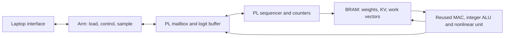

# Tiny-transformer hardware blueprint

## Continued implementation plan

The server now owns implementation of the remaining fixed-point circuit under
Aidan's instruction to get as far as possible. The board must remain off the
internet. Mac weights and original block fixtures are transferred and hash
verified; the Mac model runtime is not transferred or recreated. Source/material
pins and the uncommitted user joke draft remain unchanged.

Proceed through explicit gates:

1. Replay the original projection, RoPE and cache model fixtures in Vivado.
2. Connect Q/K/V -> RoPE -> committed Krot/V memory -> query stream. Check
   arithmetic events and actual transferred/read-back values, stalls, every
   256-position address and cancellation at each stage. Normalized input still
   comes from the host for this partial circuit.
3. Implement reusable signed integer scalar arithmetic (RNE shifts/division,
   checked multiplication, table-based negative exponential and reciprocal
   square root), then RMSNorm, attention softmax/context and SwiGLU. Check
   actual frozen tables independently of synthetic operand tests.
4. Generalize dense projections to gate/up/down/output/logit shapes, then
   connect embedding, norms, residuals and feed-forward control. Compare the
   full network's intermediate states/logits with the frozen Mac reference.
   The host continues the declared first-32-step sampler and token feedback.
5. Use bounded out-of-context synthesis for component/core resource diagnostics.
   The initial core-only placement/routing diagnostic tested internal layout at
   a provisional 10 ns clock while the original Mac comparison was pending.
   Its hypothesis is that the synthesized core can fit and route with nonnegative
   internal setup/hold slack. It uses the verified full-core checkpoint, two
   threads, and at most 600 seconds each for optimization, placement and routing,
   plus 180 seconds for reports. Preserve every completed stage/checkpoint;
   retain failures, DRC findings and unconstrained boundary paths. HD.CLK_SRC
   models a hypothetical target BUFGCE selected from the device inventory, not
   the board's actual PS clock. No data-port delays or board shell are assumed.
   If the completed clean route misses 10 ns, retain that failed result and
   reanalyze the same sealed routed checkpoint at 20 ns (50 MHz) in a separate
   180-second reporting invocation. This changes the explicit diagnostic clock;
   it does not reroute, waive DRC or establish a board frequency. A matching
   50 MHz PS candidate may be logically prepared, pending actual board checks.
   This does not release the numerical or board acceptance gates. Final board
   timing and programming-file generation follow integrated numerical
   verification and selection of the actual clock/reset/software shell.
   The original numerical comparison has since passed. Complete offline
   PS/AXI/neural candidate generation is bounded to 180 seconds, synthesis and
   separate opt/place/route to 600 seconds each, with two threads and 180-second
   final reports. Preserve source/clock/predecessor lineage and every negative
   result. Inactive hard-PS clock outputs must have exact names and zero sinks;
   active clocks/internal endpoints must be fully covered. Actual board software
   compatibility and physical programming remain later gates.
6. Inspect the actual board image/firmware and use a local offline connection
   for programming/readback. Measure board behaviour separately from simulation
   and synthesis. Do not infer speed/energy from simulated cycles.

Each simulator invocation has a 180-second watchdog and reaps its descendants.
Component synthesis uses the same180-second limit and two Vivado threads.
After two full-core runs reached cleanup but timed out at180seconds, the complete
core's synthesis-only budget is600seconds; simulations and separate timing-report
invocations remain180seconds. All raw inputs, traces, VCD, scripts, logs and checkpoints
stay under ignored `.agents/runtime/fpga-inference/`. No package installation,
model replacement, training, extra spending, push, PR or article edits.

Status: W16A16 teaching format selected. Full neural RTL is connected and has
passed component checks and BOS/prefix/long-context simulations on Linux.
Original archived block comparisons pass in Vivado. Component and assembled-core
OOC synthesis pass; after repairing the loading-handshake loop, the latter reports
31,844 LUTs, 36.5 BRAM tile equivalents and 10 DSP blocks. Full 128-token authored
and 256-token synthetic repeated-prefix runs pass independent arithmetic checks
on 239,430 and 575,686 recorded stage values respectively. Full-state/logit
comparison with the original Mac model now passes the four prescribed 1/16/128/256
token cases: 709,492 state/cache-write values including clear-context replays,
with 128,320 original input logits. This is teacher-forced numerical evidence;
no new language-quality experiment or full-core final RAM-readback sweep is claimed.
Core-only opt/place/route
commands completed without the original LUTLP-1 finding. Internal setup/hold
slack is -2.888/+0.012 ns at 10 ns, and +7.112/+0.012 ns when the same layout is
reanalyzed at 20 ns. The standalone clock has one explicit routing gap; global
fully-routed is false and both strict diagnostic receipts remain unaccepted.
There are zero reported routing errors and zero DRC errors/critical warnings,
with boundary/pipeline warnings retained. This is not board timing closure.
Candidate PS/AXI clock/reset/address designs at nominal 100 and 50 MHz pass
logical validation. The complete 50 MHz PS/AXI/neural design has generated and
passed global synthesis: 33,293 LUTs, 11,042 registers, 36.5 BRAM tile equivalents,
10 DSPs, one PS8 and one actual BUFG_PS. Its 20 ns PS clock reaches the neural
clock domain. Complete placement/routing and final diagnostics now pass at 20 ns:
setup +4.913 ns, hold +0.011 ns, full placement/routing, zero routing gaps/errors,
zero unclocked pins/internal unconstrained endpoints and zero DRC errors/critical
warnings. The pre-placement eight unused hard-PS output-clock findings are
retained in their original reports; native no_clock is zero after routing.
No DRC defaults or clock/timing constraints were waived to obtain this result.
An offline candidate `.bit` and separately verified model-word package are
prepared. The file does not initialize the actual PS or establish its software/
address/clock compatibility; our candidate has not been loaded or executed.
The actual powered revision-2 KV260 now boots a user-authorised fresh Ubuntu
24.04 SD card. Verified Mac receipts identify the compatible boot firmware,
Linux 6.8, FPGA manager/overlay support and Python; no board compiler is installed.
The captured PL0 clock is about 100 MHz, requiring a separate verified <=50 MHz
setup before loading our candidate. Offline first-BOS package generation now
cross-compiles the existing host API's ARM adapter and resolves staged clock,
programming and AFI/UIO overlays against the actual live tree. It does not change
the board. Driver binding, clock/AFI acceptance and physical programming/MMIO
remain separate gates. See README.md for sealed input identities and the staged
procedure. QSPI, Ethernet and the selected model remain unchanged.
Current physical-engine/memory choices and exact test
scopes are in README.md; the single-lane proposal below is historical.
Source review: 2 November 2026. Resource claims below are vendor-reported;
operation counts and memory allocations are analytical. Format fidelity has
been measured in the software study below. Current tool-reported mapping and
complete-candidate implementation diagnostics are above; actual board execution,
timing and power have not been measured.

## Original single-lane proposal and boundary

Keep the selected 26,720-parameter network unchanged. The software study below
selected **signed 16-bit weights and working values, with wide integer
accumulators**, under the user-selected teaching policy recorded below. The
original .1 absolute-error limit still fails; the explicit teaching policy
retains normalized accuracy, output quality and arithmetic checks.
Use BRAM for the entire model and working state, and one reused multiply-and-
accumulate (MAC) lane rather than a separate circuit for each logical neuron.
Consistent 16-bit storage makes the first example easier to explain.
The converted copy is opt-in; retain the selected q8 checkpoint as the default.

Put every network operation in programmable logic (PL), including nonlinear
functions and attention softmax. Let the Arm CPU load weights, control requests
and sample output tokens; the laptop provides the interface and verification.
A CPU sampler does not turn the layers into CPU inference, but must be disclosed.
No answer text or joke identifiers are needed by the circuit.

Planning, the software format comparison and the complete Q/K/V projection RTL
simulation, a separate RoPE block and a separate KV cache are complete.
Next discuss connecting these blocks and attention. Build-host access, synthesis,
board setup and deployment remain later stages.
Preserve the original FP32/q8 files, converted fixed payload, pinned environment,
frozen fixtures and all creative material.

## Exact network work per token

Architecture and source of truth: [selection.json](model/selection.json),
[model.py](tools/model.py) and the independent
[NumPy forward calculation](tools/llama_numpy_reference.py). Matrix shapes below
are **output rows × input coordinates**. No projection has a bias.
Let position `p` start at zero and `n = p + 1` include the current token.

| Step | Calculation and storage | Dot-product terms |
| --- | --- | ---: |
| Embedding | Read row `E[token, :]` from tied `E[320,32]` into `x[32]` | 0; 32 values read |
| Input RMSNorm | `a = x * rsqrt(sum(x²)/32 + 1e-5) * gamma_in` | Separate scalar work |
| Q, K, V | `q=Wq*a`, `k=Wk*a`, `v=Wv*a`; each matrix `[32,32]` | 3,072 |
| RoPE and cache | Split each vector into two heads of 16; rotate Q and K, not V. Write rotated K and V at position p | Separate scalar work |
| Attention scores | Per head, dot current Q with keys at positions `0..p`, then multiply by `1/sqrt(16)=1/4` | `32n` |
| Attention probabilities | Per head, subtract maximum, exponentiate and divide by sum over only `0..p` | Separate scalar work |
| Attention values | Per head, weighted sum of cached V; concatenate two 16-wide results | `32n` |
| Output projection and residual | `[32,32]` Wo, then `x = x + Wo*context` | 1,024 |
| Post-attention RMSNorm | Same RMS operation, different learned `gamma_post[32]` | Separate scalar work |
| Feed-forward expansion | `g=Wgate*a`, `u=Wup*a`; each `[128,32]` | 8,192 |
| SwiGLU | `z = (g * sigmoid(g)) * u`, elementwise over 128 coordinates | Separate scalar work |
| Down projection and residual | `[32,128]` Wdown, then `x = x + Wdown*z` | 4,096 |
| Final RMSNorm | Third learned gain vector `gamma_final[32]` | Separate scalar work |
| Tied output head | `logits = E*x`, producing all 320 logits; same E as embedding | 10,240 |
| CPU sampling | First 32 output steps: temperature .8, FP64 softmax/inverse-CDF over all 320 logits; later argmax | Outside PL network |

Thus matrix/attention dot products require **26,624 + 64n terms** per next-token
prediction: 26,688 at n=1 and 43,008 at n=256. These exclude RMSNorm, RoPE,
SwiGLU, rescaling and control. One MAC issuing a product each cycle would need
at least that many issue cycles; it is not a latency or token-rate prediction.

RMSNorm has three sets of 32 gains (96 values). Eight stored matrices contain
26,624 values, including E only once: total **26,720 parameters**. Three norms
square 96 coordinates in total; Q/K RoPE uses 128 scalar multiplications per
position. Split-half RoPE pairs coordinates `j` and `j+8` within each head,
`j=0..7`, with angle `p * 10000^(-2j/16)`; it is identity at p=0.

Only the current position is evaluated during decoding; cached earlier K/V
avoid recomputing earlier tokens. A reset sets the valid cache length to zero;
stale entries must never be read. Allocate 256 positions, 8-bit position addresses
and a 9-bit valid-length counter. The current generator makes at most 255
prediction steps; explicitly exercise the full 256-position capacity in tests.
EOS is token 257. Other non-byte vocabulary entries remain possible and must not
be silently masked or substituted.

## What q8 stores, and the proposed arithmetic

Current q8 stores unsigned codes `c=0..255` with `w = scale[group]*c + offset[group]`,
32 weights per group. There are 832 groups: 26,624 code bytes + 6,656 FP32 metadata
bytes + 384 norm bytes = **33,664 tensor bytes**. Matrix multiplication, norms,
activations and cache currently use floating point. Reading a code as a signed
INT8 weight would calculate the wrong model.

For the first conversion, independently unpack those selected q8 values, then
quantize them to the proposed fixed-point representation. Use the retained FP32
checkpoint as a separate diagnostic, not a silent change of source weights.
The original hashes, conversion, exponents, tensor layouts and table pins are
now retained in model/fixed.json and tools/fixed.py. The original proposal below
is amended by the admitted component/activation-width revisions at the end.

| Quantity | Selected software representation and rule |
| --- | --- |
| Matrices and norm gains | Signed 16-bit integer I, real value `I * 2^e`; one static exponent per matrix/gain vector. Shared E has one exponent for embedding and output. |
| Named working buffers and K/V | Signed 16-bit integer I with a static binary exponent per stage. K/V exponents stay fixed across positions; the embedding read starts as a 16-bit weight row. |
| MAC | Projection, Q/K and SwiGLU use signed 16×16 → 32-bit products; probability/V uses zero-extended 17×16 → 33 bits. Sign-extend into signed 48-bit accumulators; no per-term rounding. Down projection length 128, attention length ≤256. |
| RoPE coefficients | Signed 16-bit with 14 fractional bits, so ±1 are representable. Shared table for both heads and Q/K; accumulate a rotated coordinate before rounding. |
| Attention scores and output logits | Signed 32-bit with 16 fractional bits; check range before conversion. Attention scaling by 1/4 is incorporated into rescaling. |
| Attention probabilities | Unsigned 16-bit with 15 fractional bits; 1 is integer 32768. Zero-extend to 17 signed bits for multiplication with signed V; do not reinterpret as signed 16-bit. |
| Scalar nonlinear work | Explicit checked 64-bit integer scratch, serial multiword products/division as needed. A 32×32 multiply is not assumed to fit one DSP multiplier. |
| Narrowing and overflow | Round to nearest, ties to even; saturate at the destination bounds and increment a diagnostic counter. Never wrap silently. MAC overflow is an error, not saturation. |

For the signed 16×16 dot products, `256 * 32768² = 2^38` fits a signed
48-bit accumulator. Probability/V has the same bound because an encoded
probability is at most 32768. This bound does not certify arbitrary scalar rescaling: left shifts,
residual alignment, nonlinear intermediates and multiword products need their
own checked bounds. The independent reference should use Python integers and
assert each declared hardware width rather than allowing NumPy overflow.

Choose exponents from measured ranges, not guesses: for a nonzero maximum
absolute weight M, start with `e=ceil(log2(M/32767))`; zero tensors use e=0.
For 16-bit activations, use denominator 32767 and twice the calibration
maximum (one bit of headroom).
Align residual operands before addition; round once at each declared output
boundary. Freeze every binary point and rounding boundary before RTL. If any
range fails, report it and revise the candidate rather than silently clipping.

Software-tested nonlinear implementation; RTL verification is still future work:

- **RMSNorm:** accumulate integer squares, convert the mean square to unsigned
  64-bit with 32 fractional bits, and add epsilon encoded as 42950 (rounded
  `1e-5 * 2^32`, not zero). Range-reduce to a mantissa in [1,4), use a small
  reciprocal-square-root seed table and two Newton steps with 32-bit mantissas
  and 64-bit products, then restore the power-of-two exponent and apply gains.
- **Attention exp:** after maximum subtraction, range-reduce using ln(2)
  encoded as 45426 in Q16.16. A 257-entry unsigned Q1.31 table spans [0,ln(2)];
  interpolate with RNE and restore a binary right shift. Inputs below -16 map
  to zero, a declared approximation. Sum in checked nonnegative 64-bit scratch
  (at most `256*2^31`).
  Divide with ties-to-even rounding to get the 16-bit probabilities. Their
  individually rounded sum need not be exactly 32768. The maximum entry's exp
  is exactly one, so the denominator cannot be zero for a nonempty row.
- **SiLU:** reuse exp on `-abs(g)` and integer division for the stable positive/
  negative sigmoid formulas, then multiply by g and u. Define both rescalings.
  Do not replace SwiGLU with ReLU or remove it to simplify the circuit.

Table bits, interpolation, Newton rescalings, division rounding and corner cases
are now fixed by the selected source digest and payload in model/fixed.json. The
initial width/layout proposal is superseded where noted by the software study.
The pinned integer code is the current reference; review its operation schedule
and interfaces before implementing an independent RTL circuit.
These nonlinear functions are the largest implementation risk. If fidelity is
poor, locate the first divergent intermediate and widen/refine that operation;
retraining and a different architecture are separate decisions.

## On-chip memory budget

AMD's [KV260 datasheet, DS986](https://docs.amd.com/r/en-US/ds986-kv260-starter-kit/Product-Details)
identifies the K26-based kit and its 144 BRAM / 64 UltraRAM blocks.
The [K26 PL resource table, DS987](https://docs.amd.com/r/en-US/ds987-k26-som/Programmable-Logic)
lists 117,120 LUTs, 234,240 flip-flops and 1,248 DSP slices. These are device
resources, not the free resources inside an existing camera/accelerator overlay.
Plan a minimal custom design, not an assumed allocation inside an unknown shell.

[UG573 BRAM geometry](https://docs.amd.com/r/en-US/ug573-ultrascale-memory-resources/Block-RAM-Summary)
permits a RAMB36 as 2048×18 or 1024×36 true-dual-port, or 512×72 simple-dual-port.
Budget a full RAMB36 even for a partly filled bank. Weight/coefficient banks
use 16 of 18 bits; 32-bit banks use 32 of 36, each giving **4,096 payload bytes**.
Working-vector/cache banks also use 16 of 18 bits: **4,096 payload bytes**
each. The unused bits do not change the chosen arithmetic. These are
physical word widths, not the host reference's int64 array sizes. Reads are
synchronous; pipeline their latency.

Selected W16A16 allocation, retaining the original 47-site reservation:

| Bank allocation | Payload needed or reserved | RAMB36 blocks |
| --- | ---: | ---: |
| E, row-major 320×32×16 bits | 20,480 B | 5 |
| Q/K/V/O matrices, four separate banks | 8,192 B; each uses 1,024 of 2,048 available 16-bit words | 4 |
| Gate / up / down, each 4,096×16 bits | 24,576 B | 6 |
| Three norm gain vectors and exponent/config metadata | 192 B gains; reserve 4,096 B total | 1 |
| K and V, separate arrays `[2 heads,256 positions,16 coords]`, 16-bit | 32,768 B | 8 |
| Two activation banks, 16-bit; 128-word-aligned vector slots | 8,192 B reserved; 32 slots of 128 values in total | 2 |
| Attention work, one 32-bit bank per head | Each: 256 scores + 256 exps + 256 probability slots = 3,072 B; reserve 8,192 B total | 2 |
| All 320 output logits, 32-bit | 1,280 B; reserve 4,096 B | 1 |
| RoPE sin/cos, `256×8×2` signed 16-bit coefficients | 8,192 B | 2 |
| Nonlinear tables / scalar spill / extra precision | 16,384 B reserved | 4 |
| CPU mailbox, FIFOs and bounded teaching trace | 16,384 B reserved | 4 |
| Unassigned implementation headroom | 32,768 B reserved | 8 |
| **Total reservation** | **192,512 B payload capacity (188 KiB)** | **47 / 144 (32.6%)** |

The Q/K/V/O row's four banks each hold 1,024 used words, leaving half of each
2,048-word bank unused. No second copy of tied E is allocated. The 16-bit model
itself is **53,440 B**, and its full 16-bit KV cache is **32,768 B**. Their 86,208 B
subtotal excludes coefficient tables, activations and packing. The current
floating-point-intermediate q8 implementation's 99,200 B subtotal is a different
format, not an estimate for this layout.

47 RAMB36 sites contain 216,576 physical bytes including unused bits. The device
has 663,552 such physical BRAM bytes in total; **97 blocks remain outside this
reservation**. Placement, AXI/control and later tool mappings can change the
count. This budget is not a synthesis or timing result.

[UG573 UltraRAM geometry](https://docs.amd.com/r/en-US/ug573-ultrascale-memory-resources/UltraRAM-Summary)
is 4096×72 per block, with each of two ports doing one read or write per clock.
The 64 blocks total 2,359,296 physical bytes; **reserve zero UltraRAM initially**.
We do not need its larger granularity or extra memory to demonstrate this model.
No LUTRAM storage is assumed; ordinary LUTs/flip-flops still implement control,
addresses and pipeline registers. No neural weights or KV need to be fetched from
DDR during generation. Startup files and the CPU's OS may still use DDR/SD.

Port/scheduling contract: keep weights row-major; for an input width D, read
`base + row*D + coordinate`. Cache address is `(head*256 + position)*16 + coordinate`.
Read one weight and one activation from different banks for each MAC term. Use
separate K/V and attention scratch banks for the attention passes. If two operands
share a bank, use both available ports or schedule separate reads; adding MAC
lanes does not create more ports. CPU writes are allowed only while the engine
is idle; never depend on ambiguous simultaneous access to the same address.

## Execution engine and physical boundary

The proposed lane uses signed 16×16 multiplication, plus signed 17×16 for
zero-extended unsigned attention probabilities, with a signed 48-bit accumulator,
requantizer and valid/ready control. The first projection uses 16-bit inputs
and weights. The K26 DSP48E2's native signed 27×18
multiplier and 48-bit accumulator support this shape; see
[AMD UG579](https://docs.amd.com/api/khub/documents/pTysoma4TYgNH95BrY1Sbw/content).
Aim for one main MAC lane, plus a small serialized integer scalar unit and a
sequencer. Actual DSP count, registers, pipeline depths and clock frequency come
from synthesis later; do not claim the whole transformer needs exactly one DSP.
Use ordinary SystemVerilog for a visible first circuit, with a small portable
memory interface; introduce AMD primitives only when mapping requires them.

Execution order is the table above. For each matrix, keep the source vector
stable, clear the accumulator, visit input coordinates, write one result and
advance the output row. Reuse that same lane for every matrix, both attention
heads and scalar products. Store residual vectors until their later addition.
Process attention with a score pass, maximum/exp/sum pass, probability pass and
V-weighted-sum pass. Wait for dependencies; this is not all layers running at once.
At the end expose all logits, halt until the chosen token arrives, then advance p.

| Location | Work in the eventual demo |
| --- | --- |
| PL | Embeddings, all projections, all three norms, RoPE, cache, attention including its softmax, SwiGLU, residuals and all 320 logits |
| Arm CPU | Load/check model once; configure/control/reset; transfer logits; sample first 32 steps at .8 and then argmax; feed tokens back; EOS/limit/display escaping |
| Laptop | Interface, seed entry and explanatory views; independent reference/tests. During bring-up it can retain the existing sampler while Arm is only transport; label that mode explicitly. |

Use a small AXI-Lite register/mailbox interface initially; 320×4 = 1,280 logit
bytes cross the CPU boundary per prediction. Defer DMA and parallel users.
Only loading weights once may involve DDR; it is not per-layer DDR inference.
The circuit/bitstream defines the operations and connections; weights are RAM
data loaded separately. Inspect the board image before choosing its OS/driver
or programming procedure. Linux is convenient control software, not a
mathematical requirement for transformer inference.

For reproducible tests, retain the current host RNG and FP64 sampler, then verify
an Arm port against recorded uniform draws and token decisions. Do not assume
cross-platform libraries produce bit-identical RNG/exp results. Choose the lowest
token index for argmax ties. Preserve all 320 logits and keep repeats/errors;
no answer selection, retry, token mask or correction layer is introduced.

## Acceptance before implementation

The original gates below are retained for provenance. Software results and the
user-selected teaching-policy amendment are recorded at the end; RTL/board
gates remain future work. Keep the old 128 q8 token fixtures unchanged; new
arithmetic may select different jokes.

1. **Software candidate:** calibrate on all 48 trained targets' teacher-forced
   prefixes and development seeds 2001–2064. Freeze exponents/tables afterward.
   Compare all intermediate states and 320 logits with the unpacked selected q8
   reference; report max errors, top-token agreement and saturation by operation.
   Initial numerical screen: for every evaluated prefix, logit RMSE divided by
   `max(1, RMS(reference logits))` ≤.01 and max absolute logit error ≤.1, with no
   overflow or saturation on evaluated paths. These are engineering targets,
   not statistical guarantees or the old FP32 tolerance. Explain a failed gate;
   do not relax it mid-run.
2. **Behaviour:** use the existing 64-sample gate (≥60 exact authored jokes,
   ≥20 distinct, largest count ≤10, all complete valid nonempty UTF8). After
   freezing the candidate, use seeds 20001–20128 once: ≥120/128 exact, ≥30 distinct,
   largest count ≤12 and all complete valid nonempty UTF8, matching the existing
   128-sample acceptance rule. Read every nonexact output and show representative
   real outputs. These are new seed tests, not unseen-language tests. The known
   q8 seed-10125 failure remains recorded; a converted model need not repeat it.
3. **Bit-level reference:** before RTL, publish every scale, table coefficient,
   rounding point, division rule, address, cache order and status flag. Check
   primitive operations with an independent Python-integer oracle; do not share
   the rounding implementation with the hardware test oracle.
4. **RTL simulation:** require bit-for-bit equality to that chosen-format oracle,
   not just similar floating-point logits. Check every accumulator and stored
   intermediate for real prefixes, context lengths 1/18/63/255/256, both heads,
   all matrices and rows, repeated reset, stalls/backpressure, signed extrema,
   ties-to-even and saturation/overflow flags. Full decoding must reproduce the
   chosen-format software outputs when supplied the same sampler draws.
5. **Synthesis/board later:** verify actual part, resource/bank mapping, timing,
   reset/clock constraints and no unintended latches. Then verify board logits
   and outputs against simulation. Only then measure latency, token rate and
   energy, separating PL timing, Arm sampling/I/O and whole-system power.

If the first conversion fails, isolate range vs approximation vs implementation
error before proposing a second candidate. Keep the model small; no new trainer
or revived experiment tree is required for this work.

## First circuit milestone and teaching view

After a successful software format screen, freeze a real BOS input's normalized
32-vector and row zero of Wq from **this** checkpoint. Build one 32-term dot
product: two small input memories, address counter, multiplier, accumulator,
output rescaling and done flag. Log coordinate, weight, activation, product,
partial sum and output. It produces one Q coordinate, not a token or full layer.
Do not reuse the retired keyed model's internal vectors as if they were these.

An illustrative three-term example, **not measured model values**: x=[1,-.5,.25]
and w=[.5,1,-2]. With scale 1/4, stored integers are [4,-2,1] and [2,4,-8].
Successive products are 8,-8,-8; the accumulator goes 8,0,-8. Its product scale
is 1/16, so the result is -.5. Rescaling back to quarters gives integer -2.
The 32-coordinate circuit repeats exactly this process with actual model data.

For the article's later explanation, expose the same model coordinate in three
views: matrix row and vector; clock-by-clock MAC/address trace; the multiplier,
adder and accumulator register. Then expand to 32 rows, both heads and the full
block without implying that each model coordinate owns a permanent multiplier.
The article chat still owns prose/visuals; this is the technical teaching plan.

## Mac simulation and AMD build route

The initial inventory found Clang and Docker, with no simulator or AMD build
tools. The authorised first RTL milestone has since provisioned a local pinned
Verilator copy; its measured result and remaining limitations are below.

- **Before RTL:** use the existing offline, write-restricted Python environment
  for the software arithmetic study, preserving its lock and selected payloads.
- **RTL simulation on this Mac:** recommend a pinned native-arm64 Verilator
  plus Clang after separate installation authorisation. The
  [Homebrew package metadata](https://formulae.brew.sh/formula/verilator) lists
  Apple Silicon binaries, and the
  [upstream installation guide](https://verilator.org/guide/latest/install.html)
  supports running a source build in place. Keep generated C++, waveforms and
  simulator output in ignored runtime. This checks RTL behaviour; it does not
  place a circuit onto XCK26.
- **Actual bitstream:** obtain access to an x86-64 build machine. A concrete
  compatible option is **Vivado ML Standard 2025.2 on Ubuntu 22.04.5 x86-64**:
  AMD's [2025.2 OS list](https://docs.amd.com/r/2025.2-English/ug973-vivado-release-notes-install-license/Supported-Operating-Systems)
  supports it and its [device/edition table](https://docs.amd.com/r/2025.2-English/ug973-vivado-release-notes-install-license/Supported-Devices)
  includes Kria in Standard. This is a version-specific route, not a claim it is
  the newest release. A newer 2026.1 route is also listed for x86-64 by
  [UG973](https://docs.amd.com/r/en-US/ug973-vivado-release-notes-install-license/Supported-Operating-Systems);
  [AMD's licensing table](https://www.amd.com/en/products/software/adaptive-socs-and-fpgas/vivado/vivado-licensing-options.html)
  includes Kria in free BASIC, with annual renewal and feature limits. Pin one
  release, matching OS, board files and license terms together when access is
  arranged. An Arm Linux VM/container on the Mac is not that supported x86 host.
- **Board software:** plain custom RTL does not require Vitis AI, a DPU or a
  neural-network compiler. Choose the minimal Arm loader/control stack only
  after inspecting board firmware/image and the connection. Do not assume that
  a prebuilt vision overlay contains this model's circuit.

Open decisions before hardware: review the selected arithmetic/schedule,
simulator installation, available build-host access and the actual board
image/connection. The selected finite software teaching gates passed, while
the original .1 absolute-score limit remains failed. This does not prove
circuit correctness or physical fit. None blocks completing
this blueprint. Since the original blueprint, Aidan provisioned a Netcup x86-64
build host with Ubuntu 22.04.5; its private Tailscale SSH login is verified.
The [private desktop](README.md#linux-build-host-and-private-desktop) is installed
and user login succeeded. Vivado 2025.2 is installed at /home/admin/amd/2025.2/Vivado; direct version and
Tcl K26-device inventory checks passed (SW build 6299465, two K26 part variants).
AMD's Ubuntu prerequisite script subsequently completed; all 19 named packages,
clean package state and recovery after user-run reboot were verified. The bounded
server Codex readiness task completed across an SSH disconnect; see README.
Synthesis, FPGA flash and deployment have not run.

## Fixed-point software study contract

Aidan authorised stage 1: the Mac software experiment only. Hypothesis: the
proposed 16-bit stored values / 48-bit dot accumulators preserve this checkpoint's
finite-joke behaviour without exceeding the numerical gates above. Control is
the hash-pinned selected q8 model and unchanged sampler; the intervention is the
integer forward calculation, including norms, RoPE, attention and SwiGLU.

Use the existing sandboxed runner, pinned local environment and exact 48 targets.
Calibrate on all teacher-forced targets and q8 seeds 2001–2064, with twice the
observed activation maximum; no final seeds enter calibration. First validate
integer primitives against independent Python-integer calculations and the float
observation path against the existing independent NumPy reference. Then score
all teacher-forced prefixes and development outputs. Freeze converted weights,
scales and tables before the once-only 20001–20128 confirmation. Preserve full
outputs, numerical errors, saturation counts, phase times and source hashes.

One initial candidate; diagnose any failed gate before admitting a separately
recorded revision. Distinguish harness errors from arithmetic/quality failures.
Each full worker has an absolute 1,200-second watchdog; primitive-only smoke has
a 120-second limit. Retain raw payloads/logs only in ignored outputs/tiny/.
Reap workers and verify absence; keep selected models read-only. No training,
installation, downloads, circuit implementation, cloud, pushes or PRs.

The admitted opportunity is simplifying the complete arithmetic for a teaching
circuit. Competing failure explanations are insufficient storage precision,
nonlinear approximation, or a reference/implementation bug; per-operation errors
and primitive oracles discriminate them. Performance and power predictions are
unknown and outside this study; simulation throughput is only a harness metric.
A software pass permits discussion of the next circuit milestone, not a claim
about FPGA resource use, latency or energy.

### Admitted component revision before model evaluation

The initial direct exp table failed its primitive .003 relative-error check:
measured worst .003231127270028944 near x=-15.82. This is a component precision
result, not a model-quality result; no final seeds or full candidate run were
used. Integer table/interpolation rounding near tiny exponentials is the cause
suggested by the isolated probe. Admit fixed16-v2: keep the 257-entry uint32
table and all other formats/gates, but range-reduce `exp(-a)` into
`exp(-remainder) * 2**(-k)`, with ln(2) encoded as 45426 in Q16.16. Table points
span [0,ln(2)] at 256 intervals; RNE interpolation precedes the binary shift.
This changes the nonlinear approximation only, not model weights, architecture,
sampling, calibration seeds or acceptance thresholds. Repeat the unchanged
primitive check, then proceed to the full development gate only if it passes.
The earlier direct [-16,0] table above remains the initial proposal, superseded
for this candidate by this explicit amendment. Logs retain both failed probes.

### Admitted activation-width revision after development

Measured fixed16-v2: 64/64 exact development jokes, 36 distinct, largest count 5,
no saturation, and all 16,125 evaluated prefixes chose the same top token as
the FP32-unpacked q8 reference. Worst normalized logit RMSE .00555848 passed;
maximum absolute logit error .10922515 exceeded the unchanged .1 gate. Final
seeds were not consumed. Per-operation errors grow through residual/norm/FFN
work; the largest final-normalized coordinate error is .0386894.

Admit W16A18-v3: widen only named activation buffers and K/V from signed 16 to
signed 18 bits, recalculating their static exponents by the same 2× calibration
headroom rule. Keep 16-bit matrices/gains/RoPE, 48-bit accumulators, 64-bit scalar
scratch, score/logit/probability formats, exp/rsqrt algorithms, architecture,
source weights, sampling and all gates unchanged. Projection operands are now
18×16, attention Q/K 18×18; both fit the native 27×18 multiplier. A 256-term
18×18 dot is bounded by 2^42, within signed 48 bits. The norm triple product's
18-bit input ×16-bit gain ×Q30 mantissa is bounded by 2^62, within signed 64 bits.

This spends the previously unused two bits in 2048×18 activation/cache banks;
it adds no RAMB36 sites. K/V logical storage becomes 36,864 B; vector-bank
capacity 9,216 B. Total planned payload capacity increases by 5,120 B to
197,632 B within the same 47-site / 216,576-physical-byte reservation. These
remain analytical allocations. The first multiplier circuit would use 18-bit
activation and 16-bit weight inputs if this revision passes. Preserve both
measured candidates and test the same development gate before confirmation.

### Confirmation and packaging regression

First W16A18 confirmation completed in runtime job 20261102T213030461825.
After its successful development gate, the frozen arithmetic produced the same
128 complete token sequences as q8 on seeds 20001–20128: 127 exact jokes, 42
distinct, largest frequency 9, and the shared gibberish seed 20003. No candidate
change is admitted from these outputs. Further runs of these seeds are
regressions, not fresh holdouts.

Before promotion, switch the temporary numeric archive to the project's normal
SafeTensors payload, verifying exact integer array reload. Extend primitive
oracles to 18-bit operands/shift rounding and cache boundary tests to synthetic
255/256-position prefixes; keep arithmetic and sampling unchanged. Repeat the
comparison as an explicitly labelled packaging regression and require every
confirmation token sequence to match the first run. Preserve initial logs.

### Earlier W16A18 selection, superseded by the teaching decision below

The W16A18 candidate passed development, confirmation-path numerics and matched
output regression. Maximum logit error .04796648; worst normalized RMSE
.001932285; zero observed saturation/overflow. All 128 confirmation sequences
match q8, including seed 20003's gibberish: 127 exact jokes, 42 distinct, largest
count nine. No holdout-driven arithmetic change followed confirmation.

See model/README.md for scopes, failed candidates and runtime result identities;
model/fixed.json is the pinned arithmetic/tensor/trace contract. Use the opt-in
`generative.sh chat --format fixed` on the Mac CPU; default q8 chat is unchanged.
No model training, simulator installation, RTL, FPGA build or board access ran.
The next reviewable circuit would implement the pinned 32-term Q projection
with 18-bit activations, 16-bit weights, a 48-bit sum and declared rescaling.

The selected source pin also binds arithmetic code, not just tensor bytes.
Nonnegative scalar scratch is explicitly restricted to 0..2^63-1 in the host
reference; add/shift/product guards reject values outside that domain before
wrapping. Later validation added guards at unused scratch extremes, without
changing precision, tensors or any scored output; the frozen token hashes and
real projection trace must still pass. These are not new holdout evaluations.

### User-selected 16-bit teaching confirmation (2 November 2026)

Aidan chose 16-bit weights and stored activations for a clearer teaching example.
This is an explicit acceptance-policy amendment, not a retroactive pass of the
original .1 absolute-logit-error limit. Hypothesis: the unchanged W16A16
candidate preserves useful joke generation on the same 128 comparison seeds
without arithmetic overflow or saturation. Its known .10922515 maximum error
remains a strict numerical failure. Keep the .01 normalized-RMSE requirement;
report maximum absolute score error separately under the teaching policy.

Run `generative.sh fixed --activation-bits 16 --acceptance teaching` with the
existing pinned q8 source, 48 targets, sampler and 2x-headroom calibration on
teacher/development paths only. No new training, precision tuning, dependencies,
downloads or hardware. Freeze the converted candidate before seeds 20001–20128.
These seeds were examined for q8/W16A18, but not W16A16: this is a matched format
comparison, not a fresh independent holdout. Keep complete outputs, source
snapshots, operation errors and counters under ignored runtime outputs.

Retain the original development and confirmation quality gates: development
at least 60/64 exact jokes, 20 distinct, largest frequency at most 10;
confirmation at least 120/128 exact, 30 distinct, largest at most 12. All samples
must finish with EOS and valid nonempty UTF8. Require zero observed saturation
in development, cached/full context checks and confirmation, checked arithmetic,
independent primitive/float oracles and worst normalized score RMSE <= .01.
The absolute .1 gate is still measured and reported as strict pass/fail, but is
not a teaching-policy promotion condition. No timing, energy or physical-fit
claim. One full comparison worker has a 1,200-second watchdog, followed by the
existing 300-second frozen regression and a bounded CLI smoke. Reap workers and
verify absence. If this policy passes, select W16A16 metadata/trace and preserve
the W16A18 result in Git history and ignored runtime; leave original q8/FP32
weights and uncommitted joke edits unchanged. If it fails, report why before
any precision or training change.

### Selected 16-bit measured result

The first W16A16 matched comparison (20261102T220133840873) passed the teaching
policy: 64/64 exact development jokes (36 distinct, largest 5), and 127/128 exact
confirmation jokes (42 distinct, largest 9), all complete valid UTF8. No observed
overflow or saturation in model generation, numerical paths or context checks.
Independent primitive oracles passed 5,040 cases and float observation agreed
with the independent reference at 51 probes. Cached/full results and caches
matched bit-for-bit at lengths 1/18/63/255/256; position 257 was rejected.

The original .1 absolute-logit gate remains failed at .10922515392303467;
worst normalized RMSE .005558477816458587 passes .01. Across all 16,125
teacher/development and 11,971 confirmation prefix evaluations, most-likely
next tokens agreed. 127/128 whole sampled outputs matched q8. At seed 20087,
16-bit arithmetic selected the ready-salted joke instead of the curl/resist
joke; both are complete trained targets. Both formats retain seed 20003's
identical gibberish. Every output was inspected; no failures were filtered.

Real-trace export regression 20261102T220222626346 exactly repeated all 128
outputs. model/fixed.json now pins W16A16 exponents, the original unchanged
integer weight/table image, token hashes and actual first-Q projection:
32 signed 16-bit inputs/weights, accumulator -3,760,136 at exponent -26,
rounded to -115 at exponent -11. The first three products are 6,938,100,
7,042,714 and 2,260,244. These are software numbers, not physical clock cycles.
The earlier 18-bit selection metadata is preserved in ignored models/tiny/fixed/
w16a18-selection.json and commit 791139310; no payload was deleted or retrained.

Use `generative.sh chat --format fixed` for the selected 16-bit Mac arithmetic.
The main table/budget above reflects 16-bit storage: 47 analytical RAMB36 sites,
188 KiB payload capacity, 32,768-byte KV cache; wider scratch, score/logit and
probability formats remain explicit. Next discuss the 16×16 projection circuit
and simulation scope. No simulator, RTL, synthesis, board work or energy result.

## First RTL projection scope (authorised 2 November 2026)

Aidan authorised implementing and simulating the first 32-term weighted sum,
with diagrams/waveforms for teaching. Build a reusable SystemVerilog block with
two synchronously read 32x16 memories loaded while idle, one signed 16x16
multiply, a signed 48-bit accumulator, address counter and explicit nearest-even
rescaling by 15 bits into a saturated signed 16-bit output. The first fixture is
the pinned BOS/first-Q trace in model/fixed.json: sum -3,760,136, result -115.
Do not hard-code the answer or the weights inside the circuit.

Contract: synchronous active-high reset cancels work and clears status, retaining
loaded memory; loading and start are mutually exclusive while idle. Ignore
load/start while busy. Alternate synchronous read and accumulate states, then
round once. Hold result, valid and saturation stable until the receiver accepts
them. Emit one trace pulse per accumulated term, with index, operands, product
and partial sum. A 32-term signed 16x16 sum is bounded by 2^35, within 48 bits.

Use independent Python unbounded integers/Fraction rounding plus testbench
checks for all 32 steps, real data, signed extrema, positive/negative ties,
clipping, fixed-seed random vectors, busy inputs, output stalls, consecutive
requests and reset during work/output. Require exact results, no unexpected
clipping, all assertions passing and trace checks passing. This validates one
projection coordinate, not a layer or full model. Clock counts are simulated
architecture behaviour, not measured FPGA clock speed, timing closure or energy.

Provision one checksum-pinned public Verilator 5.052 Homebrew arm64 Tahoe bottle
under ignored runtime/toolchains only; use the existing Apple Clang/make. No
global package installation, Python dependency change, cloud or board action.
Bound provisioning to 180 seconds; each offline compile/simulation worker has
an absolute 180-second watchdog and writes only ignored output/cache/tmp. Keep
source/testbench/tool pin and a self-contained teaching-view template in this
workstream. Raw VCD/CSV/HTML, compiler products, tool payloads and logs stay
ignored. Verify exact source/tool inputs, model payload pins, required project
and full model regressions, and worker cleanup before the local checkpoint.

### First RTL measured result and teaching artifacts

Source/testbench: rtl/mac32.sv and rtl/mac32_tb.sv. The block accepts 32 input/
weight pairs through an idle-only loading port (5-bit address, two signed 16-bit
values, valid/ready), then a start/start_ready handshake. Busy start/load requests
are ignored; simultaneous idle load/start accepts neither. Synchronous active-high
reset clears control/status/registers and retains memory. The output has signed
16-bit result, saturation flag and valid/ready; all remain stable while stalled.
A step_valid pulse exposes index, signed operands/product and 48-bit partial sum.

States are IDLE -> READ -> MAC, repeating READ/MAC 32 times, then ROUND -> OUTPUT.
The two memory outputs register on READ; MAC uses them on the next clock.
The multiplier is combinational in this first RTL description. Its 32-bit product
is sign-extended into a 48-bit adder/register. Only the completed sum is rounded:
arithmetic shift right by 15 gives the floor; low bits give a nonnegative
remainder, with increment for >half or odd ties, including negative ties. Then
clip at -32768/32767 and report clipping. The real model input does not clip.
Result_valid rises 65 clock edges after accepted start; this is a simulated
schedule, not an FPGA timing/frequency result. No 65-cycle full-token claim.

Measured job 20261102T222244792128: 150 vector cases + six memory-reuse
transactions, **156 full calculations / 4,992 products and partial sums**, all
bit-exact against the independent Python unbounded-integer/Fraction oracle.
The SV testbench independently checked every index, operand, product and sum.
Directed positive/negative ties and their neighbours, exact output limits,
clipping, 128 seeded random vectors, busy requests, receiver stalls, consecutive
memory reuse and resets at READ/MAC/partial/ROUND/OUTPUT boundaries all passed.
Five resets were followed by exact no-reload calculations, checking retained
memory. Real model result: -3,760,136 -> -115, no clipping.

Initial compile attempts exposed two testbench lint issues (explicit file-handle
comparison and clock initialization, now corrected) and a Mac toolchain issue:
xcrun tried to write outside the allowed directories and selected an incompatible
MacOSX27.0 SDK. Use direct existing Apple Clang/AR and explicitly installed
MacOSX26.5.sdk; do not relax the sandbox. These were harness issues, not failed
model calculations. Logs/source snapshots remain in ignored runtime. Verilator
warnings remain fatal. The simulator is a verified 6,814,457-byte Homebrew public
bottle, 132 extracted files pinned by a full tree hash; no global install.

Each passing job creates projection.html from rtl/viewer.html plus observed CSV
rows. It shows a labelled RTL teaching diagram, step controls, control waveforms
and all 32 actual products/sums; raw VCD is also retained. The HTML is local and
has no remote assets. Browser security rejected automated file:// preview; the
page's initial values, step/back/play/pause/result logic and data were checked
with an offline mock DOM, not rendered browser QA. No browser-policy workaround
was used. All model weights/joke drafts remain unchanged.

No synthesis, generated netlist schematic, FPGA placement, physical timing or
energy result exists yet. This circuit demonstrates one Q coordinate. The next
hardware scope is a reusable matrix/vector engine using the same arithmetic,
not a claim that the whole model now runs in programmable logic.

## Full Q-vector RTL scope (authorised 2 November 2026)

Extend the existing 32-term circuit to 32 output rows using one shared multiplier
and accumulator, one 32-value input memory and one 32x32 weight memory. Preserve
16-bit operands, 32-bit products, 48-bit sum and shift-15 nearest-even/clipping.
The input is written only while loading weight row zero; later rows load only
weights. The caller must load the full vector/matrix before start. No answer
values are hard-coded. Tag trace terms and streamed results by row. Clear the
sum/address between rows; hold each output and row tag until result_ready, and
return idle only after the last result is accepted. Reset cancels the complete
matrix request, resets row/status and retains both memories.

Use the existing source and simulator harness, adding no dependencies or tool
installs. Keep one-row mode as a regression. Derive complete Q matrices and
normalized inputs from the pinned fixed model for seven real token positions,
then require Python unbounded-integer/Fraction products and output rounding to
match the full integer model's Q values. Also test matrix orientation, distinct
rows, signed extrema, ties/clipping, seeded random matrices, busy writes/start,
per-row receiver stalls, reset during later-row work, and memory reuse.

Require every product, partial sum, row/column index and output to match exactly,
including 32 rows for real BOS input (1,024 products), with no clipping on real
model fixtures. Each row still takes 65 simulated clock edges after its start;
stream handshakes add clocks and receiver stalls, with no FPGA frequency claim.
Extend the existing local HTML to select/jump between outputs and show all
observed output values, keeping the diagram an authored RTL teaching view.
The earlier browser policy rejection still applies: no automated file preview
or workaround; verify view data/control logic offline and disclose unverified
rendering. Each simulation worker remains offline, write-restricted and bounded
to 180 seconds. Preserve all original weights, tests, user joke edits and local
one-row results. No normalization/attention circuit, synthesis, board work,
training, cloud, push or PR is included in this milestone.

### Full Q-vector measured result and interface

The existing mac32 module now has ROWS=1/32 with one signed multiplier expression,
one accumulator and one column counter. A row counter selects the matrix row;
it is not an array of 32 arithmetic units. The input memory remains 32x16,
while weight storage becomes ROWS x 32 x 16. load_row/load_address choose the
weight location; only load_row zero also writes the input vector. Load all
required locations before start. Output result_row and step_row tags distinguish
rows. After an output is accepted, clear sum/column, advance the row and resume
READ; only the last accepted row returns idle. The circuit streams results to
the receiver; a complete output-vector RAM has not been added.

First complete-Q job 20261102T224017060601 passed: **53 full matrix requests,
1,696 outputs and 54,272 products/partial sums**, with all six reset probes and
receiver-stall checks. Its 46 cases comprise seven real model positions, 21
directed scalar patterns distributed across matrix rows, identity/reversed
identity and 16 seeded random matrices. Seven additional full requests check
memory retention/reuse. Real positions use prefixes of lengths 1/2/3/7/18/63/128;
all 224 Q coordinates match the pinned full integer model and have no clipping.
These are projection input probes, not tests of attention context: normalization
and previous/full-model arithmetic remain computed in Python.

The original BOS Q vector begins [-115, -5711, 2007, 3393, 5663, 1443, 976, -935].
Its 32 rows produce 1,024 products. All per-row Python oracle calculations use
unbounded integers and Fraction ties-even rounding, independently of the RTL.
The single-output regression also passed unchanged: 156 outputs / 4,992 terms.
No model image, exponent, sampling, training or creative material changed.

Each row still takes 65 clock edges from row start to valid result. One clock
accepts each streamed result, and receiver stalls add more. With no stalls,
start to last valid would be 65 + 31x66 = 2,111 edges (analytical scheduling
count); these do not establish physical FPGA clock speed or token latency.
Reset after two earlier outputs have been consumed was tested to cancel work
and restart from row zero. Output/row tags remain stable while stalled.

The existing local HTML now has an output selector, previous/next-output buttons,
a clickable grid of observed Q values and waveforms zoomed to the selected row.
Only that row's 32 observed terms are shown at once. Row jumps, all output cells,
slider/step/play/pause and model values passed offline mock-DOM checks; the
previous browser policy restriction still prevents automated local-file preview.
No workaround or new browser dependency was used; rendering remains unverified.
The same isolated pinned simulator and offline 180-second worker are reused.
This is complete Q projection RTL simulation, not a whole attention layer,
full model in PL, synthesis or board result.

## Q/K/V RTL scope (authorised 3 November 2026)

Extend the same serial matrix engine to 96 rows: Q at rows 0..31, K at 32..63,
V at 64..95. One 32-value normalized input is reused for all three learned
matrices; there is still one multiplier expression and one accumulator.
The existing static exponents require the same 15-bit rescale for each:
Q/K input -11 + weight -15 -> output -11; V input -11 + weight -16 -> output -12.
Check these relationships against the pinned manifest before generating fixtures;
do not reinterpret V's integer values as Q's units. No arithmetic/model change.

Keep one-row and Q-only modes. Extend the existing generic row counter/weight
memory to 96 rows, and test out-of-range loading addresses (96..127), Q/K/V
transitions, last-row completion, per-output stalls and resets at/beyond bank
boundaries. Compare every product, partial sum, index and result with independent
Python integer/Fraction oracles and all 96 real outputs with the complete pinned
integer model at the seven existing token positions. No clipping on real probes.
The interface still streams tagged outputs; no KV cache/output RAM, positional
rotation, normalization or attention circuit is included. Treat raw K as pre-RoPE.

Add a Q/K/V selector and bank-specific scale explanation to the existing local
walkthrough, populated only by observed simulation traces. Validate data and
controls offline; the existing browser local-file restriction remains in force.
Reuse the pinned simulator, sandbox, source snapshots and 180-second watchdog;
no dependency install/download, training, cloud, synthesis, physical board work,
push or PR. All payloads/logs stay ignored, and user joke edits stay untouched.

### Q/K/V measured result and teaching view

First Q/K/V job 20261103T104913890399 passed **55 complete requests, 5,280
outputs and 168,960 observed products/partial sums**, with all eight reset probes.
The 46 fixtures retain seven real model inputs, 21 directed arithmetic patterns,
two orientation tests and 16 seeded random matrices. Nine complete replays check
reset retention/restart and fast reuse. Q/K/V use distinct coefficients in the
orientation tests to detect bank aliasing. Follow-up verification exercises every
invalid loading row 96..127. Busy requests, tagged output stalls, last-row
completion and reset crossing Q→K and K→V are checked by the same testbench.

All **672 real coordinates** (7 inputs × 96 outputs) match both the independent
Python integer/Fraction oracle and the pinned full integer model, with no real
output clipping. This remains a projection-only check: the seven input positions
are prepared by the full Python model and do not establish attention-context
correctness in RTL. For the starting token, Q begins [-115, -5711, 2007, 3393],
K begins [-774, 5039, 2790, -3086], and V begins [1053, 1172, -515, -3423].
Q/K outputs represent integer × 2^-11; V represents integer × 2^-12. Every
projection uses the same shift15, nearest-even rounding and signed16 clipping.

The generic module's functional arithmetic is unchanged. ROWS=96 gives a seven-bit
row counter and 3,072 stored weights; the input store remains 32 values. Those
stores hold 6,144 B of weights and 64 B of input analytically, not a synthesized
BRAM mapping. One multiplier expression is reused for all 3,072 products per
complete Q/K/V calculation; results stream to the receiver. No-stall start to
last-valid scheduling is analytically 65 + 95×66 = **6,335 clock edges**, including
one acceptance edge between rows. Receiver stalls and accepting the final result
add clocks; no physical clock/token-rate claim.

The same HTML template now has a Q/K/V selector, 32 local output indices per bank,
clickable observed results, row waveforms and bank-specific scale explanations.
Offline mock-DOM checks cover projection changes, index preservation, all 96
values, bank boundaries, row navigation, playback and scaling; rendered layout
remains unverified because the prior browser restriction is still respected.
The final Q/K/V run is 20261103T105254931057; Q-only 20261103T105254213218 and
scalar 20261103T105254424548 also passed. Their artifact/source hashes, successful
watchdog receipts and absent worker process groups were checked. The scalar and
Q-only arithmetic event hashes match the previous selected examples exactly.
All 35 project checks
and the original/full fixed-point model regressions pass. Model weights, binary
points and joke edits were not changed. No additional dependency or download.

No RoPE, KV-cache storage, attention, normalization, synthesis or physical-board
result exists in this milestone. These projections are a larger verified building
block, not yet complete transformer inference in programmable logic.

## RoPE RTL scope (authorised 3 November 2026)

Implement the selected model's positional rotation as a separate serial RTL
building block, reusing the pinned simulator and existing Python harness. Do
not change the model or connect a full transformer yet. Q/K inputs are prepared
in Python; the existing projection circuit remains a separate verified block.
Both Q and K have two 16-coordinate heads. Pair coordinate j with j+8 inside
each head (j=0..7), not adjacent coordinates. For signed16 inputs a,b and signed16
Q14 coefficients c,s, compute a*c-b*s and b*c+a*s with one reused multiplier,
signed32 products and signed48 combined values. Round each result once by 14
bits, nearest ties-even, then saturate to signed16. Inputs/outputs use 2^-11.

Load 64 Q/K coordinates and the original pinned 256×8 cosine/sine table through
explicit idle-only ports. Retain memories through synchronous reset; cancel
in-flight work on reset. Reject positions >=256 before truncating. Stream 32
tagged output pairs, holding values/tags/clipping flags stable under stalls.
No KV cache, attention, V rotation, normalization or full-model connection is
part of this milestone. One multiplier in this new block is separate from the
projection multiplier; shared scheduling across blocks is later integration.

Require exact agreement with independent Python integer/Fraction products,
combined values, rounding and clipping, and with full-model Qrot/Krot at seven
real prefixes plus all 256 positions of one explicitly synthetic repeated-token
sequence. Test distinct heads/pairs, coefficient addressing, signed extrema,
ties/near-ties, clipping, seeded random operands, busy/conflicting writes,
invalid positions, stalls, reset at arithmetic/output/bank boundaries and reuse.
Extend the teaching artifacts with a local pair-rotation view showing observed
values. Respect the existing browser restriction: offline controls/data checks,
rendered layout unverified. Each worker has the same 180s wall watchdog and
150s tool deadline. No installs/downloads, training, cloud, board, synthesis,
push or PR; original weights and user wording remain unchanged.

### RoPE measured result and interface

First warning-clean run 20261103T110422495818 passed **423 complete requests,
13,536 output pairs / 27,072 coordinates and 54,144 products/combined values**,
with nine reset probes. The first build was rejected by strict lint for explicit
width/unused-upper-bit warnings in the testbench; the testbench was corrected
without suppressing warnings or changing the arithmetic contract. Raw failed
logs remain in ignored job 20261103T110408264693.

The 413 fixtures comprise seven authored prefixes, 256 positions from a synthetic
repeated training sequence, 20 directed arithmetic cases, two distinct-coordinate
orientation cases and 128 seeded random cases. Nine complete reset replays plus
one retained-memory reuse complete the suite. All 256 invalid external positions
256..511 are refused by the nine-bit position interface. All 256 valid positions,
both Q/K banks, both heads and all eight frequencies are exercised. Conflicting
idle requests, busy input/table/start attempts, output-pair stalls and reset at
each product/round/output stage, the Q→K boundary and the final pair are checked.

All **16,832 full-model coordinates** match the independent Fraction/integer
oracle exactly with no model-probe clipping: seven authored-prefix positions
0/1/2/6/17/62/127 (448 coordinates), plus every position in the synthetic sequence
(16,384 coordinates). Synthetic arithmetic tests intentionally clip. The complete
pinned integer model computes the fixture Q/K and Qrot/Krot; hardware fixtures do
not claim to run the preceding network layers. The seven projection fixture
boundaries can be compared separately; the two circuits are not wired together.

For J01 position 1, Q pair 0 uses a=-987, b=4076, encoded cosine=8852 and
sine=13787. Products are [-8,736,924, 56,195,812, 36,080,752, -13,607,769].
Combined values -64,932,736 and 22,472,983 round once by shift14 to **-3963,
1372**. Coefficients represent integer × 2^-14, inputs/outputs integer × 2^-11.
Position 0 has c=16384 and s=0 for every pair and is exactly identity.

The separate qk_rope module has one combinational multiplier expression, two
48-bit combined registers and paired rounding/output logic. It reads two input
coordinates and cosine/sine synchronously, executes four serial products, then
rounds each combined value. Pair indices tag Q head0/head1 then K head0/head1;
local pair j addresses coordinates j and j+8. Outputs and clipping bits remain
stable until the pair is accepted. The latched position is unaffected by busy
external changes. Reset cancels the request but preserves loaded input/table
memories; callers must load them before starting.

Analytical storage is 64×16 = 128 B for Q/K inputs and 256×8×2×16 = 8,192 B for
cosine/sine, before registers/packing. This reuses the model's existing table;
it is not additional learned parameters or a synthesized BRAM allocation. The
new block's multiplier is separate from mac32; sharing hardware across stages
requires a later integration/scheduler design. No-stall start-to-last-valid is
6 + 31×7 = 223 edges, including pair acceptance between calculations. Stalls
and accepting the final pair add clocks. No FPGA frequency or energy estimate.

The existing Python runner now has an rtl-rope mode and a shared simulator
command helper; no new Python source file or dependency was added. The local
rope.html template displays eight observed model cases (the seven prefixes plus
synthetic position255), defaulting to position1. It selects Q/K/head/pair and
shows products, combined registers, rounding, observed result pairs and an
input/output arrow diagram. Final view job 20261103T110624032469 passed offline
mock-DOM checks for all 256 displayed pairs / 512 coordinates across eight scenes,
including head/pair indexing, position0 identity, SVG coordinates, result visibility,
scene/pair navigation, playback and bounds. Rendered layout remains unverified
under the prior browser restriction; no workaround is used.

The shared command-helper extraction initially left an old report variable in
Q/K/V mode, caught after simulation by job 20261103T110633810396. The report
reference was fixed; rerun 20261103T110722647951 passed all 5,280 outputs and
its complete arithmetic event hash matches the previous Q/K/V checkpoint. All
448 observed Q/K outputs from the seven model probes also equal the new RoPE
fixture inputs; this checks the data boundary without claiming connected RTL.
The original model regression 20261103T110633404809 reproduced every original
and selected fixed-point token fixture. All 39 project tests passed, including
new corruption/pair-order/precision tests and the live sandbox controls.

Success/failure watchdog receipts confirm reaped workers and absent process
groups. Source snapshots and generated artifact hashes were rechecked. Original
model pins, dependencies and the user joke draft remain unchanged. No new Python
source file, package, download, synthesis, FPGA board access or training run.

## KV-cache RTL scope (authorised 3 November 2026)

Build a separate 256-position cache for rotated K and unrotated V, 32 signed16
coordinates each. K uses exponent -11, V -12; storage preserves all bits without
arithmetic. Two 8,192-word memories have a logical total of 32,768 B. This is
analytical storage, not synthesized BRAM fit. Existing projections/RoPE stay
separate; Python supplies inputs, and attention remains later work.

Append one K/V coordinate pair per accepted write, position equal to the current
committed-token count, coordinates strictly 0..31. Commit a token only after
coordinate31. Earlier committed tokens remain readable during partial appends;
unwritten/partial tokens are not readable. Reads return a registered K/V pair
and address tag after one clock edge, holding them until accepted. While a
response is pending, refuse writes and new reads. Conflicting simultaneous
commands are refused. Explicit 9-bit positions/6-bit coordinates permit testing
out-of-range addresses before truncation. Full count256 refuses further writes.

Reset cancels responses/partial appends, clears valid count/counters/output
registers, and preserves physical RAM bits. Old contents remain inaccessible
until a complete replacement token is committed. Test all addresses with one
256-position synthetic model cache, distinctive addressing/extrema patterns and
a seeded random payload; compare model Krot/V to the full model's returned cache.
Independent Python replay must match readiness, accepted commands, commits,
metadata and every returned bit, including stalls, invalid/duplicate/skipped
writes, uncommitted reads, full-cache overflow, reset during writes/responses,
reuse and bank separation. Check all 16,384 model cache values by actual reads.

Reuse the existing runner and pinned simulator, offline/write-restricted worker,
150s tool deadline and 180s wall watchdog. Generate a local memory walkthrough
using observed writes/reads, with token/coordinate addresses and committed versus
partial/invalid state. Respect the previous browser restriction: offline JS/data
checks only, with rendered layout unverified. No new dependencies/downloads,
training, cloud, synthesis, board access, push or PR. Preserve model/user edits.

### KV-cache measured result and interface

Job 20261103T112617104896 passed **113,624 simulated clocks, 24,783 accepted
K/V pair writes and 27,012 read pairs / 54,024 returned values**, all exact.
Three complete 8,192-address readback sweeps account for 49,152 values; one is
all 16,384 values in the pinned full model's synthetic 256-position Krot/V cache.
The other two use distinctive address/extrema patterns and seeded random signed16
payloads. Full model Krot/V matches its returned cache layout, and incremental
execution of the first three tokens matches that prefix of the full cache.

The controller committed 773 token rows across resets/reuse, rejected 30,860
write attempts and 30,959 read attempts (including busy/conflicting requests),
and held stable responses through 27,013 backpressure edges. Thirteen resets
cover full cache, partial row lengths 0/1/15/31, sequence reuse and a pending
response. Testbench assertions verify reset preserves RAM bits while clearing
validity and response registers. All positions256..511 and read coordinates32..63
are refused; duplicate/skipped/out-of-order writes, partial/unwritten reads and
full-cache wrapping are checked. Every accepted read/clock is independently
replayed against a Python dictionary-based memory and visibility model.

Two early attempts were rejected: 20261103T112434641427 had strict testbench
unused-index-width warnings; bounds/type declarations fixed them without lint
suppression. 20261103T112452563231 completed simulation but exposed a trace
checker incorrectly rejecting the initial clock0; initialization was corrected.
These were harness/testbench corrections, with the RTL memory protocol unchanged.
Their raw logs and reaped-process watchdog receipts remain under ignored runtime.

For each memory, word address is `{position[7:0],coordinate[4:0]}`: word8191
is position255/coordinate31. Append validation uses the full nine-bit external
position before that address narrowing. A nine-bit committed count represents
256 without wrapping. Writes store K and V together, update progress, and make
a token readable only on coordinate31. Older committed tokens remain readable
while the next row is partial. A read captures K/V and their tags after the
accepted clock edge; one response is held until accepted. No simultaneous
read/write or multiple outstanding response optimization is claimed. There is
no arithmetic or quantization change in this block. K uses exponent-11, V -12.
Logical storage is 2×256×32×16 bits = 32 KiB, not synthesized physical fit.

All 8,192 observed RoPE K outputs across the identical synthetic sequence match
the observed model-cache K readback. The first 64 observed V projection outputs
also match the first two cache input rows. These check stage data boundaries;
no connected circuit is implied. RoPE regression 20261103T112733114389 passes
all 27,072 outputs; original/fixed model verification 20261103T112735294290
reproduces every selected token fixture. All 43 project tests pass, including
address/units, partial visibility, full capacity, reset, corrupt trace and live
sandbox checks.

The local walkthrough replays observed early writes, committed/full-cache reads
and reset, and exposes all 16,384 observed model-cache values. Offline JS/data
checks cover all cells, word/byte addresses, first-three-token commits, partial
and reset validity, selection, playback and bounds. Rendered layout remains
unverified under the prior browser restriction. Generated traces/payloads/builds
stay ignored; original weights, dependencies and user edits remain unchanged.
No physical RAM mapping, timing, energy, attention or connected inference claim.

Final teaching artifact job 20261103T113027485830 reproduced the same complete
cache metrics. Offline checks confirm every displayed full-cache value and every
observed diagram address, separately from the inspection selector. Successful
report/artifact/source hashes, absent worker process groups and the unchanged
user draft were checked before the local checkpoint. No browser workaround.
