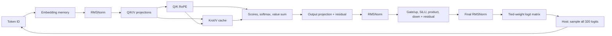

# Gradiated FPGA tiny transformer

A deliberately overfitted chip-joke generator for learning, a Sand to Thought
blog post and Gradiated marketing. **The 26,720-parameter transformer now runs
in the physical KV260's programmable logic. Four frozen prefix cases through
256 tokens passed 128,320 exact integer-score comparisons. Six physical
generations passed an independent audit of every sampling decision against the
original pinned Mac NumPy recipe; five were complete authored jokes and one
reproduced the known gibberish failure.** Neural arithmetic runs in PL; the Arm
CPU controls it and samples tokens. The clock is kernel-reported at 50 MHz.
The routed candidate passes timing/clock/DRC checks. These are finite regression
results for deliberate memorisation, with no throughput/power/cost or held-out
language claim. The historical initial loading fault, recovery and current
verified physical results are recorded below. This project
focuses on one 26,720-parameter transformer; its software model runs on the Mac.

**Latest, 9 November 2026:** a separately trained actual-text candidate now passes
all seven fresh server RTL comparisons, using the original arithmetic/circuit:
895,800 state/cache values and 169,280 scores are exact. A new sealed package is
ready; Aidan deferred its physical board test. The physical results above belong
to the earlier BOS-trained weights. See [the balanced conditioned model](#balanced-conditioned-model-ready-for-a-later-board-test)
for the new input format, artifact hashes and scoped evidence.

## Run it

For real text continuation on the loaded KV260, see
[Actual text continuation](#actual-text-continuation). The new Python interface
has passed physical machine-completion and interactive tests. Earlier verified
BOS/prefix/generation results are retained below. The original Mac software commands follow.

From this isolated worktree:

```sh
cd /Users/aidanmcconnell/.codex/worktrees/fpga-inference/gradiated
research/fpga-inference/generative.sh chat
```

To try the software version using fixed-point calculations:

```sh
research/fpga-inference/generative.sh chat --format fixed
```

This opt-in mode runs integer neural arithmetic on the Mac CPU: 16-bit weights,
16-bit working values, 48-bit dot accumulators and integer nonlinear functions.
The default command above still uses the selected q8/FP32-intermediate MLX model.
Both commands run Mac software with the same external FP64 token sampler;
the board interface is described separately below.

Enter requests a joke with a fresh random seed. Text supplies a reproducible
sampling seed, not a question the model understands. `q` quits. Optional
`--seed 10001` makes blank entries use 10001, 10002, and so on.

Every request starts from one token. The model predicts every byte; the host
samples the first 32 bytes and then selects the most probable byte until EOS.
No joke identifier, answer lookup, output mask, retry or repeat filter. Repeats
and mistakes are displayed. [Model details and limitations](../model/README.md).

## What to open

| File or folder | Purpose |
| --- | --- |
| material/one-liners-review-v2.txt | Your editable joke wording, including newer drafts |
| material/character.md | Current desired identity and humour |
| material/joke-library.txt | Readable catalogue of 106 earlier banked joke versions |
| material/library.jsonl | Preserved dialogues, prompts, draft material and historical notes |
| model/jokes.json | Exact frozen 48-joke training snapshot |
| model/selection.json | Original architecture, recipe and FP32/q8 payload hashes |
| model/fixed.json | Accepted fixed-point arithmetic, payload pin, regression hashes and real projection trace |
| tools/model.py | Original network, byte sampling, optimizer and numerical checks |
| tools/fixed.py | Integer forward calculation, calibration, comparison and fixed-point sampler interface |
| tools/generative.py | Chat, verification, RTL simulation and explicit training commands |
| tools/rtl.py | Pinned simulator setup, independent fixtures and observed-trace checks |
| rtl/mac32.sv | Reused 32-term MAC with one-row, Q-only or Q/K/V projection control |
| rtl/mac32_tb.sv | Arithmetic, reset and handshake testbench |
| rtl/qk_rope.sv / qk_rope_tb.sv | Serial Q/K positional rotation and its testbench |
| rtl/kv_cache.sv / kv_cache_tb.sv | Append-only K/V memories, visibility/read control and tests |
| rtl/cache_viewer.html | Observed cache writes, addresses, reads and reset walkthrough |
| rtl/rope_viewer.html | Observed pair-rotation teaching-page template |
| rtl/viewer.html | Offline teaching-page template, populated from real simulation traces |
| rtl/toolchain.json | Isolated simulator version, source and checksum pins |
| tools/runtime.py | Offline sandbox, environment pins and watchdog |
| tools/llama_numpy_reference.py | Independent arithmetic reference |
| hardware.md | Proposed PL engine, numerical formats, memory budget and acceptance gates |
| learning.md | Current explanations and teaching route |
| history.md | Earlier findings and recovery instructions |

The historical library preserves 2,749 unique records, with provenance for 227
input documents and inert earlier source snippets. It includes withdrawn drafts
and former identities; those are historical material, not current instructions.
[Material guide](../material/README.md).

## Verify or reproduce

```sh
research/fpga-inference/check.sh
research/fpga-inference/generative.sh verify
```

The first command runs DevEx, syntax and focused model/material/security tests.
The second verifies the original FP32/q8 formats, reproduces all 128 pre-cleanup
token sequences exactly, checks NumPy/cache/packing and performs one fresh-model
optimizer update. It also verifies 128 frozen fixed-point token hashes, primitive
integer oracles and the pinned real projection trace. It preserves the known gibberish case rather than filtering it.
The original result is 127/128 exact authored jokes across 41 different jokes;
all 48 jokes are training data, so this is not an unseen-language test.

Explicit future reproduction only:

```sh
research/fpga-inference/generative.sh train
```

This trains fresh random weights with the fixed 2,000-pass recipe and writes a
new FP32/q8 export to ignored runtime output. It never replaces selected weights.
No additional full training run was performed for cleanup.

## Connected integer decoder on the server

`rtl/transformer.sv` connects the neural operations from a token ID to all 320
signed 32-bit logits. The host still supplies the declared sampler and feeds back
its selected token. Inputs to the circuit are parameters/tables and token IDs;
there is no joke lookup, identifier input or host-computed neural layer.



This is an explanatory view of the source architecture, not a synthesized
schematic. Other than the host sampler, the boxes are RTL. Whole-model numerical
acceptance is a separate gate from writing/compiling the connected source.

New reusable components:

- `fixed_scalar.sv`: checked signed 64-bit shifts, division, multiplication,
  table-based negative exp and reciprocal square root. Division/multiplication
  are iterative, not giant combinational arithmetic. Tables are loaded data.
  Its multiplier has128-bit internal product/overflow guard registers before
  enforcing the signed64 result limit. Those guard bits detect overflow; they
  do not widen the selected model's stored values or accepted arithmetic results.
- `rmsnorm.sv`: 32-coordinate normalization, including nonzero epsilon 42950,
  the selected reciprocal-square-root/Newton schedule, gains and one final RNE.
- `dense.sv`: 32/128-input projections, up to320 rows, 16/32-bit outputs,
  signed 48-bit accumulation and selected shifts. One physical DSP was measured
  for the synthesized 320×32 logit instance after preventing debug duplication.
- `attention.sv`: both 16-wide heads, scores, exp, probability division and
  weighted values. It reads the connected cache through tagged transactions.
  Probabilities are zero-extended to 17 bits before multiplication with signed V.
- `feedforward.sv`: gate/up projections, SiLU, elementwise product and down
  projection. It retains the selected rounding and saturation boundaries.
- `frontend.sv`: wires the existing three blocks together. Queries become
  visible only after a complete rotated-K/V token row has been committed.

The first integrated implementation deliberately uses separate engines across
stages. Each dense engine reuses its own arithmetic across coordinates/rows;
this is **not** one physical multiplier shared by the complete transformer.
Tied E is loaded identically into embedding and logit memories, giving two
physical copies of the same trained tensor. The original one-copy-E/47-BRAM
reservation in hardware.md is an earlier analytical proposal, not this design's
measured allocation. Use actual synthesis reports for resource statements.

The model loader accepts exactly 29,281 ordered 32-bit words: E; Q/K/V/O;
gate/up/down; three gains; packed RoPE cosine/sine pairs; exp and rsqrt tables.
Signed 16-bit values occupy the low 16 bits, while tables/packed pairs use all 32.
Configuration completes only after the final word. Invalid banks/addresses,
partial ordering and in-flight model writes cannot configure or alter the core.
The first token after context clear must be BOS 256. The cache has 256 positions;
requests beyond capacity are refused. Global reset cancels work and requires a
full reload; idle context clear preserves the loaded model/tables for a new joke.
An arithmetic fault latches a fault packet until reset, rather than continuing
with a corrupt context. Saturation is diagnostic and includes intermediate
feed-forward clipping, not only the final outputs.

Run the bounded, standard-library Linux checks independently:

```sh
python3 -B research/fpga-inference/tools/rtl.py --vivado scalar
python3 -B research/fpga-inference/tools/rtl.py --vivado norm
python3 -B research/fpga-inference/tools/rtl.py --vivado dense
python3 -B research/fpga-inference/tools/rtl.py --vivado feedforward
python3 -B research/fpga-inference/tools/rtl.py --vivado attention
python3 -B research/fpga-inference/tools/rtl.py --vivado frontend --fixture-kind frozen
python3 -B research/fpga-inference/tools/rtl.py --vivado transformer
python3 -B research/fpga-inference/tools/rtl.py --vivado transformer --prefix j01-16
python3 -B research/fpga-inference/tools/rtl.py --vivado transformer --prefix authored128 --no-waveform
python3 -B research/fpga-inference/tools/rtl.py --vivado transformer --prefix repeated-j01-256 --no-waveform
python3 -B research/fpga-inference/tools/rtl.py --vivado axi
python3 -B research/fpga-inference/tools/rtl.py --vivado axi-core
python3 -B research/fpga-inference/tools/rtl.py --vivado host
python3 -B research/fpga-inference/tools/rtl.py --vivado pack
python3 -B research/fpga-inference/tools/rtl.py --vivado synthesis --synthesis-top frontend
python3 -B research/fpga-inference/tools/rtl.py --vivado synthesis --synthesis-top transformer --synthesis-timeout 600
python3 -B research/fpga-inference/tools/rtl.py --vivado board-prep
```

Each simulator/component-synthesis invocation has a 180-second watchdog and
process-group cleanup. Full decoder synthesis has a separately selected
600-second limit; this cannot extend simulator deadlines. Outputs remain in
ignored runtime, including source identities, exact
commands, fixtures, CSV, VCD, reports and checkpoints. Simulator warnings remain
fatal apart from the documented AMD Ubuntu wrapper warning. Synthesis warnings
are retained for review; errors/critical warnings, latches and black boxes fail.
OOC synthesis means mapping logic for the K26 without placing/routing a complete
board design. Synthesis timing is unplaced; the separate core-only layout
diagnostic is described below. Neither is a measured FPGA frequency. No
programming file or physical board test exists. Long-context runs can omit VCD
while retaining every accepted-value CSV event and all numerical/protocol checks.

Verified checkpoints:

| Evidence | Measured/check scope |
| --- | --- |
| Original Mac fixtures replayed in Vivado | Q/K/V 5,280 outputs, RoPE 27,072 outputs, cache 16,384 model values plus protocol suite |
| Connected frontend | 263 complete tokens, all 256 positions, 823,296 observed projection products and 33,920 RoPE products checked; seven archived model boundaries, other inputs synthetic |
| Scalar unit | 2,160 responses checked, including 314 expected error responses; actual model tables and synthetic operands |
| Norms | norm1 includes 224 unique archived coordinates; norm1/norm2/final and clipping-stress suites exact |
| Dense | six synthetic geometries plus five real-weight/synthetic-input geometries, all exact |
| Feed-forward | 4,096 intermediate values and 256 down outputs, four cancellation resets and missing-table fault/recovery |
| Attention | 448 contexts, 53,056 products/partial sums, 1,658 scores/exps/probabilities each; three archived Qrot/Krot/V inputs, independently derived context answers |
| Full decoder smoke | BOS and clear-context replay produce 640 ordered logits; the 16-token J01 input prefix plus replay produces 5,440. All 25,846 recorded values across 25 stages match independent integer/Fraction oracles at observed inputs; original Mac comparison is recorded separately below |
| Long decoder contexts | 128 authored-prefix tokens plus BOS replay: 41,280 logits, 239,430 stage values, 3,434,496 dense and 528,448 attention terms. Full 256-token repeated-J01 context plus replay: 82,240 logits, 575,686 stage values, 6,842,368 dense and 2,105,408 attention terms. All available arithmetic/protocol checks exact; these are teacher-forced inputs, not sampled generation or original Mac whole-model proof |

Local arithmetic replay alone is **not** an original-model logit comparison or a
sampled joke-generation result. The fresh original Mac comparison below now
passes the four prescribed cases. Full Mac generation regressions still use
its original pinned environment; it is not recreated or bypassed on Linux.

The fresh Mac export contract is four explicit inputs: `[256]`; J01's first
16 tokens including BOS; the longest frozen authored sequence's first 128
tokens; and `(J01_sequence * 256)[:256]`, labeled synthetic repeated training
tokens. Use the original selected `fixed.integer_call` in its pinned offline
Mac worker, with unchanged source/weight pins and a separate absolute 180-second
process-group watchdog per worker. Require full-versus-incremental equality for
every returned integer state/logit and the final cache; retain all counters.
Transfer the arrays and original accepted export/watchdog receipts with measured
byte counts/SHA256, and provide the manifest hash independently through the Mac
discussion. No runtime, environment, credentials or model recreation is needed.

The proposed data schema is `schema:1`, `cases:[...]`; each case has `tokens`,
`states`, `cache:{k,v}`, counters and `incremental_matches_full:true`. Tensors
preserve `shape`, `dtype` and integer `values`: vector states `[1,L,width]`,
logits `[1,L,320]`, scores/probabilities `[1,2,L,L]`, cache `[1,2,L,16]`.
`mac_case_golden` only maps verified original arrays to RTL coordinates; it is
not a model forward or a trusted-file loader. Its caller must verify the
transfer and original receipt before use. Compare only causal score/probability
columns `0..position`, every vector/logit and every committed cache coordinate.
Existing long-context RTL traces can then be compared without rerunning them.

### Accepted original Mac whole-model comparison

Fresh reference data arrived in ignored runtime at
`rmsnorm-validation/whole-model-reference-20261104T101114Z`. Trusted transfer
SHA256 is `0a64222965b788c4e2899edda5bbffe35d8283fcedf279b3ca7bee264a8fce97`;
the 20,415,279-byte `goldens.json` is
`36ae1ebe2fa0bedd74c2cf872742e996b776349ba579742b7931928c0ea0f3e6`.
All 14 transferred data/provenance files, five selected weight/config pins,
computational source identities, arithmetic digest, pinned package versions,
original sandbox/launch declarations, four watchdog/cleanup receipts and
full-versus-incremental acceptance flags are verified. Worker/supervisor source
hashes and execution controls are Mac-attested; their script bytes were not
transferred or locally re-executed. No environment or model forward was recreated.

`model-compare-2az1bnjc` passes **709,492 exact integer comparisons**, including
four idle-clear/fresh-BOS replays. It checks all 21 original returned states,
causal attention entries, all 128,320 original-position logits (129,600 including
replays), and accepted K/V writes against the original final-cache coordinates.
The cache comparison observes accepted write-bus values; it is not a final
full-core RAM readback sweep. Standalone KV readback remains separate evidence.
The Mac's 841,988 full-array values include future attention columns that the
causal RTL deliberately does not compute; they are not counted as RTL matches.

| Original input | Positions | State/cache comparisons including one BOS replay |
| --- | ---: | ---: |
| BOS | 1 | 2,696 |
| J01 first16 including BOS | 16 | 23,396 |
| Longest authored prefix (J01, first128 of143 tokens) | 128 | 206,404 |
| Repeated J01, explicitly synthetic training tokens | 256 | 476,996 |

These are 401 input positions across overlapping prescribed cases, not 401
independent language situations. Mac full/incremental counters report zero
saturation. BOS/first16 are freshly simulated with original golden logits in
the testbench; the long runs reuse sealed traces whose complete current RTL and
testbench source hashes, actual model/token words and accepted CSV values match.
The numerical gate is accepted for these inputs; no FPGA execution, new sampled
quality result or full-board timing claim follows from it.

`--vivado model-compare` requires the trusted Mac transfer seal. Repeated
`--trace-report RESULTS_JSON SHA256` pairs optionally reuse verified traces;
missing cases are simulated without VCD under unchanged 180-second watchdogs.
Its report seals the original reference and case receipts. The existing accepted
gate has SHA256 `a692b41a116ed4b7c3a62a8686652f16690f5bfaa90089fb2491fea5a7e87c98`.

### Synthesized core estimate and offline transport

The assembled `transformer` core passed K26 out-of-context synthesis with source
hierarchy retained. The estimate excludes the Arm processing-system shell and
AXI register wrapper:

| Resource | Synthesized estimate | K26 capacity |
| --- | ---: | ---: |
| LUTs | 31,844 (27.19%) | 117,120 |
| Registers | 10,084 (4.30%) | 234,240 |
| BRAM tile equivalents | 36.5 (25.35%): 30 RAMB36 + 13 RAMB18 | 144 |
| DSP blocks | 10 (0.80%) | 1,248 |
| UltraRAM | 0 | 64 |

These are tool-reported synthesized resources, not physical placement or board
measurements. No black boxes or latches remain. `frontend.rotated` uses registers
because its paired writes do not infer block RAM; Vivado also removes an unused
RoPE register. The separate unplaced timing report has +1.352 ns slack at the
nominal 10 ns constraint, with no physical clock-source/IO-delay model. This is
not a routed timing pass or a promised board frequency.

Two earlier full-core attempts reached cleanup but timed out at 180 seconds;
receipts and partial logs remain in `synthesis-pqed9bf1`/`synthesis-7lccsgam`.
The initial successful synthesis in `synthesis-b16s45sk` took 201.39 seconds,
followed by a separate 51.40-second unplaced reporting invocation. After the
loading-handshake repair below, `synthesis-jqm12y16` took 178.23 seconds plus
48.11 seconds for unplaced reporting; its source identities and checkpoint are
the current table's basis. Every owned process group was reaped. These are build
durations, not inference latency.

### Core layout diagnostic

The first core-only implementation attempt (`implementation-cqoczo5k`) completed
optimization, but placement's precondition DRC found `LUTLP-1`: a combinational
loop through model-load ready/valid and child-start control. The run was stopped;
no loop waiver was applied and no routing result was accepted. Its original
interrupted receipt records `incomplete`, the completed optimization checkpoint,
and the killed placement command. A separate process check confirmed the vendor
processes were gone. This exposes a hardware issue that the earlier behavioral
simulations and synthesized resource count did not exclude.

`transformer` and `feedforward` now forward qualified valid offers independently
of recipient ready. Only valid-and-ready advances ordered loading or writes local
configuration. Assertions verify atomic table broadcasts and one acceptance per
model word, including malformed table-value rejection. Feed-forward, the 16-token
decoder and real-core AXI regressions pass; all 25,846 recorded decoder stage
values have a byte-identical JSON export before/after the repair. The fresh
optimized checkpoint's `LUTLP-1` report contains zero findings.

The repeatable `--vivado implementation` mode verifies a trusted SHA256 of a
successful full-core synthesis report, every current RTL source hash, and the
checkpoint's byte count/hash before opening it. Optimization, placement and
routing each get their own checkpoint and watchdog; an explicit
`--implementation-timeout 600` cannot extend simulator/report deadlines. The
optimized netlist is checked for combinational loops before placement. All
critical warnings remain fatal. The provisional 10 ns clock uses `HD.CLK_SRC`
from the target BUFGCE inventory, with unrestricted core placement and no data
port delays. This is an internal core diagnostic; PS/AXI shell integration,
actual board clock/reset, boundary timing, original Mac whole-model validation
and physical execution remain separate gates.

The repaired core completed optimization, placement and routing commands in
`implementation-38hhcadw`: 58.95, 282.87 and 447.21 seconds respectively. Report
collection initially hit Vivado's different placed-LUT label; the parser was
fixed and the saved routed checkpoint was reanalyzed separately. No physical
build was repeated to repair that report parser. Effective placed resources are
30,682 LUTs, 10,084 registers, 36.5 BRAM tile equivalents and 10 DSP blocks.

| Same core layout | Setup slack | Hold slack | Specified internal timing |
| --- | ---: | ---: | --- |
| 10 ns / nominal 100 MHz (`routed-timing-2krlnzu7`) | -2.888 ns | +0.012 ns | Failed |
| 20 ns / nominal 50 MHz (`routed-timing-wc0y7ot8`) | +7.112 ns | +0.012 ns | Met under the standalone clock model |

These reports contain zero DRC errors/critical warnings and zero routing errors;
38,492 routable nets are reported fully routed. However, the explicit gap on the
standalone `clk` net remains, and Vivado's global `fully_routed` flag is **false**.
Both strict diagnostic receipts therefore retain `accepted:false`. This is not
full routing signoff. The external clock buffer at `BUFGCE_X0Y48` is modeled by
`HD.CLK_SRC`, not instantiated as part of a complete PS/PL design. All 66
unanchored input-port warnings are retained, along with DSP input/output pipeline
recommendations and the unused output-port-load warning. Boundary timing and
some connectivity DRCs remain incomplete in OOC mode. No warning or DRC severity
was waived. The 50 MHz result supports a slower prototype candidate, not a
promised clock rate for the actual board.

The reporting-only mode below verifies the sealed stage-progress receipt,
original synthesis/source identities, vendor wrapper and routed checkpoint SHA.
It preserves both clock results and cannot extend the 180-second report deadline:

```sh
python3 -B research/fpga-inference/tools/rtl.py --vivado routed-timing \
  --checkpoint-report .agents/runtime/fpga-inference/vivado-prep/implementation-38hhcadw/transformer/progress.json \
  --checkpoint-report-sha256 e80d7e3e27487600ad26b7a56f11ff690adb88b5bc4c669c372ae77f40fa25de \
  --timing-period-ns 20
```

Clock/context constraints and routing-state distinctions follow AMD's
[OOC context constraints](https://docs.amd.com/r/2022.1-English/ug905-vivado-hierarchical-design/Context-Constraints)
and [route-status command](https://docs.amd.com/r/2021.2-English/ug835-vivado-tcl-commands/report_route_status).

### Candidate KV260 processor connection

`--vivado board-prep` runs `tools/kv260-shell.tcl` under the 180-second watchdog.
It pins the installed KV260 SOM 1.4 board XML and preset, then validates
PS HPM0_FPD -> SmartConnect -> the actual AXI transformer. Vivado module references
require a generated Verilog port wrapper around the existing SystemVerilog;
that ignored wrapper contains only wires and the real module instance.
The saved candidate project includes every source dependency. The exported BD
Tcl's retained `BD 41-2925` warning requires loading that wrapper first on replay.

The proposed segment is exactly `0xA0000000..0xA00000FF`: 32-bit data, 40-bit
PS addresses translated to the core's 8-bit byte addresses. PS/SmartConnect input
uses AXI4 with 16-bit IDs; the core side is AXI4-Lite with no IDs. Nominal 100 MHz
PL0 is derived as 99,999,001 Hz by the installed IP from its 33.333 MHz reference;
this is preset-derived metadata, not a clock measured on the board. Active-low
PS reset propagates `C_EXT_RESET_HIGH=0` through the synchronized reset block.
There are no external PL ports. This candidate passed logical validation in
`board-prep-wx9ptkpb` (15.98 seconds), with no critical warnings or errors.
The explicit `--board-clock-mhz 50` alternative also passed in
`board-prep-yxh1c4al` (19.54 seconds); its derived clock is 49,999,500 Hz, with
the same reset, register window and interface widths. The default remains the
100 MHz logical candidate; neither candidate is a programmed board configuration.

Board-prep alone does no IP output generation, synthesis, XSA, bitstream or
board access. The separate complete-candidate build is below. Before deployment,
inspect the actual board revision,
QSPI/boot firmware, SD operating system/kernel, device tree and occupied address
map, PL clock/reset availability, FPGA loading/driver bindings and Arm build
environment. Keep the board off the internet. The proposed address and clock
do not establish compatibility with its existing image.

### Complete offline PS/AXI/neural candidate

After the accepted original Mac comparison, `tools/kv260-build.tcl` generated
the complete 50 MHz candidate and synthesized the actual processor interface,
SmartConnect, reset circuit and neural RTL together. Global synthesis uses
`SYNTH_CHECKPOINT_MODE=None` with direct `synth_design`; it does not launch
separate OOC synthesis runs. Initial generation took 42.65 seconds and global
synthesis 345.60 seconds under 180/600-second watchdogs, with two threads and
verified process cleanup. An initial Vivado native-file-object crash and an
incorrect module-refresh API call were retained and repaired in fresh ignored
directories; original candidate inputs were not changed.

The complete synthesized candidate reports 33,293 LUTs, 11,042 registers,
36.5 BRAM tile equivalents and 10 DSP blocks, plus one actual PS8 and one
BUFG_PS clock buffer. No black boxes or latches remain. Clock `clk_pl_0` is
constrained at 20 ns from PS8 `PLCLK[0]`, through the buffer to the actual neural
clock pins. The initial +11.196 ns setup/-0.081 ns hold estimates are unplaced
and do not establish timing closure. Placement/routing and final reports remain
separate phases; no programming file or physical execution follows from synthesis.

The first synthesized checkpoint is the explicitly audited session seed in
`board-readiness/full-build-m6b0vzkp/synth`, SHA256
`fc9bfff6a7cd89946eb8a5fc8edf7b338a045bb093afe96907eda4642972d0d1`.
Its original 145 pinned inputs included all eleven actual neural sources, but
omitted four generated vendor `.vh`/`.svh` headers. Those four now match installed
canonical AMD bytes, and the later source audit seals the complete 175-file
closure. That is current vendor-match evidence, not retrospective pre-synthesis
pinning of the omitted files. The seed retains this historical limitation;
future generate/synth phases seal the complete closure before compilation.

`--vivado board-build` requires an accepted sealed numerical report, input hash
and a sealed predecessor report. Current neural source hashes, real compile-order
paths, nested generated sources and ancestor artifacts must match. Only the
explicitly pinned initial seed can bridge the original session receipt format;
an arbitrary hashed runtime DCP cannot bypass the phase/source lineage.
Generation/source audit/reports/candidate bitstream remain 180 seconds; explicit
`--board-build-timeout 600` applies only to synth/opt/place/route.

Each DCP phase checks the real top, PS8/buffer/neural clock topology and period,
the installed DRC defaults, waiver objects, loop allowances and clock-route
overrides. Final acceptance additionally requires complete placement/routing,
zero routing gaps/errors, no active unclocked pins or unconstrained internal
endpoints and nonnegative specified setup/hold timing. The pre-placement native
`no_clock=8` count remains visible: these are exactly eight unused hard-PS peripheral output
clock pins with zero leaf sinks. They are identified by name/direction/connectivity;
no invented clock or timing exception removes them. All 6,444 installed DRC
enabled/severity/message-limit defaults remain unchanged; no waiver is added.

The complete native placement finished in 210 seconds with estimated setup slack
+5.456 ns. Its first wrapper then failed a clock-route assertion that belonged
after routing. That failed receipt remains unchanged. A separate, sealed
`board-build-dgvfhitt/recovered-placement.json` identifies the completed native
operation, original script/log, source/postcheck proofs and pending clock gap;
it does not relabel the original failed wrapper as passed. The corrected audit
keeps graph/domain checks strict at every stage and requires physical clock-route
completion after routing/final reports. Placement was not repeated.

Complete routing in `board-build-74bghzx6` and final diagnostics in
`board-build-fzsm963h` now pass at 20 ns / nominal 50 MHz:

| Full candidate final result | Tool-reported value |
| --- | ---: |
| Setup slack | +4.913 ns |
| Hold slack | +0.011 ns |
| Placed / routed | Both complete |
| Routing errors / gaps / partial / unrouted nets | 0 |
| Active unclocked pins / unconstrained internal endpoints | 0 |
| Native `no_clock` count after routing | 0 |
| DRC errors / critical warnings | 0 |
| Effective placed LUTs / registers | 31,792 / 11,027 |
| BRAM tile equivalents / DSPs | 36.5 / 10 |

These are actual implementation-tool results for the declared commercial K26
candidate, not measurements of the physical board's speed/power. All 6,444
default DRC rules remain unchanged with zero waivers/loop allowances/clock-route
overrides. The earlier standalone clock gap is absent from the complete design.
The accepted final report SHA256 is
`4ccb6b79023d6b5458035c1e20687c4e881d5483f0ae126f362fba2471f1fcfe`.

### Offline candidate programming file

`--vivado board-build --build-phase bitstream` requires that accepted final
report for its exact routed DCP, rechecks the numerical/source lineage and all
native timing/routing/clock/DRC gates, and writes only a local candidate file.
The 93.91-second export passed with no diagnostics and complete process cleanup:

- File: `.agents/runtime/fpga-inference/vivado-prep/board-build-_4wbn4bx/offline-candidate.bit`
- Bytes: 7,797,831; SHA256 `4f69ec2d1c41eca9dc33b42fa058c3440a2852fdcd42298e6f2c9893e4909cdd`
- Weights: `vivado-prep/pack-vp89u9_3/model-words.bin`, 117,124 bytes,
  SHA256 `0198baeaeb48052895b5eb4f9622d61fb144295584e6823f8e42420fc0d73cf5`.
  The `.bit` contains the circuit; verified weights/tables are loaded separately.

The file targets `xck26-sfvc784-2LV-c`, requires the PS HPM0 interface and
synchronized active-low reset, and assumes a PL0 clock no faster than 50 MHz
(candidate preset derives 49,999,500 Hz). The register window is
`0xA0000000..0xA00000FF`. The `.bit` does not initialize the PS clock/boot/OS,
confirm address availability, provide a physical Arm mapping/driver or establish
compatibility with the board's existing image. The receipt explicitly records
`candidate_only:true` and `board_compatibility_verified:false`. No board was
loaded, flashed or rebooted; no XSA or boot image was generated.

This continuation changes only `AGENTS.md`, `README.md`, `hardware.md`,
`tools/rtl.py`, `tools/test_model.py` and new `tools/kv260-build.tcl` under
`research/fpga-inference/`. Neural RTL, selected models and creative material
are unchanged by this continuation.

### Physical KV260 inspection and fresh SD setup

The initial unpowered-board USB checks identified only the FTDI bridge. On
9 November, after Aidan connected the correct supply, a passive capture remained
quiet, but one carriage return produced `kria login:`. Aidan then authorised
erasing only the microSD, preserving QSPI and other Mac disks. The Mac chat wrote
the official Kria Ubuntu 24.04 image and verified a full byte-for-byte card
readback. The downloaded XZ has a recorded SHA256 and valid CRC64, but no
independent publisher SHA256 was available; do not describe that as publisher-hash
verification. Aidan booted the fresh card and set the new password privately.

Verified transferred receipts now identify Ubuntu 24.04.2, Linux
6.8.0-1015-xilinx, aarch64; KV260 carrier SCK-KV-G revision 2 and K26 SOM revision 2.
The boot firmware reports `K26-BootFW-01.02-06140626`; no QSPI update was made.
Ethernet carrier remains zero. At this initial inspection the manager operated
with the stock `k26-starter-kits` application, not our circuit. The four existing root-only UIO
devices are `axi-pmon` performance monitors and must never be used for our model.
Python 3.12.3, dtc, xmutil, dfx-mgr and kernel overlay/UIO support are present;
no board C compiler or development headers are installed.

Raw reports are under ignored `board-inspection/mac-ubuntu-24.04/`. The sealed
`original-json/transfer-manifest.json` SHA256 is
`1d6011ab7f58f56dafca1e320796b5eb5e28ebd56db3c09787a8bb0020080151`;
`live-support/transfer-manifest.json` is
`f2aa50e19870a7ab987b14149e7075260c91e94cc6ad0ff3e3f82dcc91101ffe`.
All 15 files match their manifests. The complete live tree contains 227 nodes;
the raw JSON preserves all 1,640 properties, including redundant `name`
properties that dtc omits. Both the raw JSON and independently parsed compiled
tree were checked on the Mac; this is captured-board evidence, not a current
live connection from the server. No registered resource overlap with the
candidate window was observed; that is not physical MMIO accessibility proof.

**The initial captured PL0 clock was 99,999,999 Hz, hardware-enabled with no Linux
consumer. It must be set and verified at no more than 50 MHz before loading the
timing-closed circuit.** A bitstream does not configure that PS clock. AFI data
width/reset setup and a separate UIO node are also needed. A subsequent sealed
read-only check confirms `CONFIG_XILINX_FCLK=y`, `CONFIG_XILINX_AFI_FPGA=y` and
both registered driver paths (`xilinx_fclk`, `afi-fpga`), with no devices bound
yet. Its 882-byte receipt is
`clock-afi-driver-check-20261109T132436Z.json` under the inspection root,
SHA256 `085558f8d5bf038a72f83591b975dcf2896a2b7f487aa288c8023babde239869`.
These built-in drivers need no installation or modprobe. This closes the driver
registration prerequisite. The later clock stage passed, programming failed,
and AFI/interface setup and physical MMIO remain unexecuted, as recorded below. The package
manifest's driver-availability unknowns reflect its earlier preparation time;
the later sealed receipt closes those two entries without modifying its bytes.

### Historical first-load failure and loading-mode diagnosis

**Measured on 9 November 2026:** the Mac verified the corrected `bos-7ie8ziyp`
package on both hosts and loaded `libboard_bos.so` on the board without MMIO.
Stock `xmutil unloadapp` returned `Ok` and its overlay disappeared. The FCLK
overlay applied and bound; PL0 reported 50,000,000 Hz, prepare/enable counts 1,
hardware enabled, and no new kernel errors. Only PL0's divider-chain rates
changed. Exactly one configfs programming-overlay write/close then triggered
`kernel BUG at include/linux/scatterlist.h:115` on
`6.8.0-1015-xilinx #16-Ubuntu`, through:

```text
sg_alloc_append_table_from_pages -> sg_alloc_table_from_pages_segment
-> cma_heap_attach -> dma_buf_dynamic_attach -> dma_buf_attach
-> fpga_mgr_load -> fpga_region_program_fpga -> configfs_release_bin_file
```

The process died with IRQs disabled/preempt count 1; a context-tracking warning
followed. Post-fault taint was 640, manager flags `20`, state `operating` and
empty status. Those last two values do not prove a new load: the crash preceded
the load helper's state transition. The programming configfs directory remained,
but its firmware-name property was absent. No custom interface overlay, AFI
binding, model UIO, model MMIO, weight load or inference token ran. Existing UIOs
remained the four `axi-pmon` devices. Ethernet carrier was zero and QSPI was
untouched. There was no retry or automatic reboot.

All nine receipt files under ignored
`board-bringup/mac-first-load-20261109/` match `transfer-manifest.json`, SHA256
`e9a351069fa0f22a36ab602180fc37ef3d7c93ba015c3f774374d7dd1c59632d`.
The 82,141-byte transfer archive hash communicated by the Mac is
`42e31d905b1e6ae0504f676271b6cdb7c3e6358d54fce57e44266c0f0b31b303`;
the manifest and its individual files were independently rehashed here.
`uart-program-fault.log` is 7,906 bytes, SHA256
`592a2d946a6baa6f8ea561664834ff613b038070f25ae90c5f181b2e67888dee`.
The Mac replaced an incomplete unframed UART capture with hashed/compressed
frames; no hardware action was repeated to retrieve these receipts.

**Exact-source finding:** Ubuntu's
[linux-xilinx 6.8.0-1015.16 source](https://launchpad.net/ubuntu/+source/linux-xilinx/6.8.0-1015.16)
adds `FPGA_MGR_CONFIG_DMA_BUF = BIT(5)`. The prior stock inspection already
recorded sysfs flags `20\n`; this is hexadecimal `0x20`, not decimal twenty.
In `fpga_mgr_load`, global `mgr->flags & FPGA_MGR_CONFIG_DMA_BUF` selects
`fpga_dmabuf_load` before the firmware-name check. That helper attaches the
existing `mgr->dmabuf`, rather than requesting our new firmware file. Its cleanup
drops the buffer reference without clearing either the pointer or mode; the
ioctl sets both when a fresh DMA-BUF is supplied. The captured programming
request supplied only the DTBO and no fresh DMA-BUF ioctl. The exact Ubuntu
patch SHA256 is
`2f73ef45d2ddbb70e540fc657bf3c74a7c45d3b0663c10e0a6e45f723c332954`,
verified against Canonical's published source checksum. The corresponding
[AMD manager implementation](https://github.com/Xilinx/linux-xlnx/blob/xlnx_rebase_v6.6_LTS_2024.2/drivers/fpga/fpga-mgr.c)
also exposes this dispatch/reference behavior.

**Confirmed:** the firmware-name request took the inherited DMA-BUF branch and
failed while attaching its CMA buffer, before the configuration-transfer call.
**Inferred:** the retained pointer/page storage from the stock load had been
released and reused. Source plus trace strongly support that lifetime fault;
there is no allocator/refcount capture proving exactly when it was freed.
This is not evidence of neural arithmetic, 50 MHz timing, reset-ID119 or AFI
failure. Our staged loading procedure missed the global manager-mode gate.

**Verified recovery:** after the Mac observed Aidan's manual `sudo poweroff`
complete all unmounts and reach `Powering off`, human-controlled recovery and
private login produced a fresh read-only stock baseline. The separate
`board-bringup/mac-first-load-20261109/recovered-readonly.json` receipt is
2,986 bytes, SHA256
`950ce6e77e39b82f9649bbe1a47bf56e4541837892bf57107fd12619287ca243`;
it was rehashed and checked here, independently of the earlier transfer
manifest. Boot ID is `bcb863cb-0211-48a8-a817-ab0c80dccd03`, kernel taint zero.
The stock `k26-starter-kits` overlay is applied, its firmware name is restored,
and the manager reports `operating`. All three stock file hashes match the
pre-change capture; both QSPI slot revisions still report
`K26-BootFW-01.02-06140626`. PL0/PL1 are back at 99,999,999 Hz, with no candidate
FCLK/AFI bindings and only the four original `axi-pmon` UIOs. Ethernet carrier
remains zero. The existing mtdoops/TPM/stock-overlay boot diagnostics match the
prior capture; the error log is not empty. No candidate load, model MMIO or
inference has been repeated. Stock loading again leaves flags `20`, confirming
that a fresh boot alone does not establish firmware-file mode.

**Next decision:** preserve this recovered stock baseline. Never reuse the
earlier tainted session or improvise live overlay cleanup as recovery. The
next bounded experiment must release stock-app ownership through its manager
and exclude any concurrent FPGA/dfx load. Explicitly select ordinary unencrypted full
firmware-class loading by setting `/sys/class/fpga_manager/fpga0/flags` to zero;
read back zero immediately before applying the programming overlay. This makes
the exact source bypass the stale DMA-BUF pointer and request the verified
firmware file. Re-establish the bound/enabled 50 MHz FCLK and all existing
firmware/reset/ownership checks first. Merely changing firmware names or using
the manager's `firmware` attribute without clearing flags is insufficient: the
firmware helper copies the same global flags into its image information.
This is a materially different source-supported loading path, not a physical
success claim. No new kernel, circuit build, package edit or installation has
been performed for this diagnosis.

### Physical BOS comparison passed

The corrected firmware-file load applied `bos-ghzmrwrd`'s unchanged circuit
without a kernel fault. Flags were zero, DFX runtime-inactive, and PL0 remained
enabled at 50 MHz. The original strict empty-error assertion failed because
Linux logs two expected base-node property warnings at error level. Its receipt
was preserved; source review classified exactly one occurrence each for
`/fpga-region/firmware-name` and `/fpga-region/resets`, with no other new errors.
In [Linux's overlay implementation](https://github.com/torvalds/linux/blob/v6.8/drivers/of/overlay.c#L325-L345),
that log concerns retained property memory on later removal; the statement
does not set a failing return value or invoke WARN_ON/BUG. Keep the raw warnings
and inspect any additional/new warning separately. No reprogramming was done.

The interface then bound AFI and the dedicated transformer UIO4 at
`0xA0000000`, map size 4096, reset119. Read-only preflight was ready. Exactly one
`--run-bos` returned accepted, API0, counters `[0,29281,320,1,0]`, all 320 original
Mac signed32 scores equal, no mismatches/saturation/new kernel errors, and taint
zero. Its outer elapsed time of about .754 seconds includes process startup,
reset, weight loading and one token; it is not a tokens-per-second measurement.
The server independently compared every returned score with the frozen BOS
reference. Model arithmetic was in PL; no token sampling happened in this test.

The 12 receipts plus manifest are under ignored
`board-bringup/mac-filemode-load-20261109/`. `transfer-manifest.json` SHA256 is
`33aa20fc99418b2b838a67ff40eb939f23657674be40449bce9ce0d75cb33da4`;
all individual receipt lengths/hashes were verified. `bos-result.json` SHA256 is
`056a7fac28ecdd19735c363b0f042eb10d01687ce6f81333310e412b27061182`.
The Mac's 74,968-byte transfer archive hash is
`2b3d7e95dc554a6dcde2367a7c325bc9d99d8327433aae5332d550b0901b1b13`.
The candidate remains loaded at 50 MHz; DFX is stopped only at runtime with boot
enablement retained. No QSPI/model/circuit changes or internet connection.

### Actual text continuation

**Physical acceptance passed, 9 November 2026.** `Lithography put` fed BOS plus
all 15 UTF-8 prefix bytes; its 16 prefix frames matched all 5,120 frozen
J01-first16 scores exactly, then selected and fed back `s` at the one-token cap.
`Our chocolate-chip RAM` continued exactly to EOS with:

>  melted. That's phase-change memory, procurement forgot the new phase is a puddle.

The arbitrary prefix `fu2p2q` produced the retained 32-token capped output
`tieeeorppppoaaamby, pppppatttttt`. This verifies actual input conditioning, not
coherence for arbitrary text. Across the three machine requests, 161 retained
frames contain 51,520 score values and all 116 greedy decisions independently
match first-index argmax over their 320 signed32 scores. Only the 5,120 known
prefix scores have an independent neural-reference comparison. A fourth
physical `--interactive` request returned the same authored-prefix continuation
and exited cleanly on EOF. All four requests ran once, with empty new-kernel
error deltas, taint zero and the same recovered boot. Final read-only preflight
is ready at kernel-reported 50 MHz, UIO4, flags0 and Ethernet carrier0.

All 14 records (outer manifest/five files and eight archived board records) are
verified read-only under ignored `board-bringup/mac-text-input-20261109/`.
Transfer-manifest SHA256:
`9673d9e64b7d25583abb1a2c17f88a12ee9b392639078ef07aeceb37b2bff9c6`;
`acceptance.json` SHA256:
`acc9b7a39ead82316e6f2aa705dc4ce5464d63eef1b3f7c1d205918f5337ab5a`;
`final-board-state.json` SHA256:
`0e2ea408e643ee4a3b99fcdd6b52d60650876c0249c0c4a43159c2f177925aa4`.
The 203,774-byte board archive and each of its eight members were independently
verified; archive SHA256:
`d3590a0cd44cf3947768478f393d3df8efefbc6114541070d523f13961716d5a`.
Sealed package metadata retains its pre-test physical-status flag; these later
receipts establish acceptance without altering any source or artifact bytes.

An initial Mac console-wrapper SyntaxError occurred before its payload exec,
after scrolling recalled old shell commands. The read-only resume inventory
shows no attempt files or runner before the four actual tests. The owned
wrapper was stopped and the malformed line cleared before execution; no model
result was discarded or repeated. At handoff the Mac display is detached and
logging is off. Reattach **on the Mac** with:

```sh
screen -r 55668.kv260
```

Inside screen, Ctrl-A then `[` enters scrollback; Esc exits. Use screen's
scrollback rather than recalling shell commands while a wrapper is being sent.

The new text interface feeds the submitted text to the actual transformer.
It encodes the exact Unicode string as UTF-8 byte tokens, scores BOS256 followed
by EVERY prefix byte through `NativeSession`, and uses the last prefix's 320
FPGA scores for the first continuation decision. Selection is deterministic
first-index integer argmax over all 320 entries. Every selected byte is fed
back and scored in PL, including the final selected byte at the output cap.
There is no seed API, hashing of the prefix, vocabulary mask, software neural
fallback, retraining or new native/circuit build in this mode. Arm handles text
encoding and argmax; the neural layers, weights and KV cache remain in PL.

After staging and verifying the new package, run these commands **on the board
through its existing USB console**, using its verified package path:

```sh
board_bundle=/home/ubuntu/.agents/runtime/fpga-inference/board-packages/text-bgjxdjep
sudo -n python3 -I -B "$board_bundle/board_bos.py" --bundle "$board_bundle" --interactive
```

Type a prefix such as `Our chocolate-chip RAM` or `fu2p2q`; the interface prints
the continuation. Ctrl-D exits. Each line starts a fresh independent child,
reset/full model load and prefix, with no conversation history. Blank input is
BOS-only. This model memorised 48 authored jokes; arbitrary prefixes can produce
gibberish. Typing text does not train it or incorporate the separate joke draft.

For machine-readable proof and a bounded continuation:

```sh
sudo -n python3 -I -B "$board_bundle/board_bos.py" --bundle "$board_bundle" --complete 'Lithography put' --max-new-tokens 1
sudo -n python3 -I -B "$board_bundle/board_bos.py" --bundle "$board_bundle" --complete 'Our chocolate-chip RAM' --max-new-tokens 128
sudo -n python3 -I -B "$board_bundle/board_bos.py" --bundle "$board_bundle" --complete 'fu2p2q' --max-new-tokens 32
```

The default maximum is 128 new tokens; the permitted bound is 1..255. BOS plus
the entire prefix and fed-back generated bytes must fit the 256-position
context. Oversized prefixes (more than 255 UTF-8 bytes, rather than characters)
are rejected before any child/MMIO. A 255-byte prefix fills context and returns
no continuation with `stop_reason: context_limit`. EOS257 stops without being
fed back. Any other non-byte token (256 or 258..319) is retained in
`generated_tokens` and the decision record, then stops without substitution or
retry. Invalid UTF-8 output bytes are retained as hex and token IDs, with
`continuation_text: null` and `valid_utf8_bytes: false`; they are never repaired.
Interactive diagnostics expose the actual non-byte ID or invalid-byte sequence,
and non-printing characters are escaped for terminal display.

`--complete` returns machine JSON with `prefix_text`, `prefix_utf8_hex`,
`prefix_tokens` (including BOS), actual `input_tokens`, `generated_tokens`,
`continuation_text`, raw-byte hex fields, EOS/stop reason and context count.
EVERY actual scoring frame retains all 320 signed32 `logits`, API/state counters,
input token, `frame_index`, `phase: prefix` or `phase: generation`, and SHA256 of
packed `<320i` logits. `decisions` records the chosen token and the exact frame
that supplied its scores. `Lithography put` is exactly the frozen first16 case:
BOS plus its 15 UTF-8 bytes. The first 16 `prefix` frames can therefore be
compared directly with the original reference; a selected byte then adds a
17th `generation` frame. Greedy decisions are auditable directly from the
integer vectors without a NumPy sampling-equivalence claim.

The parent reads human lines outside the watchdog and passes exact text as JSON
stdin to a fresh child, preserving Unicode, whitespace and embedded characters
without shell interpretation. Every text request has an absolute 180-second
child watchdog; native calls keep the existing 30-second deadlines and all
UIO/clock/reset/file-mode/model guards. Invalid input is rejected before MMIO;
a child/native failure or timeout ends the interactive session without recovery,
reset/reload retries, clock changes or overlay cleanup. No hardware transaction
interruption guarantee is inferred from a userspace timeout. The original
`--run-bos`, `--validate`, `--generate` and `--stream` modes retain their behavior.

Fresh text package: `board-packages/text-bgjxdjep/`. Manifest 7,573 bytes,
SHA256 `bf40e0c470fd3af974f021c1e6f57583c7c8098b9cd35889513fe1a136984d9f`.
Runner `board_bos.py` is 35,279 bytes, SHA256
`a177225e088afffdeff70b2f81162497f5891fc8b1b7466d85f2b216451734aa`.
Full `text-bgjxdjep.tar.gz`: 1,563,353 bytes, SHA256
`494d9ac21f16fad78af3d877ce5665ac59a45354cb62734a142838f8d08b63cc`.
Two-file `text-bgjxdjep.from-bos-h50in0kf.delta.tar.gz`: 13,239 bytes, SHA256
`aeca5781c0915d2ee3a65ef9c196653de1f461aff4ee2f1fde67a42e9dc4910e`.
Apply the delta only to a fresh copy of verified `bos-h50in0kf`, then require
the new manifest's trusted hash and every payload hash. Only `board_bos.py` and
`package.json` differ: the other nine payloads, including the native library,
model, bitstream, overlays, fixtures and draw file, are byte-identical. Package
preparation invoked no compiler or circuit tool. Previous sealed packages and
the user joke edit remain unchanged. Delta reconstruction passed.

Offline checks passed: 45 board/session tests plus 55 existing model-contract
tests, covering exact prefix bytes/UTF-8/whitespace, last-prefix conditioning,
greedy tie breaking, EOS, invalid outputs, context/output limits, failure paths,
fresh interactive children and fixed watchdogs. Both text modes subsequently
passed the physical acceptance above. The implementation change included only `README.md`,
`tools/board_bos.py` and `tools/test_board_session.py`; no standalone runner or
native/model/circuit change was introduced. This final evidence update changes
README only and runs documentation checks only. No hardware/model/training
tests, implementation changes, reprogramming or firmware/clock/network changes
were repeated; all sealed packages and the user joke edit remain unchanged.

### Balanced conditioned model ready for a later board test

**Server validation passed; physical test deferred by Aidan.** The new actual-text
candidate has the same 26,720-parameter geometry and every original weight and
activation exponent. Offline conversion multiplies SwiGLU up row51 by 9/8 and
down column51 by 8/9 before quantization. The factors cancel algebraically; the
Mac measured maximum FP32 identity error 6.68e-6. This fits every weight without
clipping and retains down exponent -16 and the existing right shift 15. No RTL,
bitstream, ARM library or overlay rebuild was needed.

Five Mac numerical probes retain exact full/incremental states and every prefix
cache, zero observed activation saturation and maximum normalized RMSE
.0049067316, below the existing .01 gate. The .10631943 maximum absolute-logit
error remains diagnostic under the previously accepted teaching policy. The
matched 1,000-input format regression reproduces all 1,000 prior token sequences:
991 exact authored outputs, 40 distinct jokes, largest frequency 85, all EOS and
zero saturation. These are previously examined inputs, not a new holdout.
Empty/Unicode/whitespace failures and repeats remain; this model's training
association is largely input-ending dependent, with no semantic-understanding claim.

The trusted transfer is `conditioned-balanced-import-20261109/`: 30 payload files,
27,964,776 bytes. Manifest SHA256
`c0d3b73943ab580199cc7a4ceb0807c9a215e250d58c169fab016b019598a4fc`;
2,992,324-byte archive SHA256
`fb9b7ef73234bb28935742bba5207db8dc888ce82906c7ff2d26df6bd851b6c0`.
Its arithmetic manifest SHA256 is
`fec2c9b0f155da1d7fa28184fa70fe0f1e86f93582898d1243e2709ff6d45773`;
64,648-byte tensor image SHA256 is
`fcaa3fb5161b3b404f3b8704cdbae6e681d7c54182b5a92e0b28b832da98e142`.
All byte counts/hashes were independently verified on the server. Computational
sources are bound to the earlier verified source import; Mac source snapshots
never replace server implementation. Export worker/supervisor sources and
successful 180-second watchdogs are included. Actual Mac launch/environment
controls remain Mac-attested; individual launch.json receipts were not transferred.

Fresh `model-compare-l9bvejs9/results.json` SHA256
`85759f1545f8be07f17efcfdb2456cdc9403eca72f36e3e2d55bbe83a96bbd39`
accepts all 21 integer states, all 320 scores at every position, every accepted
K/V value and seven fresh-BOS clear replays against the new Mac goldens:

| Reference case | Input positions |
| --- | ---: |
| BOS | 1 |
| J01-first16 | 16 |
| authored128 | 128 |
| repeated-J01-256 | 256 |
| encoded-fu2p2q | 13 |
| encoded-hello | 11 |
| encoded-max48 | 97 |
| Total | 522 |

There are 895,800 exact state/cache comparisons and 169,280 exact score values
including clear replays (167,040 input scores). Independent per-stage integer/
Fraction checks also pass at observed RTL inputs. Every compiled RTL source
matches the original accepted circuit. All 24 tool calls exited zero with
their process groups reaped, two elaboration threads and 180-second watchdogs;
the longest simulation took 149.78 seconds. This is teacher-forced numerical
evidence, not a physical test or a new generation/throughput/power measurement.

Native mock validation `host-0nnpzq9v/results.json` SHA256
`a55f3a88589699b13af8d65b35717479dc3977df4a6a5ff782a0ec21aabffe4d`
passes six suites, including 256 frames/81,920 synthetic scores, with ASan/UBSan.
Transport receipt `pack-lzvte580/results.json` SHA256
`0efb307ae20ebd67a1e064ab08643e4f328cc5d8ab978812fc41f3f2cb5554a7`
binds the 29,281-word/117,124-byte model image, SHA256
`698df2e177b8e478088fffe9b02af09cd10c9ac0afbe252f3b031f133262e055`.

New sealed package: `board-packages/conditioned-6wbein7j/`.
Manifest 3,649 bytes, SHA256
`b0394ba256d877fb62d6eb6e74942d5ff0c649cf751d53481e827c8bae5e9167`.
Archive `conditioned-6wbein7j.tar.gz`: 1,664,210 bytes, SHA256
`567d0a1499c7bf1dbb45e3814d74a2f052989ac973a32cc5efabc2697e892509`.
Runner SHA256 `0e32bdf32ea073911ae2cfb81706aa990d71e6788dc43c87da56abca293efe64`;
acceptance receipt SHA256
`d208cdc0a70485836ca136f3268d8aa8b02cc99890779cb41f5649523307c64d`.
Its firmware, native library and three overlays are byte-identical to the
physically accepted predecessor. Firmware SHA256 remains
`678aaab239203a9b235b44868b36dd8b1022a5480430c7a3a8f6f587e24ea0d0`.
Every archive member passed reconstruction/integrity checks. The isolated
packaged CLI passed help, oversized-input and forbidden-seed checks without
starting a native session. All 125 offline board/session/model tests pass.
Old packages, weights and the user's joke edit remain unchanged.

The manifest's pinned `conditioned-hex-balanced-v1` profile selects encoding,
references and default output cap; there is no user encoding override. Every
UTF-8 byte `b` becomes two tokens,
`272 + (b >> 4)` followed by `288 + (b & 15)`, after BOS256. No answer marker is
appended. For example, `é` becomes `[256,284,291,282,297]`; empty input remains
`[256]`. The limit is 48 UTF-8 bytes, yielding at most 97 prefix tokens; oversized
inputs are rejected before any session without truncation. Output remains raw
byte tokens, with deterministic first-index argmax over all 320 scores. EOS and
non-byte/invalid-UTF8 failures retain the existing explicit diagnostics.

The conditioned path matches the original Mac decoder's context budget:
at most `256 - prefix_length` output decisions, and the final selected byte at
the request/context cap is retained without another scoring call. With a
48-byte input and a requested cap of 255, that permits 159 output decisions
and at most 255 actual scoring frames. Callers must explicitly supply an
adequate output cap; the conditioned CLI defaults to 255 and legacy remains 128. This behavior is
bound to the imported Mac `tools/model.py` snapshot SHA256
`215ec28bdd266a6221f9b41adce27d7f3509dffcfa64fc967412aba0b4b13f23`.

Each interactive line starts a fresh reset/full load and independent request.
Known empty-input, non-byte and invalid-UTF8 failures are preserved. There is no
input hashing, joke ID, answer lookup, mask, retry, output repair or neural CPU
fallback. The conditioned package refuses seeded `--generate`; completion is
first-index integer argmax over all 320 scores. `--validate all` will check all
seven reference cases when a later supervised physical test is authorized.
No candidate programming, MMIO, clock, QSPI, network or board action occurred
during this server validation/preparation.

Offline transport preparation can also receive explicit inputs with
`tools/rtl.py --vivado pack --fixed-inputs ARITHMETIC_JSON SHA256 TENSORS`.
The trusted manifest hash and its tensor hash/size are checked before decoding.
Every arithmetic setting, weight/activation exponent and tensor geometry must
equal the original circuit's pinned format, including down exponent -16 and
shift 15. Changed weights are permitted; changes to arithmetic are rejected even
with a renewed manifest hash. The resulting transport records the actual imported
manifest and tensor identities. This mode performs no neural forward, candidate
selection, Vivado invocation or board action; the original selected manifest and
sealed packages are untouched. Explicit inputs are also accepted by
`--vivado model-compare` only with the separately verified seven-case reference
transfer. They remain refused by build and legacy simulation modes.
`tools/board_prepare.py --conditioned` requires the three accepted model/native/
packing reports and each trusted SHA256 before sealing a fresh package. It
rechecks simulation artifacts, source closure, arithmetic, unchanged physical
payloads and native ABI source identity; it invokes no compiler/vendor tool.

To reproduce the seven-case comparison **on the server**, from this repository:

```sh
fpga_candidate=/home/admin/projects/gradiated/.agents/runtime/fpga-inference/conditioned-balanced-import-20261109
python3 -B research/fpga-inference/tools/rtl.py --vivado model-compare \
  --fixture-dir "$fpga_candidate" \
  --manifest-sha256 c0d3b73943ab580199cc7a4ceb0807c9a215e250d58c169fab016b019598a4fc \
  --fixed-inputs "$fpga_candidate/fixed/arithmetic.json" \
  fec2c9b0f155da1d7fa28184fa70fe0f1e86f93582898d1243e2709ff6d45773 \
  "$fpga_candidate/fixed/fixed-tensors.safetensors"
```

The same three fixed-input arguments apply to `--vivado pack`; `--vivado host`
runs the bounded native mocks. All outputs go to fresh ignored directories.
These server commands perform no physical board action. The original staged
50 MHz clock/program/AFI/UIO procedure remains necessary after a later normal
board boot; the package does not install an automatic loading service.

### Multi-token validation and generation

**Measured physical acceptance, 9 November 2026:** the sealed `bos-h50in0kf`
package ran on the actual board. An initial first16 invocation passed, followed
by `--validate all` with three explicit context clears and these exact original
Mac reference comparisons:

| Frozen case | Tokens | Exact signed32 scores |
| --- | ---: | ---: |
| BOS | 1 | 320 |
| J01-first16 | 16 | 5,120 |
| authored128 | 128 | 40,960 |
| repeated-J01-256 | 256 | 81,920 |
| Main validation total | 401 | 128,320 |

The earlier separate BOS/first16 smokes are not added again to this main-suite
total. Returned complete-case packed-score hashes independently match the
sealed original fixture. Final context was 256, taint zero, with no new kernel
errors or saturation.

Six subsequent actual generations used the sealed uniforms and unchanged
model/circuit. The original pinned Mac NumPy 2.5.4 worker independently checked
every decision from every raw FPGA score vector and the exact uniform draws,
using 180-second supervised offline workers. All audits passed with unchanged
source identity, zero neural-forward/training calls and reaped/absent workers.
The server verified the audit-to-hardware packet hashes, every frame's packed
score checksum, token/input/context/counter/draw consistency and frozen token
hashes without rerunning neural inference or the Mac audits.

| Seed | Scored positions | Output | Frozen fixed token sequence |
| --- | ---: | --- | --- |
| 47 | 96 | Exact authored J40 | Extra audited sample |
| 20001 | 77 | Exact authored J42 | Matches |
| 20002 | 65 | Exact authored J31 | Matches |
| 20003 | 99 | Retained known gibberish | Matches |
| 20087 | 75 | Exact authored J11 | Matches |
| 20128 | 105 | Exact authored J07 | Matches |

That is 517 physical scoring positions, 165,440 recorded/integrity-checked score
values, and 517 NumPy-matched sampling decisions. These generation score vectors
were not independently compared against fresh neural-reference logits; the
128,320 exact neural-score comparisons above are a separate evidence scope.
All five previously frozen fixed-token hashes matched, including seed20003.
Five of the six outputs are complete exact authored jokes, all five distinct;
all six ended at EOS and decoded as valid UTF8. This is a finite regression of
the deliberately memorised 48-joke model, not a language-quality estimate.

Seed47's actual output was:

> Sour cream and onion chips are excellent. I schedule important meetings immediately afterwards.

The complete unfiltered seed20003 failure remains in the raw record:

> Nvidia has liquid couripechipen. Theyor tepe toenthereces eam finghhre prorticheses arug aidedere.

The UART wrapper lost its startup import lines before seed20002's payload
executed. The raw NameError trace and a read-only file-existence inventory are
retained: no attempt/result existed for that seed at that point. The handoff
delay was corrected before its one actual execution. No completed generation
was discarded, retried, masked, replaced or served by a neural CPU fallback.

All 34 payloads plus `transfer-manifest.json` are verified under ignored
`board-bringup/mac-multitoken-generation-20261109/`. Manifest SHA256:
`274800d29108d6cce19b7e91c3ab9f19eae06ee9da77775acc6f1378ed10ffef`.
`hardware-results-summary.json` is 8,129 bytes, SHA256
`c91a092546d8a2a27457cffcc157710e3d3a80294d20d9e72722f454b13d0ec8`;
`final-board-state.json` is 41,498 bytes, SHA256
`95659cda0537ab2d4aa48c00133eefc1ea0547383d28c95baf232d3272edfe5c`.
The Mac communicated an 814,668-byte archive with SHA256
`5581d96a974d184a6713cfe87f762f9344fdc055d36b1454abb0753d8696bff5`;
the archive itself is not retained here, while all extracted files were
independently checked against the trusted manifest. Evidence includes raw
validation/generation packets, all six audit/watchdog pairs and their worker/
supervisor sources, attempt inventory and pre-execution UART failure.
Raw generation records intentionally still say `sampling_verified: false`;
their accepted hash-bound audit sidecars supply the later verification without
rewriting the original observations.

Final captured board state is the loaded candidate's three applied overlays,
manager `operating`, flags0, taint0, kernel-reported PL0 rate 50,000,000 Hz with
enable/prepare counts1 and hardware-enable Y, transformer UIO4 plus bound FCLK
and AFI. DFX is inactive with MainPID0, retaining boot enablement. Ethernet
carrier is zero. All three stock-file hashes and the QSPI slot revision reports
match the recovered baseline; the last reported context count is 105. Clock
status is not an external frequency measurement. The board setup is runtime
state: no automatic boot-loading service was installed. No isolated throughput,
energy, power or cost experiment was performed, and none is inferred from the
outer job elapsed times. No further hardware work is needed for this milestone.

The extended native adapter uses the same `host.c` state machine and ordered
32-bit MMIO/DSB barriers. Starting any device-writing session explicitly resets
the core and loads all 29,281 words once. Each token retains the KV context;
`clear` explicitly clears context while retaining model words and requires BOS
again. Closing or failing releases mappings/lock only: no hidden reset, reload,
retry, reprogramming or clock/overlay cleanup. Each native call is bounded to
30 seconds, and a supervised child has an absolute 180-second lifetime by
default, including input waits; `--watchdog-seconds` accepts 1..600. These remain
userspace safeguards, not interruption guarantees for a wedged hardware bus.

For reproduction on the loaded/verified candidate, use these
bounded invocations with `PACKAGE` the verified board directory. Each invocation
explicitly resets/reloads model weights without reprogramming the circuit.
Capture JSON to fresh files; preserve existing receipts and use hashed/framed
transport for large outputs:

```sh
sudo -n python3 -I -B PACKAGE/board_bos.py --bundle PACKAGE --validate J01-first16 --watchdog-seconds 180
sudo -n python3 -I -B PACKAGE/board_bos.py --bundle PACKAGE --validate all --watchdog-seconds 180
sudo -n python3 -I -B PACKAGE/board_bos.py --bundle PACKAGE --generate 47 --watchdog-seconds 180
```

`--validate` accepts `BOS`, `J01-first16`, `authored128`, `repeated-J01-256` or
`all`. It compares all 320 signed32 scores at every position, stops on the first
mismatch, and retains the failing frame. Successful cases report the SHA256 of
all their packed little-endian signed32 score vectors. `all` loads once and
explicitly clears between the four cases: 401 input tokens, 128,320 scores,
three context clears. References come only from the pinned original Mac export.
This is teacher-forced numerical validation, not sampled language output.

`--generate SEED` accepts the six sealed draw sets: 47, 20001, 20002, 20003,
20087 and 20128. It starts with BOS only, consumes all 320 hardware logits,
scales by 2^-16, applies temperature .8 FP64 softmax/inverse CDF for the first
32 decisions, then first-index argmax, ending at EOS257 or 255 output decisions.
It never feeds EOS back, masks vocabulary, selects answers, filters invalid
bytes, retries a seed or invokes software neural arithmetic. Arm stdlib exp/sum
can round differently from NumPy. Consequently the result explicitly reports
`hardware_accepted: true`, `sampling_verified: false` and
`requires_mac_numpy_audit: true`, retaining every raw score vector/checksum,
input/context/token/draw and all 32 uniforms. Exit zero means hardware-frame
completion only. Do not accept generated output until the original pinned Mac
NumPy worker independently reproduces EVERY decision from these exact frames
and draws. Retain any mismatch without resampling or replacing the output.
The 5,204-byte `sampling-draws.json` hash is
`7dd023b96ebe016ccbc626df89356a0e44fc8e2a928b6108820d78f393734b1a`.
Preparation checks every value against the 8,427-byte original pinned NumPy
export, SHA256
`e735b68f8a083d5a6a983d3bd9bf8247ffe7448c8fa10bb8c18ff8af1867ca2a`,
whose provenance records zero model/training calls and unchanged weights.

Optional `--stream` retains sampling entirely on the Mac. Startup emits a
flushed JSON ready event with protocol `fpga-logits-v1` and context zero. Send
JSON lines with IDs 0,1,...: `{"id":0,"op":"step","token":256}`;
`{"id":1,"op":"clear"}`; `{"id":2,"op":"close"}`. Step replies echo ID,
operation and input token, with `accepted`, API/counters, context count, all 320
raw `logits`, `logit_exponent: -16` and `logits_sha256` over packed `<320i`.
Clear retains weights and resets count to zero; close releases userspace only.
EOF, repeated/out-of-order IDs, oversized/malformed requests, native faults,
saturation or a failed deadline end the session. There is no retry operation.

Current extended package: `board-packages/bos-h50in0kf/`, manifest 6,923 bytes,
SHA256 `f196b9d6f24f0d6ab829137aae044fcc692534407e57edb8cd14c8454d895d50`.
Full archive `bos-h50in0kf.tar.gz`: 1,561,140 bytes, SHA256
`04c64854e5975970e68a506d86d07d484e78c88b6d17025bd21693ca5c871f06`.
Delta `bos-h50in0kf.from-bos-ghzmrwrd.delta.tar.gz`: 433,781 bytes, SHA256
`d841a6a09e2bc0769cced50446d2cfd22ebb571332605835a86ac7f8891b2e37`.
Apply only to a fresh copy of verified `bos-ghzmrwrd`. The five files are
`board_bos.py`, `libboard_bos.so`, `token-logits.json`, `sampling-draws.json` and
`package.json`. Verify the new manifest and all payloads after reconstruction.
The six existing circuit/model/BOS-reference/overlay payloads are identical;
the new native library adds session calls without changing `host.c` or neural
RTL. Old sealed packages are preserved. Offline checks pass: 27 board tests,
55 model-contract tests, existing six native mock suites with ASan/UBSan,
ARM 32-bit-access/barrier inspection, fixture parsing and delta reconstruction.
These session/validation/generation modes subsequently passed the physical
acceptance recorded above. This final evidence update changes README/AGENTS
only; it does not repeat tests or change implementation/model/circuit/package
bytes. Any future sampling run still requires its own original Mac audit.

### Offline first-BOS deployment package

**Preserve the corrected reset-119 package identified below for a later gated
attempt after recovery. The earlier
`bos-4w4hau6h` package is withdrawn from deployment and retained unchanged for
provenance.** Its reset-116 overlays do not match this generated circuit.

`tools/board_prepare.py` prepares a new ignored `board-packages/bos-*` directory.
It verifies the sealed board reports, original BOS reference, selected model
package and exact candidate `.bit`; it never connects to a board. It uses only
installed AMD tools, with 60-second process-group watchdogs and no installation
or model runtime recreation. Invoke from the server repository root:

```sh
python3 -B research/fpga-inference/tools/board_prepare.py
```

The package contains a Bootgen-converted full `.bit.bin`, three separately staged
DT overlays, the model words, all 320 original Mac BOS scores, `board_bos.py`,
and `libboard_bos.so`. The conversion check requires the entire binary to equal
the exact .bit data payload with each 32-bit word swapped; it checks every byte.
The overlays compile and resolve against the sealed actual board tree. Resolved
checks cover the clock specifier/rate, firmware name, AFI configuration and
256-byte UIO window, plus both reset properties. Preparation joins the pinned
actual processor XCI (`C_NUM_FABRIC_RESETS=1`) and generated HDL connection
`pl_resetn0 = emio_gpio_o_temp[95]` to the pinned firmware definition
`PM_RESET_GPIO5_EMIO_95 = PM_RESET_BASE + 119`. Both overlays must name 119.
It rejects the former generic 116 choice, which maps to EMIO92 in the published
firmware table. This is generated-wiring/firmware-interface evidence, not a
measurement of a physical pulse or extraction of the board's firmware source.
Compiler and DT diagnostics are retained; the merged base
tree's pre-existing dtc warnings are not waived. The package manifest seals all
payloads, sources, tools and upstream pins. Verify its communicated SHA256
before accepting a transferred package.

The native library is cross-compiled with the installed Clang/LLD, without a
board compiler/sysroot download. It reuses the existing `host.c` state machine;
only clock_gettime/memset and optionally memcpy are resolved against the board's
normal libc. AArch64 disassembly is retained. MMIO uses aligned volatile 32-bit
accesses with DSB SY barriers; no Python bulk-copy operation touches registers.
The native library has now loaded on the physical ARM board without MMIO; the
model runner has not executed there. Its build and the portable host's mock
tests remain separate evidence from board inference.

`board_bos.py` defaults to read-only package/sysfs inspection, opening no device
and mapping no hardware. Its opt-in `--run-bos` performs reset/full model load,
one token 256 and all 320 logits, under a 30-second API deadline and 40-second
child watchdog. It requires an operating FPGA manager with readable hexadecimal
flags equal to zero, the custom firmware
property/file, bound clock/AFI devices, a Linux-enabled PL0 clock in 40..50 MHz,
and exactly one dedicated transformer UIO device with the expected DT node,
driver, character-device type and register/map geometry. It also verifies
reset-controller identity and reset ID 119 in both the programming and AFI
nodes before permitting MMIO. It checks all output
indices via the original host API, no saturation, context count 1 and exact
original integer scores. A failure is diagnostic only: no retries, sampling or
automatic reset/reprogramming. A hardware AXI transaction that never completes
is not made interruptible by a userspace watchdog; first access remains a
separate physical acceptance gate.

The flags check rejects inherited DMA-BUF mode (`20` means hexadecimal `0x20`),
all other nonzero values, malformed text and a missing/unreadable flags file.
The read-only report includes the parsed `manager_flags` integer. This gate
runs after programming and before model MMIO; it neither sets flags nor programs
the FPGA. The separate immediate pre-programming flags-zero/loader-ownership
check below remains necessary to avoid the kernel's stale DMA-BUF branch.

The following is a **reviewable future sequence**, including the loading-mode
gate identified after the failed first attempt above. Aidan subsequently
authorised temporary bring-up writes; the earlier read-only inspection alone
did not authorise them. Recovery and a clean baseline come first. Before a load,
load, independently check registered `xilinx_fclk` and `afi-fpga` driver paths,
`CONFIG_XILINX_FCLK`/`CONFIG_XILINX_AFI_FPGA`, stock-app ownership and bus/reset
compatibility. Keep Ethernet unplugged. Do not use `/dev/mem`, the existing
performance-monitor UIO nodes, QSPI updates or guessed physical register writes.

1. Transfer only the sealed package through the Mac, verify every byte/hash,
   and stage its uniquely named binary directly under `/lib/firmware/`. Keep
   the existing stock firmware files intact. Do not install a boot-time service.
2. After authorisation, use the existing dfx manager (`xmutil unloadapp`) to
   release the stock application's overlay; verify the result and ownership.
   Do not independently remove an overlay still owned by dfx-mgr. Exclude
   concurrent loaders, explicitly set the FPGA manager's sysfs flags to zero
   for this unencrypted full firmware-name load, and verify zero. A successful
   unload does not establish that mode; the failed attempt retained `0x20`.
3. Apply only `kv260-clock.dtbo` through the existing configfs overlay interface.
   Its `xlnx,fclk` consumer requests clock 71 at 50 MHz. Verify actual driver
   binding, its `set_rate` readout, `clk_summary` enable/prepare/hardware status
   and a rate <=50 MHz. Check other PS/peripheral rates against the saved tree.
   Stop before programming if any check fails. Leave this overlay in place.
4. Recheck manager flags are zero with no intervening/concurrent loader. Stop
   if the mode is unknown or nonzero. Apply `kv260-program.dtbo` for **full**
   programming through the FPGA-region interface, then require its applied
   status, manager `operating` state and no unexpected kernel errors. Retain and
   classify only the two exact OF property/removal notices described above;
   do not suppress other diagnostics. Recheck PL0's rate and enabled state.
5. Apply `kv260-interface.dtbo`. Require both the new AFI device's binding and
   the dedicated generic-UIO device. The AFI setting is only register-id 14,
   value `0x800`: GP0=32-bit and disabled GP1's candidate setting=128-bit, using
   AMD DTG's encoding. The driver requests reset 119 for EMIO95 / `pl_resetn0`.
   The programming fragment's `resets` property alone is not proof of a pulse;
   the reviewed AFI driver's reset call does not propagate its return value.
   Treat driver binding/live DT as prerequisites and the first hardware result
   as functional evidence, not independent pulse readback. Unused PL-master and LPD
   AFI interfaces are not changed. No model-register access occurs in this step.
6. Run `sudo python3 -I -B board_bos.py --bundle PACKAGE` for read-only preflight.
   Review it before a separate opt-in `--run-bos` invocation. The first accepted
   physical milestone is exactly 320 matching scores; it is not sampled text or
   a throughput/power result. Preserve the returned JSON and kernel diagnostics.

On failure, stop and retain receipts rather than blindly retrying. Never remove
the clock overlay while the candidate is still in use. Removing a programming
overlay does not restore the previous bitstream or PS/AFI settings. Restoration
needs its own quiesced sequence with the preserved stock firmware and clock
state; no automatic rollback or reboot is supplied by these tools.
The stock DTBO contains only firmware/reset metadata, not AFI/clock restoration,
and the original AFI register value was not captured. Consequently a complete
responsive return to the original processor state is not specified. Preserve
the stock files and unchanged startup configuration; user-controlled full
power-cycle/normal boot is the fallback, followed by renewed inspection. Do not
substitute an improvised stock reload, blind retry or automatic reboot.

The interface/clock plan follows AMD's
[DTG encoding](https://github.com/Xilinx/device-tree-xlnx/blob/xlnx_rel_v2024.2/device_tree/data/common_proc.tcl),
[FCLK driver](https://github.com/Xilinx/linux-xlnx/blob/xlnx_rebase_v6.6_LTS_2024.2/drivers/staging/fclk/xilinx_fclk.c),
[AFI driver](https://github.com/Xilinx/linux-xlnx/blob/xlnx_rebase_v6.6_LTS_2024.2/drivers/fpga/xilinx-afi.c)
and [Linux FPGA loading guide](https://xilinx-wiki.atlassian.net/wiki/spaces/A/pages/18841847).

Previous BOS-only guarded package: `board-packages/bos-ghzmrwrd/`, manifest 6,219 bytes,
SHA256 `6d153993204d960ff857ad9d8b46ebe691061ebc095862101e44fa87edb1a14a`.
Full archive `board-packages/bos-ghzmrwrd.tar.gz` is 1,140,642 bytes, SHA256
`ef0eb4cf524c54772436835b842778e4a8d8d224b2ee6f2adf8165c425663eea`.
Small delta `board-packages/bos-ghzmrwrd.from-bos-7ie8ziyp.delta.tar.gz` is
6,858 bytes, SHA256
`307fece4a99cdb13034ced260b30515d8b4e94a814caa98aecbc5c1a5ed5501f`.
It contains only `board_bos.py` and `package.json`. Verify the predecessor's
trusted manifest and every payload, copy it to a new `bos-ghzmrwrd` directory,
then apply the delta only to that new copy. Require the new manifest's trusted
hash and every payload hash before use. Offline reconstruction from the old
payloads plus this delta matched the complete new package. All seven other
payloads are byte-identical, including the native library, selected model,
original BOS scores, circuit and three reset119/clock/interface overlays.
`board_prepare.py` only updates the superseded-manifest identity; it still
verifies the same inputs and uses the same installed toolchain.

Previous corrected reset-only package: `board-packages/bos-7ie8ziyp/`, manifest SHA256
`6ee1b80d9519beb20b575dec31328fe5b4faf4b5bb9e2e00f6507fefb6065ef5`.
The minimal nine-file transfer archive `board-packages/bos-7ie8ziyp.tar.gz`
is 1,140,441 bytes, SHA256
`2102e31c2ec071e3433709760ac9664489975abeb05bd889a965840c043ca357`.
The withdrawn original `bos-4w4hau6h` manifest/archive retain their original
hashes `8a027c6369c276aa3a1613183f32748202da820d5092a7700e22518083f2a0da`
and `ad25a100cf11a19c0ea6d3ee86b4c12e0d298fe951eb659e4a4724cfb8b14b2b`.
It contains the eight payloads and package manifest, without intermediate
objects, copied source bitstream or tool logs. Raw build diagnostics remain
in the package directory. The converted full binary is 7,797,692 bytes,
SHA256 `678aaab239203a9b235b44868b36dd8b1022a5480430c7a3a8f6f587e24ea0d0`.

Verification: 14 offline package/preflight tests and all 55 existing
model/RTL-contract tests pass on Linux. The C host's six mock suites also pass
normal, AddressSanitizer and UndefinedBehaviorSanitizer builds. Root DevEx passes.
Full test discovery additionally encounters three pre-existing Mac runtime
tests that cannot execute on this Linux/Python 3.10 host (sandbox-exec, pinned
Mac runtime directory and tomllib requirements); another explicitly Mac-only
test is skipped. These controls were not bypassed or rewritten. Native ARM
library loading subsequently passed without MMIO; physical BOS comparison then
passed as recorded above. Extended physical inference remains unverified. The existing user
joke draft and its trailing whitespace are preserved.

This change includes exactly workstream `AGENTS.md`, `README.md`, `hardware.md`,
`tools/board_bos.c`, `tools/board_bos.py`, `tools/board_prepare.py`,
`tools/kv260-clock.dts`, `tools/kv260-program.dts`, `tools/kv260-interface.dts`
and `tools/test_board.py`. It does not change neural RTL or selected model bytes.
The reset correction changes only `AGENTS.md`, `README.md`, `tools/board_bos.py`,
`tools/board_prepare.py`, both program/interface DTS files and `tools/test_board.py`.
The loading-mode guard changes only `AGENTS.md`, `README.md`,
`tools/board_bos.py`, `tools/board_prepare.py` and `tools/test_board.py`.
Its four new behavioral tests first reproduced the missing check, then passed
for zero, nonzero (including hex `20`), malformed and missing flags. Package
preparation and delta reconstruction passed; both earlier sealed packages and
archives were rehashed unchanged. This is offline evidence, not a successful
physical programming or BOS result.
The full bitstream binary, ARM library, clock overlay, model words and original
BOS scores are byte-identical between the old and corrected packages. No neural
synthesis/implementation was repeated and no board action was performed here.

`axi_transformer.sv` provides the future Arm-side 32-bit AXI4-Lite register
interface. Its protocol test uses an explicitly synthetic core stub: 10,355
checked clocks, 56 write responses, 1,641 read responses and 1,280 exactly-once
synthetic logit consumptions. It also compiles/elaborates against the real core.
Those bus-protocol counts do not establish neural computation through the bus.

| Offset | Access | Meaning |
| --- | --- | --- |
| `0x00` | RO | Status bits 0..4: configured/busy/error/saturation/logit-valid; bit 5 generic token capacity; bit 6 generic model-load capacity |
| `0x04` | RW | Model bank |
| `0x08` | RW | Model word address |
| `0x0C` | WO | Push one model word; address increments only on acceptance |
| `0x10` | WO | Push token ID |
| `0x14` | RO | Peek next logit index without consuming |
| `0x18` | RO | Read signed 32-bit logit; consume only when the read response is accepted |
| `0x1C` | WO | `1`: idle context clear; `2`: reset/full model reload; `0`: no-op |
| `0x20` | RO | Nine-bit context count, including 256 |

Read/write responses hold under stalls; AW and W can arrive in either order.
Invalid addresses/partial writes/commands return SLVERR without action. A pending
logit read blocks reset, and fault data cannot masquerade as a valid zero score.
Generic capacity bits do not expose a data-dependent native READY signal.

The pack command emits `model-words.bin` and `model-package.json` under ignored
runtime after verifying the selected SafeTensors bytes and arithmetic digest.
The 117,124-byte little-endian image has 29,281 words and SHA256
`0198baeaeb48052895b5eb4f9622d61fb144295584e6823f8e42420fc0d73cf5`.
This prepares offline transport; it does not load a board. All 320 logits must
reach the external sampler. The physical KV260 stays off the internet.

The actual-core AXI test then loads all 29,281 selected words through the real
register interface and returns 640 scores from two neural BOS requests. Every
score matches a fresh direct-RTL baseline, including index-peek/consume order
and bus stalls. That is real neural computation plus transport consistency;
the reference comparison is still with the preceding RTL run, not the original
Mac full-model goldens. `axi_transformer_core_tb.sv` performs no model-memory
injection. Its helper regenerates its baseline each run.

`tools/host.h`/`host.c` provide a portable callback-based control API. They load
the verified little-endian package, submit tokens, check every index and return
all 320 signed 32-bit logits (real score = encoded value × 2^-16). The caller must verify
SHA256 before marking an image verified and provide completed, ordered MMIO
transactions with the supplied absolute deadlines and platform memory barriers.
The API opens no device, assumes no UIO/base address and performs no sampling,
neural layer, automatic context clear or retry. A failure preserves its first
cause and requires explicit reset/reload. Context clear is an explicit idle
operation retaining the model; global reset requires loading it again.

Strict C11 `-Wall -Wextra -Werror -pedantic` compilation, six synthetic MMIO mock
suites, AddressSanitizer and UndefinedBehaviorSanitizer pass. The full-capacity
mock checks 256 frames/81,920 signed logit reads plus index peeks, invalid images,
deadlines, faults, ownership and full-context refusal. Those are transport API
tests on the server, not physical Arm/FPGA executions. `host_tb.c` is test-only.
The next physical step needs the board's existing firmware/Linux image, local
USB console access and a deliberately selected PS/PL clock/address/driver shell.
No board assumptions, public network service or `/dev/mem` mapping were added.

The source changes for this implementation are confined to the following paths
under `research/fpga-inference/`. The pre-existing mac32/RoPE/cache source and
testbenches, model pins, dependencies and creative material are unchanged.

| Scope | Source paths |
| --- | --- |
| Instructions and design | `AGENTS.md`, `README.md`, `hardware.md` |
| Shared verifiers | `tools/rtl.py`, `tools/test_model.py` |
| Scalar arithmetic | `rtl/fixed_scalar.sv`, `rtl/fixed_scalar_tb.sv` |
| Normalization | `rtl/rmsnorm.sv`, `rtl/rmsnorm_tb.sv` |
| Dense projections | `rtl/dense.sv`, `rtl/dense_tb.sv` |
| Feed-forward | `rtl/feedforward.sv`, `rtl/feedforward_tb.sv` |
| Attention | `rtl/attention.sv`, `rtl/attention_tb.sv` |
| Connected frontend | `rtl/frontend.sv`, `rtl/frontend_tb.sv` |
| Decoder controller | `rtl/transformer.sv`, `rtl/transformer_tb.sv` |
| Register transport | `rtl/axi_transformer.sv`, `rtl/axi_transformer_tb.sv`, `rtl/axi_transformer_core_tb.sv` |
| Portable host API | `tools/host.h`, `tools/host.c`, `tools/host_tb.c` |
| Candidate board shell/build | `tools/kv260-shell.tcl`, `tools/kv260-build.tcl` |

## Linux Vivado simulator preparation

The server entry point uses its existing Python 3.10 standard library and the
installed Vivado 2025.2 simulator. It does not run a model, load MLX, provision
Verilator, or recreate the Mac environment. From the repository root:

```sh
python3 -B research/fpga-inference/tools/rtl.py --vivado compile
python3 -B research/fpga-inference/tools/rtl.py --vivado synthetic
```

The bounded hypothesis is that the existing portable SystemVerilog testbenches
can run under Vivado without changing circuit arithmetic or interfaces.
Acceptance has three separate levels: compile/elaborate every block; pass
testbench assertions and independent Python trace checks with explicitly
synthetic inputs; replay the original hash-verified Mac model fixtures. Only
the first two could run with the original source-only server checkout. The
frozen inputs below have now arrived with verified hashes, and the original
three suites pass. Whole-decoder full-state comparison is the separate gate above.

Use `--block mac32`, `--block qk_rope`, or `--block kv_cache` for one block.
Projection `--rows 1`, `--rows 32`, and default `--rows 96` retain the original
geometries. Each `xvlog`, `xelab`, or `xsim` process has a 180-second wall timeout;
the runner kills/reaps its process group on completion, failure, or timeout.
Logs, command receipts, input hashes, fixture JSON, hex files, CSV, VCD and XSim
wave databases stay under ignored `.agents/runtime/fpga-inference/vivado-prep/`.
Each run gets a fresh directory, preventing stale traces from satisfying a run.
`results.json` records incomplete/failed runs as well as successful runs.

`xvlog --sv` compiles the sources. `xelab work.<block>_tb --debug typical --mt 2
--snapshot <block>_sim` constructs the simulator model; projections also use
`--generic_top ROWS=<rows>`. `xsim <block>_sim --runall --onerror quit --onfinish
quit --testplusarg KEY=VALUE ...` runs the existing testbench. A zero tool exit
alone is insufficient: require its explicit PASS receipt and independent CSV
replay. HDL warnings/errors remain fatal. The sole accepted environment warning,
XSIM 43-3431 naming only `LIBRARY_PATH`, comes from the installed Ubuntu
`rdiArgs.sh` wrapper itself. Its warning and wrapper SHA256 remain in receipts;
no installed tool, warning setting, or security service is changed.

Synthetic projection cases reuse the original directed extrema, rounding,
clipping, orientation and seeded-random cases. RoPE reuses its original 150
synthetic cases. Its startup coefficient table is explicitly identity, then
each case loads its own eight coefficient pairs; this is **not** the frozen
model table or the original 256-position model sweep. The cache testbench needs
three banks: this mode uses the original address/extrema and seeded-random
payloads and repeats the address pattern as bank three. That is two distinct
synthetic payloads, zero model values, and the same append/read/reset/stall
protocol exercise. Synthetic results must not be described as a model pass.

The multiplier/accumulator and memory controllers are simulated separately.
For the teaching explanation, a projection visits 32 input/weight pairs using
one multiplier expression and a 48-bit running sum, then rounds once; it reuses
that arithmetic for each of 96 output rows. RoPE similarly visits four products
per coordinate pair. The cache stores the resulting numbers rather than
calculating new ones: 32 coordinate writes complete a token before reads can
see it. Simulation traces expose these logical clock steps. They do not show
synthesized DSP/BRAM mapping, board clock speed, or measured FPGA behaviour.

Measured server results (synthetic, not model-reference evidence):

| Suite | Completed requests / clocks | Exact checks |
| --- | ---: | --- |
| Q/K/V, 96 rows | 48 requests | 4,608 outputs; 147,456 products/partial sums; eight reset probes |
| Q only, 32 rows | 46 requests | 1,472 outputs; 47,104 products/partial sums; six reset probes |
| Scalar, one row | 155 requests | 155 outputs; 4,960 products/partial sums; five reset probes |
| RoPE | 160 requests | 10,240 outputs; 20,480 products; nine reset probes |
| KV cache | 113,624 clocks | 54,024 returned values; 13 reset edges; two distinct synthetic payloads |

The complete three-block run is `vivado-prep/synthetic-ri3sbpej`; scalar and
Q-only runs are `synthetic-yrt_4uh7` and `synthetic-204du8hl`. Compilation-only
run `compile-gp4mjvgx` passed all three blocks. An initial attempt was rejected
because of the AMD wrapper environment warning described above, with its failed
receipt retained in `compile-c1wfpdwf`. Source RTL needed no changes. All tool
receipts confirm reaped children/absent process groups; artifact hashes were
rechecked and VCD traces are nonempty. Root DevEx and 19 focused offline RTL,
cache and transfer-integrity tests pass. The existing real-fixture unit test
cannot run because `models/tiny/fixed/fixed-tensors.safetensors` is absent;
the full Mac-only project/model checks were not run or bypassed.

### Frozen inputs to transfer from the Mac

Do not generate replacement model fixtures on Linux. For each block, copy the
following **existing successful Mac job artifacts**, preserving bytes, into a
separate ignored runtime folder. The job names below are recorded successful
references; the Mac chat must confirm their actual contents and receipts.

| Block | Candidate Mac job under `outputs/tiny/` | Required files |
| --- | --- | --- |
| Q/K/V, 96 rows | `20261103T110722647951` | `fixtures.json`, `results.json` |
| RoPE | `20261103T112733114389` | `fixtures.json`, `results.json`, `TC.hex`, `TS.hex` |
| KV cache | `20261103T113027485830` | `fixtures.json`, `results.json` |

All paths above are relative to the Mac's ignored
`.agents/runtime/fpga-inference/`. `fixtures.json` is UTF8 JSON containing:

- Projection: 46 matrices, each with `name`, 32 signed16 `x` values, 96 rows of
  32 signed16 `weights`, per-row oracle `expected`, and seven real
  `model_reference` records. The runner regenerates memory hex from this JSON.
- RoPE: 413 cases with `name`, `position`, 64 signed16 `x` values, eight
  `[cosine,sine]` coefficient pairs, `expected`, `outputs`, and the original
  263 model-reference records. `TC.hex` and `TS.hex` each contain 2,048
  four-digit two's-complement hex words, one per line, position-major then pair.
- Cache: three named banks, each with `source`, `k[256][32]` and `v[256][32]`
  signed16 integers. Bank zero must remain the original full-model cache from
  repeated J01 tokens; the other two are the original synthetic banks.

`results.json` must be the original accepted, complete Mac report, including
artifact SHA256 pins and `source_sha256`. Retain its original `source/` snapshots,
`watchdog.json`, traces and logs on the Mac for provenance; they need not all be
copied for replay. Verify that its fixed arithmetic/model manifest and the two
RTL sources match the server. Retain the original failure cases and joke snapshot.

The Mac chat should produce a small UTF8 `transfer.json` beside each bundle and
send its SHA256 separately through the trusted discussion. Schema:

```json
{
  "schema": 1,
  "block": "mac32",
  "rows": 96,
  "fixed_manifest_sha256": "7b7f076e30a759ac9fa011d17f2bd85539397d031fd8e40f0630ce75d7cbbe37",
  "fixed_payload_sha256": "36bc0337d1202ad059753f9fcd48a68b596792a76986978915d6048572527da8",
  "files": {
    "fixtures.json": {"bytes": 0, "sha256": "REPLACE_WITH_MAC_FILE_SHA256"},
    "results.json": {"bytes": 0, "sha256": "REPLACE_WITH_MAC_FILE_SHA256"}
  }
}
```

Replace byte counts/hashes with actual Mac measurements; the example is not
usable evidence. Use `rows: null` for `qk_rope`/`kv_cache`, and include `TC.hex`
and `TS.hex` in the RoPE `files` object. No other file keys are accepted.
The server checks the trusted transfer digest, each byte count/hash, original
artifact pins and original source identities **before using fixture data**.
It also recomputes projection/RoPE expectations with the independent integer/
Fraction oracle, then checks every observed trace. Replay example:

```sh
python3 -B research/fpga-inference/tools/rtl.py --vivado frozen --block mac32 \
  --fixture-dir .agents/runtime/fpga-inference/mac-frozen/mac32 \
  --manifest-sha256 ACTUAL_TRUSTED_MAC_TRANSFER_SHA256
```

Frozen scalar/Q-only replay additionally needs its own original 150-case/46-case
fixtures/report and matching `rows: 1`/`rows: 32` transfer manifest. Do not slice
the 96-row fixtures and call them an original frozen suite.

The weight payloads below have now been transferred and reverified. They are
not needed to replay archived RTL fixtures but are used by new circuit tests.
Preserve these exact files; never replace, retrain or load them before hash verification:

| Path under ignored runtime | Bytes | SHA256 |
| --- | ---: | --- |
| `models/tiny/fixed/fixed-tensors.safetensors` | 64,648 | `36bc0337d1202ad059753f9fcd48a68b596792a76986978915d6048572527da8` |
| `models/tiny/q8/model.safetensors` | 36,310 | `1b0f61dfa5c6d0c8c4fffadc80dea4aa8138b3b0e8ed3b375c75c4db7f0590b1` |
| `models/tiny/fp32/model.safetensors` | 107,983 | `ec92ab96fd24c5d82c0b0f9114afbecada1dfc3f4217250472b0336ba0f34e58` |
| `models/tiny/q8/config.json` and `models/tiny/fp32/config.json` (each) | 367 | `9c9e7add01c488a8f5f999dcd964ae3aaca9deeca0d987c9666477e353abd351` |

Exact pins/provenance remain `model/selection.json` and `model/fixed.json`.
Do not transfer the Mac venv, credentials, browser state or unrelated material.
Mac-only `check.sh` and `generative.sh verify` remain unavailable on this host;
Linux simulator success does not substitute for those model regressions.

## Linux build host and private desktop

The user-provisioned Netcup RS 4000 runs Ubuntu 22.04.5 x86-64 with about 32 GB
RAM and a 503 GiB root filesystem. Its Tailscale name is `fpga-build`
(address `100.73.61.0`). A fresh Tailscale SSH login as the user-created
`admin` account succeeded, including Tailscale's additional authentication
check. The 1.104.5 Tailscale version was observed on the server. These are host
checks, not FPGA or Vivado results. No model weights have been uploaded.

`desktop-setup.sh` prepares Xfce plus Ubuntu-packaged xrdp on this host.
It is separate from the pinned offline Mac model environment. It refuses other
OS/architecture combinations and requires an existing, tested Tailscale SSH
connection. Run the reviewed copy in the server terminal:

```sh
sudo bash /home/admin/fpga-build-setup/desktop-setup.sh admin
```

The script has a 20-minute timeout and installation lock. It temporarily prevents
the RDP services from auto-starting before configuration, preserves original
configuration under `/var/lib/gradiated-fpga-desktop/`, then permits only
localhost RDP (`127.0.0.1:3389`) and session-management (3350) listeners.
The session manager may use IPv4 `127.0.0.1`, IPv6 `::1`, or both; each is
loopback only. Wildcard and other addresses are rejected. It requires TLS,
disallows root desktop login and drive redirection, and disconnects idle sessions
after 15 minutes without intentionally killing disconnected sessions. Upstream
limits on idle detection still apply. It records installed package versions and
a root-only setup log at `/var/log/gradiated-fpga-desktop-setup.log`.
Failure after service masking leaves desktop services stopped/masked for review.

After checking the desktop listeners, it masks/stops the standard OpenSSH
service and socket. Tailscale runs its own SSH server, so a new private login
must be verified after this step. Netcup SCP's **Screen** remains the recovery
console if Tailscale access fails; repair Tailscale there rather than opening
public administrative ports. Do not disable MFA, broaden company access rules,
copy passwords into scripts or make RDP public.

Once setup succeeds, open a **second Mac terminal** and keep this running:

```sh
tailscale ssh admin@100.73.61.0 -N -o ExitOnForwardFailure=yes -L 127.0.0.1:13389:127.0.0.1:3389
```

In Microsoft Windows App, add a PC named `127.0.0.1:13389`, friendly name
`FPGA build`, using the Linux account/password entered locally. A self-signed
RDP certificate warning must be checked against the certificate/fingerprint
obtained through authenticated SSH. Keep local-folder redirection disabled.
Closing the tunnel stops desktop access; it does not terminate server builds.
The RDP password is never needed by the agent.

Current status: all 49 project checks passed. The embedded editor also passed
on the actual Ubuntu xrdp 0.9.17-2ubuntu3.1 package while preserving its 15
repeated Xorg arguments. The first privileged run installed packages, then
stopped/masked desktop services because its checker incorrectly rejected IPv6
loopback `[::1]:3350`. The corrected checker accepts this session-manager
address and checks TCP connectivity to every permitted desktop listener.
The corrected sudo run completed. Fresh private SSH passed afterwards, with
OpenSSH service/socket masked and no kernel TCP port-22 listener. Observed
listeners are `127.0.0.1:3389` and `[::1]:3350`; both desktop services are active.
A temporary Mac localhost tunnel negotiated RDP TLS 1.2 and its SHA256 certificate
matched the one read through authenticated SSH; no login credentials were sent.
Direct IPv4 connections to public ports 22/3350/3389 and Tailscale ports 3350/3389
were refused. The test tunnel was closed. Installed versions are Xfce 4.16,
xrdp 0.9.17-2ubuntu3.1 and xorgxrdp 1:0.2.17-1build1. Aidan confirmed a successful Windows App desktop login. Xorg, xfce4-session and
xfwm4 were observed running as admin; 479 GiB of disk space remained. No browser
is installed on the server. The 2025.2 Linux web
installer was downloaded on the Mac, copied over Tailscale SSH to
`/home/admin/fpga-build-setup/vivado-2025.2/`, and unpacked there with
`--noexec --nox11 --target installer`. No installation or AMD login was started by the agent. The user later launched
xsetup; its GUI failed because libXtst.so.6 was still missing.

Verified file: `FPGAs_AdaptiveSoCs_Unified_SDI_2025.2_1114_2157_Lin64.bin`,
363,538,224 bytes, SHA256
`a78dbe8943c1c7ea14aea13937192d6316c0ba94e05bf6f4ebcdca9ef1a73280`.
Both AMD's signed digest and detached signature passed with the public key linked
on the [official download page](https://www.amd.com/en/support/downloads/adaptive-socs-and-fpgas/development-tools/2025-2.html).
The HTTPS-fetched key's primary fingerprint is
`4D27DDF2A08955CE241B4304FD3DD2C355D2B701`, signing subkey
`E5F24BD454F2C46DB4D669A55DB253CE971AD24F`. GPG uses the separate
`verification-keyring` beneath that staging directory, without global trust
changes. Metadata and binaries stay outside Git; Mac installer was not executed.
Recheck in the server staging directory with `sha256sum` and:

```sh
gpg --homedir verification-keyring --batch --verify FPGAs_AdaptiveSoCs_Unified_SDI_2025.2_1114_2157_Lin64.bin.sig FPGAs_AdaptiveSoCs_Unified_SDI_2025.2_1114_2157_Lin64.bin
```

Measured: the bundled Java GUI requires missing `libXtst.so.6`; its JVM is
bundled and resolves with the JRE library paths. AMD's Ubuntu requirement also
calls for missing `libtinfo.so.5`. Both packages are available from the configured
Ubuntu repositories. The user must enter the sudo password locally to install
them; then launch the installer as admin from a terminal inside the Linux desktop:

```sh
sudo apt-get install --no-install-recommends libtinfo5 libxtst6
bash ~/fpga-build-setup/vivado-2025.2/installer/xsetup
```

AMD account credentials remain user-entered. Keep the pinned 2025.2/Kria ML
Standard route in hardware.md. Select only the needed tool/device families,
review the license terms and installation size with the user, and install into
an admin-owned directory without spaces. No root installer, SFD, Lab Edition,
Vitis AI/DPU or all-device download is needed for the current RTL work.

Sources: [Ubuntu xrdp configuration](https://manpages.ubuntu.com/manpages/jammy/man5/xrdp.ini.5.html),
[session management](https://manpages.ubuntu.com/manpages/jammy/man5/sesman.ini.5.html),
[Tailscale SSH](https://tailscale.com/docs/features/tailscale-ssh).


### Codex running independently on the build server

Current status: ChatGPT sign-in and the bounded real-agent disconnect test passed.
See the measured result at the end of this file. Earlier notes retain their
chronological state. The agent is currently idle.

Aidan requires the agent to keep working with the Mac closed, not merely remote
build commands launched by the Mac app. The Mac-hosted chat has not moved.
Codex CLI 0.166.0 was installed as admin using the inspected official standalone
installer from `https://chatgpt.com/codex/install.sh`, invoked non-interactively
with `--release 0.166.0` and a 180-second process bound. Installer SHA256:
`44ac252c1b9a68c02bdf0de8e1c6cbfde36fc1afa8684624962eae7d4c461e70`.
The installer verified archive digests, used ~/.codex/packages/standalone,
created ~/.local/bin/codex, and added that directory to ~/.bashrc. No sudo,
Node/npm, copied Mac authentication, model task or API-key spending was involved.
`codex --version` passed; `codex login status` returned not logged in.

The server already has tmux. A unique temporary tmux session started a synthetic
Python process, then the first SSH connection closed. A new SSH connection
observed the process's delayed marker and live tmux session. The probe session
and marker were removed. This demonstrates terminal persistence, not yet an
authenticated Codex task surviving disconnection. Reboot persistence is not set up.

User sign-in is next, from a server terminal:

```sh
tmux new-session -A -s fpga-codex -c /home/admin/projects/gradiated
~/.local/bin/codex login --device-auth
```

Complete the supported ChatGPT/workspace authentication privately, without
sharing codes, credentials or auth.json. If company settings disallow device
login, retain them and use a supported browser callback flow. Before agent work,
use the matching source checkout at `/home/admin/projects/gradiated` on branch
`codex/fpga-inference`. It is a shallow copy of this branch with the user joke
edit preserved as uncommitted, not a copy of the Mac environment or ignored
weights. Transfer provenance and hashes belong in ignored runtime. Origin
remains offline and pushes are disabled until GitHub access is arranged. Never
rely on a live Mac filesystem mount for server work. Use workspace sandboxing and normal approvals; do not run
Codex as root or enable approval/sandbox bypass. A task may stop on completion,
limits, error or a necessary approval; persistent terminal is not indefinite
autonomy. Keep builds/scripts on the server and use Vivado GUI for inspection.

After private login succeeds, launch from the project root inside tmux:

```sh
~/.local/bin/codex -C /home/admin/projects/gradiated --sandbox workspace-write --ask-for-approval on-request
```

The first task is a bounded, read-only project/Vivado readiness inventory.
Read root and FPGA AGENTS, run the root startup checks, preserve the existing
joke edit and report the tool versions. The FPGA Mac checks are unavailable
on Linux until a separate Linux-specific verification path exists; do not copy
or install MLX/the Mac virtual environment. Keep synthesis and new circuit
work for a subsequent authorised step. To detach tmux, press Ctrl+B, release,
then D; reconnect using `tmux attach -t fpga-codex`. Closing RDP is a disconnect,
not a Linux logout. Do not log out, stop the server or close the agent session
when leaving a task running.

Recommendation: CLI plus tmux for this Ubuntu 22.04 host. The official Linux
app is a preview supporting Ubuntu 24.04/26.04, not 22.04; Computer Use is not
available in that preview. Do not upgrade/reinstall this Vivado host just to add
the desktop agent. Sources: [Linux app](https://learn.chatgpt.com/docs/linux/linux-app),
[Codex CLI](https://learn.chatgpt.com/docs/codex/cli),
[authentication](https://learn.chatgpt.com/docs/auth).


## Local environment and weights

The pinned environment remains at `.agents/runtime/fpga-inference/venv/`, with
its Python distribution under `.agents/runtime/fpga-inference/python/`.
Dependencies are declared in pyproject.toml and pinned by uv.lock; no global
installation is used. Selected payloads are local SafeTensors under:

- `.agents/runtime/fpga-inference/models/tiny/q8/`: 36,310-byte weight file.
- `.agents/runtime/fpga-inference/models/tiny/fp32/`: 107,983-byte weight file.

An additional converted payload is under models/tiny/fixed/: a 64,648-byte
SafeTensors file containing 53,440 weight bytes and fixed coefficient tables.
It is pinned by model/fixed.json, along with its arithmetic source digest.

Original configurations and SHA256 hashes are retained. Weights/environments and
runtime logs are ignored by Git. The selected weights are not distributed by
cloning this repository; preserve these local copies. An exact original training
implementation remains at the recovery checkpoint for provenance.

Workers verify environment versions before loading libraries, strip credentials
and startup-injection variables, deny network and source/model writes, and have
absolute timeouts. Allowed writes are limited to runtime outputs/cache/tmp.
Normal account read access remains: this is not a hostile-file isolation boundary.

## Fixed-point comparison and next step

The selected teaching format uses **16-bit weights and stored working values**.
The matched 128-seed comparison produced 127 exact authored jokes across 42 jokes,
with one shared gibberish case (20003). 127 complete token sequences matched q8;
seed 20087 selected a different complete joke. No observed overflow/saturation.
This is a finite trained-joke test, not an unseen-language or universal-equivalence claim.

The maximum score difference remains .10922515, so the original .1 absolute
numerical limit still fails. Aidan selected 16-bit storage for teaching; the
explicit teaching policy keeps normalized RMSE <= .01 (measured .00555848),
primitive/cache checks, zero saturation and the original output-quality gates.
The earlier 18-bit result remains in Git/runtime history.
[Measured results and numerical limits](../model/README.md#fixed-point-software-study).

Reproduce the selected comparison, or the original strict negative result:

```sh
research/fpga-inference/generative.sh fixed --acceptance teaching
research/fpga-inference/generative.sh fixed --acceptance strict
```

To reproduce the earlier wider comparison, use `fixed --activation-bits 18`.
These reuse examined seeds as regressions, not new holdouts. Each full study
has a 1,200-second watchdog and writes payloads/results/source snapshots under
ignored runtime outputs; it never replaces selected weights.

The complete Q, K and V linear projections are now implemented and simulated; see below.
The full-model analytical reservation remains 47 RAMB36 sites. There is no
synthesis, physical fit, FPGA timing or energy measurement yet. Further board
work, cloud spending and publication remain outside the current scope.


## Q, K and V projections: simulate and explore

```sh
research/fpga-inference/generative.sh rtl
```

This compiles SystemVerilog with the checksum-pinned local Verilator 5.052,
then runs **55 full 96-output requests: 5,280 outputs and 168,960 products/partial
sums**, all checked exactly. The suite includes seven real model inputs, directed
rounding/clipping/extrema, identity/reversed-identity and random matrices,
busy requests, per-row stalls, invalid loading rows, memory reuse and eight reset
probes, including the Q→K and K→V boundaries. Every real model Q/K/V output also
matches the complete pinned integer reference at seven token positions. Input
normalization is still prepared in Python; positional rotation, caching, attention
and other layers are not RTL.

The first real Q vector begins `[-115, -5711, 2007, 3393, ...]`. One shared
multiplier and accumulator in the RTL visit all 96 rows: Q at 0..31, K at 32..63,
and V at 64..95. The first K and V outputs are -774 and 1053. Q/K integers use
scale 2^-11 and V uses 2^-12, so raw numbers across these banks are not directly
comparable. All three projections use the same 15-bit rounding shift.
The input memory is reused, the sum clears between outputs, and each tagged
result is streamed to the receiver. No output vector memory or DSP-count/fit
claim is implied. Simulator warnings remain fatal.

The earlier examples remain available. Q-only checks 1,696 outputs / 54,272
terms; single-output mode checks 156 outputs / 4,992 terms:

```sh
research/fpga-inference/generative.sh rtl --rtl-rows 32
research/fpga-inference/generative.sh rtl --rtl-rows 1
```

The command prints the absolute path of **projection.html**. Open that file in
your browser to step through the real simulation, see the circuit teaching
diagram, choose Q/K/V, jump between outputs, inspect each row’s 32 products and
view control waveforms. A grid shows the selected projection’s 32 outputs as
they are produced. The page is self-contained, has no remote assets and stays local. The diagram is an authored
view of the RTL architecture, not a tool-generated synthesized schematic.
Automated browser preview of local files was blocked by browser security policy;
data/control logic was checked offline, but rendered layout has not been verified.
Raw **waves.vcd** and **cycles.csv** are beside it; all generated files stay ignored.

The simulator lives under ignored runtime/toolchains, with no global installation
or Python dependency change. To provision the same pinned public bottle after
moving to a compatible Apple Silicon Mac, explicitly run:

```sh
research/fpga-inference/generative.sh rtl-setup
```

Setup has a 180-second deadline. Simulation is a separate offline/write-restricted
worker with a 180-second watchdog. The current native build uses existing Apple
Clang 21 and MacOSX26.5.sdk explicitly; it does not install an SDK. Compiler and
SDK metadata are recorded in results. See [hardware.md](../hardware.md) for ports,
schedule, controls and remaining work. RoPE is the next verified block below.
The cache is verified below too; attention and connecting the blocks remain later work.


## RoPE: rotate one Q/K pair

```sh
research/fpga-inference/generative.sh rtl-rope
```

This simulates a **separate positional-rotation block** with the existing pinned
simulator, sandbox and 180-second watchdog. It prints a local **rope.html** path.
Open it to choose token position, Q/K, head and pair, then play the observed
calculation or press **Show completed pair**. The diagram treats two coordinates
as an arrow; its observed rounded output appears after the four products finish.
Position 1 is the default, since position 0 leaves the input unchanged.

For each 16-coordinate head, pair 0 with 8, 1 with 9, and so on. Q and K each
have two heads; V is not rotated. One multiplier in this block sequentially forms
`a*c`, `b*s`, `b*c`, `a*s`; combine as `a*c - b*s`, `b*c + a*s`, round each once
by dividing by 16,384, and clip to signed16. Q/K input/output units remain 2^-11.
Coefficients come from the original pinned Q14 table. This block is not yet wired
to the projection circuit, so it does not share that block's physical multiplier.

**423 complete requests passed: 27,072 output values and 54,144 products/combined
values**, including nine reset probes, input/table conflicts, invalid positions,
busy writes and output stalls. Full-model comparisons cover 448 values from
seven authored prefixes plus 16,384 values across a synthetic 256-position
sequence. All match exactly with no clipping on those model probes. Synthetic
arithmetic tests deliberately exercise clipping. Each pair takes six simulated
edges after start; actual FPGA clock speed remains unknown.

All neural arithmetic shown here is RTL simulation. Python prepares Q/K and
loads the coefficient table. KV-cache storage is a separate verified block below;
attention and full-model circuit integration remain future work. Like the
projection page, the self-contained view uses no remote assets; its data/controls are checked offline, while rendered
layout remains unverified under the existing browser restriction. Logs, HTML,
VCD and CSV are ignored runtime artifacts. No new packages or downloads.


## KV cache: store and read a token's numbers

```sh
research/fpga-inference/generative.sh rtl-cache
```

This runs the separate **32 KiB logical KV cache** and prints a local **cache.html**
path. Open it and press **Next complete token**: a row changes from partly written
to readable only after its 32nd K/V coordinate pair arrives. Choose the full-cache
example to inspect any position/coordinate, or the reset example to see retained
RAM bits become invalid. The diagram follows the actual observed operation;
the location selector separately inspects recorded contents and word addresses.

K is stored **after RoPE**, with units 2^-11; V keeps units 2^-12. Each of two
memories has 256×32 signed16 words. Position p, coordinate c maps to word `p*32+c`
in both memories. The combined 64 values per token occupy 128 bytes. Reset clears
validity and counters without clearing all RAM words. The controller refuses
reads of unwritten/partial tokens, out-of-order writes, invalid addresses and
additional appends after 256 complete tokens. Reads return a registered pair,
held stable until accepted; only one read response may be outstanding.

The suite checked **113,624 clocks and 54,024 returned values exactly**, including
three full readback sweeps (49,152 values), 13 reset edges and backpressure.
The model fixture covers every one of its 16,384 Krot/V cache values, using an
explicitly synthetic repeated 256-token sequence. Two further fixtures exercise
address patterns, extrema and seeded random data. Full/incremental Python cache
layout and existing model regressions pass. Offline controls checks inspect all
16,384 displayed model values, partial/full/reset visibility and address selection.

This remains a separate RTL building block. Python supplies its Krot/V inputs;
projection/RoPE wiring and attention remain future work. Logical storage is not
a synthesized BRAM allocation or measured timing/energy result. The local page
replays observed traces; its rendered layout is unverified under the existing
browser restriction. No dependency, download, training or physical board work.


### Completed Vivado installation and remaining OS prerequisites

Aidan completed the GUI installation at `/home/admin/amd/2025.2/Vivado`.
Direct SSH checks observed `vivado -version` exit 0 with version 2025.2,
SW build 6299465. A bounded Tcl startup/device-inventory check (no synthesis,
project compilation or bitstream) returned both `xck26-sfvc784-2LV-c` and
`xck26-sfvc784-2LVI-i`, exit 0. Its script/output stay in the server's ignored
runtime `vivado-install-check-k8tqo0ok`. This verifies startup and device files,
not a finished FPGA design or an exhaustive dependency check.

The installer requests its Ubuntu OS prerequisite script. The inspected script
at `/home/admin/amd/2025.2/Vivado/scripts/installLibs.sh` has SHA256
`f216082924e30f9bc8a5b8e8058a8e69efbcf30861688057f0d1e9d374968cdc`.
Its Ubuntu branch runs apt-get update/install for runtime/GUI libraries and
build tools, including some shared Vitis/AIE prerequisites. It does not buy a
license. It writes a chmod-777 log in the current directory, so run it inside
the existing private (0700) setup directory. The user enters sudo locally:

```sh
cd ~/fpga-build-setup
sudo timeout --foreground --kill-after=30s 20m bash -e -o pipefail /home/admin/amd/2025.2/Vivado/scripts/installLibs.sh
```

The wrapper adds fail-fast pipeline checking and a 20-minute bound. The script
has not yet been run. Verify its completion/package state afterwards. Close the
optional License Manager; ML Standard 2025.2 needs no FLEX license key for Kria.
The screenshot's desktop-entry helper reports zero errors and skipped entries;
actual shortcut launch remains separate from the passing direct startup check.

Server source transfer passed all 3,216 tracked path checks, Git connectivity,
root startup checks and the preserved joke-edit hash. The server has no Git
remote and push.default=nothing. Codex login status now confirms ChatGPT login.
The persistent fpga-codex terminal exists. A synthetic native Codex sandbox test
passed workspace writes, denied outside writes (Linux EROFS) and denied direct
network access. For CLI 0.166.0 the diagnostic syntax is `codex sandbox -P :workspace`;
there is no linux subcommand. The authenticated agent test has NOT run: automatic
approval review rejected it because private project instructions/check outputs
would go to OpenAI without payload-specific user permission. A reviewed prompt
is prepared in the Mac's ignored runtime server-source-sync/readiness-prompt.txt.
The user must explicitly approve that payload and destination before retrying;
installation screenshots and successful account login are not that approval.


OS prerequisite completion: the user finished the package setup. All 19 Ubuntu
packages named in the inspected script are installed; dpkg --audit is empty and
no apt/dpkg/needrestart process remains. Vivado -version still passes. Tailscaled,
xrdp and xrdp-sesman are active and enabled for boot; systemctl --failed is empty.
Restarts were deferred in needrestart to preserve the RDP session. A controlled
reboot is now appropriate and was accepted by the user; it has not yet occurred.
Only an idle bash pane exists in fpga-codex, so no Codex task is being interrupted.
The tmux session does not survive a reboot and must be recreated afterwards.
After user-run sudo reboot, verify a new boot ID and fresh private SSH/RDP before
claiming recovery. The Mac RDP tunnel must be restarted if its SSH session exits.
The authenticated Codex test remains unrun and still needs the explicit payload/
destination approval requested earlier. Package/reboot progress is not that approval.


### Post-reboot checks and AMD updater autostart

Reboot recovery is now observed: boot ID changed, private SSH passed, the user
returned to the RDP desktop, tailscaled/xrdp/xrdp-sesman are active/enabled,
OpenSSH remains masked, dpkg audit is empty and no systemd units are failed.
Vivado 2025.2 still starts. Codex ChatGPT authentication and the exact uncommitted
joke edit survived. The idle fpga-codex tmux session was recreated; no Codex agent
was started. The earlier payload/destination approval remains pending.

A new wildcard TCP listener appeared after desktop login: Java PID 1282, class
com.xilinx.xic.XIC, executable under /home/admin/amd/xic. Public IPv4 TCP 44209
was reachable. This is the installed InformationCenter update helper; there is
no evidence of compromise or of an FPGA build running. Its user autostart entry
was /home/admin/.config/autostart/Xilinx Information Center.desktop, launching
/home/admin/amd/xic/xic -c -t. Added Hidden=true atomically and gracefully stopped
only that verified admin-owned helper. The original desktop entry is preserved
at /home/admin/fpga-build-setup/Xilinx-Information-Center-autostart.before.desktop.
No Vivado binaries or licenses were changed. The helper exited, TCP 44209 now
refuses public connections, and Vivado -version passed again. Public 22 and 3389
also refused connections. Manual InformationCenter launch may recreate its
listener; leave its automatic startup disabled and review update tooling before
using it. No further reboot was needed for this per-user autostart change.


### Approved bounded server-agent check

On 3 November 2026 Aidan explicitly approved the explained transfer to OpenAI
through the server's ChatGPT sign-in: root/FPGA instructions, only Linux build-host/
server-Codex README notes, and read-only readiness outputs. Earlier approval-pending
notes are historical and superseded for this one task. Secrets, weights, unrelated
source and joke contents remain excluded. The first real agent task is limited to
180 seconds, read-only, with a separate SSH connection checking after launch.
Installation, synthesis and ongoing agent work are outside this test.


### Measured server-agent disconnect result

The approved single task completed with exit code 0 in 60.17 seconds using
Codex CLI 0.166.0, read-only sandboxing and a 180-second outer timeout. The
launching SSH connection ended after dispatch into fpga-codex. Fresh SSH
connections observed the live task about 27 and 52 seconds after start, then
retrieved its completed result. Root startup passed, Vivado executable paths
were found without execution, and only the original joke edit remained dirty
with its expected SHA256. No build, install, synthesis or model ran. The nested
version check warned that read-only storage prevented PATH-alias creation but
returned the correct version.

The agent listed live Vivado validation and separate-SSH confirmation as
outstanding because those checks were outside its view. Parent checks already
verified Vivado 2025.2/K26 support and now observed SSH-disconnect persistence.
The claimed eight-second wait lacks a separate sleep event; independent SSH
observations provide the evidence. Logs remain in ignored server directory
.agents/runtime/fpga-inference/server-codex-readiness-9v_k0ckl.

The task is finished; fpga-codex retains an idle shell. From the Mac, inspect it:

```sh
/usr/local/bin/tailscale ssh admin@100.73.61.0
tmux attach -t fpga-codex
```

Detach with Ctrl+B, release, then D. The one-task approval is consumed; no
further task was launched. This proves independence from the launching SSH
connection, not server-reboot persistence or unlimited autonomy.
