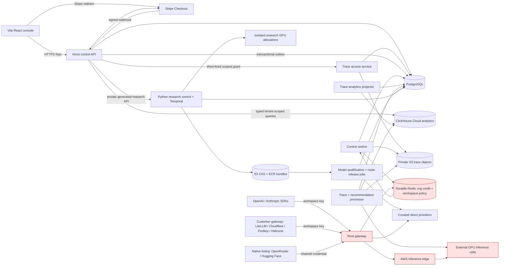
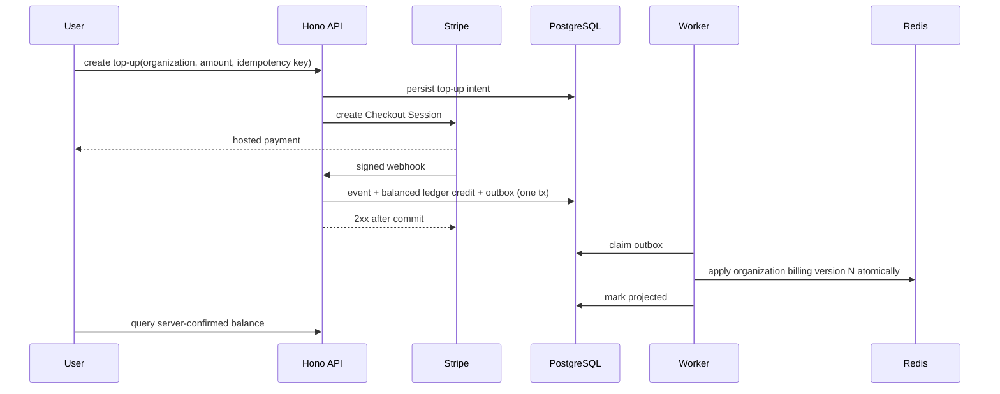

# Architecture

## Component topology



The red path is the serving hot path. Redis is the gateway's only synchronous internal **state/control dependency**. Curated model APIs and the AWS inference edge are upstream serving dependencies after admission. The gateway does not call the API, worker, PostgreSQL, ClickHouse, Stripe, an external queue, object storage, Kubernetes, or a capacity-provider lifecycle API.

Grad inference is independently OpenAI-compatible. Direct clients and customer-configured gateways authenticate with a workspace key and use organization prepaid accounting. Native listings authenticate with a dedicated distribution-channel credential and use a channel catalog, exposure limits and receivable settlement. Credential lookup selects the principal/profile before model or money resolution; no request header/body can cross those domains. Both profiles reuse the same public protocol, exact Grad release, inference edge/cells, metering and request identity. See [Open distribution and gateway integration plan](DISTRIBUTION_GATEWAY_INTEGRATIONS_2026-07-13.md).

For OpenRouter specifically, OpenRouter validates/bills its end user's OpenRouter token and then calls this public gateway with a Grad-issued OpenRouter channel credential. Grad validates the channel—not the end user—and still performs channel exposure, model, capacity, rate and concurrency admission before forwarding an exact-release request through the private inference edge. Public/channel credentials are never valid at the inference edge or cell.

## TypeScript control plane

### `apps/web`

- Vite, React, strict TypeScript.
- Tailwind and shadcn/ui components; no parallel component library.
- TanStack Router for typed routes and URL state.
- TanStack Query with the tRPC v11 TanStack client for server state.
- React Hook Form and Zod for forms where schema reuse helps.
- Static assets deploy separately from the API and may be served by a CDN.

The frontend contains presentation and interaction state only. It never computes an authoritative balance, grants membership, or treats a payment redirect as success.

### `apps/control-api`

Hono runs on a supported Node LTS runtime through `@hono/node-server`. It mounts:

- Better Auth under `/api/auth/*` for users, sessions, email/social providers, and account recovery;
- tRPC under `/trpc/*` using `fetchRequestHandler` and Hono's native `Request`;
- Stripe webhook REST handlers under `/webhooks/stripe` using the raw request body;
- versioned public management REST under `/api/v1/*` only for documented external use cases;
- `/healthz`, `/readyz`, metrics, and OpenAPI documentation.

Business logic lives in domain packages and accepts an explicit actor/organization/workspace context. tRPC routers and Hono handlers are thin transports. Better Auth does not own organization or workspace membership; the product schema does, preventing competing tenancy authorities.

### `apps/control-worker`

The Node worker owns asynchronous control-plane operations:

- PostgreSQL transactional-outbox publication;
- Redis organization credit and workspace/key policy projection;
- Redis Stream usage consumption and PostgreSQL posting;
- periodic ledger-to-Redis reconciliation and projection rebuild;
- PostgreSQL usage/outbox to ClickHouse analytical projection with idempotent batching, lag checkpoints and rebuild;
- top-up/refund/chargeback follow-up and receipts;
- alerts, email, and retention jobs;
- model-catalog ingestion, capability conformance, qualification evidence, immutable route-release publication, deterministic canary assignment, and automatic rollback signals;
- encrypted trace-stream drain to S3, retention/delete/export, workload-profile derivation, recommendation jobs, and customer-approved migration experiment orchestration.

Worker handlers are idempotent. A job/event is acknowledged only after its PostgreSQL transaction commits.

## Rust data plane

### Runtime and modules

Use a Cargo workspace with Tokio, Axum, Tower, Reqwest, tracing/OpenTelemetry, rustls, prost, serde, and checked integer money types. Suggested crates:

- `gateway-server`: listener, middleware, request lifecycle, shutdown;
- `gateway-protocol-openai`: ingress/egress schemas and SSE;
- `gateway-protocol-anthropic`: Messages schemas and event stream;
- `gateway-protocol-google`: versioned GenerateContent schemas/streaming and official SDK fixtures;
- `gateway-core`: canonical internal request, provider/model or Grad effort/speed identity, capability planning, route-release resolution, attempts, errors;
- `gateway-admission`: Redis functions/scripts and typed state transitions;
- `gateway-distribution`: authenticated workspace/channel principal profiles, catalog projections and channel request/settlement correlation;
- `gateway-provider`: model-provider adapter trait and generic streaming transport;
- `gateway-provider-{openai,anthropic,google,owned}` plus operator-only OpenRouter/generic adapters;
- `inference-edge`: stable streaming target, signed cell-target validation, mTLS/direct/tunnel transport and event relay;
- `inference-cell`: cell agent/router, exact-release runtime lifecycle, token queueing, cache affinity and drain;
- `fleet-controller`: slow-path PostgreSQL intent projection, Grad fleet CRDs/controllers, capacity-provider adapters, budgets, orphan cleanup and target publication inputs;
- `gateway-trace`: data-mode enforcement, credential stripping, bounded trace serialization, public-key encryption and Redis trace events;
- `gateway-contracts`: generated Prost messages;
- `gateway-testkit`: fake upstreams, Redis harness, generated traces.

Keep public protocol structs separate from internal Protobuf messages. Exact JSON presence, unions, unknown fields, headers, and SSE event names cannot be inferred safely from an internal canonical model.

### Request lifecycle

```text
parse bounded headers/body
  -> hash and resolve key to workspace or native distribution principal in Redis
  -> derive capability/data-policy/native-tier requirements
  -> resolve provider-qualified concrete model or Grad effort/speed release
  -> select eligible targets from the Redis route projection
  -> validate principal/catalog/model/config/price versions
  -> prove a conservative maximum fixed customer or channel sell exposure
  -> atomic organization-credit or channel-exposure reserve + concurrency admission + XADD
  -> apply deterministic canary/session pin and choose a healthy same-lane target
  -> call exact curated provider/model or AWS inference edge for selected owned cell
  -> stream while collecting metered usage
  -> atomic settle/release + decrement in-flight + XADD
  -> finish response
  -> asynchronously append bounded encrypted trace event when Product Intelligence permits
```

Provider retry/fallback stays attached to the same admitted financial principal, route release, and price book. A workspace request remains organization-funded/workspace-attributed; a native listing remains channel-funded/channel-attributed. A direct request may retry only the same concrete model/version within the named provider. A Grad request may retry only owned endpoints qualified for that exact effort/speed release; it never falls back to a frontier provider or slower lane. Failed-attempt buy cost is ours and is never added to sold usage. Only transient connection, capacity, rate-limit, or server failures before usable output are retryable. Context, capability, authentication, moderation/refusal, and principal-policy errors are returned rather than hidden. Cancellation settles known billable usage and marks uncertainty explicitly. If no usable output was delivered, the worker posts exactly one eligible sell-credit/receivable correction under that principal's contract.

### Model lanes and route-release domain

The customer model surface has explicit provider and first-party identities while endpoint machinery remains hidden:

- `ModelProviderDefinition` is one curated direct model-provider namespace (`openai`, `anthropic`, `google`) with adapter/data-policy/lifecycle status. Adding it is an operator release, not customer configuration.
- `ModelDefinition` is a provider-qualified concrete model/version or owned concrete checkpoint with exact modalities, context/output limits, parameter support, lifecycle, alias set and public sell price.
- `ModelProduct` is a canonical `grad/<effort>/<speed>` identity. Effort is `low|medium|high|max`; speed is `flex|standard|fast|turbo`; the active-cell set is catalog-driven.
- `ModelFamily` defines the compatibility envelope for `grad/<family>/<speed>` heads. A family head may adopt a newly qualified complete stack only inside that envelope.
- `ModelAliasHead` atomically maps a managed or family identity to one immutable `RouteRelease`; `@release` identities bypass mutable heads and resolve the pinned release directly. Preview `slow` may warn-and-map to `flex` but is not a fifth speed.
- `DirectModelEndpoint` is an operator-owned endpoint for one exact model-provider/model with region, credential reference, capacity, buy price, retention/training policy and measured health. Grad serving endpoints are `InferenceCell` status projected into signed `CellTarget` records; the two concepts never share credentials or lifecycle ownership.
- `QualificationEvidence` records scope-matched protocol, quality, tool, structured-output, modality, privacy, latency, throughput, and economics evidence. Evidence is never transferred to a different model, endpoint, region, runtime, or quantization without a new qualification.
- `RouteRelease` is immutable. For direct models it permits only same-provider/same-version endpoints. For Grad it freezes effort/speed, owned checkpoint/runtime/hardware, capability/SLO/queue envelope, bounded attempts, fixed prices, rollout and rollback target.
- `RouteCandidate` binds a release to a concrete model and endpoint class with its qualification IDs and constraints.
- `RouteRollout` defines deterministic organization/workspace/request buckets. Publishing or rolling back creates an audited control-plane event and a versioned Redis projection.

The control worker builds and publishes releases from PostgreSQL. The Rust gateway performs request-time filtering and selection locally from Redis plus bounded in-process endpoint-health/circuit-breaker state; it never calls the control plane. Bare aliases resolve only when unambiguous. A direct ID is a hard provider/model/version pin unless the request carries a valid customer-approved migration-experiment header bound to that exact source/workload; that distinct contract selects baseline or Grad deterministically before admission and discloses it. A Grad ID may switch only among owned candidates qualified for that effort/speed product.

Owned inference is not a hidden preference inside direct-provider requests: customers reach it by selecting a managed `grad/<effort>/<speed>`, a stable `grad/<family>/<speed>`, or an immutable Grad `@release` pin. Each response and usage row identifies the requested canonical identity, actual provider/model or owned release, route release and data mode. This makes direct traffic a trustworthy migration baseline instead of secretly routing it to us.

For Grad, a Redis route release contains signed cell targets rather than GPU pods. The gateway chooses an exact-release cell and calls a regional AWS inference edge. A cell-local router chooses a ready replica using queue deadline, token capacity and cache affinity. In the AWS management EKS cluster, Grad fleet CRDs/controllers project PostgreSQL capacity intent and reconcile external GPU capacity through curated capacity-provider adapters; they cannot participate in a live request. Managed Kubernetes, self-managed cell-local Kubernetes and provider-native container/VM allocations implement the same cell contract without pretending every allocation is a Kubernetes Node or spanning a cluster across providers. The complete designs are [Owned Grad inference architecture](OWNED_INFERENCE_ARCHITECTURE.md) and [Kubernetes provider abstraction](KUBERNETES_PROVIDER_ABSTRACTION_2026-07-13.md).

### Research factory and exact bundle boundary

The research factory is an always-on Python inference laboratory. Each supported model has a durable `ModelProgram` containing its reproducible baseline, production champion, Pareto frontier, open questions, negative findings, campaigns and ranked experiment queue. Opportunity scanners, baseline keepers, portfolio planning and agent loops run continuously. Cheap static, simulation and CPU work may run continuously; GPU experiments require an immutable hypothesis, expected-information score, spend/time cap, stop rule and cleanup contract. The objective is validated stack improvement and learning per dollar, not experiment count or GPU utilization.

Python 3.12, PyTorch, Transformers, safetensors and Triton own model architecture, surgery, training/healing, quantization, evaluation and kernel discovery. A private Python research-control service and Python Temporal workers are the sole normal writers of campaign, evidence, candidate and qualification state. Hono/tRPC is the authenticated operator BFF through a generated Protobuf/gRPC client; it does not reproduce research state machines. Rust owns bundle inspection/materialization, cell/runtime supervision and serving. A runtime may graduate as an out-of-tree Python framework plugin, a native CUDA/C++ library or an owned Rust engine; measured value, not a language mandate, determines the boundary.

The factory iterates across weights/model architecture, tokenizer/templates, custom operators, kernels, runtime, scheduler/cache, parallelism/topology and hardware mapping. Its deployable output is one signed, content-addressed `ModelStackBundle`, not a checkpoint or a hand-maintained serving recipe. Canonical JSON architecture/checkpoint/operator/runtime/qualification manifests and generated Protobuf services are the language-neutral handoff. Large immutable objects live in S3 CAS; runtime images and the small OCI bundle index live in ECR. PostgreSQL owns programs, campaigns, evidence, qualification, releases and alias heads. Temporal coordinates durable research workflows; Kueue/JobSet schedule only honest Kubernetes execution, while native GPU allocations use provider adapters behind a separate research contract.

Fable and Sol are historical spike evidence, not runtime dependencies or interfaces to preserve. Useful algorithms, controls and regression cases are ported with provenance into factory-owned Python/Rust packages and revalidated. Simulation or component evidence never authorizes production. An independent qualification plane tests the exact bundle through model, operator/runtime, protocol, measured single-node, distributed-cell, security, soak and canary gates. Research allocations cannot publish production `CellTarget`s or possess production credentials.

`RouteRelease` wraps a qualified bundle with the customer product contract: stable family or managed effort/speed identity, immutable pin, capability/SLO/price envelope, eligible placements, rollout and rollback. Cells attest the exact release and bundle digest before the target projector can publish them. A live request remains bound to the release resolved at admission even if an alias moves. The full design is [Model research factory to production](MODEL_RESEARCH_TO_PRODUCTION_2026-07-13.md) and [ADR-0007](../../docs/decisions/0007-research-production-model-lifecycle.md).

For `python_plugin`, the Rust cell agent launches the pinned framework runtime and communicates over a cell-local Unix-domain socket using the internal serving Protobuf. `native_library` and `rust_engine` use the same external cell contract. This keeps the gateway/edge path stable while the factory can replace the model implementation, kernels or runtime inside an attested bundle.

Every generative Grad release enables active-sequence KV and cross-request prefix cache. The gateway supplies an opaque HMAC scope separated by workspace/channel, exact release, and retention class. Product Intelligence and Private/No Retention both cache but never share a namespace. Cache state remains in GPU/RAM or qualified encrypted ephemeral local storage and never enters Redis, PostgreSQL, S3, ClickHouse, trace payloads, backups or logs.

### Release and rollback flow

1. ModelOps records source-dated endpoint metadata and runs deterministic conformance plus bounded quality/performance evaluations.
2. A release proposal freezes candidate evidence, customer price, attempt budget, compatibility matrix, and rollback target.
3. Review publishes an immutable release to PostgreSQL/outbox; the worker projects it to Redis.
4. The gateway assigns deterministic canary buckets and session pins. The same session remains on the same candidate while eligible and healthy.
5. SLO, error, tool/schema, data-policy, margin, or failed-request-credit thresholds halt rollout or atomically point the canonical model head to the prior release.
6. Existing request reservations settle against their admitted release and price version; rollback never changes an in-flight charge.

### Trace and migration architecture

Product Intelligence is the default workspace data mode. The gateway strips credentials/non-allowlisted headers, bounds the record, encrypts it with a random symmetric data key, wraps that key to a rotating asymmetric public trace-ingest key from Redis, and asynchronously appends ciphertext to an organization-tagged trace stream after terminal response/settlement. This preserves Redis as its only synchronous internal state/control dependency and keeps capture off customer latency. Failure records a safe capture status and alerts but does not fail or unbill completed inference.

The control worker drains ciphertext to a private S3 bucket and writes authorization, object reference, per-trace wrapped-key, retention and tombstone state to PostgreSQL. Separate KMS-backed trace/recommendation roles can decrypt; the gateway and ordinary API role cannot. A small internal trace-access service accepts a signed, single-object, workspace/action/expiry-bound grant minted only after control-plane authz/recent-auth checks. It rechecks tombstone/retention/key state, fetches and decrypts one trace, streams it without caching, and writes an audit event. It never lists a bucket or issues reusable object URLs. Key destruction, S3 lifecycle/version deletion and PostgreSQL tombstones enforce bounded retention.

ClickHouse Cloud stores the replayable analytical projection used for trace lists, charts, model/workload summaries and evaluation facts. Its tables contain only allowlisted typed metadata, copied settled usage/cost, latency, derived features and aggregates—never raw customer payloads or arbitrary tags. The financial worker commits authoritative usage and an analytics outbox record in the same PostgreSQL transaction; a separately scalable projector performs acknowledged idempotent batches into ClickHouse. A ClickHouse outage therefore produces visible dashboard lag while serving, ledger posting and S3 payload persistence continue.

Hono authorizes organization/workspace scope in PostgreSQL and maps a closed filter grammar to parameterized, time/row/byte-bounded ClickHouse queries. Browser code never sees ClickHouse credentials or SQL. Trace detail follows the separate PostgreSQL grant and S3 path. Delete first tombstones/revokes the per-trace key in PostgreSQL, then deletes every S3 version and the ClickHouse row; APIs hide tombstoned/expired rows while managed merge/backup cleanup converges. The complete store/schema/restore contract is [ClickHouse trace analytics decision](CLICKHOUSE_TRACE_ANALYTICS_DECISION.md).

The trace processor creates workspace-local profiles/candidates and runs unbilled offline replay. Recommendations advance through opportunity, replay candidate, evaluator/shadow verified, and live-canary ready. Shadow/live experiments require explicit budgets, buckets and stops. A live canary affects only requests carrying its explicit header; no control-plane job intercepts ordinary direct traffic or mutates the customer's model automatically.

Private/No Retention is workspace policy or a stricter per-request override. It suppresses payload trace creation before Redis and requires an eligible endpoint data policy. It does not disable transient active/prefix KV cache; no-retention cache uses its own salted trust domain and bounded ephemeral lifecycle. Minimum financial/security metadata may still project to ClickHouse with `payload_state=no_retain`, so customers retain usage/cost/latency analytics without content history. Retention for product features is not permission to train global models; training requires separate consent and architecture.

### Redis access

Use Redis Cluster-compatible key hash tags so organization credit plus all workspace/key limits touched by one request share `{organization_id}`. Prefer versioned Redis Functions if operational support is proven; otherwise load SHA-pinned Lua scripts and verify their digest at readiness. This intentionally creates one financial mutation slot per organization; load-test large tenants before considering escrow/sharded reservations.

The gateway may keep a bounded in-process read cache for public model metadata and already validated immutable config versions. It may not use that cache to bypass organization credit, workspace/key budget, concurrency, suspension, or billing-event checks.

## Data stores

### PostgreSQL

Authoritative for users, sessions, organizations/memberships, workspaces/memberships, invitations, API-key metadata, provider/model/product definitions, alias bindings, endpoint/qualification evidence, route releases/rollouts, data/retention policy, trace registry/wrapped-key/tombstone state, workload profiles, migration candidates/recommendations/experiments, workspace model policy, budgets, immutable price books, top-ups/payments, ledger, usage/corrections, audits, analytical projection checkpoints, and outbox records. Raw trace payloads live encrypted in S3; high-volume trace analytics are a derived ClickHouse projection.

Financial transactions use serializable or explicitly locked organization account rows, unique idempotency keys, balanced entries, and checked integer arithmetic. Workspace/key windows are spend caps and attribution, not funded wallets. No balance is derived from a mutable decimal cache alone.

### ClickHouse Cloud

Derived and rebuildable for request/attempt/evaluation facts plus bounded workspace/model rollups. It is optimized for user-facing time-series/filter/percentile queries and workload intelligence, but owns no authorization, money, retention policy or raw payload. Separate insert, read-only, schema and deletion identities follow least privilege. Every customer query is generated server-side with mandatory organization/workspace/time predicates; every row has a retention deadline and content-free schema.

Projection disagreement is an incident and a rebuild input, never a reason to alter PostgreSQL financial facts. Managed TTL/lightweight deletion is asynchronous, so PostgreSQL tombstones and key revocation deny access immediately and restore procedures replay tombstones before enabling reads.

### Private S3 traces

Stores compressed ciphertext only, under an opaque object reference and purpose-separated KMS/key/access roles. PostgreSQL—not the object key or bucket prefix—decides which actor can request one payload. Per-trace wrapped-key destruction, all-version deletion and lifecycle deadlines implement cryptographic and storage cleanup. S3 is payload custody/replay input, not the interactive analytics index.

### Redis

Redis is simultaneously:

- versioned serving projection for organization/workspace/key policy plus model catalog, route releases, target eligibility, and prices;
- atomic organization spendable balance, nested active reservations, budget windows, and concurrency state;
- reservation lease index;
- Redis Streams transport for reservation/settlement/diagnostic events;
- separate bounded encrypted trace-ingest streams; billing capacity and admission gates take precedence.

Production Redis is not a disposable cache. Require replication across failure domains, AOF persistence (`appendfsync everysec` or stronger), backups, tested restore, memory headroom, `noeviction`, TLS, ACLs, and stream-lag alerts. The initial deployment uses one financial write region per organization; global active-active money mutation is out of scope.

## Top-up and projection flow



Webhook delivery can be duplicated or reordered. Uniqueness on Stripe event ID, payment object ID, and internal idempotency key gives one financial effect. Refunds and chargebacks append reverse entries and may immediately restrict or suspend the Redis organization projection and all its workspaces.

## Gateway billing flow

Admission and settlement are fully specified in [Billing and Redis](BILLING_AND_REDIS.md). The important boundary is:

- gateway events represent organization-funded facts attributed to workspace/key reservations;
- the worker turns those facts into PostgreSQL financial entries;
- the PostgreSQL ledger determines the recoverable authoritative balance;
- Redis determines whether the next request may be admitted.

## Deployment shape

Seed production uses:

- static/CDN Vite deployment;
- independently autoscaled Node API and worker containers;
- independently scalable trace-access/trace/recommendation workers and bounded ModelOps jobs;
- independently autoscaled regional Rust gateway containers;
- managed PostgreSQL with point-in-time recovery;
- managed ClickHouse Cloud reached privately for replayable trace analytics;
- managed Redis meeting persistence/no-eviction requirements;
- managed secret storage, KMS, WAF/load balancer, and OpenTelemetry backend.
- private versioned/lifecycle-managed S3 trace storage distinct from public Vite assets and Terraform state.

Docker Compose and CI service containers run PostgreSQL, ClickHouse, durable Redis configuration, Stripe webhook fixtures, and deterministic fake providers. Real provider and ClickHouse Cloud credentials exist only in protected environments.

## Failure policy

| Failure | Required behavior |
| --- | --- |
| Redis unavailable before admission | Return retryable 503; do not call a provider. |
| Atomic script/function or stream append fails | Roll back/no-op atomically and do not dispatch. |
| PostgreSQL/API unavailable | Existing projected organizations/workspaces continue through Redis; control-plane mutations/top-ups wait. |
| ClickHouse unavailable | Serving, financial posting and S3 trace persistence continue; analytics projector retries and UI shows delayed data. |
| ClickHouse row/tombstone disagreement | PostgreSQL authorization wins; hide/revoke immediately, enqueue deletion/rebuild and alert. Never restore payload access from ClickHouse. |
| Worker unavailable | Redis continues bounded operation; stream lag alerts and eventually admission is restricted before retention/headroom risk. |
| Provider fails before measurable usage | Settle/release according to adapter evidence; bounded fallback only within reserve. |
| Provider fails after partial usage | Settle known or conservatively estimated charge and mark evidence quality. |
| Unsupported capability/parameter | Return stable 400 before admission or dispatch; never silently drop or transform it. |
| Pinned concrete model unavailable | Return retryable model-unavailable error; never switch model family. |
| Managed release has no eligible target | Return route-unavailable with retry guidance and alert ModelOps; do not weaken privacy/capability policy. |
| Direct provider/model unavailable | Return model-unavailable or same-provider capacity error; never cross provider/model/version. |
| Grad speed lane unavailable | Return early typed 429/503; never serve a slower lane under the requested ID. |
| Trace capture unavailable/backpressured | Complete inference/billing, mark capture skipped, protect billing-stream headroom, and alert; never persist plaintext fallback. |
| Trace deletion/retention job behind | Stop new Product Intelligence capture for affected scope if the compliance deadline is at risk and page operators. |
| Migration evaluator/canary fails | Halt experiment, retain evidence, preserve original requested model; never auto-switch. |
| No usable output delivered | Settle provider evidence, then post exactly one eligible customer sell-credit correction under the anti-abuse policy. |
| Actual cost exceeds reserve | Atomically debit remaining spendable credit; if insufficient, record debt and immediately restrict/freeze. |
| Ledger/projection mismatch | Enter organization `reconciling`; stop new cost-bearing requests if tolerance or age is exceeded; repair from ledger. |
| Redis failover loses acknowledged writes | Detect epoch/sequence gap, freeze affected organizations, replay streams/outbox, and reconcile before reopening. |

## Dependency direction

Transports depend on domain services; domain services depend on repository/clock/idempotency interfaces; infrastructure implements those interfaces. Generated contracts do not import application code. The Rust gateway never imports control-plane database models. This permits independent subagent delivery and contract-first integration.
