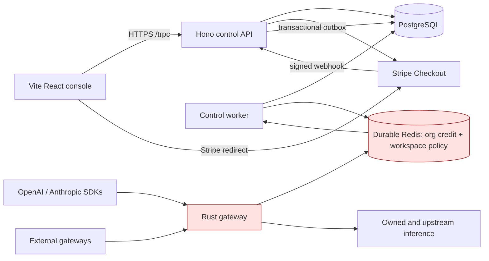
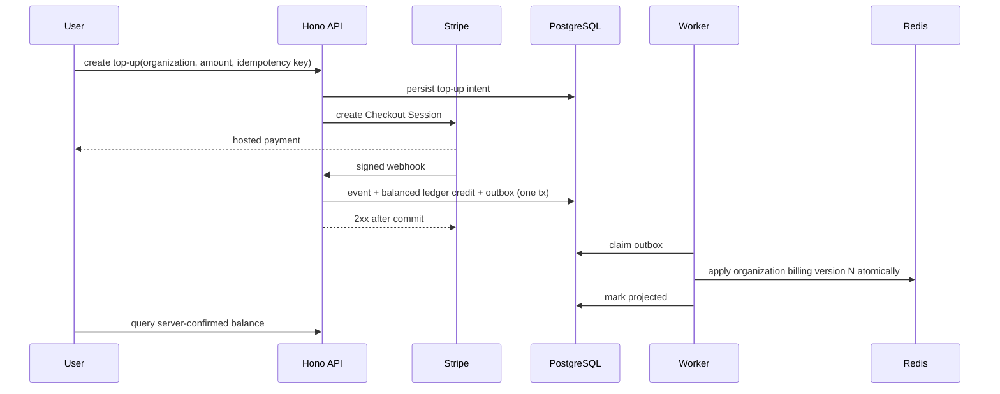

# Architecture

## Component topology



The red path is the serving hot path. Its only internal network dependency is Redis. The gateway does not call the API, worker, PostgreSQL, Stripe, an external queue, or object storage. Provider calls are outbound inference dependencies, not control-plane dependencies.

## TypeScript control plane

### `apps/web`

- Vite, React, strict TypeScript.
- Tailwind and shadcn/ui components; no parallel component library.
- TanStack Router for typed routes and URL state.
- TanStack Query with the tRPC v11 TanStack client for server state.
- React Hook Form and Zod for forms where schema reuse helps.
- Static assets deploy separately from the API and may be served by a CDN.

The frontend contains presentation and interaction state only. It never computes an authoritative balance, grants membership, or treats a payment redirect as success.

### `apps/control-api`

Hono runs on a supported Node LTS runtime through `@hono/node-server`. It mounts:

- Better Auth under `/api/auth/*` for users, sessions, email/social providers, and account recovery;
- tRPC under `/trpc/*` using `fetchRequestHandler` and Hono's native `Request`;
- Stripe webhook REST handlers under `/webhooks/stripe` using the raw request body;
- versioned public management REST under `/api/v1/*` only for documented external use cases;
- `/healthz`, `/readyz`, metrics, and OpenAPI documentation.

Business logic lives in domain packages and accepts an explicit actor/organization/workspace context. tRPC routers and Hono handlers are thin transports. Better Auth does not own organization or workspace membership; the product schema does, preventing competing tenancy authorities.

### `apps/control-worker`

The Node worker owns asynchronous control-plane operations:

- PostgreSQL transactional-outbox publication;
- Redis organization credit and workspace/key policy projection;
- Redis Stream usage consumption and PostgreSQL posting;
- periodic ledger-to-Redis reconciliation and projection rebuild;
- top-up/refund/chargeback follow-up and receipts;
- alerts, email, and retention jobs.

Worker handlers are idempotent. A job/event is acknowledged only after its PostgreSQL transaction commits.

## Rust data plane

### Runtime and modules

Use a Cargo workspace with Tokio, Axum, Tower, Reqwest, tracing/OpenTelemetry, rustls, prost, serde, and checked integer money types. Suggested crates:

- `gateway-server`: listener, middleware, request lifecycle, shutdown;
- `gateway-protocol-openai`: ingress/egress schemas and SSE;
- `gateway-protocol-anthropic`: Messages schemas and event stream;
- `gateway-core`: canonical internal request, routing, attempts, errors;
- `gateway-admission`: Redis functions/scripts and typed state transitions;
- `gateway-provider`: adapter trait and generic streaming transport;
- `gateway-provider-{openai,anthropic,openrouter,owned}`;
- `gateway-contracts`: generated Prost messages;
- `gateway-testkit`: fake upstreams, Redis harness, generated traces.

Keep public protocol structs separate from internal Protobuf messages. Exact JSON presence, unions, unknown fields, headers, and SSE event names cannot be inferred safely from an internal canonical model.

### Request lifecycle

```text
parse bounded headers/body
  -> hash and resolve key to organization/workspace in Redis
  -> validate organization/workspace/key/model/config versions
  -> estimate maximum sell cost
  -> atomic reserve + low-balance concurrency admission + XADD
  -> select route and call provider
  -> stream while collecting metered usage
  -> atomic settle/release + decrement in-flight + XADD
  -> finish response
```

Provider retry/fallback consumes the same organization-funded, workspace-attributed reservation. The reserve must cover the bounded attempt policy or be atomically increased before another cost-bearing attempt. Cancellation settles known usage and marks uncertainty explicitly; it never blindly refunds the full reserve.

### Redis access

Use Redis Cluster-compatible key hash tags so organization credit plus all workspace/key limits touched by one request share `{organization_id}`. Prefer versioned Redis Functions if operational support is proven; otherwise load SHA-pinned Lua scripts and verify their digest at readiness. This intentionally creates one financial mutation slot per organization; load-test large tenants before considering escrow/sharded reservations.

The gateway may keep a bounded in-process read cache for public model metadata and already validated immutable config versions. It may not use that cache to bypass organization credit, workspace/key budget, concurrency, suspension, or billing-event checks.

## Data stores

### PostgreSQL

Authoritative for users, sessions, organizations, organization memberships, workspaces, workspace memberships, invitations, API-key metadata, routing/model config, workspace/key budgets, immutable price books, organization top-up intents, payment events, organization ledger accounts/transactions/entries, usage charges, audits, and outbox records.

Financial transactions use serializable or explicitly locked organization account rows, unique idempotency keys, balanced entries, and checked integer arithmetic. Workspace/key windows are spend caps and attribution, not funded wallets. No balance is derived from a mutable decimal cache alone.

### Redis

Redis is simultaneously:

- versioned serving projection for organization/workspace/key/model/price policy;
- atomic organization spendable balance, nested active reservations, budget windows, and concurrency state;
- reservation lease index;
- Redis Streams transport for reservation/settlement/diagnostic events.

Production Redis is not a disposable cache. Require replication across failure domains, AOF persistence (`appendfsync everysec` or stronger), backups, tested restore, memory headroom, `noeviction`, TLS, ACLs, and stream-lag alerts. The initial deployment uses one write region per workspace; global active-active money mutation is out of scope.

## Top-up and projection flow



Webhook delivery can be duplicated or reordered. Uniqueness on Stripe event ID, payment object ID, and internal idempotency key gives one financial effect. Refunds and chargebacks append reverse entries and may immediately restrict or suspend the Redis organization projection and all its workspaces.

## Gateway billing flow

Admission and settlement are fully specified in [Billing and Redis](BILLING_AND_REDIS.md). The important boundary is:

- gateway events represent organization-funded facts attributed to workspace/key reservations;
- the worker turns those facts into PostgreSQL financial entries;
- the PostgreSQL ledger determines the recoverable authoritative balance;
- Redis determines whether the next request may be admitted.

## Deployment shape

Seed production uses:

- static/CDN Vite deployment;
- independently autoscaled Node API and worker containers;
- independently autoscaled regional Rust gateway containers;
- managed PostgreSQL with point-in-time recovery;
- managed Redis meeting persistence/no-eviction requirements;
- managed secret storage, KMS, WAF/load balancer, and OpenTelemetry backend.

Docker Compose and CI service containers run PostgreSQL, durable Redis configuration, Stripe webhook fixtures, and deterministic fake providers. Real provider credentials exist only in a protected GitHub environment.

## Failure policy

| Failure | Required behavior |
| --- | --- |
| Redis unavailable before admission | Return retryable 503; do not call a provider. |
| Atomic script/function or stream append fails | Roll back/no-op atomically and do not dispatch. |
| PostgreSQL/API unavailable | Existing projected organizations/workspaces continue through Redis; control-plane mutations/top-ups wait. |
| Worker unavailable | Redis continues bounded operation; stream lag alerts and eventually admission is restricted before retention/headroom risk. |
| Provider fails before measurable usage | Settle/release according to adapter evidence; bounded fallback only within reserve. |
| Provider fails after partial usage | Settle known or conservatively estimated charge and mark evidence quality. |
| Actual cost exceeds reserve | Atomically debit remaining spendable credit; if insufficient, record debt and immediately restrict/freeze. |
| Ledger/projection mismatch | Enter organization `reconciling`; stop new cost-bearing requests if tolerance or age is exceeded; repair from ledger. |
| Redis failover loses acknowledged writes | Detect epoch/sequence gap, freeze affected organizations, replay streams/outbox, and reconcile before reopening. |

## Dependency direction

Transports depend on domain services; domain services depend on repository/clock/idempotency interfaces; infrastructure implements those interfaces. Generated contracts do not import application code. The Rust gateway never imports control-plane database models. This permits independent subagent delivery and contract-first integration.
