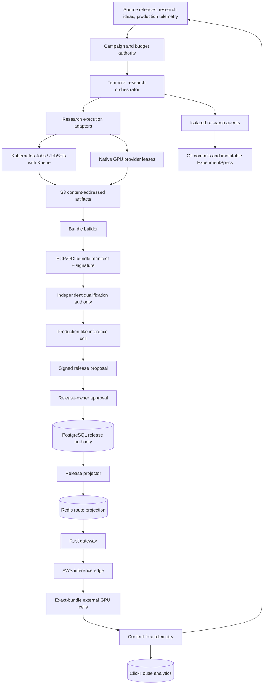

# Model research factory to production

## Decision

Grad's research factory produces a complete deployable **ModelStackBundle**, not just a checkpoint. A bundle freezes the weights and model configuration, tokenizer and templates, custom model code, runtime image, kernels, quantization, scheduler and cache policy, parallelism and topology, compatible hardware/software envelope, protocol surface, and evidence references. Research, qualification, staging, and production use the same signed bundle digest. Promotion never rebuilds a candidate from loose files or mutable tags.

The factory may continuously and autonomously propose, implement, run, reject, and qualify candidates inside explicit campaign budgets. Production release authority is separate. Initially, a human release owner must approve a signed release proposal before a public alias moves. Once approved, shadow/canary progression and rollback may be automatic within the release's frozen policy. Fully automatic public promotion requires a later decision backed by operational evidence.

This design joins three systems without confusing their evidence:

- Fable is the fast hypothesis and co-design surface: typed full-stack configurations, simulation, functional twins, model surgery, healing, and component parity tests.
- Sol is the evidence-admission discipline: immutable experiment specifications, scope-matched controls, pre-registered predictions, fidelity labels, held-out measurements, and fail-closed claim composition.
- Product ModelOps turns an admitted full-stack candidate into an immutable route release, deploys it through production-like cells, and atomically moves or rolls back customer-visible aliases.

Fable output is a prior or hypothesis until a Sol-style, scope-matched experiment measures it. A component win is not multiplied into a bundle claim. A bundle qualified on one model, workload, runtime, GPU, topology, or provider cannot donate that qualification to another scope.

## Product outcome

The customer sees a small, stable surface while the factory can change every layer behind it:

| Customer identity | Meaning | Movement rule |
| --- | --- | --- |
| `grad/glm-5.2/fast` | Stable family-and-speed head within the GLM 5.2 compatibility lineage. | May move to a newly qualified bundle in the same family envelope; never silently changes to GLM 5.3 or another family. |
| `grad/medium/standard` | Managed effort-and-speed product. | May move across qualified model families only when the release meets the published capability, quality, latency, price, and data-policy envelope. The actual release is always disclosed. |
| `grad/glm-5.2/fast@r2026.07.13.3` | Immutable public release pin. | Never moves. It identifies one `RouteRelease` and one exact bundle digest until its declared support end. |
| `msb_sha256_<digest>` | Internal content identity for a complete ModelStackBundle. | Never moves and is not the normal customer model string. |

The existing canonical speed classes remain `flex|standard|fast|turbo`. `flex` means queue-tolerant, spot-first, lower-cost service and may be fast when idle; calling it `slow` would incorrectly promise latency rather than deferability. During preview, `grad/<effort>/slow` may be accepted as a documented alias for `grad/<effort>/flex` with a deprecation warning. It does not create a fifth lane, and its retention or removal must be decided before GA from adoption evidence.

The family example above is illustrative. A family may be published only after legal, license, naming, compatibility, and qualification review; a source repository name alone does not create a public Grad family.

## System topology



The gateway's hot-path architecture does not change. Redis remains its only synchronous internal state/control dependency. Research metadata, Temporal, PostgreSQL, S3, ECR, GitHub, Kubernetes, and capacity-provider APIs are never queried by a live request.

## Planes and authority

### Research control plane

The AWS-hosted research control plane contains:

- PostgreSQL domain state for campaigns, budgets, experiment specifications, evidence, candidates, qualifications, release proposals, approvals, and audit history;
- Temporal for durable campaign/run orchestration, retries, timeouts, signals, human approval waits, and cleanup workflows;
- an agent coordinator that grants short-lived, least-privilege work leases and prevents two agents from owning the same mutation scope;
- an evaluation authority with separate code ownership and hidden-holdout access;
- S3 buckets for immutable datasets, checkpoints, logs, evidence, and large content-addressed bundle objects;
- ECR for runtime images and the small OCI artifact that indexes a bundle;
- KMS-backed signing identities and Sigstore/cosign-compatible attestations;
- a control API and Vite/shadcn research console integrated into the existing application, but protected by operator/research roles rather than customer workspace roles.

PostgreSQL is domain authority. Temporal's event history makes workflows durable, but it does not decide whether evidence is valid or which release is active. S3 and ECR contain immutable bytes; they do not decide lifecycle state. ClickHouse is an analytical projection and is never promotion authority.

### Research execution plane

Each run receives a `ResearchAllocation`, never a production `CellTarget`. Execution adapters implement a common contract:

```text
quote(spec) -> admissible placements and bounded cost
acquire(spec, lease_id, idempotency_key) -> allocation
stage(allocation, artifact digests) -> staged inputs
run(allocation, command digest, timeout) -> observations
collect(allocation) -> content-addressed artifacts and metering
release(allocation, reason) -> cleanup evidence
```

The backends are:

- local/CI CPU containers for schema, unit, differential, and small functional-twin tests;
- Kubernetes `Job` or `JobSet` resources for managed/self-managed clusters;
- Kueue within each Kubernetes cluster for quota, priority, fair sharing, topology-aware admission, and all-or-nothing resource assignment;
- provider-native VM/container leases where no honest Kubernetes compute API exists;
- an optional Argo Workflow execution adapter later, but not the cross-provider campaign authority.

The existing Grad fleet provider adapters and cleanup patterns should be reused at the transport/lifecycle layer. Research and serving remain distinct resource kinds, IAM roles, queues, budgets, networks, and registration paths. A research allocation cannot publish readiness, receive a customer request, or acquire a production edge identity.

### Independent qualification plane

Qualification runs in a separate account/namespace and role boundary. Candidate-writing agents cannot modify the evaluator image, thresholds, hidden holdouts, production baselines, or result parser. Qualification receives only a signed bundle digest and a frozen `QualificationPlan`.

The final system and soak gates run the exact bundle in production-shaped cells using the same boot, attestation, edge protocol, metrics, drain, cache, and interruption behavior as serving. The only differences are credentials, traffic source, and non-customer route registration.

### Production plane

Production consumes only a signed bundle whose required gates passed. `RouteRelease` adds the product contract around that bundle: customer-visible identity, capabilities, context/output bounds, price, service envelope, eligible placement envelope, rollout policy, rollback target, and support/deprecation dates.

The bundle describes what can run. A release describes what Grad promises and sells. A `CellTarget` proves one ready cell is running that release's exact bundle under an eligible hardware/software/provider envelope.

## Factory artifact: ModelStackBundle

### Canonical manifest

Define `ModelStackBundleManifest` in Protobuf for TS/Rust APIs and emit a JSON representation canonicalized with RFC 8785 JSON Canonicalization Scheme before hashing. Do not hash ordinary JSON or rely on cross-language Protobuf serialization order. The identity is `sha256(canonical_manifest_bytes)`.

The manifest contains only immutable values or content-addressed references:

| Section | Required contents |
| --- | --- |
| Identity | schema version, bundle digest, human version, creation time, source commit, parent bundle(s), campaign and candidate IDs. |
| Model lineage | source model/revision and license evidence; architecture/config; transformed checkpoint shard digests; tokenizer, vocabulary, templates, reasoning/tool parsers; intervention set; model fingerprint. |
| Custom architecture | factory-produced modules, generated code, compiler passes, custom operators, shape/dtype constraints, fallback behavior, and compatibility ABI. |
| Runtime | immutable image digest, source commit, build recipe, dependency lock, driver/CUDA/ROCm/compiler constraints, entrypoint, SBOM and vulnerability scan reference. |
| Kernels | kernel/plugin digests, dispatch table, supported dtype/shape/hardware matrix, numerical tolerances, compilation/cache policy, fallback kernels. |
| Compression | weight/KV quantization, calibration dataset/version, scales/tables, sparsity/pruning layout, accuracy contract. |
| Serving | scheduler, batching, prefix/active KV cache, cache salt/version, speculative decoding, prefill/decode split, queue and overload policy. |
| Distribution | tensor/expert/pipeline/data parallelism, rank map, collectives, topology requirements, failure domains and elastic/preemption behavior. |
| Placement envelope | approved GPU/SKU, node count, memory, interconnect, CPU/RAM/disk/network, driver/firmware and capacity-provider classes. |
| Protocol | supported endpoints, modalities, fields, tools, structured output, reasoning, streaming events, context/output bounds, usage semantics. |
| Data/security | supported data modes, ephemeral cache behavior, logging/crash-dump policy, network/filesystem needs, secret classes and isolation profile. |
| Operations | health/readiness, warmup, artifact-load budget, drain, checkpoint recovery, metrics, safe diagnostic fields, and rollback compatibility. |
| Evidence | exact experiment/evaluation/control IDs, gate policy version, limitations, expiry, evaluator and signature references. |

Multi-terabyte bytes remain in S3 content-addressed storage. The OCI artifact in ECR contains the canonical manifest and references runtime OCI image digests plus S3 object digests. The bundle remains verifiable without treating an OCI registry as a model-file filesystem.

### Build and reproducibility contract

A bundle build is hermetic enough to reproduce the manifest and runtime from pinned sources. Model transformation jobs may be nondeterministic at the byte level; when they are, the manifest records seeds, framework determinism mode, input digests, output digest, and a semantic reproducibility check. Promotion reuses the produced digest rather than rebuilding it.

Every artifact carries:

- producer identity, source commit and workflow/run ID;
- inputs and command/build-recipe digest;
- content digest and size;
- evidence classification (`measured`, `analytical`, `vendor_reported`, `derived`, `inferred`, or `synthetic`);
- retention and license/export policy;
- signature/attestation and SBOM where executable;
- cleanup status for any remote resources.

Cosign/in-toto attestations bind build, test, and approval predicates to the bundle subject. Admission fails closed when any required attestation is absent, invalid, expired, signed by the wrong role, or names a different digest.

## Domain model and state machines

### Research campaign

`ResearchCampaign` freezes objective, hypothesis space, target model/workloads/hardware, quality/SLO/economics gates, control requirements, budget, timeout, permitted providers, data authority, artifact contract, stop rules, and owner. A local stop rule ends one lineage; it does not silently redefine the campaign decision.

State:

```text
draft -> approved -> active -> decision_supported -> completed
                  |       \-> budget_exhausted
                  |       \-> cancelled
                  \-> paused_for_authority
```

Only explicit new authority can expand spend, data access, providers, production access, or the intervention set beyond the approved campaign.

### Experiment and evidence

`ExperimentSpec` is immutable and content-addressed. It freezes model/workload/hardware/software/intervention/control identities, predictions, metrics, thresholds, repetitions, statistical method, fidelity label, budget, timeout, and output contract before execution.

```text
proposed -> preregistered -> admitted -> running -> observations_sealed
                                                   |-> invalid_environment
                                                   |-> inconclusive
                                                   |-> failed
observations_sealed -> evidence_reviewed -> claim_admitted | claim_rejected
```

Raw observations are append-only. Re-analysis creates a new analysis artifact and claim version. An invalid environment does not become negative model evidence. Claims name their exact scope and may be composed only when the claim graph proves compatible identities and interactions; otherwise the composition is rejected.

### Candidate and bundle qualification

`ResearchCandidate` refers to one coherent intervention set and parent lineage. It can aggregate admitted component evidence, but it is not deployable until a bundle exists.

```text
proposed -> screened -> component_validated -> bundle_built -> qualification_pending
   |          |                |                    |
   +---------> rejected <------+--------------------+
```

`BundleQualification` is separate so a new environment or policy can requalify the same immutable bundle without changing it:

```text
static_pending
 -> model_pending
 -> runtime_pending
 -> protocol_pending
 -> single_node_pending
 -> distributed_pending
 -> security_pending
 -> staging_soak_pending
 -> release_candidate
```

Any gate can become `failed`, `invalid`, or `expired`. A waiver is a signed, time-bounded policy artifact naming the exact gate and digest; it cannot waive license, artifact identity, tenant isolation, billing/metering correctness, or hidden-holdout integrity. Customer production must not rely on waivers at seed.

### Production release

```text
draft -> proposed -> approved -> published -> shadow -> canary -> active
                                               |         |        |
                                               +-------> rolled_back
active -> superseded -> deprecated -> retired
any non-retired state -> revoked
```

- `approved` requires release-owner signature over bundle, gate set, price, alias changes, rollout, rollback, and expiry.
- `published` writes an immutable PostgreSQL `RouteRelease` and outbox event.
- `shadow` receives production-shaped replay with no customer-visible output or charge.
- `canary` uses deterministic buckets and frozen stop conditions.
- `active` atomically advances one or more alias heads; it never mutates the release.
- `rolled_back` atomically restores the prior release head. In-flight requests settle against their admitted release and price.
- `revoked` removes new admission immediately for a security, legal, corruption, or severe correctness event. Pins return a stable revoked error rather than resolving elsewhere.

State transitions use optimistic versions and idempotency keys. Property tests generate duplicate, reordered, delayed, retried, and concurrent transition commands and prove that forbidden states and split alias heads are unreachable.

## Continuous agent organization

### Roles

| Agent | Scope | Cannot do |
| --- | --- | --- |
| Scout | Watches source releases, papers, kernel/runtime changes, hardware availability, production regressions and workload opportunities; opens bounded hypotheses. | Spend GPU budget or claim a result. |
| Campaign planner | Produces campaign and ExperimentSpecs, controls and information-gain ordering. | Modify evaluator or approve its own campaign. |
| Candidate implementer | Changes model transformation, architecture, kernels, runtime, scheduler or topology in an isolated worktree/container. | See hidden holdout, production credentials or alias authority. |
| Runner | Acquires bounded compute, executes exact specs, uploads sealed observations, and cleans up. | Change a spec after observations begin. |
| Evaluator | Runs fixed visible suites and independently owned hidden gates. | Change candidate artifacts. |
| Evidence auditor | Validates scope, controls, environment, statistics, artifact lineage and claim composition. | Turn synthetic/simulated output into measured evidence. |
| Bundle builder | Assembles and signs the manifest from admitted inputs. | Select public aliases or weaken gates. |
| Release proposer | Compares qualified candidate with active release and creates rollout/rollback proposal. | Approve or directly publish it. |
| Release owner | Human at seed; approves/rejects exact signed proposal. | Edit the bundle under review. |

### Work and isolation

- GitHub Issues own cross-agent campaign intent; a scoped task packet owns the reproducible local contract. PostgreSQL/Temporal own machine run state, leases, and high-cardinality DAG events.
- Each mutation agent gets a clean worktree at a pinned commit, declared writable paths, ephemeral credentials, network allowlist, CPU/GPU/spend/time limits, and automatic cleanup.
- Agents communicate through immutable artifacts and typed events, not mutable shared notebooks or chat history.
- A lease has one owner and epoch. Expired work may be retried by a new owner without accepting stale writes from the old epoch.
- Candidate code and evaluator policy have separate owners and review paths. Hidden holdout access is rate-limited, audited, and never present in candidate containers.
- Negative, invalid, and inconclusive results remain durable and searchable so agents do not repeat failed branches.
- Search optimizes a Pareto frontier over quality, goodput, latency, memory, reliability, cost, energy where measured, and implementation risk. One scalar leaderboard cannot authorize promotion.

### Trigger loop

Campaigns may be proposed from:

1. a new upstream model or checkpoint revision;
2. a new architecture intervention from Fable/model surgery;
3. a new kernel, compiler, runtime or driver;
4. a new GPU/provider/topology or material price change;
5. production quality, latency, error, margin or cache regression;
6. an aggregate workload cluster with an evidence-backed optimization opportunity;
7. a scheduled exploration budget.

Production feedback is content-free by default. Product Intelligence traces may feed customer-specific replay/evaluation only under their retention contract. Retention is not permission to train a global model. Training, distillation, or cross-customer use requires a distinct explicit consent and dataset-governance contract. No-retain payloads never enter the factory, though their content-free SLO/error/cost facts may identify a system regression.

## Fable and Sol interaction

### Keep from Fable

- the typed full-stack search space (`ModelSpec × HardwareSpec × KernelSpec × ServingSpec × WorkloadSpec × ParallelSpec × CostSpec`);
- a functional twin for fast CPU/small-model correctness checks;
- model surgery plus healing/fine-tuning pipelines;
- per-layer and engine parity tests;
- simulator-guided ranking to spend scarce GPU budget on high-information candidates;
- matched controls, including a tuned or fine-tuned unmodified model rather than only the raw baseline;
- calibration loops that update simulator priors from measurements.

### Do not promote from Fable alone

- simulated absolute economics or modeled speedups;
- results transferred from Apple Silicon to data-center GPUs;
- small-model quality transferred to a frontier model;
- a component result multiplied with another unmeasured interaction;
- a custom runtime result without stock-runtime and tuned-production controls;
- a model surgery result without instruction, safety, long-context, tool and domain gates.

### Apply Sol discipline

- use immutable, content-derived ExperimentSpecs and exact scope identities;
- pre-register predictions and stopping rules before expensive runs;
- progress through cheap deterministic, emulated, small-scale, measured single-node and measured distributed fidelities;
- compare against tuned stock and current-production controls on the same hardware/time window;
- keep environment validity separate from candidate outcome;
- admit claims only with scope-matched artifacts and confidence/uncertainty;
- require held-out predictive validity before trusting simulator-guided production claims;
- refuse to multiply marginal wins unless a measured combined bundle proves the interaction.

## Qualification pipeline

Every later gate reuses the same bundle digest. A failure creates evidence and a new candidate; it does not patch the candidate in place.

### G0 — source, legal and supply chain

- source model revision, license, redistribution, acceptable-use and export review;
- dataset licenses/consents and contamination/leakage checks;
- manifest/schema validation and all referenced object digests present;
- reproducible build metadata, locked dependencies, SBOM and vulnerability policy;
- image and bundle signatures/attestations; mutable tags forbidden;
- secret, private-data, unsafe-file and payload-log scans.

### G1 — architecture and model correctness

- config/tokenizer/template/parser round trips and reference fixtures;
- checkpoint shape, tensor, shard and architecture invariants;
- reference-logit, hidden-state and generation differential tests with declared dtype tolerances;
- property tests across valid sequence lengths, masks, batch shapes, dtypes, devices, expert/rank mappings and malformed inputs;
- transformed-checkpoint load/save and resume/recovery tests;
- matched unmodified/tuned/healed controls;
- capability suites for chat, reasoning, tools, structured output, long context, multilingual, modality, refusal/safety and target workloads;
- repeated runs, uncertainty intervals, non-inferiority margins and explicit regression budgets.

### G2 — custom kernels and runtime

- unit, property and differential tests against a trusted implementation for supported dtype/shape/hardware combinations;
- numerical bounds, determinism contract, race/thread sanitizers, fuzzing and malformed metadata;
- unsupported-shape fallback or explicit rejection; no silent incorrect dispatch;
- OOM, fragmentation, memory leak, graph/compile cache, restart and cancellation tests;
- compiler, driver, CUDA/ROCm and firmware compatibility matrix;
- runtime ABI and custom-operator version checks before model load.

### G3 — protocol and metering

- official OpenAI/Anthropic/Google clients for every claimed skin;
- streaming event order, cancellation, errors, usage, tools, structured output, reasoning and context bounds;
- token accounting and cache/read/write metering compared with a reference tokenizer/runtime;
- no unsupported field silently removed or rewritten;
- malformed/midstream failures settle exactly once in the gateway harness.

### G4 — measured single-node system

- exact bundle on each proposed GPU/software envelope;
- tuned stock runtime, active production release and component-isolation controls;
- canonical prompt/output traces and fixed load geometry;
- TTFT, inter-token latency, tokens/s, goodput under SLO, queueing, memory, cache hit/miss, startup and artifact-load time;
- fully loaded cost and capacity measurements with evidence class, quote timestamp and uncertainty;
- active/prefix KV correctness, tenant/release/retention-class isolation, eviction and cache-loss behavior.

### G5 — distributed topology and cell

- exact rank/topology mapping, collectives, expert placement and prefill/decode policy;
- replica consistency and deterministic tolerance;
- network loss/latency degradation, rank/process/node failure, partial bootstrap and stalled collective injection;
- spot interruption, checkpoint/restart, drain, lease expiry and orphan cleanup;
- edge authentication, signed target registration, route readiness and no research-to-production identity crossover;
- provider and AZ concentration checks;
- at least one sustained production-like soak, with duration set by release risk (24 hours is the initial high-risk default, not a universal magic number).

### G6 — security, privacy and operations

- no-retain payload absence from Redis, S3, ClickHouse, logs, dumps, swap and diagnostics;
- cache always enabled for generative releases but salted by principal/release/retention class and stored only in qualified ephemeral media;
- IAM/RBAC/network/secret boundaries, artifact tamper, signature failure and dependency policy;
- observability cardinality, payload-redaction, alert and runbook tests;
- backup/restore for authority state and rebuild for projections;
- revocation and emergency rollback drills.

### G7 — shadow, canary and production evidence

- production-shaped shadow traffic or approved replay against the exact release;
- customer-specific evaluators only for the authorized workspace/data contract;
- deterministic canary steps (initial default `1% -> 5% -> 25% -> 50% -> 100%`) with minimum sample/duration as well as maximum duration;
- automatic stop for quality, protocol, latency, error, capacity, cost/margin, privacy, or metering regression;
- one-command alias rollback and verified in-flight release/price stability;
- post-promotion observation window before the previous release loses warm rollback capacity.

The percentages are defaults, not evidence. The release policy may use smaller cohorts for high-volume lanes or longer windows for rare capabilities, but cannot skip minimum evidence silently.

## Public naming, versioning and disclosure

### Stable family heads

`grad/<family>/<speed>` is for users who want a recognizable model lineage while letting Grad improve its complete serving stack. The family contract freezes:

- source architecture/lineage and major compatibility boundary;
- public capability and protocol envelope;
- data modes, context/output policy and tokenizer/template compatibility rules;
- speed-class SLO and price-change policy;
- deprecation window.

A family head may adopt new weights within that declared lineage, a healed or quantized checkpoint, custom architecture implementation, kernels, runtime, topology, or hardware only after bundle qualification. A breaking tokenizer/template, behavior, architecture lineage, context, tool, data-policy, or price change requires a new family/version or explicit compatibility decision.

### Managed effort/speed heads

`grad/<effort>/<speed>` is the simplest default. Effort is a measured behavior/compute envelope; speed is a service envelope. The alias may change underlying families because that is its product value, but only when:

- the candidate meets the exact managed product's quality/capability contract and effort monotonicity policy;
- the speed class meets measured latency/goodput/capacity policy;
- price remains under the release's published policy or a new price is disclosed before activation;
- workspace model/data policy permits it;
- the response and usage record expose actual family, immutable release, and bundle digest reference.

Aliases move atomically as versioned PostgreSQL rows projected to Redis. Redis projections include alias generation, release ID, bundle digest, price book, eligibility and rollback release. A request reserves and remains bound to the resolved generation even if the alias moves midstream.

### Pins and support

Public release pins are intended for reproducibility, regulated evaluation, incident diagnosis, and gradual migration. They freeze exact serving identity but do not promise indefinite capacity. Each pin publishes lifecycle (`preview|stable|deprecated|revoked`), support end, price book and available regions/speeds. Retirement requires notice and usage visibility; revocation may be immediate only for security, legal, corruption, or severe correctness reasons.

## Gateway and inference integration

The flow for a managed alias is:

1. The gateway authenticates a workspace or distribution-channel credential in Redis.
2. It resolves `grad/medium/standard` or `grad/glm-5.2/fast` to one immutable `RouteRelease` and bundle digest from the versioned Redis projection.
3. It validates capability, data mode, price, limits and exposure, then atomically reserves credit/receivable and concurrency.
4. It chooses only signed `CellTarget`s attesting to that exact release, bundle, speed, region and security envelope.
5. The AWS edge verifies the gateway service identity and target epoch, then forwards an exact-release `GenerateRequest`.
6. The cell proves its boot attestation, runtime image, manifest digest and placement envelope before readiness. Its router may choose only replicas of that bundle.
7. Streaming, cancellation, usage and terminal state return through the existing Protobuf contract. The gateway settles against the admitted release/price.

An OpenRouter-native listing follows the same path after channel authentication. OpenRouter validates its end user and bills that user; Grad validates the OpenRouter channel credential, performs channel exposure/capacity admission, and routes through the gateway to the exact inference release. OpenRouter never calls a raw cell or bypasses Grad's release, capacity, security, metering, and receivable controls.

## Storage and analytical boundaries

| Store | Authority and contents | Forbidden contents/uses |
| --- | --- | --- |
| PostgreSQL | Campaigns, specs, claims, lineage, qualifications, releases, aliases, approvals, budgets, leases, audit. | Large weights, raw high-volume metrics, customer payloads as experiment metadata. |
| S3 | Immutable datasets, checkpoint shards, evidence, logs, reports, bundle objects, encrypted authorized trace payloads in separate buckets/prefixes/roles. | Mutable alias truth, credentials, unencrypted customer traces. |
| ECR/OCI | Runtime images, small bundle manifests/indexes, signatures and attestations. | Lifecycle authority or mutable production tags. |
| Temporal persistence | Workflow histories, timers, retries and signals. | Release/evidence truth, large observations, model artifacts. |
| ClickHouse | Content-free run/request/attempt metrics and derived research dashboards, replayable from authoritative events/artifacts. | Promotion decisions, hidden holdout contents, raw customer payloads, money/auth truth. |
| Redis | Current bounded production route/policy/price/cell projection and serving state. | Research DAGs, artifacts, payload traces or promotion authority. |
| Git/GitHub | Code, prompts/procedures, configs, issue/task intent, reviews and durable reports. | Secrets, model weights, high-cardinality run state. |

MLflow may later be deployed as a derived experiment browser if researchers need its UI/ecosystem. It does not own aliases or production registry state: its model abstraction and mutable alias API do not capture Grad's whole serving bundle, financial contract, cell qualification, or atomic Redis route projection. Exporters may mirror experiment and bundle links into MLflow, and the mirror must be rebuildable.

## Orchestration choice

Use Temporal as campaign orchestration because campaigns span code agents, Kubernetes jobs, native provider leases, retries, long timers, approvals, cancellation and cleanup. Temporal workflows recover by replaying event history after infrastructure failure, while side-effecting activities remain explicit. Domain transitions still commit through idempotent PostgreSQL APIs.

Use Kueue/JobSet beneath Temporal for Kubernetes execution only. Kueue's workload is the admission unit and can represent multiple coupled pod sets; JobSet describes coordinated groups of Jobs. Neither should impersonate provider-native capacity or become cross-provider release authority. Argo Workflows is a valid Kubernetes execution backend with S3 artifact support, but adding it at seed would duplicate Temporal orchestration. Reconsider it only if Kubernetes-native DAG authoring materially improves researcher throughput.

## APIs and packages to build

### Protobuf packages

```text
gradiated/research/v1/
  campaigns.proto
  experiments.proto
  evidence.proto
  candidates.proto
  bundles.proto
  qualification.proto
  workflows.proto

gradiated/inference/v1/
  releases.proto        # extend with bundle identity and alias generation
  cells.proto           # extend attestation with exact bundle digest
  serving.proto         # exact release/bundle carried internally
```

Public JSON remains fixture-governed and is not generated from internal Protobuf.

### TypeScript services/packages

- `apps/research-worker`: Temporal workers and activity dispatch, separate from financial/trace workers;
- `packages/research-domain`: campaign/spec/evidence/candidate/qualification/release state machines;
- `packages/research-db`: tenant/operator-scoped repositories and optimistic transitions;
- `packages/research-artifacts`: S3 CAS, canonical manifest, ECR/OCI and signature clients;
- `packages/research-evals`: evaluator registry, policy versions and result schemas, not candidate implementations;
- `packages/research-provider`: typed execution adapter client and fake backend;
- `packages/research-testkit`: generators, state-machine models, fake clock/provider/artifact/evaluator;
- Hono/tRPC routers for campaigns, experiments, candidates, bundles, qualifications, releases and approvals;
- Vite/shadcn operator screens: campaign queue, lineage/Pareto view, experiment evidence, bundle diff, gate matrix, release proposal and rollout.

### Rust crates

- `research-contracts`: generated Protobuf and manifest validation;
- `bundle-inspect`: offline digest/signature/SBOM/reference verifier;
- `bundle-launcher`: only executable allowed to materialize and start a bundle in research/staging/production cells;
- `qualification-runner`: protocol/runtime/system/fault harnesses with sealed outputs;
- `kernel-testkit`: property/differential generators and tolerance policies;
- existing `inference-cell`: consume bundle launcher and attest exact digest;
- existing `fleet-controller`: distinguish research allocations from production capacity and reject cross-registration;
- `gateway-testkit`: exercise exact release/bundle pinning, alias movement and rollback.

### Commands

```text
grad research campaign validate <path>
grad research run <experiment-spec>
grad research status <campaign-or-run>
grad research reproduce <run-id>
grad bundle build <candidate-id>
grad bundle inspect <bundle-ref>
grad qualify <bundle-ref> --plan <plan-ref>
grad release propose <qualification-id>
grad release approve <proposal-id>
grad release rollout <release-id>
grad release rollback <release-id>
```

Mutating commands require the appropriate role, explicit idempotency key, dry-run output, and audit record. CI and agents use the same commands; no critical promotion logic lives only in a web button.

## Property-based and reproducibility testing

TypeScript uses fast-check and Rust uses proptest. Stateful models cover:

- campaign budget/lease/timeout/cleanup under duplicate, delayed and reordered events;
- experiment immutability and observation sealing;
- evidence scope and claim composition;
- candidate lineage DAG acyclicity and digest stability;
- bundle manifest canonicalization and missing/tampered objects;
- qualification state transitions, expiry and role separation;
- release/alias/canary/rollback concurrency;
- research allocation versus production target non-interference;
- gateway resolution remaining on the admitted release during alias movement;
- cache namespaces across principal, release and retention class;
- provider interruption and orphan cleanup convergence.

Cross-language golden vectors prove TS and Rust agree on IDs, canonical manifest bytes, enums, money, timestamps and state transition commands. CI emits failing seeds and minimized replay artifacts. Nightly and protected jobs increase case counts and run fault/Kind/real-GPU suites; pull-request checks remain cheap and deterministic.

## Delivery sequence and delegation

### RF-00 — contracts and local substrate

Freeze Protobuf, canonical manifest, domain states, fake artifact/provider/evaluator services, Temporal dev service, MinIO/S3-compatible local storage, local OCI registry, PBT replay, and `grad research` command skeleton. This must precede parallel agent implementation.

### RF-01 — campaign, experiment and evidence authority

Implement PostgreSQL schema, immutable specs, budgets, leases, observations, claims, scope composition, audit and tRPC views. Port Sol's discipline as policy and tests without coupling product code to a mutable research directory.

### RF-02 — artifact and bundle supply chain

Implement S3 CAS, canonical manifest, ECR/OCI publication, signatures/attestations, SBOM, bundle inspect/launcher and fake bundle fixtures. Prove one digest launches identically in local, research and staging harnesses.

### RF-03 — execution and agents

Implement Temporal workflows, isolated-agent leases, local/Kubernetes/native adapters, Kueue/JobSet templates, quotas, metering, cancellation and cleanup. Begin with fake, local and one native provider; add managed Kubernetes only after lifecycle PBT passes.

### RF-04 — Fable/Sol research adapters

Expose Fable stack configs, simulator scores, surgery/healing outputs and parity results as typed candidate inputs labeled synthetic/derived/measured. Expose Sol experiment/evidence artifacts through a stable adapter. Do not rewrite either active research workstream during product implementation.

### RF-05 — qualification harness

Build independent evaluator ownership, visible/hidden suite registry, model/kernel/runtime/protocol/system/security/fault gates, stock and production controls, production-like cell qualification and signed gate attestations.

### RF-06 — registry, aliases and release authority

Implement family/generic/pin identities, bundle qualification registry, release proposal/approval, PostgreSQL alias heads, outbox/Redis projection, exact cell attestation, canary/rollback and deprecation/revocation.

### RF-07 — operator experience and observability

Build campaign/lineage/Pareto/gate/bundle-diff/release screens, content-free ClickHouse projections, alerts, runbooks, cost controls and evidence expiry/requalification jobs.

### RF-08 — first vertical candidate

Run one bounded end-to-end candidate through hypothesis, implementation, controls, bundle, single-node, full-cell, shadow and dry-run release proposal. Do not move a public alias in this work package. The exit artifact is evidence that the machinery is reproducible and that rollback can be rehearsed.

After RF-00, RF-01 and RF-02 can proceed in parallel. RF-03 starts against RF-00 fakes. RF-04 and evaluator authoring can proceed after evidence schemas freeze. RF-06 depends on RF-02 and RF-05. RF-07 consumes typed APIs and can begin with fakes. One integration owner continuously runs state-machine and cross-language properties.

## Architecture validations before implementation depth

The design is coherent, but these claims still require measured spikes before production choices are final:

1. **Bundle materialization:** prove S3 CAS + OCI manifest can cold-load a representative large checkpoint within the intended cell startup budget on two capacity providers.
2. **Exact runtime portability:** prove one bundle digest runs unchanged on at least one native provider and one Kubernetes-backed provider, or narrow its placement envelope honestly.
3. **Temporal operations:** run worker crash/replay, long timer, cancellation and cleanup tests; confirm self-hosted operational burden is acceptable. If not, compare a PostgreSQL state-machine worker or managed Temporal without changing domain contracts.
4. **Custom architecture parity:** choose tolerances and trusted references for the first actual factory-produced architecture; generic thresholds are unsafe.
5. **Hidden-eval governance:** select evaluator ownership, dataset licenses, contamination controls and access policy before autonomous search is allowed to optimize against it.
6. **Release pin economics:** determine support/deprecation terms and warm-capacity cost for immutable public pins.
7. **Family compatibility:** define the exact compatibility envelope for the first published family; do not infer it from a marketing model name.
8. **Canary statistics:** calibrate sample/duration thresholds from actual traffic and evaluator variance rather than treating rollout percentages as proof.
9. **Provider qualification:** measure network, artifact load, interruption, driver and cost variance for each placement envelope.
10. **Automation authority:** keep public alias approval human until false-positive/rollback history supports a separate automation decision.

These spikes refine thresholds and provider envelopes; they do not require changing the core separation between immutable bundle, evidence qualification, route release and mutable alias head.

## Evidence and primary references

Evidence labels in this document are architectural inference unless stated otherwise. The Fable and Sol findings are repository-measured or repository-reported only within their recorded scopes; this document does not promote them to product claims.

- Temporal documents resilient workflows that reconstruct state from event history and keep side effects in activities: [Temporal Workflows](https://docs.temporal.io/workflows).
- Kueue defines a workload as its unit of admission and supports multi-pod resource requests, priorities and arbitrary workload integrations: [Kueue Workload](https://kueue.sigs.k8s.io/docs/concepts/workload/).
- JobSet defines coordinated groups of Kubernetes Jobs for distributed workloads: [JobSet concepts](https://jobset.sigs.k8s.io/docs/concepts/).
- Argo Workflows supports S3-compatible artifact repositories; it remains an optional Kubernetes execution backend here: [Argo artifact repositories](https://argo-workflows.readthedocs.io/en/latest/configure-artifact-repository/).
- OCI manifests/indexes provide content-addressed artifact composition: [OCI image specification](https://github.com/opencontainers/image-spec/blob/main/manifest.md).
- Cosign supports signed in-toto attestations and policy verification: [Sigstore attestation verification](https://docs.sigstore.dev/cosign/verifying/attestation/).
- MLflow supports model versions and mutable aliases, which informs but does not replace Grad's full-stack release registry: [MLflow Model Registry workflows](https://mlflow.org/docs/latest/ml/model-registry/workflow).

## Non-negotiable invariants

- The factory's custom architecture is output inside the bundle; production never hand-recreates it.
- A promoted byte, image, kernel, config or topology is content-addressed and named by the signed manifest.
- The exact bundle tested in later qualification stages is the one launched in production.
- Research agents cannot publish production targets, access production credentials, view hidden holdouts while mutating candidates, or approve their own release.
- Simulation, component tests and transferred evidence cannot authorize a system release.
- A live request never queries research systems and never changes release because an alias moved after admission.
- Stable family heads stay in their family compatibility envelope; generic heads stay in their effort/speed product envelope; pins never move.
- No-retain payloads never enter research artifacts, while always-on tenant-isolated KV cache remains allowed and ephemeral.
- Retention is not global training consent.
- Failed, invalid and negative experiments remain durable evidence.
- Production rollback is an alias-head operation; it does not rebuild artifacts or rewrite settled usage.
