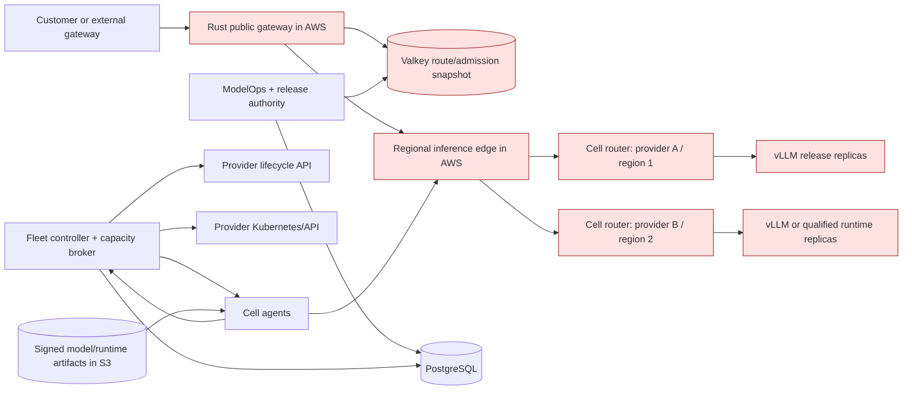

# Owned Grad inference architecture

This document freezes the product/runtime architecture for `grad/<effort>/<speed>`. AWS hosts the customer gateway, inference edge, control plane, financial/data services, ModelOps, and fleet control. Curated external GPU providers supply disposable execution capacity. AWS GPU instances are not normal serving capacity; an emergency or qualification deployment requires an explicit, margin-gated release like any other provider.

The evidence and provider uncertainty are in [the dated GPU fleet brief](MULTI_PROVIDER_GPU_EVIDENCE_2026-07-13.md). Infrastructure realization is in [Multi-provider GPU fleet](../../infra/docs/MULTI_PROVIDER_GPU_FLEET.md). The serving decision is [ADR-0005](../../docs/decisions/0005-multi-provider-spot-inference.md); the common fleet actuation API is [ADR-0006](../../docs/decisions/0006-kubernetes-provider-abstraction.md) and [its implementation contract](KUBERNETES_PROVIDER_ABSTRACTION_2026-07-13.md).

## Product invariants

1. A Grad request runs the exact immutable Grad release selected for its effort/speed cell. It never falls back to a direct provider, another model release, effort, speed, quantization, tokenizer, or runtime.
2. The Rust gateway still has one synchronous internal state/control dependency: Redis/Valkey. Curated model APIs and the inference edge are upstream serving endpoints after admission, not control-plane lookups.
3. The gateway never discovers GPU pods, calls a capacity-provider API, reads PostgreSQL/Kubernetes, or asks the fleet operator to schedule a live request.
4. Provider interruption may remove capacity or cache but cannot change model semantics, tenant boundaries, money authority, or trace policy.
5. Every generative Grad release uses KV cache for active sequences and enables cross-request prefix reuse. Private/No Retention does **not** disable either cache.
6. Cache material is confidential ephemeral serving state. It is isolated by opaque workspace/trust-domain salt, never enters Redis/PostgreSQL/S3/ClickHouse/backups/logs, and is never shared across workspaces or provider channels.
7. No-retention suppresses durable request/response/tool trace capture. It does not mean “no transient computation state”; the customer contract explicitly discloses bounded ephemeral serving caches.
8. Spot/preemptible capacity is assumed to disappear with zero warning. Notice signals improve draining but are never required for correctness.
9. The capacity broker may optimize placement only among endpoints qualified for the exact release and speed policy. A lack of qualified capacity returns an explicit capacity error; no silent downgrade occurs.
10. A cell receives no customer API key, organization credit state, provider credential, trace encryption private key, or database access.

## Plane and service topology



### AWS control/data/gateway domain

- **Public Rust gateway:** protocol compatibility, API-key auth, Redis admission/reservation, immutable route selection, commercial metering, public streaming response, and trace-policy enforcement.
- **Inference edge:** a stateless, regional Rust serving proxy. It validates the signed release/cell target, applies the request deadline, chooses a live connection for the selected cell, forwards a canonical gRPC request, and relays usage/events. It supports direct mTLS endpoints and outbound cell tunnels behind one interface.
- **ModelOps/release authority:** qualifies exact runtime/model/hardware/capability combinations, signs manifests, creates immutable releases, and publishes eligible target snapshots to Redis.
- **Fleet planner/broker and capacity-provider controllers:** project PostgreSQL-owned intent into Grad fleet CRDs in AWS EKS, reconcile desired warm capacity with provider reality, budgets, price, health, and interruption evidence, and persist observations back to durable lease history. They are slow-path and never request-serving dependencies.
- **PostgreSQL, S3, Valkey, ClickHouse:** retain their existing authority boundaries. S3 additionally holds immutable signed model artifacts; it never holds live KV cache.

### External inference cell

A cell is one provider, region/data zone, network/security boundary, and orchestration substrate. It contains:

- a **cell agent** for signed bootstrap, desired-release reconciliation, health/capacity heartbeat, drain, and termination;
- a **cell router** for token-aware queueing, deadline admission, cache/session affinity, replica selection, and local overload rejection;
- one or more immutable **runtime replica groups**, each serving exactly one release manifest;
- an optional encrypted, ephemeral **artifact cache** and KV spill tier with no backup or cross-cell replication;
- provider-native lifecycle infrastructure or a cell-local Kubernetes cluster.

Cells are disposable. They never own catalog, billing, organization policy, route authority, or customer traces. A cell can be destroyed and recreated from signed manifests without data restore.

## The two-level routing decision

Routing is deliberately split so live GPU details never enter the public gateway.

### Level 1: gateway to cell

The immutable Redis `RouteRelease` contains a bounded list of signed `CellTarget` records for the exact Grad release. Each target includes cell ID, inference-edge region/endpoint, ingress mode, target epoch, hard capability/data-region attributes, coarse health/capacity class, and rollout weight. It never lists pods or provider credentials.

The gateway:

1. performs normal Redis admission and fixes the release/price;
2. filters targets by exact release, requested speed, data zone, capability, rollout cohort, and circuit state;
3. uses a deterministic hash of request/session cache affinity plus weighted health to choose a cell;
4. calls the AWS inference edge with the chosen cell target and deadline;
5. may retry another target only under the failure rules below.

Publishing is asynchronous. A missing/stale target closes new admission for that cell; it never causes a control-plane lookup.

### Level 2: cell router to replica

The cell router knows current queue depth, estimated input/output tokens, runtime readiness, active sequences, cache residency, GPU topology, and drain state. It prefers a ready replica with matching cache affinity only when the request can still meet its queue deadline. Cache locality is an optimization after correctness and speed SLO.

The router rejects before runtime spend when the exact release is unavailable or the queue deadline cannot be met. It cannot select another release. Kubernetes service discovery may feed this router inside a Kubernetes cell; native provider cells use cell-agent registration.

## Gateway-to-inference Protobuf contract

Canonical messages live under `product/proto/grad/inference/v1/` and generate Rust/TypeScript types plus golden fixtures. Public JSON is translated once at the gateway. The first contract includes:

```text
GenerateRequest
  request_id, attempt_id, reservation_id
  route_release_id, release_manifest_digest
  public_model_id, effort, speed
  canonical_input (messages/content/tools/structured-output/sampling)
  capability_requirements, max_output_tokens
  absolute_deadline, queue_deadline
  opaque_billing_principal, opaque_cache_scope, cache_affinity_key
  data_mode, trace_context, idempotency_token

GenerateEvent (ordered sequence)
  accepted(cell_id, replica_id, release_digest)
  queued(position_class, estimated_deadline)
  output_delta(sequence, canonical_delta)
  usage_delta(input_tokens, cached_input_tokens, output_tokens)
  terminal(finish_reason, authoritative_usage, runtime_identity)
  error(stage, code, retry_scope, emitted_output, authoritative_usage)
```

Rules:

- `release_manifest_digest` is mandatory and checked by edge, cell router, and runtime sidecar before output.
- The edge and cell emit monotonic event sequence numbers; the gateway deduplicates reconnect/replay within one attempt.
- `absolute_deadline` only tightens downstream. A component cannot extend it.
- `opaque_cache_scope` and `cache_affinity_key` are HMAC-derived; external cells do not receive raw organization/workspace IDs.
- No provider-specific instance, bid, host, runtime flag, or Kubernetes object appears in this request contract.
- Usage is cumulative/monotonic at terminal settlement. A runtime crash with uncertain usage is explicitly classified for conservative reconciliation; it is never fabricated as zero.

Control-plane contracts are separate and generate/check the corresponding `fleet.grad.dev/v1alpha1` CRD domain fields:

- `ReleaseManifest`: model/tokenizer/config/image digests, quantization, runtime and kernel versions, topology, capabilities, cache requirements, benchmark profile, and artifact signatures.
- `CellTarget`: signed serving endpoint/epoch and hard eligibility.
- `CapacityIntent`: desired release capacity by region/speed, warm floor, purchase classes, deadline, budget, and maximum effective cost.
- `CapacityLease`: provider allocation identity, cell, release/topology, lifecycle state, acquired price, TTL, and idempotency key.
- `CellHeartbeat`: current manifests, ready/draining replicas, queue/token capacity, cache pressure/hit metrics, notices, and sanitized health.

PostgreSQL owns durable `CapacityIntent`/`CapacityLease` history. `CapacityPool`, `CapacityAllocation`, and `InferenceCell` CRs are rebuildable actuation/status projections with single writers. Provider controllers cannot sign a route; the target projector combines qualified release state, attestation and redundant edge connectivity before it publishes `CellTarget` to Redis.

## Always-on KV cache and no-retention semantics

“KV cache” has two layers and both stay enabled for generative Grad releases:

1. **active-sequence KV:** required for autoregressive generation and held in GPU/RAM while a request runs;
2. **prefix KV reuse:** completed prefix blocks remain available for later requests in the same cache trust domain until eviction/TTL/node loss.

The gateway derives:

```text
opaque_cache_scope = HMAC(cache_epoch_secret,
  channel || organization || workspace || retention_class || optional_customer_scope)
```

The runtime derives block keys from this opaque salt, exact release digest, tokenizer/adapter revision, multimodal input hash, prefix token hash, and block position. Product Intelligence and Private/No Retention use separate `retention_class` namespaces. Both receive caching; neither can infer or reuse the other's entries. Provider-channel traffic uses an isolated channel/API-principal namespace.

Cache contract:

- no cross-workspace, cross-channel, cross-release, cross-tokenizer, or cross-retention-class reuse;
- no raw prompts, responses, token arrays, cache keys, or tensors in telemetry;
- GPU/RAM first; encrypted local NVMe spill is optional and release-qualified, with bounded service TTL, no snapshot, no backup, no object-store migration, and destruction on cell teardown;
- cache metadata and tensors are not customer traces and are unavailable in the console/export API;
- trace deletion does not index or scan cache blocks; organization/workspace deletion or a privacy-boundary change rotates the cache epoch so old blocks become immediately unreachable, then bounded TTL/eviction removes them without a durable copy;
- key/salt rotation intentionally creates misses and is the emergency cache-fence control;
- cache loss never changes output correctness and never permits a release or speed downgrade;
- timing-isolation, namespace, expiry, no-log, and teardown properties are mandatory release tests.

Customer copy for Private/No Retention must say that request content is not written to product history, trace storage, or analytics payload storage, while transient encrypted transport, GPU memory, and bounded ephemeral serving caches are still used to execute and accelerate requests.

## Runtime and release model

vLLM is the first baseline implementation target because current releases expose automatic prefix caching, per-request cache salting, Kubernetes deployment, cache-aware routing, and single/multi-node execution. It is a control and initial runtime, not a permanent architecture boundary. The research factory may produce a modified runtime, custom model architecture, generated kernels, compiler passes, scheduler, topology or complete custom engine. Those outputs enter serving only as one qualified `ModelStackBundle`; production never reconstructs them manually.

`RuntimeAdapter` supports vLLM, SGLang, or a factory-produced engine only through that exact bundle:

```text
prepare(manifest) -> artifact/topology validation
start(manifest) -> readiness with exact runtime identity
generate(GenerateRequest) -> ordered GenerateEvent stream
drain(deadline) -> stop new work, finish/cancel bounded active work
health() -> content-free load/cache/runtime metrics
terminate() -> zeroize ephemeral state and exit
```

Runtime image, model weights/architecture, factory-produced code/operators, tokenizer, chat template, reasoning parser, quantization/calibration, kernels/dispatch, scheduler, parallelism, speculative configuration, cache implementation, topology, hardware/software envelope and protocol/data-policy behavior are all bundle identity. The manifest is canonicalized, content-addressed and signed; its S3/ECR references are immutable. Changing any field or referenced bytes creates a new candidate, bundle digest and qualification evidence. A rolling deployment cannot silently mutate an existing release.

`RouteRelease` is the commercial/operational wrapper around a qualified bundle. It freezes public family or managed effort/speed identity, immutable release pin, capabilities, SLO, price, eligible placement envelope, rollout and rollback. Research, qualification, staging and production launch the same bundle digest. The cell's boot attestation includes that digest, runtime image and observed placement; the target projector refuses readiness on any mismatch. See [Model research factory to production](MODEL_RESEARCH_TO_PRODUCTION_2026-07-13.md).

Start with single-node tensor parallel groups where possible. Multi-node Ray/multiprocessing, disaggregated prefill/decode, remote cache, speculative decoding, and LoRA multiplexing are separate measured candidates because they add correlated failure and state-transfer surfaces.

## Capacity and speed policy

Effort selects model behavior/release family; speed selects a measurable service policy. The capacity broker does not create 16 permanent fleets. It pools compatible release groups and publishes only catalog cells that have qualified capacity.

| Speed | Initial capacity posture | Permitted customer behavior |
| --- | --- | --- |
| `flex` | spot-first, lowest effective successful-token cost, cold/warm mix, longest queue deadline | explicit queueing; may be unavailable rather than use a costlier/unqualified topology |
| `standard` | diversified spot plus a measured warm floor and bounded regular fallback on external GPU providers | default balanced queue/latency target |
| `fast` | pre-warmed capacity in multiple independent cells, stricter admission, more regular/reserved coverage when margin allows | low queue budget; rejects before silent downgrade |
| `turbo` | topology-specific hot capacity and strongest redundancy only where measured economics support it | smallest queue budget; catalog-gated rather than universally available |

The exact warm floor, provider count, purchase mix, queue deadline, token capacity, and price are immutable release/policy inputs backed by load evidence. “Spot-first” never means “spot-only for every tier.”

The broker scores capacity by hard eligibility first, then effective cost per successful token, startup time, observed interruption rate, successful-start rate, throughput/TTFT, queue demand, egress, warm-idle cost, quota, and provider concentration. Raw hourly GPU price alone is not an optimization objective.

## Spot lifecycle

Every allocation follows an idempotent state machine:

```text
requested -> acquired -> bootstrapping -> attesting -> loading
-> warming -> ready -> draining -> terminated
                   \-> failed -----------^
```

- A `CapacityLease` has a provider idempotency key, owner epoch, maximum hourly/effective cost, and expiry. The controller releases orphaned or expired resources even after its own restart.
- Bootstrap accepts only a signed, short-lived manifest and obtains a short-lived cell certificate. Provider API credentials never leave AWS.
- `ready` requires verified GPU/topology, artifact signatures/digests, runtime identity, cache enabled, synthetic generation, and registered serving connectivity.
- Interruption/preemption notice immediately fences the allocation, removes it from new routing, drains active work until the provider deadline, and terminates. Absence of notice follows the same externally observable failure contract after heartbeat loss.
- A capacity-provider API outage freezes acquisition/release retries under bounded backoff. Existing ready cells continue serving; budget/orphan alarms escalate independently.
- Warm capacity is reduced only after cooldown, active/cache pressure checks, concentration constraints, and minimum speed coverage remain satisfied.

## Failure and retry contract

| Failure | Serving behavior | Billing/cache behavior |
| --- | --- | --- |
| Fleet controller or PostgreSQL unavailable | existing published cells continue; no new scale/release | gateway admission and existing caches continue |
| Capacity-provider lifecycle API unavailable | existing cells continue; acquisition/cleanup retries and orphan alarm | no request waits on lifecycle API |
| Inference edge instance fails before output | gateway retries another edge/cell target for the exact release within deadline | same reservation/attempt lineage; no duplicate sell charge |
| Cell/runtime fails before first output | one bounded retry to another qualified cell when deadline permits | failed attempt buy evidence retained; settle actual/zero sell usage per policy |
| Cell/runtime fails after any output | no transparent replay; emit terminal `upstream_interrupted` with partial-usage evidence | settle once; apply existing no-usable-output credit rule only when eligible |
| Cache miss or cell loss | recompute prefix on exact release | correctness unchanged; cache-hit accounting is not billing authority |
| Exact release has no capacity | explicit `capacity_unavailable`/429; no other release or speed | reservation released/settled with no inference sell charge |
| Release digest/topology mismatch | cell never becomes Ready or is fenced immediately | no customer traffic; security incident if unexpected |

Retries never cross a direct-provider/Grad boundary, model release, effort, speed, data zone, or retention policy. Once output is visible, automatic replay is forbidden because duplicated tool calls/text are worse than an explicit interrupted stream.

## Security boundary

- Capacity-provider credentials live only in AWS Secrets Manager and are available only to a separate matching controller service account/network/secret identity; the broker and target signer cannot read them.
- Cell certificates are short-lived, provider/cell/release scoped, rotated, and revoked by target epoch. Edge-to-cell traffic is mTLS. Public endpoints allow only controlled AWS egress ranges where the provider supports firewalling.
- `DIRECT_MTLS`, `MANAGED_LB`, and `OUTBOUND_RELAY` are supported ingress modes. Outbound relay workers initiate authenticated connections to at least two edge shards in distinct AWS AZs; signed targets carry shard set and epoch. They do not expose a general shell or management port.
- Signed runtime/model manifests and artifact digests are verified before execution. Model license/redistribution policy is part of release eligibility.
- Runtime request logging, crash dumps, prompt metrics, core dumps, swap, and provider console logging are disabled. Content-free metrics use opaque IDs and bounded labels.
- The provider can necessarily observe encrypted transport endpoints and plaintext in process/GPU memory while executing. No-retention cannot honestly promise otherwise; provider contractual/security qualification is required.
- A compromised cell can affect its current requests and model availability, but cannot mint credit, read PostgreSQL/Redis/customer keys, decrypt S3 traces, call a capacity-provider controller, or publish a route release.

## Observability and customer experience

The gateway remains the customer trace boundary. The cell emits content-free operational metrics: release/cell/replica IDs, queue and active counts, token totals, cache hit/miss/eviction counts, TTFT/ITL, termination reason, GPU health/utilization, artifact/startup timing, and provider allocation cost. Organization/workspace identifiers are HMAC/pseudonymous and excluded from provider labels.

The console shows requested Grad ID, actual immutable release, region/data mode, speed SLO outcome, usage/cost, and interruption status. It does not expose capacity-provider bidding or raw host selection by default. Placement may be available in enterprise audit/export only when disclosure is contractually required.

Capacity-provider invoices and allocation lease intervals are durable PostgreSQL evidence. A content-free ClickHouse projection attributes GPU-seconds/token work, warm idle, failed starts, interruptions, storage and network cost to release/cell/request attempts for margin analysis. This allocation-cost attribution never changes fixed customer usage or price; unmatched invoice/resources freeze new acquisition and enter reconciliation.

## Property and end-to-end tests

TypeScript `fast-check` model tests cover release publication, PostgreSQL intent/lease to CR projection, capacity-provider offer normalization, channel/customer accounting isolation, spend/concentration limits, finalizer plus orphan cleanup, rollout, and the rule that no broker state transition changes a live request's release.

Rust `proptest`/state-machine tests cover:

- gateway/edge/cell event ordering, deduplication, deadlines, cancel, and settlement outcome;
- target selection and retries preserving exact release/effort/speed/data mode;
- allocation lifecycle under duplicate/reordered API/CR observations, owner-epoch races, leader/controller restarts, finalizer failure and management-cluster rebuild;
- cache-scope derivation/epoch rotation and no cross-workspace/channel/release/retention-class reuse;
- no-retention requests producing cache put/hit/evict behavior while producing no trace payload event;
- preemption before/after first token, two-AZ relay-shard loss, heartbeat loss, drain races, self-asserted readiness rejection and stale target epochs;
- integer cost/budget arithmetic, lease expiry, and no orphan surviving bounded reconciliation.
- manifest canonicalization/signature/object verification, research-allocation versus production-target separation, exact bundle launch, and alias movement never changing an admitted request.

Deterministic E2E boots a Kind management cluster, Grad fleet CRDs/controllers, an inference edge, fake capacity-provider APIs, fake cell agents, a real Redis, and tiny CPU/fake runtimes. It kills controllers/cells at every lifecycle/event boundary and rebuilds CR state from PostgreSQL. GPU qualification runs under a preregistered provider budget with tiny prompts and records startup, cache hit, streaming, interruption, cleanup, and cost evidence. Protected CI never relies on spot availability for pass/fail; capacity absence is a classified result, while protocol/security regressions fail.

## Seed implementation sequence

1. Freeze Protobuf messages, `ModelStackBundle` canonical manifest, release wrapper, target signature, cache scope, event/settlement, and fake provider/cell models.
2. Build the Rust inference edge, local cell router/agent, fake runtime, and exhaustive failure/PBT harness without cloud capacity.
3. Integrate a pinned vLLM single-node baseline bundle with always-on salted prefix caching and exact bundle/runtime/placement attestation.
4. Implement one native container/VM `CapacityAllocation` controller and prove acquire-to-cleanup under a hard spend cap.
5. Implement one managed-Kubernetes cell and prove the same contract without changing gateway/edge messages.
6. Add diversified spot, drain, lease/orphan, cache-affinity, and cost controls; launch only qualified `flex`/`standard` cells.
7. Add multi-node/runtime/topology candidates and `fast`/`turbo` only after measured latency, availability, interruption, and margin gates.
8. Qualify external-gateway provider traffic on the same inference edge with isolated channel/cache/billing principals.
9. Connect the research factory only after its independent qualification pipeline can prove that one exact factory-produced bundle passes baseline parity, custom architecture/kernel/runtime tests, full-cell soak and dry-run release rollback.

The revenue path remains simple: direct provider traffic works immediately through the gateway; Grad cells appear only when owned supply is actually ready and profitable. Multi-provider breadth is an internal reliability/margin mechanism, not customer configuration.
