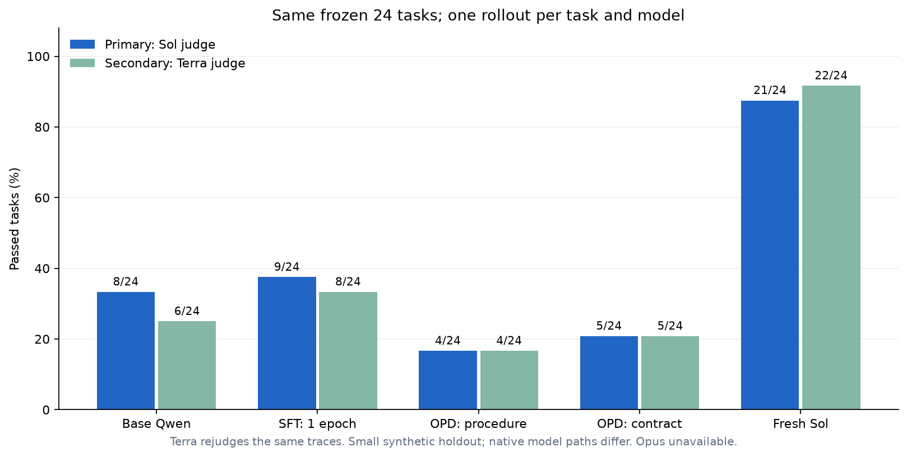
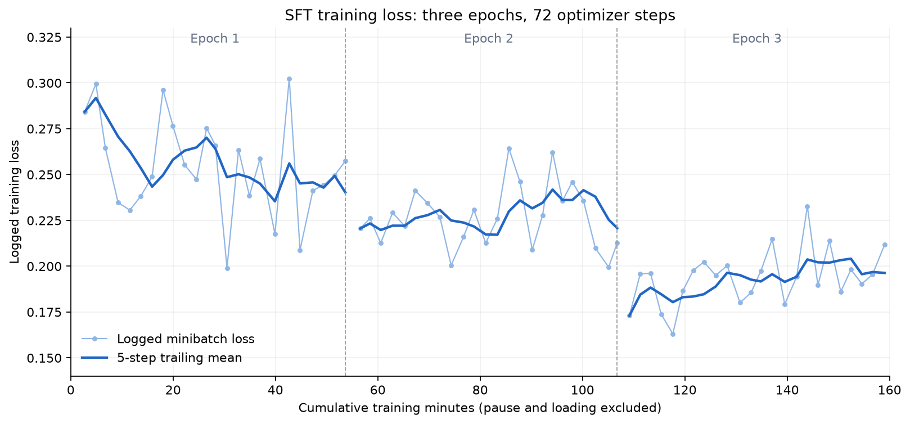
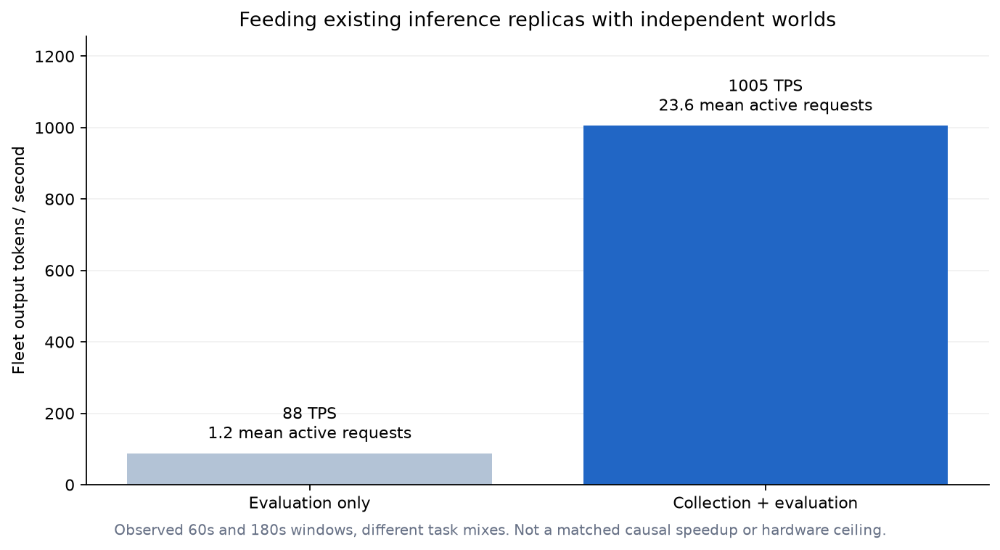

# PostHog AI agent: environments, correction data, and post-training

**Working experiment record, not a blog draft.** Started 2026-11-02; this
backfill was assembled on 2026-11-03 from the conversation, saved protocols,
and host-side results. Dates below use UTC. The exact data capture time is in
[`data/snapshot.json`](data/snapshot.json). Historical entries are reconstructed;
they are not a contemporaneous log of every command.

**Current status:** the first SFT/OPD comparison is complete. Two additional
SFT epochs have completed, and development evaluation is in progress. A fresh
Sol reference run is complete. DeepSeek's repaired OpenRouter benchmark and a
new bounded throughput/collection run are in progress. Do not present partial
development counts as an epoch ranking.

## Question and strongest result so far

Can we construct trustworthy, learnable analytics-agent tasks, collect useful
successful and teacher-guided corrected trajectories, and improve a local
Qwen policy through SFT or privileged-context distillation?

The first comparison **did not establish a reliable capability gain**. On the
same frozen 24-task holdout, fresh Qwen passed 8 tasks and one-epoch SFT passed
9. Both exploratory OPD variants performed below base. A subsequent fresh Sol
run passed 21/24, leaving substantial headroom. This is a small synthetic
benchmark, not a claim about production performance.

We also found a concrete systems issue: an evaluation with only two mutable
worlds underfed an eight-GPU inference fleet. Adding independent training
worlds increased observed fleet output from 88 TPS in a 60-second evaluation
window to 1,005 TPS in a 180-second collection-plus-evaluation window. These
are different workloads/windows, not a controlled 11.5× kernel speedup.

## Setup and method

- **Environment:** synthetic PostHog-shaped data and actual agent tools on
  the existing fbf8 host. One fictional reporting-product archetype, with
  analytics, billing, warehouse, feature-flag, and AI-usage questions.
- **Worlds:** 20 training worlds, seeds 1101–1120; two separate development
  worlds, seeds 1121/1122. Registered populations vary from 700–1,150, history
  from 84–126 days, and anonymous-to-registered ratios from 1.5–2.5.
- **Initial curriculum:** 12 workflow families with three substantive question
  scopes per family, targeting authoring difficulty 3/4. Those labels are
  authoring targets, not measured difficulty.
- **Trace grounding:** the world generator is hand-designed. Train-split
  anonymized first user requests are authoring examples for style/intent;
  production trace frequencies do not define this world's distribution, and
  trace answers are not teacher labels.
- **Models:** local Qwen3.8-27B-base for learner rollouts; subscription Sol,
  Terra, and a small Luna pilot for authoring/review. Sol roots use their native
  tool path with medium effort. Qwen uses the existing emulated-tool path.
  Later DeepSeek uses OpenRouter, native tools, and high reasoning.
- **Hardware:** eight existing B300 GPUs. Initially four TP1 Qwen servers;
  later two TP4 replicas, four GPUs each. Training temporarily reclaims one
  group while the other serves, then restores resident inference.
- **Task gates:** live reference-query execution, a strong primary validator,
  a second strong gate, independent sampled live contract review, semantic
  review, split checks, and versioned task/proof freezes before collection.
  A task passing these gates is not yet proof that the student can learn it.
- **Pass definition:** judge score ≥7.5/10, no materially wrong final claims,
  and no materially unsupported final claims. Execution status `ok` alone
  does not mean a task passed. Infrastructure failures are incomplete results.
- **Rollouts:** normally 12 turns, 1,200-second wall budget, tracked-state
  restoration. One mutable-world actor at a time; teacher/judge work can run
  outside that lease. No evaluation/training-world races.

The frozen final benchmark has 24 instances across 12 workflows and two worlds
(seeds 43/47). Its task SHA256 is
`23a07a82b838dec80b7f427d18240b05d21fcbeb10d38babb523a22617fc1ff4`.
It was excluded from training, corrections, teacher contexts, and original
checkpoint selection. It uses an older attribution recipe with known realism
limitations, preserved rather than rewritten after scores. Follow-up epoch
selection uses development worlds; this already-examined final benchmark is
not a fresh test set for future optimization.

## Experiment log

### E01 · Nov 2 · Generate worlds, then audit semantics

**Hypothesis:** varied synthetic populations and live-query-backed contracts
can produce a broad, learnable training pool. The original plan was 240 train
candidates plus 24 dev candidates across 22 worlds.

**What happened:** all 22 original worlds passed global audit, and structural
checks on 1,159,693 events found no future events, shared-person sessions,
export-duration mismatches, duplicate invoice IDs, or AI cost arithmetic
violations. Yet a separate live contract review found only **9/15 SOUND**
against a required 14/15. Six cases exposed referral UTM tags paired with a
direct referrer. The provisional task pool was not admitted.

**Decision:** structural checks and broad model audits were insufficient.
Preserve the negative evidence and reject the source lineage before training.
Source: `early_contract15/review/summary.json` in the source map.

### E02 · Nov 2 · Two attribution repairs, with a rejected intermediate version

**Change:** the first repair changed referrer domains but left return visits
carrying first-touch campaign tags; fresh review still found a material
realism problem. That version was rejected. The next source revision,
`e84c49235`, separated person/account first-touch acquisition from current-visit
event attribution. Return visits deterministically choose direct, original,
or alternative channels without consuming the business-journey RNG.

**Checks:** on the 20 new training worlds, 1,067,418 events had zero checked
referrer-domain, signup/first-touch, or within-session channel mismatches;
28,864 people had multiple visit channels. Full business-value comparison found
no changes outside the five intended attribution fields. Two-world smoke
audits were 2/2 CLEAN for both Sol and Terra.

**Complication:** the full Terra audit returned 17 CLEAN and three MATERIAL
findings for AI correlation. Those three used the wrong common ID assumption:
generation events use `$ai_trace_id`, while client events use `request_id`.
Correct-key live joins had no violations, and fresh schema-aware Sol reviews
were CLEAN. The negatives were preserved and explicitly adjudicated with
separate hashes; no silent replacement of the original verdicts.

**Learning:** data repair, task-contract repair, and an auditor's schema mistake
are different events. Each needs its own evidence and preserved version.

### E03 · Nov 2 · Pipeline authoring and validation instead of serial stages

**Bottleneck:** authoring whole groups before validating them left useful work
waiting. The controller was changed to up to six overlapping per-task
pipelines, reusing completed author caches rather than regenerating drafts.

**Measured small timing sample:** Sol HTTP calls averaged 27.94 s (n=14),
Terra 14.45 s (n=7), and SQL batches 0.166 s (n=18). Fresh authoring averaged
144.5 s (n=7); accepted validation averaged 31 s primary plus 85.1 s gate
(n=12). About 99.4% of timed model-plus-SQL work was HTTP time. This does not
separate provider queueing from inference or equal end-to-end critical-path
share. SQL and idle local GPUs were not the task-authoring bottleneck.

**Caveat:** a later cached-draft phase briefly produced about 170 accepted
instances/hour. That was not a sustained fresh-authoring forecast. Quality
repairs and provider overload invalidated the earlier 3–5-hour ETA.

### E04 · Nov 2 · Matched four-case model-routing pilot

**Trial:** four fixed hard scopes, without learner/test-score selection:
Luna author versus Terra author versus the Sol baseline, keeping strong
validation. Also test swapping validator order.

**Results:** Luna authored 1/4 accepted cases; Terra 4/4. Terra's service time
was 186.25 s per accepted task versus about 230.24 s for the matched Sol
baseline, roughly 19% lower. Swapped validation accepted 4/4; its cached author
time was not a fresh-generation speed measurement.

**Decision:** do not promote Luna. Limit Terra authoring to the piloted families;
retain strong gates and an independent reviewer different from the author.
Four cases are not evidence of equivalent quality across all workflows.
Exact route aggregates are in `data/snapshot.json`.

### E05 · Nov 2 · Diversity audit changes the curriculum

**Finding:** semantic review of 151 train/dev instances rated **66 (~44%) as
cosmetic near-clones**. Ratings are model judgments with inconsistent cluster
granularity, not a gold taxonomy, but the repetition was substantial.

**Action:** pause queued repetitions; test new operation scopes such as ordered
last-nondirect attribution, channel overlap/deduplication, session-versus-person
units, and flag/experiment creation or modification. Later factory work added
new operation candidates with contract and novelty checks. Physical execution
copies were used for concurrency, never counted as new skills.

**Learning:** 150 task IDs are not 150 skills. Gate acceptance, semantic breadth,
model difficulty, correction yield, and final learning gains are separate axes.

### E06 · Nov 2 · Difficulty and judge calibration

**Checks:** run base Qwen and Sol on development tasks; rejudge the same traces
with Terra; independently audit Sol failures and stratified successes against
the user contract and live queries. One examined warehouse failure had correct
math but omitted requested breakdowns. Sol/Terra agreed on the omission but
disagreed on severity. A sound contract can still have judge-sensitive scoring.

**Opus:** the exact native `claude-opus-5-5` endpoint returned 429 with cooldown
beyond the overnight window. No paid fallback or differently named model was
silently substituted. The early Qwen/Opus probe therefore did not measure an
Opus gap.

### E07 · Nov 2 · Small correction pilot, then broader collection

**Method:** after a learner failure, Sol gives fault-guided procedural notes;
the learner retries. Passing traces can become hint-free SFT examples after
independent safety and exact-token checks. This is a **DAgger-style correction
approximation**, not expert action labeling at every visited state.

**Initial yield:** 28 admitted tasks produced six first-try and nine corrected
kept traces; 13 were not kept, including three incomplete/error cases. Subsequent
cleaning left 13 usable pilot traces. The first 13-trace training pilot was
diagnostic; do not confuse it with the larger morning experiment.

**Expansion:** more admitted tasks and multiple samples per task. The final
overnight clean manifest contains **314 trajectories / 148 canonical tasks**:
177 first-try and 137 corrected successes, 3,854 exported calls, and 1,538,093
completion tokens. This is below the user's stretch goal of 1,000 trajectories.
Different traces from the same task remain practice variation, not new skills.

**Retention rules:** exact served-token alignment, full detokenization,
hint-free prompts, no teacher-answer leakage/direction, no teacher references
in completions, clean state restoration, whole-trace and row deduplication,
at most four retained traces per canonical task and two per normalized strategy.
Long contexts outside the default limit are withheld rather than truncated.
Teacher-guidance diagnosis not actually shown to the passing learner must not
be confused with the visible hint being audited.

Raw logprobs from a hinted rollout are conditional on that hinted prompt;
stripping the hint for SFT does not turn them into clean-prefix policy
logprobs. The later OPD experiment therefore collected fresh unguided student
samples instead of reusing those values as if the contexts matched.

### E08 · Nov 2 night · Serving and orchestration experiments

**Observation:** client workers are episode orchestrators, not separate Qwen
deployments. Low concurrent model demand left expensive resident GPUs underfed.
One world cannot safely host simultaneous stateful tasks, but independent
worlds can. Teacher work and restoration also consume time between generations.

**Changes:** test TP4 on the spare group, then explicitly promote two resident
TP4 groups. A token-replay trial observed about 715 aggregate TPS for the TP4
candidate at concurrency 16; the TP1 fleet control had concurrent campaign
load, so it was not a clean causal TP comparison or full-task quality test.

**Operational evidence:** continuous original/execution-world collection later
measured 1,200.7 fleet TPS at 29.32 mean active requests in a 598-second window.
A live 16-versus-20 per-backend test did not improve output (paired ratios
0.985, 0.988, 0.922), so the cap stayed at 16. This is not a hardware ceiling.
Rebalancing a fixed eight-call Sol budget from six judges/two critics to four
and four addressed a critic queue; another window measured 1,104 TPS.

These older windows are reconstructed from measured completion messages in
the thread. They have different task mixes and are not a scaling curve.

### E09 · Nov 3 morning · Freeze a bounded SFT training selection

**Question:** can the collected successful/corrected behavior improve Qwen?

**Selection:** freeze 313 clean trajectories / 147 tasks before training. Every
trajectory contributes its first root call, then deterministic late/middle
calls fill a 600-row / 30M input-token budget. Actual totals: 29,222,117
input-plus-target tokens and **294,739 completion tokens**. Maximum sequence
length 125,851; no selected call was truncated. The 314th clean trajectory
arrived after the training snapshot and was not retroactively included.

**Important coverage distinction:** this is not SFT on every call of every
trajectory. One epoch saw about 19% of the final pool's completion-token
volume. Extra epochs repeat those same 600 calls; they do not expose the
remaining decision steps.

**Training:** independent base start, LoRA rank 16/alpha 32, AdamW, LR 5e-5,
one epoch, 24 optimizer steps, seed 0, max length 131,072, four GPUs. All steps
were finite; training took about 54 minutes. A correct but slower reference
convolution fallback was present; no rushed dependency/kernel change was made.

### E10 · Nov 3 morning · Two paired privileged-context OPD variants

**Data:** fresh unguided student rollouts at T=1/full support, selecting both
successful and failed trajectories. Fixed-cutoff yield: 59/96 planned episodes,
34 canonical tasks, 318 complete selected calls / 173,136 completion tokens
per variant. Four episodes passed; 55 did not. The two variants use exactly
the same student inputs, tokens, and sampler logprobs.

**Teacher variants:** frozen **base Qwen** with (a) procedural guidance or
(b) the full verified training contract/reference context. These are privileged
views of the same model, not stronger Sol/Opus teachers. Teacher privilege is
absent from student inputs. Actual sampled-token advantages are
`clip(teacher_logprob - student_sampler_logprob, -2, 2)`, using the existing
clipped policy update. This is not full-vocabulary distribution distillation
or multi-iteration online OPD.

**Checks and budget:** finite/aligned logprobs; clean-prefix replay mean absolute
logprob delta 0.0091. Each arm starts from base, rank 16, LR 5e-5, one epoch,
24 optimizer steps. Both finished in about 34 minutes each. SFT versus OPD
data distributions and token budgets differ; algorithm alone is not isolated.

### E11 · Nov 3 morning · Fresh base/SFT/OPD final comparison

All four models ran once on every frozen final task with the same 12-turn /
1,200-second limits. Adapters use an isolated hint-free launcher; shared
canonical base code was not rewritten. Hashes bind data, harness, and adapters.

| Model | Sol judge | Terra judge on same traces |
| --- | ---: | ---: |
| Fresh Qwen base | 8/24 (33.3%) | 6/24 (25.0%) |
| One-epoch SFT | 9/24 (37.5%) | 8/24 (33.3%) |
| Procedural-context OPD | 4/24 (16.7%) | 4/24 (16.7%) |
| Contract-context OPD | 5/24 (20.8%) | 5/24 (20.8%) |

SFT gained two passes and lost one versus base: **+4.2 percentage points**,
workflow-cluster bootstrap 95% interval **[-8.3, +16.7]**. Procedural OPD was
−16.7 points, interval [-29.2, −4.2]; contract OPD was −12.5 points, interval
[-29.2, +4.2]. These intervals have only 12 clusters and omit other uncertainty.

All 96 runs were `ok` and all 96 restorations clean. Judges agreed on 93/96
pass decisions. Neither judge is human truth. No adapter was promoted, and
the result does not show that OPD generally fails or that SFT reliably helps.

### E12 · Nov 3 follow-up · Fresh Sol reference

**Request:** measure Sol now, rather than mistake the older 21/24 Sol result
for Opus. Fresh Sol passed **21/24 (87.5%)** with the primary judge and
**22/24 (91.7%)** with Terra. All 24 runs were `ok`, with zero unclean resets.
This is the same frozen task set, but native model implementations differ.

Data: [`data/evaluation_results.csv`](data/evaluation_results.csv).

### E13 · Nov 3 follow-up · Continue SFT to three epochs

**Hypothesis:** the small update budget may leave useful supervision unlearned.
The user requested two additional epochs. Resume the one-epoch adapter and its
saved optimizer, same 600 calls/LR, seed 1 for the next two shuffled passes.
Save total-epoch-2 and total-epoch-3 checkpoints. No new training examples.

**Measured training:** all 48 additional steps completed; about 105 minutes.
Mean logged minibatch loss by epoch: **0.254 → 0.227 → 0.194**. Loss is scored
on different shuffled batches, and the plotted moving average resets at epoch
boundaries. The jumps are not a scheduled learning-rate restart. There is no
fixed validation-loss curve yet, and lower training loss is not a task gain.

Data: [`data/sft_loss.csv`](data/sft_loss.csv). The 18-task development
comparison includes base plus epochs 1/2/3 (72 planned runs). It remains partial
in the saved snapshot; unmatched subsets must not be ranked. The already-used
final holdout will not be used to select these follow-up checkpoints.

### E14 · Nov 3 follow-up · DeepSeek V4.1 Flash 1017 via OpenRouter

**New authorization:** the user explicitly permitted OpenRouter for this run,
separate from the earlier subscription-only campaign. Exact ID:
`deepseek/deepseek-v4.1-flash-1017`; native tools, high reasoning, 32,768 maximum
completion tokens per call, same 24 final tasks and turn/wall limits, Sol primary
and Terra secondary judging. Existing host credentials remain on the host.

**Integration failure:** a minimal public tool-call smoke passed, but all 24
initial real cases were `infra_error`: `parallel_tool_calls=true` plus strict
provider parameter filtering left no eligible endpoints under the account's
allowed-provider settings. This was not a 0% model pass rate. The smoke did
not initially reproduce the real harness payload, which was a process mistake.

**Repair:** omit that unsupported flag only in the isolated DeepSeek adapter;
retain native tools and all task/judge limits. The same public test succeeds
without the flag, a repaired real task completed with clean tracked restoration,
and a new versioned benchmark is running. Original negatives are preserved.
Model/provider/request usage metadata is captured; a complete DeepSeek pass
rate and final cost are still pending in this snapshot.

### E15 · Nov 3 follow-up · Feed both replicas during development evaluation

**Observation:** a 60-second read-only window showed 87.7 fleet output TPS,
1.17 mean active requests, no waiting queue, about 4.6-second mean completed
request latency, and replica A idle. The development benchmark uses only two
mutable worlds and is pinned to B. That is not a model-capacity measurement.
Public-text logprob checks confirmed that each SFT adapter changes outputs;
all 24 completed development runs at that check executed/restored cleanly.

**Action:** use 40 existing training/execution worlds, disjoint from dev/test.
Check 683 prior tracked restorations; none unclean. Queue 80 episode chains,
limit actual collection admission to A16/B12 slots (28), leaving B headroom
for the unchanged development test. Same base Qwen, existing two-round
correction loop and quality publisher, old 314-trace pool immutable, same
per-case/strategy/duplicate quotas. New chains admitted for about two hours,
then bounded drain/QA; no automatic training or recurring scheduler.

**First window:** 180 seconds, **1,005 fleet TPS**, 549 on A and 456 on B,
23.6 mean active requests. Mean waiting: A0.36/B0.00. This is useful collection
traffic, not synthetic load-test tokens. New verified trace yield and evaluation
latency impact must still be checked; TPS alone is not the objective.

At the first quality checkpoint (2026-11-03 11:02:55 UTC), the new publisher
had verified **10 additional trajectories**, bringing its combined manifest
to 324 trajectories / 157 canonical tasks. Thirteen episode chains had
completed, 80 remained active/queued, and no worlds were blocked. This is a
checkpoint, not the final yield of the two-hour run.

Data: [`data/throughput_windows.csv`](data/throughput_windows.csv). Different
task mixes and window lengths; not a matched causal speedup.

## Key learnings for later writing

**Supported by this experiment**

1. Structural validity and global model audit can miss task-relevant data
   semantics. Independent live contract review caught a real attribution flaw
   before training; a second repair was necessary.
2. Task count, semantic diversity, execution copies, successful trajectories,
   and actual supervised tokens are different quantities. Each needs its own
   denominator. Repeated epochs cannot recover omitted trajectory steps.
3. Pipeline supply can dominate apparent inference performance. Independent
   worlds and root-only state leases made existing GPUs much busier without
   changing model kernels. Serving capacity and useful clean yield differ.
4. More teacher information is not automatically a better learning signal.
   These two same-base privileged-context variants regressed. This says little
   about stronger-teacher OPD under matched data and tuned development budgets.
5. Train loss can fall without an established capability gain. The original
   SFT gain was one extra pass; model-judge agreement and a bootstrap interval
   help bound the claim but do not make a 24-case benchmark high-powered.
6. A public API smoke should match the real native-tool payload. An omitted
   parallel-tool flag difference invalidated the first DeepSeek attempt.

**Hypotheses, not established explanations**

- Better selected-step coverage or more diverse complete trajectories might
  matter more than repeating the current 600-row selection.
- A stronger teacher or a better-calibrated privileged-context objective might
  make distillation useful; same-base teacher probabilities are not outcome truth.
- Three epochs may help or overfit. Wait for complete matched development
  cases rather than extrapolate from training loss or partial pass counts.
- Judge/curriculum biases and the old holdout's realism limitations may distort
  absolute pass rates. New independent worlds are needed for a future final test.

## Artifacts, provenance, and updates

- [`data/snapshot.json`](data/snapshot.json): captured aggregates, source-file
  hashes/locations, exact model/data budgets, uncertainty, and partial statuses.
- [`data/evaluation_results.csv`](data/evaluation_results.csv): complete original
  final comparison plus fresh Sol, separated by judge and run.
- [`data/sft_loss.csv`](data/sft_loss.csv): all 72 optimizer-step measurements.
- [`data/throughput_windows.csv`](data/throughput_windows.csv): recent measured
  serving windows with their different workloads and durations.
- [`figures/`](figures/): PNG and SVG figures. Rebuild derived CSVs and figures:
  `uv run --with matplotlib python research/experiments/2026-11-02-posthog-ai-agent/plot.py`.
- [Original morning report](../../factory/docs/RL_TRAIN_DAGGER_PILOT.md): frozen
  detailed interpretation of the first SFT/OPD comparison; do not retroactively
  mix it with later epoch or model trials.

The source map points to existing host manifests, not a complete reproduction
bundle. Raw prompts, traces, person records, teacher contexts, token sidecars,
and adapters remain on fbf8. This folder contains approved aggregate exports.
It is internal evidence, not automatically cleared for public release. Review
internal paths/model labels and any provider-sensitive details before writing
a public post. No post was drafted or published as part of this work.

**Next updates:** complete the epoch development comparison; record the repaired
DeepSeek result and cost; measure new collection's clean yield, repetition,
and evaluation contention; append decisions to E13–E15 without overwriting
their original attempts. Use `$experiment-record` to keep this folder current.
