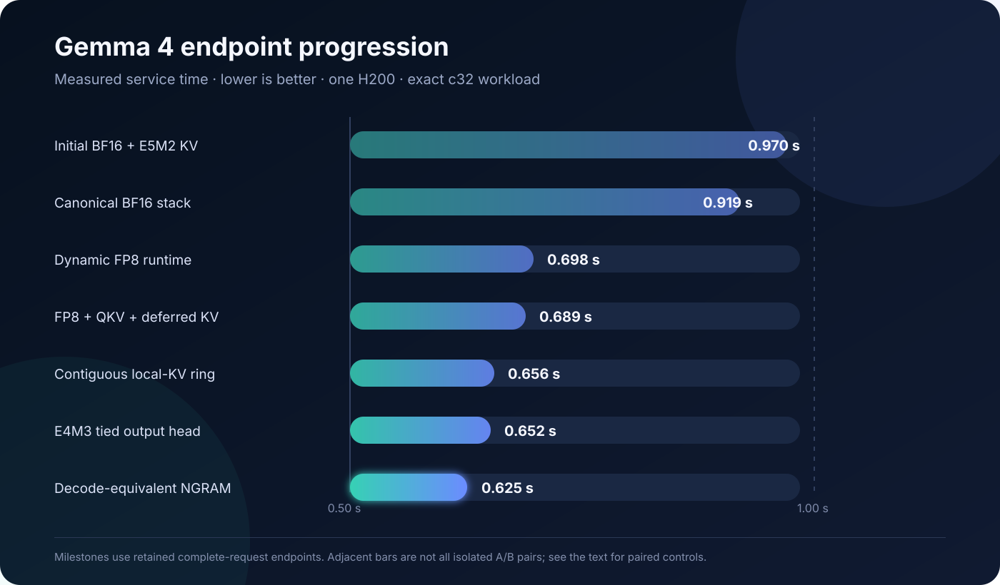
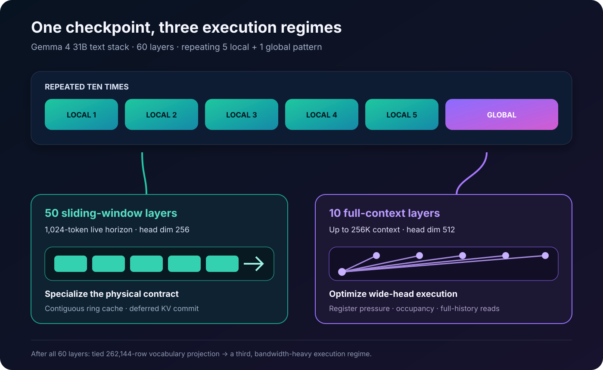
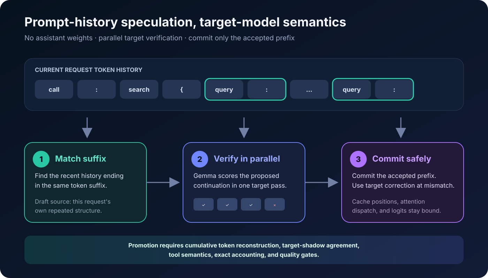

# 4,880 Accepted Drafts, 89.9% Slower: Optimizing Gemma 4 All the Way Down

*We cut service time by 32% across precision, cache layout, kernels, decoding,
and hardware. The hard part was learning which wins to delete.*

Gemma's assistant accepted 4,880 draft tokens. That should have been the chart.

It was a trap.

On the full service, multi-token prediction made Gemma 4 **89.9% slower**. The
assistant was doing useful work; the system was simply paying more to obtain it
than the accepted tokens were worth.

That result became the theme of our optimization campaign. A smaller attention
tile attacked a real occupancy problem and lost 3.2% at the endpoint. W4 moved
48% fewer MLP weight bytes and ran 8.5% slower. B200 beat an earlier H200 stack
in wall time and lost on the invoice.

The stack that survived was less cinematic: prompt-aware scheduling, runtime
FP8, a fused QKV epilogue, a ring buffer for Gemma's 50 local-attention layers,
a separately quantized view of its tied output head, and NGRAM speculation with
a verifier we made decode-equivalent. Together, those changes took our
canonical BF16 endpoint from **0.9195 to 0.6251 service-seconds per request** on
one H200: 32.0% less service time and 47.1% more request throughput. Against the
stock endpoint, service time fell 35.5%.



This is a story about those two outcomes: the 32% we kept, and the tempting
ideas we killed to get there.

> **Evidence note.** “Measured endpoint” below means complete HTTP requests on
> the bound server and workload. Component timings are labeled as such. The
> chart shows retained milestones, not an additive waterfall; scope-matched A/B
> pairs are given when we assign credit to an intervention. Unmeasured ideas are
> quarantined in the final section.

## One number needs a denominator

“Fast Gemma” is not a benchmark. Batch one and batch 32 are different systems.
A decode-heavy chat endpoint and a prompt-heavy agent loop stress different
paths. Even the same GPU can be cheap or expensive depending on how much of its
memory is left for useful cache.

We froze the unit of work before touching the stack:

| Dimension | Frozen value |
| --- | --- |
| Model | `google/gemma-4-31B-it`, revision `b9ea41a2…` |
| Mode | text-only, non-reasoning |
| Main hardware | one NVIDIA H200, tensor parallelism 1 |
| Concurrency | 32 requests |
| Per request | 4,214 prompt tokens, 358 completion tokens |
| Cache reads | 12.6958% of prompt tokens |
| Accounting | 32/32 complete responses; exact token and cache counters |
| Primary metric | batch wall time / 32 |

The requests look like background agents: long prompts, moderate answers,
shared context, and enough concurrency to keep the accelerator occupied. Our
stock H200 server finished the batch in 31.036 seconds, or 0.969888 seconds per
request.

We call that number *service time*, not latency. It is the batch makespan divided
by completed requests—a capacity measure under this exact arrival geometry.
Its reciprocal is request throughput. The canonical BF16 endpoint sustained
1.088 requests/s; the final candidate sustained 1.600 requests/s. That is why a
32.0% service-time reduction becomes a 47.1% throughput increase.

The denominator is narrow on purpose. None of the numbers in this post is a
universal Gemma record. They describe one checkpoint revision, one request
distribution, one concurrency, and one machine.

## Gemma 4 is not one transformer repeated 60 times

The public [31B configuration](https://huggingface.co/google/gemma-4-31B-it/blob/main/config.json)
describes a five-local, one-global rhythm across 60 decoder layers. Fifty layers
forget everything beyond a 1,024-token window and use 256-wide heads. Ten layers
retain the full context through 512-wide heads. Every decode step then projects
a 5,376-wide hidden state over a 262,144-token vocabulary, using a weight shared
with the input embedding.

That is three inference machines hiding in one checkpoint:

- a bounded, moving KV working set for the 50 local layers;
- a long-context path with unusually wide heads for the ten global layers; and
- a very large, tied vocabulary projection on every generated token.



A framework quite reasonably wants one abstraction for “attention.” The GPU
does not reward the abstraction. Local cache management, global attention, and
the output head have different shapes, different bottlenecks, and different
useful representations. Most of our wins came from respecting those
differences.

## The first 5% came from two flags. We did not celebrate.

The stock server admitted large prompt chunks while decode work was active.
With a 2,048-token dynamic prefill chunk, service time fell from 0.969888 to
0.930607 seconds/request: **4.05%**. Mean time to first token dropped from
10.724 to 9.437 seconds while decode duration barely moved—20.278 versus 20.308
seconds.

That phase split mattered more than the percentage. It told us the scheduler
had improved the admission of prompt work; token generation itself had not
become faster.

Next, the runtime's Gemma-specific fused QK normalization and rotary-position
path brought the BF16 endpoint to 0.919457 seconds/request, another 1.20% from
the chunked control.

Two mundane runtime changes had removed roughly five percent before we wrote a
kernel. We kept them, stopped tuning them, and changed bottlenecks. This sounds
obvious. In an automated lab it needs to be policy: retain small compatible
wins, but do not let a 1% result consume the week.

## FP8: move fewer bytes, then prove which bytes moved

Gemma 4 31B is dense. During decode, the linear layers repeatedly stream a
large weight set through HBM. Halving the bytes per weight is the obvious move.
“Quantize the model,” however, leaves out the part that matters: which
representation reaches which kernel on the live request path?

Our first official ModelOpt route calibrated the checkpoint and then failed to
serialize a deployable Gemma 4 export. We did not treat a broken exporter as
evidence against FP8. We moved the representation boundary.

The working path kept the exact BF16 checkpoint as the source, constructed E4M3
weights and scales in memory, and audited the server to prove that requests
reached the scaled FP8 matrix-multiply consumer:

```text
BF16 checkpoint  ──load──>  E4M3 weights + scales  ──execute──>  FP8 GEMM
     identity                 representation                     consumer
```

A filename containing `fp8` proves none of this. Neither does finding a scale
tensor in memory. We gave performance credit only when all three identities
were bound.

The first complete implementation reached 0.748553 seconds/request with 32/32
responses and 240 audited FP8 module rows. On the cleaner SGLang v0.5.13 stack,
runtime dynamic FP8 measured **0.697924 versus 0.928040** for its BF16 control—a
**24.80% service-time reduction**. This was the largest surviving win in the
campaign.

### Once the floor moved, the seams became visible

Gemma's attention projections feed Q/K normalization, rotary position encoding,
and KV-cache writes. The generic path materialized intermediate tensors and
launched each transformation separately. We built a Gemma-specific QKV epilogue
that kept the work inside the consumer boundary.

The same-session endpoint pair moved from 0.700445 to **0.692842
seconds/request**, a measured 1.085%. Not a headline; just capacity we would no
longer need to buy.

The output head exposed a stranger boundary. Gemma ties its input embedding to
its output projection, so converting the shared tensor naively also changes the
lookup table. We preserved the BF16 embedding and logits contract, but captured
a separate E4M3 view for the output projection across every CUDA Graph bucket
used by the endpoint.

At `M=32`, the head itself fell from 0.714848 ms to 0.415568 ms. The complete
server moved from 0.655657 to **0.651828 seconds/request**, only 0.584%.
Component speedup and endpoint speedup answered different questions; publishing
the former as the latter would have exaggerated the result by an order of
magnitude.

## A local window is a queue, not a database

Fifty Gemma layers cannot read a token once it is more than 1,024 positions old.
Yet a generic paged KV cache still pays for page tables, scatter/gather address
calculation, and a layout built for arbitrary history. For these layers, most of
that generality manages data the model is forbidden to use.

We represented each local layer as a contiguous circular buffer:

```text
logical token   ...  1022  1023  1024  1025  1026  ...
ring slot            1022  1023     0     1     2
```

The cache writer and attention reader used the same modulo mapping. At the
window boundary, extension bytes and the first decode outputs were byte-exact
against the stock cache. The paired endpoint improved from 0.676646 to
**0.655657 seconds/request**, a measured **3.102%**.

Nothing about the attention math changed. We made the physical lifetime of the
cache match its semantic lifetime. A later deferred-commit path removed another
0.266% from the stacked endpoint.

The ten global layers taught the inverse lesson. Their 512-wide attention kernel
used 255 registers per thread, admitted one CTA per SM, reached 12.5% warp
occupancy, and showed only 10.1% tensor activity. `BLOCK_M=16` looked like the
clean repair for a `BLOCK_M=32` occupancy problem.

It executed correctly and made the endpoint 3.18% slower: 0.690445 to 0.712372
seconds/request. More occupancy did not pay for the altered execution geometry
and extra work. We closed the branch.

## 4,880 accepted drafts, 89.9% slower

Autoregressive decoding spends one target-model step per output token. Gemma 4
ships with an assistant/MTP path designed for speculative decoding. If the
assistant can propose several correct tokens cheaply, the target verifies them
in parallel and advances more than one position.

Our assistant ran 354 forwards, the target ran 354 verification steps, and
4,880 proposed tokens were accepted. Those are healthy-looking counters.
Service time went from 0.674326 to **1.280270 seconds/request**.

The endpoint did not care that the assistant was often right. It cared that the
low-acceptance tail and serialized assistant/verify path cost more than ordinary
decode. Target verification alone was already above our economic ceiling, so an
overlap-only repair could not rescue that lineage. We deleted it.

NGRAM speculation fit the workload better because it brought no assistant
model. It searches the request's own token history for a recent matching suffix,
copies the continuation that followed the earlier occurrence, and lets the
target verify several tokens together. Agent traces repeat JSON keys, tool
scaffolding, code fragments, and stock phrases. Their prompts already contain a
cheap draft model: the prompt itself.



The first endpoint pair looked almost too good: 0.702239 to 0.596751
seconds/request, a 15.02% reduction. Then our streamed traces appeared to
diverge.

We traced the first disagreement through target logits, cache positions,
attention dispatch, CUDA Graph shapes, and the token-event aggregator. The
first culprit was embarrassingly ordinary. Autoregressive output arrived in
50-token chunks; NGRAM arrived in 100- and 258-token chunks. Our tool compared
final deltas instead of reconstructed cumulative streams. Once fixed, the
four-row discriminator produced identical token IDs, and all 54 shadow target
comparisons chose the same argmax.

The decode-equivalent candidate completed 32/32 requests at **0.625149
seconds/request**. In a ten-row product feature suite, nine rows were
token-exact. The tenth used expanded whitespace in JSON, but parsed to the same
tool name, arguments, finish reason, and payload.

Fresh sequential captures on the same FP8 stack gave the following paired
results:

| Evaluation | Autoregressive | NGRAM |
| --- | ---: | ---: |
| GPQA-Diamond | 55 / 198 | 55 / 198 |
| TauBench | 10 / 165 | 10 / 165 |
| Completion tokens | 9,387 | 9,369 |
| Aggregate captured latency | 150.420 s | 85.398 s |

This promoted NGRAM against that FP8 control. It is **not a claim of universal
quality parity**. Our earlier BF16/FP8 comparison had a wide TauBench uncertainty
interval, and vision, audio, reasoning mode, and long-horizon behavior were out
of scope. The semantic gate told us this endpoint deserved the next test—not
that testing was finished forever.

## The newest GPU did not win the invoice

We treated hardware placement as an optimization variable, not a procurement
decision made after the software work.

| Placement | Result on the relevant scope | Decision |
| --- | --- | --- |
| H200 | retained measured endpoint | best balance for this stack and workload |
| H100 | FP8+QKV at 0.951014 s/request | missed its price-normalized gate by 28.34% |
| B200 | FP8 at 0.633996 vs 0.734228 BF16 | faster, but missed the fixed and price-normalized targets |
| L40S | optimistic c32 lower bound: 47.45 GiB | did not fit in 44.99 GiB exposed memory |
| RTX PRO 6000 Workstation | runnable measured endpoint | price-normalized negative; not transferred to Server Edition |

B200's absolute result beat earlier H200 FP8 milestones. It still lost the
decision under the hourly price and exact workload we had frozen. L40S looked
cheap until memory fit destroyed the intended concurrency and cache geometry.

The useful metric was not tokens per second. It was dollars per completed unit
of the workload while meeting the service contract.

## An agentic lab needs a kill function

The research agents did not search a giant grid of flags. Each project owned a
falsifiable claim and climbed an evidence ladder:

```text
architecture + workload
          ↓
source proof or cheap physical bound
          ↓
exact-shape component on the target GPU
          ↓
same-session endpoint A/B
          ↓
feature, semantic, quality, and economic gates
```

A component earned endpoint time only if its whole-request ceiling was worth
testing. A fast endpoint did not become a candidate until it passed the product
contract. A broken exporter, unavailable GPU, or failed runtime closed one
branch, not the campaign.

The unit of progress was not a patch. It was a surviving endpoint result or a
belief we no longer had to test:

| Belief | Seductive evidence | What killed it |
| --- | --- | --- |
| Accepted MTP drafts imply a win | 4,880 accepted tokens | 89.86% endpoint regression |
| Smaller global tile fixes low occupancy | 255 registers/thread | 3.18% endpoint regression |
| W4 wins by moving fewer MLP bytes | 48.05% fewer stored bytes | 8.51% component-chain regression |
| Faster B200 means cheaper serving | 13.65% over B200 BF16 | price-normalized gate missed |

This is where automation changes the economics of systems research. The agents
could preserve a warm, verified bench, test a 1% idea, bind its evidence, and
discard it before a human team would have finished rebuilding the environment.
But parallelism without closure merely rediscovers the same attractive dead end
five times. The kill function is as important as the idea generator.

## Two bets we have not earned yet

Some mechanisms survived source and CPU checks but did not receive qualifying
GPU time. They are worth showing precisely because their status is explicit.

### Produce FP8 across the verifier boundary

**Source-complete, CPU-exact; target-GPU endpoint unmeasured.** At the NGRAM
verifier's `M=384` shape, our adapter carries request-row RMSNorm directly into
per-token E4M3 production and the unchanged QKV GEMM. It matched all 6.29
million local and 7.86 million global QKV output elements in the CPU
discriminator. The next test is the exact H200/B200 producer-consumer path,
including target rounding, saturation, and zero-row behavior—not another toy
fusion benchmark.

### Compress prompt state after the early layers

**Derived physical proxy; quality unvalidated; no GPU credit.** Prefill remains
the largest prize in this prompt-heavy workload. A structured proxy keeps all
4,214 tokens through layer five, then replaces them with 1,152 protected
singletons or weighted summary states. Charging 15 ms for the transformation
and a 10% non-scaling floor gives a derived bound of 0.4987
seconds/request.

That number is large enough to justify training a recovery mechanism. It is not
a result. Until the real quality suite shows that the compressed state preserves
the model, the bound belongs on a research board, not in the headline.

## What survived

The final stack fits on one line:

```text
H200 + prompt-aware scheduling + runtime FP8 + fused QKV
     + local-KV ring + FP8 tied head + decode-equivalent NGRAM
```

Its value is not that any item is magical. Each layer earned its place against
the same request distribution, endpoint, semantic contract, and cost function.
The result is scoped: one H200, one checkpoint revision, one c32 prompt-heavy
workload, and a limited quality suite. It is not a multi-node record or proof
that every Gemma mode is unchanged.

What the campaign did prove is narrower and, to us, more interesting. An
agentic lab can keep the model architecture, kernel shapes, runtime behavior,
hardware placement, and service economics in view at the same time. It can
follow a broken serialization route to a working representation, turn a local
attention rule into a physical cache layout, and catch a semantic “failure”
that was really a streaming bug.

The final test is whether it can abandon a clever result after 4,880 reasons to
keep it. The accepted drafts were the flashy chart. Deleting them was the
optimization.

---

### Public references

- [Gemma 4 model overview](https://ai.google.dev/gemma/docs/core)
- [Gemma 4 model card](https://ai.google.dev/gemma/docs/core/model_card_4)
- [Gemma 4 31B checkpoint configuration](https://huggingface.co/google/gemma-4-31B-it/blob/main/config.json)
- [Gemma 4 implementation in Transformers](https://github.com/huggingface/transformers/blob/main/src/transformers/models/gemma4/modeling_gemma4.py)
- [SGLang NGRAM speculative-decoding arguments](https://github.com/sgl-project/sglang/blob/main/docs/advanced_features/server_arguments.md)

*All performance and quality numbers are our measurements on the exact scopes
stated. Public sources provide architecture and runtime context; no external
performance result is transferred into this campaign.*
