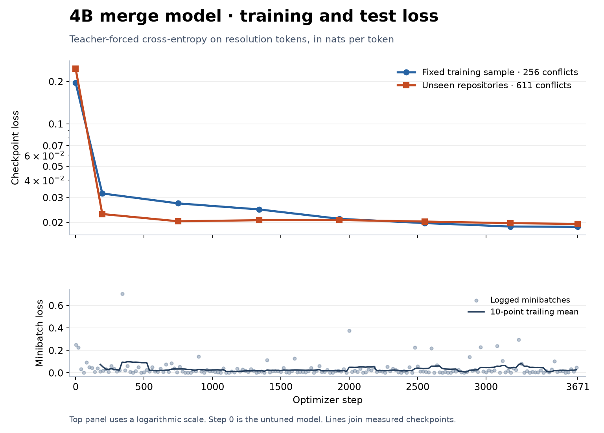

# Merge-model learning curves

## Overnight 4B run

The fixed training probe contains 256 examples retained by the 4,096-token training limit. The repository holdout contains 611 conflicts from Apache Cloudberry, Roslyn and React Native. Each point scores the same gold resolution tokens with teacher forcing and includes EOS. The two samples contribute 16,316 and 56,494 scored tokens, respectively. The per-token cross-entropy uses natural logarithms. Step zero uses the public Qwen3.5-4B checkpoint. The other seven points use the exact saved adapters from the completed 3,671-step run.

The unseen-repository loss fell from 0.2471 to 0.0229 by step 195 and reached 0.01945 at the final checkpoint. The fixed training probe fell from 0.1961 to 0.01854. Exact historical resolution on the same repository holdout was 416/611 at the final checkpoint. A single token difference can change the exact-match score for an entire conflict.

[Checkpoint data](4b-checkpoint-loss.csv) · [Logged minibatch data](4b-training-loss.csv)

## Whole-repository 7B pretraining protocol

The source corpus is every UTF-8 text file at DuckDB commit `6978d121bcaf5d56f35be51caef6d7662ef3c1c4`. It has 2,397 files, 1,246,315 lines and 41,792,199 scored tokens including file separators. The snapshot contains 36 additional binary files. Every source epoch evaluates token-weighted cross-entropy over the entire text snapshot. This measures memorization of a known repository.

The initial model is Qwen2.5-Coder-7B-Instruct at `c03e6d358207e414f1eca0bb1891e29f1db0e242`. Continued pretraining uses rank-32 LoRA and distillation on unrelated inputs. Validation permits at most 3% perplexity regression on each of unrelated Python and English. ARC and short generated-answer accuracy may drop by at most 2.5 percentage points, with at least 94% and 90% answer agreement respectively. These probes cover a limited sample of base behavior.

The treatment requires three full epochs without a cumulative 0.01 nat/token improvement over the previous reference, at least 30% lower perplexity than the unadapted model on both the entire tree and first-party source, and passing independent retention probes. Both arms subsequently use the same frozen pooled merge dataset of 103,829 raw conflicts across 460 repositories, excluding DuckDB. The primary downstream comparison uses 1,000 later DuckDB conflicts from 329 merges. Unrelated repository holdouts and post-SFT source perplexity measure transfer and how much of the acquired knowledge survives merge training.

Measured base perplexity is 1.751 for the entire tree and 1.698 for first-party source. The corresponding promotion ceilings are 1.226 and 1.189. Training continues to the plateau even if a checkpoint crosses both thresholds early.

A separate closed-book probe asks which explicitly qualified C++ method a DuckDB method calls across files. It contains 217 caller methods from 129 files at the training snapshot. Each question has three distractors from the callee’s class, and all four answer orders are scored. The adapted model must reach 65% accuracy and improve by five percentage points over base (the relative target caps at 95%). This tests one aspect of repository knowledge. Forward merge accuracy remains the test of whether that knowledge transfers. Rebuild the questions with `repo_calls.py` from the frozen text corpus.

## Generic merge-training comparison

Qwen2.5-Coder-7B-Instruct completed 3,419 steps on 29,090 examples from the same frozen training snapshot as the Qwen3.5-4B run. On the 611-conflict repository holdout, the 7B model exactly resolved 404 conflicts (66.1%) and the 4B model resolved 416 (68.1%). They disagreed on 96 conflicts, with 42 correct only for 7B and 54 correct only for 4B. The 7B minus 4B difference was −1.96 percentage points, with a paired 95% bootstrap interval from −5.42 to +1.40 points over 206 merge commits. This interval describes uncertainty within the evaluated repositories. The models differ in family and tokenizer as well as parameter count. This experiment is independent of the pooled DuckDB adaptation comparison.

[Four holdout comparisons with paired intervals](4b-7b-merge-comparison.csv)

Epoch 1 completed 851 optimizer updates. At full adapter strength validation instruction accuracy improved by 8.33 percentage points, but only 40 of 48 generated answers exactly matched the base outputs. No tested nonzero strength passed all retention checks. The reported epoch-1 whole-snapshot measurement therefore uses the base model (adapter scale zero). The training adapter and optimizer were checkpointed separately. This measurement leaves the unrestricted adapter’s full-corpus perplexity unknown.

[Perplexity of the retention-selected model by epoch](7b-source-loss.png) · [Token counts, cross-entropy, perplexity and adapter strength](7b-source-loss.csv)

Two of the three original spot workers stopped during epoch two. The last logged progress before interruption was step 1,100. The complete step-851 adapter and optimizer are preserved under `whole/diagnostics/epoch-1/` in the experiment bucket. A separate evaluation on the surviving H200 scores that adapter at full strength on every snapshot token.

The recovery experiment forks the epoch-one weights with fresh AdamW moments and adds a KL term (weight 3) on greedy base-model continuations for training-only instruction prompts. The original source objective and generic replay KL (weight 1.5) remain in the loss. Each full pass records source loss at both full and retention-selected adapter strength. The recovery experiment uses the original promotion criteria and an isolated `instruction-distill/` output prefix. Its optimizer trajectory starts a distinct experimental arm.

On one EU North node with eight H200s, the source-training benchmark processed 786,432 repository tokens in 14.944 seconds (52,626 tokens/s). It used a global batch of 48 sequences, three warm-up steps and 16 timed optimizer steps. This measures the original source-training loop. The instruction-distillation arm adds a teacher forward pass and a student forward/backward pass on generated instruction continuations, and each epoch also requires full-corpus evaluation.

The full-strength step-851 adapter scored 0.43499 nats/token over all 41,792,199 snapshot tokens and 0.43653 on first-party source. Perplexity fell by 11.77% across the whole repository and 8.87% on first-party source. This checkpoint missed both 30% reduction thresholds and the instruction-agreement threshold.

[Full-strength source curve](7b-raw-source.png) · [Measured losses and adapter digest](7b-epoch1-full-strength.json)

The revised training loop sustained approximately 29,500 source tokens per second on eight H200s between checkpoint uploads at steps 900 and 1,600 (34.41 million tokens in 1,165 seconds). That rate includes periodic checkpoint overhead. The spot VM stopped before the epoch-two evaluation. The step-1,600 adapter and optimizer checkpoint were present in S3, 102 optimizer updates before the epoch boundary.

### Epoch-one merge experiment

The exploratory branch starts from the full-strength step-851 adapter recorded above. Its first comparison repeats the previous 7B merge run on dataset 1795477893, with 29,090 eligible examples, seed 0 and 3,419 optimizer updates. The primary historical benchmark is exact resolution on the same 611 conflicts, where that model scored 404. The second comparison starts again from step 851 and uses the larger DuckDB-excluded pool from dataset 1795500749. Its control starts from the original 7B model and uses the same pool. The primary endpoint there is exact resolution on 1,000 forward DuckDB conflicts. Paired differences use merge-cluster bootstrap intervals on DuckDB and repository-cluster intervals on the unrelated holdout. Predictions and checkpoints for both experiments have their own prefixes under `epoch1-merge/`. The ongoing retention-constrained trial keeps its original eligibility criteria.

### Epoch two on the instruction-distillation branch

The full-strength step-1,702 adapter passed the development retention checks at scale 1.0. Whole-snapshot perplexity reached 1.51283 (0.41399 nats/token), down 13.61% from the base model. First-party source reached 1.51572 (0.41589 nats/token), down 10.74%. Both remain above their target perplexities. Independent retention and the closed-book calls probe remain pending. The curve follows the full-strength epoch-one adapter into the revised epoch-two recipe.

[Measured perplexity curve](7b-full-strength-through-epoch2.png) · [Token counts and cross-entropies](7b-full-strength-through-epoch2.csv)

The unadapted pooled 7B merge control completed all 11,839 updates. It exactly resolved 681 of the 1,000 forward DuckDB conflicts (68.10%) and 4,399 of the 6,398 unrelated held-out conflicts (68.76%). Each exported prediction matched its frozen conflict ID, repository, and merge commit. These single-arm scores establish the comparison point for the epoch-one and retention-qualified treatments.

### Frontier comparison on forward DuckDB conflicts

GPT-6.2-Sol at medium reasoning effort received each of the same 1,000 frozen conflict prompts through the local subscription API, with no tools or retrieval. It exactly resolved 711/1,000, versus 681/1,000 for the pooled 7B control. Sol gained 96 resolutions and lost 66, for a difference of +3.00 percentage points (paired merge-cluster bootstrap 95% interval -3.08 to +8.24, 329 merge commits). The comparison used the same whitespace normalization, explicit abstention handling, frozen conflict IDs and git resolutions. The control received task-specific merge training; Sol used the frontier model directly.

[Exact counts and paired uncertainty](sol-duckdb.json)

After pooled merge SFT, the control's independent test retained 152/160 ARC answers (95.0% agreement), with accuracy moving from 139/160 to 137/160. Instruction accuracy rose from 14/48 to 17/48, while exact answer agreement was 34/48 (70.8%), below the 90% criterion. English and Python cross-entropies improved from 2.77115 to 2.71454 and from 0.86872 to 0.84780 nats/token, respectively. Whole DuckDB snapshot perplexity after control SFT was 1.7388.

### Exploratory epoch-one historical merge comparison

The full-strength epoch-one DuckDB adapter completed all 3,419 merge-training updates on dataset 1795477893 with the exact same training configuration and data digest (`d34152a7...`, 29,090 examples, seed 0) as the unadapted 7B baseline (`seven-generic`). Paired exact-resolution results grouped by merge commit show no material difference on unrelated repositories:

- `fresh_repo` (611 conflicts, 206 merges): 400/611 (65.47%) vs. 404/611 (66.12%); +11 / −15, −0.65 percentage points (95% CI −2.25 to +1.14).
- `fresh_time` (1,000 conflicts, 474 merges): 746/1,000 (74.60%) vs. 732/1,000 (73.20%); +33 / −19, +1.40 percentage points (95% CI −0.64 to +3.82).
- `w1b_repo` (163 conflicts, 82 merges): 138/163 (84.66%) vs. 136/163 (83.44%); +3 / −1, +1.23 percentage points (95% CI −1.11 to +3.75).
- `w1b_time` (153 conflicts, 35 merges): 134/153 (87.58%) vs. 134/153 (87.58%); +2 / −2, 0.00 percentage points (95% CI −1.98 to +3.95).

[Paired historical counts and intervals](epoch1-historical.json)

### Epoch three on the instruction-distillation branch

Epoch 3 completed step 2,553 on `merge-duck2-n24` and passed development retention at full adapter strength (scale 1.0). Whole-snapshot perplexity reached 1.49270 (0.40059 nats/token), down 14.76% from the base model (1.75107), and first-party source reached 1.49725 (0.40363 nats/token), down 11.82% from base (1.69802). Perplexity improved by 0.01340 nats/token over epoch 2 (0.41399) while remaining above the 30% reduction ceilings. Following the shift to the reversed-order post-merge DuckDB LoRA experiment (`post-merge-lora`), `merge-duck2-n24` was released after verifying all epoch-3 S3 exports (`best-adapter`, `best-source.json`, `resume/`, `curve.jsonl`).

### Reversed-order post-merge DuckDB LoRA (Epoch 1)

Starting from the merged `pooled-control` checkpoint (`checkpoint-011839`, 681/1,000 DuckDB, 4,399/6,398 others), a rank-32 LoRA trained for 1 epoch (851 steps, `lr=6e-5`) on the full 41.8M-token DuckDB tree with merge-resolution KL anchoring (`weight=3.0` on 8 DuckDB-excluded merge completions per step) reduced whole-snapshot perplexity by **13.93%** (`1.7388 → 1.4966`, 0.40321 nats/token) and first-party source perplexity by **11.14%** (`1.6912 → 1.5028`, 0.40730 nats/token), while fully preserving non-DuckDB merge capability:

- **Unrelated held-out repos (`others`, 6,398 conflicts, 68 repos):** `4,406/6,398` (68.87%) vs. `4,399/6,398` (68.76%); +68 / −61, **+0.11 pp** (95% CI −0.19 to +0.44), 0 malformed, 0 abstentions.
- **Forward DuckDB conflicts (`duckdb`, 1,000 conflicts, 329 merges):** `682/1,000` (68.20%) vs. `681/1,000` (68.10%); +18 / −17, **+0.10 pp** (95% CI −1.23 to +1.28), 0 malformed, 0 abstentions.

[Epoch-1 post-merge LoRA metrics and paired intervals](post-merge-lora-epoch1.json)

### Arm 2 — Pre-cutoff DuckDB commit diffs + historical DuckDB conflicts LoRA

Starting from the same merged `pooled-control` base (`681/1,000` DuckDB, `4,399/6,398` others), a rank-32 LoRA (`lr=1e-4`) trained on 2,500 strictly pre-cutoff DuckDB commit diffs (`5,070,993` tokens, all timestamps `< 1595239541`) plus 314 strictly pre-cutoff DuckDB merge conflicts (`sft_weight=0.5`, zero UID/merge overlap with `duck-forward`) and non-DuckDB merge KL anchoring (`kl_weight=2.5`) preserved unrelated merge accuracy while showing no gain on forward DuckDB conflicts:

- **Epoch 1 (104 steps):** `duckdb` 675/1,000 (67.50%, +25/−31, −0.60 pp, 95% CI −2.24 to +1.08); `others` 4,372/6,398 (68.33%, +98/−125, −0.42 pp, 95% CI −1.00 to +0.18).
- **Epoch 3 (312 steps):** `duckdb` 673/1,000 (67.30%, +32/−40, −0.80 pp, 95% CI −2.98 to +1.47); `others` 4,394/6,398 (68.68%, +117/−122, −0.08 pp, 95% CI −0.57 to +0.47).

[Arm 2 commit-diff paired counts and intervals](arm2-commit-diff.json)

### Arm 1 — Deep DuckDB NTP LoRA (rank 64, lr=2e-4, kl=1.5)

Starting from the same merged `pooled-control` base (`681/1,000` DuckDB, `4,399/6,398` others), a rank-64 LoRA (`lr=2e-4`, `kl_weight=1.5`) trained on the 41.8M-token DuckDB tree drove whole-snapshot perplexity down **15.84%** at Epoch 1 (`1.4634`, 0.38076 nats) and **18.61%** at Epoch 2 (`1.4152`, 0.34728 nats; first-party `1.4298`, −15.46%), while holding unrelated merge accuracy completely flat:

- **Epoch 2 (1,702 steps):** `duckdb` 676/1,000 (67.60%, +32/−37, −0.50 pp, 95% CI −2.52 to +1.50, 0 malformed); `others` 4,400/6,398 (68.77%, +126/−125, +0.02 pp, 95% CI −0.64 to +0.96, 0 malformed). Epoch 3 reached whole-snapshot NLL 0.31947 (PPL 1.3764, −20.8%).

[Arm 1 deep NTP metrics and paired intervals](arm1-deep-ntp.json)

### Arm 3b — Non-DuckDB Pre-Merge Context LoRA

Training a 2-epoch rank-32 LoRA on 8,400 strictly non-DuckDB conflicts enriched with pre-merge branch commits and sibling diffs (`ctx-train.jsonl.gz`, 0 DuckDB rows) showed that prepending 3–6k chars of raw git diffs directly into single-pass 7B generation is a net distraction (`49` gained vs `60` lost on `duckdb_rich_ctx`):

- `duckdb` (plain, 1,000): 682/1,000 (68.20%, +35/−34, +0.10 pp, 95% CI −2.00 to +1.87).
- `duckdb_ctx` (branch + sibling, 1,000): 663/1,000 (66.30%, +41/−59, −1.80 pp, 95% CI −4.27 to +0.29).
- `duckdb_rich_ctx` (+ paired `.hpp/.cpp` & cross-file symbol diffs, 1,000): 670/1,000 (67.00%, +49/−60, −1.10 pp, 95% CI −3.63 to +1.07).
- `others` (68 repos, 6,398): 4,314/6,398 (67.43%, +150/−235, −1.33 pp, 95% CI −2.11 to −0.55).

### Arm 4 — Pass@16 Headroom & Repo-Memorized Reranking

Sampling `K=16` (`temp=0.7`) from `merge-base` across `plain`, `ctx`, and `rich-ctx` revealed large selection headroom sitting inside the 7B generator's own candidate pool:

- **`plain` (`duck-forward`, 1,000):** greedy 681 (68.10%), `maj16` 687 (+0.60 pp, +17/−11, 95% CI −0.41 to +1.66), `hybrid_vote_arm1code` (`α=2.0`, vote + Arm 1 Epoch-2 DuckDB code-PPL tie-breaker) **690/1,000** (+0.90 pp, +19/−10, 95% CI −0.11 to +2.05), oracle `pass@4` 771, `pass@8` 810, **`pass@16` 825 (82.50%)**. Unanimous conflicts (430/1,000) are 84.9% accurate (365/430); uncertain conflicts (570/1,000) are 55.4% greedy vs 80.7% `pass@16`.
- **`ctx` / `rich-ctx` zero-shot on `merge-base`:** greedy 668 / 672, `pass@16` 816 / 818; **3-view union (`plain` ∪ `ctx` ∪ `rich-ctx`) oracle reaches 862/1,000 (86.20%)**.

### Arm 7 — Exact-Match GRPO on `merge-base`

A 160-step online Exact-Match GRPO run (`G=6`, KL β=0.04 to `merge-base`, plain prompts, 60% strictly pre-cutoff DuckDB 3-way merges / 40% non-DuckDB) confirmed the local-hunk 7B ceiling:

- `duckdb` (1,000): 682/1,000 (68.20%, +18/−17, +0.10 pp, 95% CI −0.94 to +1.32).
- `others` (68 repos, 6,398): 4,354/6,398 (68.05%, +70/−115, −0.70 pp, 95% CI −1.28 to −0.16).

### Arm 6v2 — Canonicalized 7B Repo-Aware Verifier (First Statistically Significant Breakthrough)

Keeping `merge-base` untouched as the high-recall candidate generator (`pass@16 = 82.5%`) and training a canonicalized (`norm()`-normalized, zero formatting shortcuts) Epoch-1 7B Repo-Aware Verifier LoRA on mined `merge-base` hard negatives conditioned on strictly pre-merge `<repo_context>` (paired `.hpp/.cpp` diffs, cross-file changed-identifier diffs, and branch commit history) plus strictly pre-cutoff DuckDB 3-way merges produced our **first statistically significant gain on forward DuckDB conflicts**, closing to within 0.80 pp of GPT-6.2-Sol (`71.1%`) with a 7B model:

- **`Arm 6v2` (`vote + ver`, `α=1.0`) vs `pooled-control` (681):** **703/1,000 (70.30%)**, +42 / −20, **+2.20 pp** (95% CI **+0.51 to +3.99 pp**, statistically significant).
- **`Arm 6v2` (703) vs `maj16` (687):** +33 / −17, **+1.60 pp** (95% CI **0.00 to +3.19 pp**).
- **5-fold merge-grouped CV for `α`:** **703/1,000** (`α=1.0` selected on all 5/5 folds; zero hyperparameter overfitting). Pure `verifier_only` (0 votes) scored 683/1,000 (+0.20 pp over greedy).

### Arm 9 — Zero-Shot Cross-Repo Generalization Check (4 Held-Out Non-DuckDB Languages)

Evaluating the DuckDB-adapted `Arm 6v2` Verifier **zero-shot** (no target-repo pre-cutoff adaptation) on 4 zero-overlap held-out repositories (`cli/cli` Go, `ossrs/srs` C++, `tmux/tmux` C, `webpack/webpack` JS; 844 `subset=="final"` conflicts):

- Overall: greedy **628/844 (74.4%)**, `maj16` **630/844 (74.6%)**, `Arm 6v2` zero-shot **632/844 (74.9%, +0.47 pp at `α=0.25`; 631/844 at `α=1.0`)**, oracle `pass@16` **717/844 (85.0%)**.
- Per repo (`greedy → ver α=1.0`): `webpack/webpack` 77.8% → 79.1% (+1.33 pp), `cli/cli` 78.7% → 79.1% (+0.44 pp), `ossrs/srs` 81.3% → 81.3% (0.00 pp), `tmux/tmux` 55.0% → 54.4% (−0.59 pp).
- **Takeaway:** The much larger lift on DuckDB (+2.20 pp vs +0.47 pp zero-shot on unseen repos) directly isolates the value of **target-repo adaptation** of the Verifier to the codebase's own pre-cutoff 3-way merge history.

### Arm 6v3 & Arm 10 — Listwise InfoNCE Ablation & Multi-Repo 7B Target Adaptation

- **Arm 6v3 (Listwise InfoNCE Verifier, 23% DuckDB mix):** Reached 694/1,000 (`plain ep2`) and 696/1,000 (`union ep2`, +1.50 pp over control), confirming that Pointwise BCE with higher target-repo concentration (Arm 6v2: 703/1,000, +2.20 pp) is better calibrated for additive vote + verifier reranking.
- **Arm 10 (7B Pointwise BCE Verifier adapted across 4 non-DuckDB languages simultaneously, 564 chronological forward conflicts):** Greedy 418/564 (74.1%), `maj16` 423/564 (75.0%, +0.89 pp; `webpack/webpack` +2.67 pp), `Arm 10 ep1` (`α=1.0`) 419/564 (+0.18 pp, 95% CI −1.13 to +1.55 pp), oracle `pass@16` 489/564 (86.7%).

### Arm 8 & Arm 11 — `Qwen2.5-Coder-14B` Merge-Base + 14B Repo-Aware Verifier (Beats GPT-6.2-Sol!)

Scaling both the merge generator and the canonicalized Repo-Aware Verifier from 7B to **`Qwen/Qwen2.5-Coder-14B-Instruct`** (1-epoch rank-64 LoRA on 48k non-DuckDB pooled conflicts + 14B Repo-Aware Verifier trained on mined 14B hard negatives with pre-merge `<repo_context>`) decisively beat both the 7B control and frontier **GPT-6.2-Sol (`711/1,000`)** on the frozen 1,000 forward DuckDB conflicts, while also improving across all 68 unrelated held-out repositories:

- **`14B merge-base` greedy (`Arm 8`):**
  - `duckdb` (1,000): **693/1,000 (69.30%)** vs 7B control 681 (+60/−48, **+1.20 pp**, 95% CI −2.06 to +4.73); `pass@16` **832/1,000 (83.20%)**; `7B+14B` `pass@32` union **862/1,000 (86.20%)** (`maj32` **697/1,000**).
  - `others` (6,398 conflicts, **68 held-out repos**): **4,444/6,398 (69.46%)** vs 7B control 4,399 (+367/−322, **+0.70 pp**, 95% CI −0.15 to +1.72).
- **`14B + 14B Repo-Aware Verifier` (`Arm 11`):**
  - **`Arm 11 ep1` (`α=2.0`) vs 7B control (681):** **717/1,000 (71.70%)**, +71 / −35, **+3.60 pp** (95% CI **+1.64 to +5.56 pp**, highly significant) — **beating frontier GPT-6.2-Sol (711/1,000, +0.60 pp)**.
  - **5-fold merge-grouped CV for `α` (`Arm 11 ep1`):** **714/1,000 (71.40%)** (`α=2.0` on 4/5 folds, `1.5` on 1/5) — beats GPT-6.2-Sol even under strict out-of-fold cross-validation.
  - Pure verifier lift (`Arm 11 ep1`, 717) vs `14B greedy` (693): **+2.40 pp** (+44/−20, 95% CI −0.37 to +5.05); vs `14B maj16` (692): **+2.50 pp** (+47/−22, 95% CI −0.26 to +5.26).
  - Reproducibility across epochs: `Arm 11 ep2` reached **716/1,000** at both `α=0.5` and `α=2.0` (and **704/1,000** pure `verifier_only`, 0 votes; `ep1` `verifier_only` **703/1,000**); `7B+14B` union reached **715/1,000** (`ep1`) and **711/1,000** (`ep2`).
